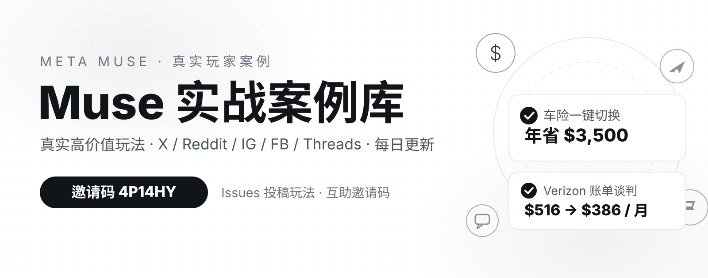

# Muse 实战案例库 💡

> Meta 个人 AI 智能体 **Muse** 的真实高价值玩法合集。
> 收录标准：**收录 X / Reddit / Instagram / Facebook / Threads 上的真实用户分享**，优先收录结果明确、有数字、可复制的案例。

📊 **收录案例：349** ｜ 🕐 **最后更新：2026-11-14** ｜ 🤖 每日 0 点自动更新 ｜ 🌐 **在线预览站（支持中英双语）：https://jaxxchen003.github.io/muse-use-cases/**

 

---

## 🎁 我的 Muse 邀请码：`4P14HY`

欢迎使用我的邀请码加入 Muse，一起玩转 AI 智能体！

- 📱 **手机 App**：打开 Muse App → 设置 → **兑换码**（加入后 48 小时内可兑换）
- 💻 **网页版**：muse.ai → 设置 → 通用 → 用量 → **兑换邀请码**
- 📌 具体奖励金额与规则以邀请页面显示的条款为准（各账号可能不同）
- 🤝 也有邀请码想分享？欢迎到 Issues 留言互助（有专门的分享模板）

---

## 📖 核验标准

| 标记 | 含义 |
|------|------|
| ✅ | 原帖直链已核验：读到原帖，人物、金额、做法三要素一致 |
| 🟡 | 平台分享已确认：作者与聚合站归档交叉核验一致，原帖直链暂未公开收录 |

> 本库只收录 X / Reddit / Instagram / Facebook / Threads 上的真实用户分享；纯网页文章/视频仅作参考，不附来源链接。
> 核验日期：2026-10-11/12。原帖因平台限制无法直接抓取时，采用帖子发布时间（X 用帖子 ID 时间戳）+ 聚合站归档日期 + 多源交叉三重校验。

---

## 📑 目录

- [💰 省钱 · 账单 · 索赔](#-省钱--账单--索赔)（74）
- [✈️ 出行 · 旅行](#️-出行--旅行)（40）
- [🛒 购物](#-购物)（37）
- [⚡ 效率 · 自动化](#-效率--自动化)（110）
- [🎨 内容 · 创作](#-内容--创作)（26）
- [🛠️ 开发 · 建站](#️-开发--建站)（21）
- [💼 生意 · 维权](#-生意--维权)（41）
- [🤝 参与方式](#-参与方式)
- [⚠️ 免责声明](#️-免责声明)

---

## 💰 省钱 · 账单 · 索赔

### 1. 车险一键切换，年省 $3,500 ✅
- **作者**：Joseph Devoy（@JosephDevoy，Tempo 创始人）
- **原帖**：https://x.com/JosephDevoy/status/2098158828135002245（2026-09-10）
- **做法**：上传现有车险保单，要求"同等保障找更便宜的"；约 5 分钟内 Muse 找到新方案、完成购买并取消旧保单
- **结果**：**年省 $3,500**
- **可复制性**：⭐⭐⭐⭐⭐ 保险/订阅类"同等条件比价"是最高频刚需之一

### 2. Xfinity 电话砍价，5 年省约 $5,118 ✅
- **作者**：@raunaqbn
- **原帖**：https://x.com/raunaqbn/status/2100042003807601124
- **做法**：让 Muse 打电话给 Xfinity，闯过电话菜单树，身份验证环节再把本人接进来，全程有 agent 与客服对话实录
- **结果**：**约 $5,118（5 年，锁定 $85.30/月）**
- **可复制性**：⭐⭐⭐⭐ 需要通话功能权限，话术可复制

### 3. Verizon 账单 $516 → $386/月，睡前发起醒来办好 ✅
- **作者**：@williamgeronco
- **原帖**：https://x.com/williamgeronco/status/2099826624849961009
- **做法**：发起 Verizon 客服聊天后直接去睡觉，Muse 连夜把账单谈下来
- **结果**：**$516/月 → $386/月，年省约 $1,560**
- **可复制性**：⭐⭐⭐⭐⭐ "睡觉时让 AI 谈账单"是 agent 时代的标志性用法

### 4. AT&T 宽带 $80 → $30/月，还白嫖 3 个月 + 网速翻倍 ✅
- **作者**：@NoSaberNiPapa
- **原帖**：https://x.com/NoSaberNiPapa/status/2099947510349316129
- **结果**：**$80/月 → $30/月 + 3 个月免费 + 网速翻倍**
- **可复制性**：⭐⭐⭐⭐ 账单谈判类授权话术可直接套用

### 5. AT&T 光纤 $80 → $40/月 + 3 个月免费 ✅
- **作者**：Chandra Bhavanasi（@chanduiiit）
- **原帖**：https://x.com/chanduiiit/status/2099527544643207558（2026-09-14）
- **做法**：授权 Muse"接受任何低于 $70/月的方案"，由它去谈判
- **结果**：**$40/月 + 3 个月免费**
- **风险提示**：部分"电话谈判"类案例经报道实际有人工客服参与执行；运营商 App 内聊天渠道 AI 可能无法触达，效果因运营商而异

### 6. 两户 AT&T 账单，24 个月合计省 $1,920 ✅
- **作者**：@JasonL_Capital
- **原帖**：https://x.com/JasonL_Capital/status/2100307407075205279（2026-09-16）
- **做法**：让 Muse 替两户家庭的 AT&T 网络账单谈价
- **结果**：**24 个月合计省约 $1,920**

### 7. 车险比价 15 分钟，年省 $1,156 ✅
- **作者**：@JasonL_Capital
- **原帖**：https://x.com/JasonL_Capital/status/2099991678538879461（2026-09-15）
- **做法**：在健身房随手上传当前车险单，Muse 按同等保障比价
- **结果**：**年省约 $1,156**
- **可复制性**：⭐⭐⭐⭐⭐ 碎片时间交办的典范

### 8. 医疗账单逐行审计，省下 $4,000+ 🟡
- **作者**：Holdy（@Ryan_Holdaway）
- **做法**：把 Muse 接进医疗服务商 portal，拉出明细账单逐行质疑，发现多处重复收费并申请折扣
- **结果**：**省 $4,000+**
- **可复制性**：⭐⭐⭐⭐ "把糊涂账丢给 AI 逐行审"适合医疗/装修等明细账单

### 9. 热水器 $1,450 拿下（报价 $2,300），省 $850 🟡
- **作者**：PREEM（@PipeBladex）
- **做法**：午饭时把坏掉的热水器型号发给 Muse；它比了 3 家店的价格，给 2 个安装师傅发邮件询价，并约好周四上门安装
- **结果**：**省 $850**
- **可复制性**：⭐⭐⭐⭐⭐ 家电维修/换新比价的标准流程

### 10. 克罗地亚—意大利轮渡，省 $2,200 异地还车费 🟡
- **作者**：Erik Lammerding（@Lammerding）
- **做法**：Muse 找到并订好克罗地亚到意大利的汽车轮渡，从租车合同里提取车牌/车型信息，并确认保险覆盖跨境
- **结果**：**省 $2,200**
- **可复制性**：⭐⭐⭐ 跨境自驾场景可参考

### 11. 车险 $500 → $335/月，年省约 $1,980 🟡
- **作者**：Minh Phan（@MinhInvest）
- **做法**：去超市买东西的功夫，Muse 搜集了 4 家车险报价（Tesla 转 CSAA），当天就切换
- **结果**：**$165/月，年省约 $1,980**

### 12. United 航班降价追踪，拿回约 $1,026 🟡
- **作者**：@Yairyup
- **原帖**：https://x.com/Yairyup/status/2098136696277627177
- **做法**：持续追踪已订 United 航班的降价，然后找客服把差价要回来
- **结果**：**约 $1,026 credit**
- **可复制性**：⭐⭐⭐⭐⭐ "帮我盯着已订的航班，降了就去要差价"

### 13. 为岳父找回 $1,750 无人认领财产 🟡
- **作者**：@moneyeducator
- **原帖**：https://x.com/moneyeducator/status/2098170064721543402（2026-09-10）
- **做法**：搜遍住过的所有州的无人认领财产登记，填表申领；另比价网络/电话套餐再省约 $120/月（聚合站记录）
- **结果**：**$1,750 + 套餐优惠**
- **可复制性**：⭐⭐⭐⭐ 各州 unclaimed property 是美国特有的"捡钱"场景

### 14. 跨州搜无人认领财产，10 分钟找回 $800+ ✅
- **作者**：@WaitWhat
- **原帖**：https://x.com/WaitWhat/status/2098169214091887047（2026-09-10）
- **结果**：**$800+，约 10 分钟**
- **可复制性**：⭐⭐⭐⭐ 一句话交办："查我住过的所有州有没有我的无人认领财产"

### 15. Amazon 退货 $239 + 狗看病理赔 $516 🟡
- **作者**：@armand_ruiz
- **做法**：清理卡住的 Amazon 退货，顺手把狗看病的保险理赔也提交了
- **结果**：**约 $755**
- **相关**：该作者同期还晒过累计 $2,120.95 的省钱清单（含 AT&T 账单谈判 $300/年、IKEA 退货等）

### 16. PODS 搬家比报价低 $576，还顺手查出缺失的税表 🟡
- **作者**：@benparr
- **做法**：给妈妈订 PODS 搬家服务谈到比报价低 $576；另建 2025 税务文档追踪表，找出缺失的 K-1 表
- **结果**：**$576 + 税务查漏**

### 17. 邮件收据审计，揪出被遗忘的 $100/月 Claude Max 🟡
- **作者**：@idobn
- **做法**：扫描 6 个月邮件收据，发现公司卡上一个被遗忘的 $100/月 Claude Max 订阅
- **结果**：**年省约 $1,200**
- **可复制性**：⭐⭐⭐⭐⭐ "审计我所有订阅，找出没在用的"

### 18. 车险分析，年省 $603 🟡
- **作者**：@frankilus
- **结果**：**年省约 $603**

### 19. 航班延误邮件索赔，拿回 $200 🟡
- **作者**：@tiramisucrux
- **做法**：航班大延误后全程用邮件跟航司交涉
- **结果**：**$200**

### 20. WiFi 账单 10 分钟砍下 $300 🟡
- **作者**：@nathanael_smith
- **做法**：Muse 直接替他跟客服代表砍价
- **结果**：**$300，不到 10 分钟**

### 21. Alaska 航班取消索赔 $189.37 🟡
- **作者**：@duboibaptiste
- **做法**：从邮件里翻出取消的 Alaska 航班和 Lyft 收据，搞定坏掉的上传组件后提交索赔，拿到 case number
- **结果**：**$189.37**

### 22. 找回妻子遗忘一年多的图书订阅费 🟡
- **作者**：Chris Abraham（@chrsabraham）
- **原帖**：https://x.com/chrsabraham/status/2099879164895527008（2026-09-15）
- **做法**：Muse 扫描账单，发现妻子一年多前忘记取消的图书订阅，自动取消并按退款政策追回
- **结果**：**追回一整年费用**
- **可复制性**：⭐⭐⭐⭐⭐ 零门槛，人人可用

### 23. 订阅审计省 $200 🟡
- **作者**：Nicolas Bustamante（@nicbstme，微软 AI 从业者）
- **做法**：让 Muse 检查循环订阅，取消不再需要的
- **结果**：**$200**（同一帖还提到 24 小时内 Muse 帮他买了袜子、订了 Whole Foods、约了保洁、买了汉堡）

### 24. 买车现场防坑，省 $1,250
- **作者**：Nick Prince（Coinbase 产品经理）
- **做法**：在经销商买车/买断租约时让 Muse 审查费用明细，识别不必要的附加服务和高额手续费
- **结果**：**避开约 $1,250 额外支出**
- **背景**：该案例出自 Meta 首席 AI 官发起的 #MuseMoneyChallenge 活动期间的媒体报道
- **可复制性**：⭐⭐⭐⭐ 大额消费前让 AI 审合同/费用明细

### 25. 电话谈判，一年省 $800+
- **作者**：Peter Yang（YouTuber）
- **做法**：Muse 代打客服电话谈有线电视和电话账单
- **结果**：**年省 $800+**

### 26. 给 Muse 取名 "Fred"，取消订阅 + 车险比价年省 $2,500+
- **作者**：@landonbtw（IG 创作者，约 25 万粉）
- **做法**：Fred 先翻出长期不用的订阅逐一取消，再对比各家车险报价逐项汇报（2026-10-08 reel 实拍）
- **结果**：**年省 $2,500+**

### 27. Verizon $100 礼品卡抵账单
- **作者**：u/Sleds88（Reddit r/MuseAgent）
- **做法**：Muse 确认礼品卡可抵账户余额后，直接在 Verizon 官网完成抵扣支付
- **结果**：**省 $100**

### 28. 24 小时健康杂事：$80 Oura 折扣 + 福利一次搞定 🟡
- **作者**：Khiet Tran（@trannkhiet）
- **做法**：24 小时内约流感疫苗、找到 $80 Oura Ring 折扣、正确注册福利计划（没多交 HSA）、把两个播客总结进笔记
- **结果**：**$80 折扣 + 福利无差错**

### 76. 一周实测 8 项代办：追回 $1,000 拖延退款、订阅砍 $200 ✅
- **作者**：@ekate.lee（Threads 用户）
- **原帖**：https://www.threads.com/@ekate.lee/post/DeR4okrm9Lb（2026-10-09）
- **做法**：连用一周，8 件事全丢给 Muse——按粗糙想法起草并发布社媒内容、连 Kling/Higgsfield 修图剪视频、邮件整理打标签、清理 LinkedIn DM、自家产品 Networkio 接客服 chatbot、重要会议事项提醒；还处理了两笔一直拖着没办的退款（2026-10-09 发帖）
- **结果**：**追回 $1,000 退款 + 订阅费砍掉 $200**（作者自曝翻车：曾让 Muse 连币圈 App，$300 亏剩 $100）
### 85. "A Month with Muse"实测：修网站 + 5 家车险比价，年省 $1,530 🟡
- **作者**：@mostly.borrowed.ideas（IG 账号）
- **做法**：一个月实测总结——①让 Muse 修了他的网站（补上两年前就想加的 dark mode + 订阅按钮 + 一键功能），自称"花 $20/月雇了个技术上称职的员工"；②让 Muse 扫了 5 家车险报价，一年省 $1,530，设为每 5 个月重扫一次对抗"续约惯性"；③同时盯 4 个邮箱、每天生成板球新闻摘要、追踪 GPU 价格（2026-10-12 IG 长视频）
- **结果**：**年省 $1,530；省钱的本质是干掉惯性——让 agent 每 5 个月替你重新问一圈价**

### 93. NYC 停车罚单一次聊天交清：$115 滚到 $145，CityPay 实付 $147.90 🟡
- **作者**：Shervin Shaikh（@shervinshares，IG 4.5 万粉）
- **做法**：一张拖了 3 个月的 NYC 停车罚单（No Standing，公交站违停）让 Muse 按车牌去市官网查——原本 $115 已滚到 $145；Muse 跳转 CityPay，刷卡另收 2% 手续费合计 $147.90，经 Stripe Link 准备扣 Business Platinum Amex；首次扣款因账单地址不匹配失败，Muse 主动给出 PayPal/eCheck 替代方案，最后晒出 CityPay 付款成功截图（2026-10-12 IG reel，实拍手机录屏，声明"非广告"）
- **结果**：**政府网站的经典坑（账单地址不匹配）它都替你想好了 Plan B；只用对话就把政府网站的活干完了**

### 94. 跟风"订阅谈判"实测：月省约 $700，车险换公司年省约 $2,000 🟡
- **作者**：Paul Pruitt（FB 用户）
- **做法**：看了别人"让 Muse 谈订阅费"的 reel 后跟进——给 Muse 开了账户权限，Muse 取消闲置订阅、纠正多收费用；车险从 Progressive 换到 GEICO，同等保障一年省约 $2,000（2026-10-12 FB 发帖）
- **结果**：**订阅月省约 $700 + 车险年省约 $2,000；"听说别人谈下了"的跟风实验，跑完账单是真的变薄了**

### 115. 订阅审计 22 个砍到 5 个：月费 $149.11 → $58.73，月省约 $100 🟡
- **作者**：@karol.ylt（西语创作者，IG 2.9K 粉）
- **做法**：让 Muse 翻出所有自动扣费，用 dashboard 展示"订阅前后对比"（2026-10-11 截图）；哪个值得留由她决定——留下的订阅里还包括 Claude Pro（$22.11/月）和 ChatGPT Plus（$20/月）（2026-10-16 reel）
- **结果**：**22 个 recurring charges 砍到只剩 5 个，月费 $149.11+ → $58.73+；用 Muse 省钱，竞品的订阅一个没退**
---

### 120. 治疗师账单全翻出来，20 分钟过 deductible 拿报销 ✅
- **作者**：@natashaghoskins（创始人）
- **原帖**：https://x.com/natashaghoskins/status/2102821622893961727（2026-09-23）
- **做法**：让 Muse 翻遍邮箱找出所有治疗师发票，提交给 Aetna 保险
- **结果**：**20 分钟过掉 deductible，接下来一年都能拿报销**
- **可复制性**：⭐⭐⭐⭐ 医疗/保险报销文书的典范

### 121. 被遗忘的 Verizon $200 礼品卡，Muse 领回来了 ✅
- **作者**：@melon_thief
- **原帖**：https://x.com/melon_thief/status/2100461407334506919（2026-09-17）
- **做法**：签约时忘了领的 $200 礼品卡，Muse 替他找出来兑现
- **结果**：**$200，"够付一两年产品费"**
- **可复制性**：⭐⭐⭐⭐ 签约赠品/返现经常被遗忘，值得让 AI 查一遍

### 122. 搬家一口气办妥：水电燃气 + 保险账户转移 ✅
- **作者**：@stevenwhatevr（X，2026-10-17）
- **原帖**：https://x.com/stevenwhatevr/status/2111508387452047545（2026-10-17）
- **做法**：搬家时让 Muse 办多伦多水电（Toronto Hydro）、燃气（Enbridge）和保险的账户转移，收到各家确认邮件
- **结果**：**搬家最烦的三件事一次搞定**
- **可复制性**：⭐⭐⭐⭐ 搬家是"多头开户"的集中爆发期

### 155. 揪出双重征税，省 $1,860 ✅
- **作者**：@at_url（X，2026-10-16）
- **原帖**：https://x.com/at_url/status/2111207662079947113（2026-10-16）
- **做法**：让 Muse 审税单，发现作者正被双重征税（具体税单细节未披露，金额为作者自述）
- **结果**：**作者称省下 $1,860**
- **可复制性**：⭐⭐⭐⭐ "把税单丢给 AI 做异常排查"，报税季前必做

### 156. 裁缝店 $350 改衣尾款，一周跟进要回来 ✅
- **作者**：@saleskhalifa（Khalifa，X，2026-10-16）
- **原帖**：https://x.com/saleskhalifa/status/2110888090596261905（2026-10-16）
- **做法**：婚礼西装店改衣师病倒、另找别家花 $350 加急改衣；让 Muse（取名 Goob）向原店索赔报销，全程跟进一周
- **结果**：**$350 拿回来**
- **可复制性**：⭐⭐⭐⭐ "索赔诉求起草 + 持续跟进"，小额维权模板

### 158. 巴黎酒店接机被收 €30 等待费，Muse 查政策写邮件全额索回 ✅
- **作者**：Sandman（@HH002_Dream）
- **原帖**：https://x.com/HH002_Dream/status/2112453085163647473（2026-10-20）
- **做法**：巴黎酒店接机被收 €30 等待费；让 Muse 查了接机公司的等待费政策、起草交涉邮件，直接跟公司交涉
- **结果**：**€30 全额退款到账**
- **可复制性**：⭐⭐⭐⭐ 被乱收费先别认：让 agent 查政策条款、写交涉邮件

### 163. 车险 $260 → $170：只有 Progressive 放行 agent 操作 ✅
- **作者**：Mikejnr（@MikeCjunior，X，2026-10-21）
- **原帖**：https://x.com/MikeCjunior/status/2113032044158894452（2026-10-21）
- **做法**：新建邮箱后把"降车险"任务交给 Muse；多家保险公司网站直接拒绝 agent 访问，只有 Progressive 放行，转投后账单降下来
- **结果**：**$260/月 → $170/月**（作者自述；howtousemuse 标注为未经验证的自述）
- **可复制性**：⭐⭐⭐⭐⭐ 新角度：agent 能否登录你家保险公司官网，本身成了比价的决定因素

### 164. Muse 打电话给 loyalty team，光纤账单砍 $40 ✅
- **作者**：James Cordrey（@JamesCordrey2，X，2026-10-22）
- **原帖**：https://x.com/JamesCordrey2/status/2113070700252525003（2026-10-22）
- **做法**：Muse 直接打电话给供应商的 loyalty（忠诚度挽留）部门谈判、还代发了邮件；该帖是 thread 首条，关键事实都在首条
- **结果**：**光纤账单省 $40**（周期未公布，作者自述）
- **可复制性**：⭐⭐⭐⭐ "电话直打 loyalty team"是谈判类任务的标准打法

### 165. 房屋保险跨渠道比价，Muse 发邮件询价自称省约 $400 ✅
- **作者**：@TechTradeBlue（X，2026-10-22）
- **原帖**：https://x.com/TechTradeBlue/status/2113086665690644806（2026-10-22）
- **做法**：把"比价房屋保险"任务交给 Muse；Muse 给多家保险代理人发邮件询价、并在多个网站上抓报价
- **结果**：**自称省约 $400**，且保障范围更好（作者自述；howtousemuse 标注为未经验证的自述）
- **可复制性**：⭐⭐⭐⭐ 保险比价高频刚需；主动给代理人发邮件询价是车险之外的新打法

### 178. 结肠镜自付 $330 谈到 $0 ✅
- **作者**：Artem Russakovskii（@ArtemR，X，2026-10-27）
- **原帖**：https://x.com/ArtemR/status/2115136935002046559（2026-10-27）
- **做法**：收到医生办公室邮件，预估结肠镜自付部分为 $330；让 Muse 研究并撰写回复去交涉，诊所随后与保险核对
- **结果**：**自付部分从 $330 降至 $0**
- **可复制性**：⭐⭐⭐⭐ 医疗账单先别直接付：让 agent 查保险口径、写交涉邮件，诊所核对后可能直接改价

### 187. 电影票买错语种，Muse 主动发现并起草退款信 ✅
- **作者**：Greg Uspensky（@GregoryUspensky，X，2026-10-28）
- **原帖**：https://x.com/GregoryUspensky/status/2115406430408773870（2026-10-28）
- **做法**：Muse 主动发现买到的电影票语种不对，起草退款信去交涉
- **结果**：**退款到账，并买到了正确语种的票**（退款金额卡片未注明）
- **可复制性**：⭐⭐⭐ “让 agent 盯着已买的东西有没有买错”是低成本的兜底用法

### 199. 订阅续费前找折扣码，Monarch 省 $50 ✅
- **作者**：Julian Norton（@JulianNorton，X，2026-11-01）
- **原帖**：https://x.com/JulianNorton/status/2116710782725652562（2026-11-01）
- **做法**：续费 Monarch 订阅前让 Muse 找可用折扣码，实测可用才下单
- **结果**：**省 $50**，作者称“ Muse 已经回本了”
- **可复制性**：⭐⭐⭐⭐ 订阅续费前先让 agent 找码：找到才付、找不到也不亏

### 201. FTC 亚马逊和解金 $12.99，一路催到 PayPal 到账 ✅
- **作者**：André（@andr3barroso，X，2026-10-31）
- **原帖**：https://x.com/andr3barroso/status/2116530634382340242（2026-10-31）
- **做法**：9 月收到 FTC 亚马逊和解支票后把后续跟进交给 Muse，一路催到款项落袋
- **结果**：**$12.99 打到 PayPal**，人在上班、钱自己到账
- **可复制性**：⭐⭐⭐ 小额和解金别嫌麻烦：把“查状态 + 跟进”交给 agent

### 204. 401(k) 全套接管：调仓降费、搭仪表盘，电费网费账单也管 ✅
- **作者**：cubeqube（@cubeqube，X，2026-09-22）
- **原帖**：https://x.com/cubeqube/status/2102187698127569173（2026-09-22）
- **做法**：把 401(k) 交给 Muse 管理：调仓、把同类基金换成低费率版本、汇总全部金融账户和交易做成仪表盘并设预算与订阅提醒；同时管电费/网费账单、HSA 报销、税务亏损收割机会、邮件分拣
- **结果**：**401(k) 调仓降费、仪表盘与预算订阅提醒全部跑起来**（帖子未给具体省额），几天内搭起一整套个人财务系统且仍在免费额度内
- **可复制性**：⭐⭐⭐⭐ 财务托管的打包样本：调仓 + 账单 + 报销 + 提醒一次接过去

### 209. Resy 订位成功，取消时才冒出 $200 取消费：订前没报细则 ✅
- **作者**：zopatoli（@zopatoli，X，2026-10-20）
- **原帖**：https://x.com/zopatoli/status/2112680170037588101（2026-10-20）
- **做法**：让 Muse 在 Resy 订晚餐，15 分钟后计划有变取消，Muse 这时才说有 $200 + 税的取消费、且用的是他存好的卡
- **结果**：**订位本身成功，但 $200 + 税取消费事后才披露**；作者称早知道就不会订
- **可复制性**：⭐⭐⭐⭐ 反面教材：让 agent 订位/订票前先报取消政策与扣款方式，细则先行

### 210. 信用卡手动激活的优惠，Muse 一次全激活 ✅
- **作者**：Pierre（@Pierre5x，X，2026-10-22）
- **原帖**：https://x.com/Pierre5x/status/2113279598980898925（2026-10-22）
- **做法**：让 Muse 登录信用卡账户，把需要手动激活的折扣优惠逐个激活
- **结果**：**全部手动激活类优惠一次激活完毕**（帖子未给具体省额）
- **可复制性**：⭐⭐⭐⭐ 每月固定动作：优惠不激活等于白送，交给 agent 批量处理

### 211. 保险电话被识破是 AI，Muse 顺滑转接给本人 ✅
- **作者**：Adebowale Ojo（@ifeoluwadebo，X，2026-10-22）
- **原帖**：https://x.com/ifeoluwadebo/status/2113311789370712458（2026-10-22）
- **做法**：让 Muse 打电话给保险公司，按指定免赔额变化要一份报价；对方听出是 AI agent，要求与账户本人通话，Muse 直接把电话转接给他
- **结果**：**报价请求完成，转接过程顺滑**（帖子未给报价金额）
- **可复制性**：⭐⭐⭐⭐ 电话代办的升级路径样本：对方要求真人时转接而不是硬聊

### 212. 无人认领财产 $97 到手，还顺手退订数据经纪商 + 激活 Amex 优惠 ✅
- **作者**：Aaron Skrivan（@AaronSkrivan，X，2026-09-10）
- **原帖**：https://x.com/AaronSkrivan/status/2098183632120840423（2026-09-10）
- **做法**：让 Muse 查无人认领财产并填表申领；随后让它向各大数据经纪商提交 opt-out，再把 Amex 账户里的优惠逐个激活
- **结果**：**找回 $97 无人认领财产，省下约 200 次手动点击**
- **可复制性**：⭐⭐⭐⭐ "捡钱三件套"：查无人认领财产、退订数据经纪商、激活信用卡优惠，一次交办

### 213. 6 个月邮件收据翻出遗忘订阅：$100/月 Claude Max，年省 $1,200 ✅
- **作者**：@idobn（X，2026-09-09）
- **原帖**：https://x.com/idobn/status/2097570513107272175（2026-09-09）
- **做法**：让 Muse 翻 6 个月邮件收据，逐笔核对订阅
- **结果**：**发现公司卡上被遗忘的 $100/月 Claude Max 订阅（已有企业版），年省 $1,200**
- **可复制性**：⭐⭐⭐⭐ 邮件收据审计是订阅清理最省事的入口

### 214. 医院账单“暂缓收费”是假的：Muse 一通电话确认根本没 hold ✅
- **作者**：Lucus Bendzsa（@RealLucusB，X，2026-10-24）
- **原帖**：https://x.com/RealLucusB/status/2113984571276415053（2026-10-24）
- **做法**：收到"已暂缓审核"的医院账单仍被扣款，让 Muse 打电话给医院，闯过语音菜单、核对账户，确认账单从未被暂缓
- **结果**：**确认账单并无暂缓，扣款异常坐实，可凭此追讨**
- **可复制性**：⭐⭐⭐⭐ 账单状态存疑时，让 agent 打电话核实比自己排队快

### 215. Tesla 代客停车退款：首通电话失败，补问两句再打就全额获批 ✅
- **作者**：Kyle G（@kylemissionai，X，2026-10-21）
- **原帖**：https://x.com/kylemissionai/status/2113022477152776628（2026-10-21）
- **做法**：代客泊车拒收 Tesla（手机钥匙问题），停车费已付；让 Muse 打电话要退款，第一次因缺细节失败，Muse 追问他两个问题后再次致电
- **结果**：**全额退款获批，本人全程没听等待音乐**
- **可复制性**：⭐⭐⭐⭐ 退款电话失败别自己重打：让 agent 补信息再打一次

### 216. 宽带账单无预警上涨，Muse 电话谈判降月费 + 要回两个月差价 ✅
- **作者**：@CryptoTamilza（X，2026-10-20）
- **原帖**：https://x.com/CryptoTamilza/status/2112648082496053496（2026-10-20）
- **做法**：宽带账单无通知上涨，让 Muse 直接打电话给客服现场谈判
- **结果**：**月费降下来，并要回过去两个月的差价 credit**（帖子未给具体金额）
- **可复制性**：⭐⭐⭐⭐ 账单无预警上涨的经典打法：电话谈判 + 追溯差价

### 217. 药房 copay 被 Muse 打下来：处方折扣卡比保险还便宜 ✅
- **作者**：Nan（@SuperNanTX，X，2026-10-24）
- **原帖**：https://x.com/SuperNanTX/status/2113991981462392963（2026-10-24）
- **做法**：让 Muse 对比各家处方折扣卡与保险自付价
- **结果**：**找到比保险 copay 更便宜的折扣卡**（帖子未给具体省额）
- **可复制性**：⭐⭐⭐⭐ 拿药前先比价：折扣卡有时比保险自付还便宜

### 227. 车险 GEICO 续保 $2,123，Muse 比价换 Progressive 年省 $1,174 ✅
- **作者**：Mike Nichols（@MistrDeplorable，X，2026-10-28）
- **原帖**：https://x.com/MistrDeplorable/status/2115495145437093938（2026-10-28）
- **做法**：GEICO 续保涨到 $2,123，让 Muse 比价；找到保障更好的 Progressive $1,536，随后由 Muse 打电话给 GEICO 取消旧保单，本人只在身份验证时接入约 1 分钟
- **结果**：**年省 $1,174**（$2,123 → $1,536）
- **可复制性**：⭐⭐⭐⭐⭐ 车险续保先比价再换保：比价 + 代打取消电话一次办完

### 231. 6 年 Gmail 300 多封购物收据，30 分钟翻成一张给会计的收藏品追踪表 ✅
- **作者**：Austin Evans（经 @muse 官方 Threads 转发，2026-10-31）
- **原帖**：https://www.threads.com/@muse/post/DfKpRPJkZfp（2026-10-31）
- **做法**：让 Muse“Lotus”搜 6 年 Gmail 里的购物收据，约 30 分钟生成一张收藏品追踪表；同视频里还查了美国大奖赛门票、往日历加活动、每天早上推科技新闻简报。
- **结果**：**300 多封收据约 30 分钟跑完，生成一张可直接给会计的收藏品追踪表**
- **可复制性**：⭐⭐⭐⭐⭐ 旧账翻一遍就能交表：让 agent 先搜邮箱收据，再生成会计能直接用的表格

### 232. 邮件里揪出 $49.99 的 AppleCare+，助手代打 16 分钟电话追回全款 ✅
- **作者**：MARCIANOTECH（@marcianotech_，Instagram，2026-11-02）
- **原帖**：https://www.instagram.com/reel/DfQGLrUJ1A0/（2026-11-02）
- **做法**：Muse“Baby Muse”从邮件里发现一笔对应从未激活 iPad 的 $49.99 AppleCare+ 扣费，让助手 Hailey 打 16 分钟电话给苹果客服取消订阅并全额退到 Amex。
- **结果**：**$49.99 全额退款（到账处理最长 30 天，退款本身已确认）**
- **可复制性**：⭐⭐⭐⭐ 先让 agent 翻邮箱找“没用过的订阅”，再让它替你打那通退订电话

### 233. 每天股票提醒 + 价格触发，用了一个多月；顺手验出车险已是最便宜 ✅
- **作者**：Sriram Arumelli（@srirams_chronicles，Instagram，2026-10-11）
- **原帖**：https://www.instagram.com/reel/DeXid7ESXvl/（2026-10-11）
- **做法**：让 Muse 每天发股票提醒与研究思路，带代码、价格触发、目标与止损；另让它拿保单文件研究更便宜的加州车险，结论是现有保单已有竞争力。
- **结果**：**每日股票提醒坚持用了一个多月；车险比价后确认现有保单已是最优，自己向保险公司核实过**
- **可复制性**：⭐⭐⭐ 把“盯盘 + 比价”写成固定简报：每天同一格式，触发价到了再看

### 234. 大学错收约 $7,000，数月邮件无果，Muse 翻记录找对部门清掉 ✅
- **作者**：u/vainjuggler（Reddit r/MuseAgent，2026-09-29）
- **原帖**：https://www.reddit.com/r/MuseAgent/comments/1wszqn5/meta_muse_just_saved_me_over_7000_in_bs/（2026-09-29）
- **做法**：在退学截止日前退学却被收约 $7,000 且遭催收威胁，数月邮件无果；Muse 登录大学账户调出退学时间记录，找出他从未注册的后续学期课程，算出有权处理的人并把争议递到该部门。
- **结果**：**约 $7,000 错误收费被清除**
- **可复制性**：⭐⭐⭐⭐⭐ 账单争议先让 agent 翻记录、找证据、定位“谁有权改”，再递争议

### 235. AT&T 账单谈下 $50/月，约 45 分钟客服聊天搞定 ✅
- **作者**：u/RaiderMike824（Reddit，2026-10-03）
- **原帖**：https://www.reddit.com/r/MuseAgent/comments/1wwnysh/comment/pdmexe0/（2026-10-03）
- **做法**：让 Muse 谈 AT&T 账单，约 45 分钟客服聊天、中间按需补信息，最终月费降 $50。
- **结果**：**AT&T 月账单降 $50**
- **可复制性**：⭐⭐⭐⭐ 砍价电话的“等 + 补信息”最磨人：把目标和底线先写清，让 agent 去磨

### 236. SiriusXM 打电话取消没人认得的订阅，拒了 $72/年挽留，拿回 $37.65 ✅
- **作者**：u/Equivalent-Draft9248（Reddit r/MuseAgent）
- **原帖**：https://www.reddit.com/r/MuseAgent/comments/1xoz533/muse_phones_sirius_xm_to_save_me_500/
- **做法**：Muse 打电话给 SiriusXM，核对户名与账单邮编后确认一笔没人认得的 XM 电台订阅，拒绝对方 $72/年续费挽留，当日取消，$37.65 可在 3–5 个工作日内退回。
- **结果**：**$37.65 退款在途；订阅当日取消（原帖标题写的 $500 与通话记录不符，不采纳）**
- **可复制性**：⭐⭐⭐⭐ 不认得的订阅先让 agent 打电话核对：报户名 + 邮编，挽留价先别接

### 237. 托管续费细则翻出来，$359.88 退款一次拿回 ✅
- **作者**：Greg Hung（Instagram）
- **原帖**：https://www.instagram.com/reel/DfU5vYSjyaG/
- **做法**：让 Muse 读他从没读过的托管续费条款，找到退款窗口并排好整个套餐迁移方案，再去找客服谈，$359.88 退回。
- **结果**：**$359.88 退款到账：3 个站并到一个 $59.88/年套餐**
- **可复制性**：⭐⭐⭐⭐ 续费前先让 agent 读细则：退款窗口 + 平替套餐一次算清再谈

### 238. Google Workspace 一句话取消，月省 ¥13,200 ✅
- **作者**：Katsutoshi Kitamura（Facebook）
- **原帖**：https://www.facebook.com/groups/1905039367540244/permalink/1905662027477978/
- **做法**：一次聊天取消了 sozo.art 的 Google Workspace Business Plus 订阅，赶在 11 月 1 日扣费日前办好。
- **结果**：**月省 ¥13,200，约 ¥158,000/年，不再扣费**
- **可复制性**：⭐⭐⭐⭐ 扣费日前一天是最后窗口：把“取消 + 确认不再扣费”写成一句话指令

### 239. 早上 9:36 的邮件说当天截止，10:44 提醒赶上领钱 ✅
- **作者**：Reirei（Instagram）
- **原帖**：https://www.instagram.com/p/DfKTyOQExUy/
- **做法**：早上 9:36 的邮件说票据销售款当天必须申领，他完全错过了这封邮件；Muse 10:44 提醒他，并一步步带他走完收款人菜单办完申领。
- **结果**：**当天截止的票据销售款申领办成，没错过**
- **可复制性**：⭐⭐⭐⭐ “当天截止”最怕埋在邮件里：让 agent 盯着收件箱，截止类邮件立刻推

### 240. 忘了在付的订阅翻出来，已省 $54 ✅
- **作者**：Kailash Sarma（Instagram）
- **原帖**：https://www.instagram.com/reel/DfJctTSJqw2/
- **做法**：把收件箱与银行账户接给 Muse，找出没在用的订阅省下 $54；同时让它盯餐厅订位、每天早上汇总夜间重要事项。
- **结果**：**已省 $54；还顺手盯餐厅订位、每天早上推夜间简报**
- **可复制性**：⭐⭐⭐ 订阅审计要连银行：只看邮箱会漏掉“扣了费、没邮件”的那几笔

### 241. “掠夺性”杀虫合同取消，本人只参加最后那通电话 ✅
- **作者**：flick（Threads）
- **原帖**：https://www.threads.com/@0xflick/post/De8AEPVlsUk
- **做法**：让 Muse 取消一份他称为“掠夺性”、接近到期的杀虫合同；Muse 自己办了大部分流程，最后把他接进与客服的收尾电话，几个身份问题问完即取消。
- **结果**：**杀虫合同取消办成**
- **可复制性**：⭐⭐⭐ 取消类电话最适合“agent 先办、本人只接最后一通”：身份问题留给人答

### 317. “Finch”订阅审计：38 项订阅每月 $2,285.21，一句话翻出来、4 项一键取消 🟡
- **作者**：@pjacefilms（Facebook，2026-11-09；@muse 官方 Threads 同日转发）
- **原帖**：https://www.facebook.com/reel/1471540751575508/（2026-11-09）
- **做法**：让自己的 Muse agent“Finch”接上银行（Plaid 只读），扫出全部定期扣费——38 项、每月 $2,285.21（一年 $27,422.52），其中有重复的影视订阅和重复的会计软件套餐、还有长期不用的服务；打一句“List every subscription that I am currently paying”，Finch 列出清单，他勾 4 项取消、批准由 Finch 起草取消邮件发出；后续确认屏显示健身房会员、影视订阅、重复会计套餐、娱乐套餐 4 项已取消，未用月份申请退款，目标看板更新为“Save money - 4 subscriptions canceled”
- **结果**：**38 项订阅每月 $2,285.21 一次翻出来，4 项一键取消、未用月份申请退款**（作者自述过去两年在这些遗忘订阅上“丢了几千美元”）
- **可复制性**：⭐⭐⭐⭐⭐ “把全部订阅一次翻出来、勾掉、发取消信”是订阅审计的完整闭环；订阅总额为视频内看板显示，退款到账尚未证实

### 325. “Ernesto”不到一个月省近 $2,000：$80 重复扣费追回、积分重排机票免费省 $800 🟡
- **作者**：Courtney Johnson（@courtlynnjohnson，Instagram，2026-11-09，26 万粉）
- **原帖**：https://www.instagram.com/reel/Dfh7DLryzbU/（2026-11-09）
- **做法**：给自己的 Muse 取名“Ernesto”（大象头像），不到一个月省了近 $2,000，五笔账都具体：① 发现一笔 $80 重复扣费，找银行追回；② 重排积分策略，把一张机票订成免费，省 $800 现金；③ 提醒她发一张被遗忘的 $400 发票；④ 催她上完一门已付费 $100、一直没打开的网课；⑤ 找到一个一年 $300、不用的健身房会员取消。关键是大部分干预不是她吩咐的——Ernesto 在后台自己盯着账户，发现问题才来找她确认，花钱前一定先问她
- **结果**：**不到一个月省近 $2,000；“不用你吩咐、自己盯着、到点叫你”**
- **可复制性**：⭐⭐⭐⭐⭐ 后台盯账户、到点叫你的订阅/账单审计样本；金额为作者自报，未独立核验；该 reel 标注 #MetaPartner

### 334. “Leroy Jenkins”主动报双重扣费：NBA League Pass 两条路同时扣，一年约 $460 买同一服务 🟡
- **作者**：Jamian C. Polk（@jamiancpolk，Threads，2026-11-10）
- **原帖**：https://www.threads.com/@jamiancpolk/post/Dfk4Qj0kQht（2026-11-10）
- **做法**：他的 Muse “Leroy Jenkins”主动提醒他被双重扣费——NBA League Pass 同时走了 Apple 月付 $24.99（约 $299.88/年）与 Prime Video 年付 $159.99，一年约 $460 买的是同一项服务；截图里 Leroy 把重复项列清楚、建议取消哪一个，还顺带指出另一笔重复发票问题。他强调这不是他吩咐的，是 Leroy 自己发现的
- **结果**：**同一服务两条路同时扣、一年约 $460，agent 自己翻出来、告诉你取消哪一个**
- **可复制性**：⭐⭐⭐⭐⭐ 后台盯着、主动报重复扣费的用法；用户自述 + 截图口径，金额为作者自报，未独立核验

### 335. “Trevor”盗刷善后：公司卡被盗后找出她漏掉的 3 笔未授权交易，还重配 QuickBooks 让收款不断 🟡
- **作者**：Leah Herring（Facebook，2026-11-10，小企业主）
- **原帖**：https://www.facebook.com/leah.herring.56/posts/pfbid02RHUadXLmamd9VyhevLvt4kr4qqy8ZjUx7iRdgiyTgUCPZshu9z6neMPdqabS2ceel（2026-11-10）
- **做法**：公司卡信息被盗、资金被取走后，Muse “Trevor”在过去一个月里帮她找出 3 笔她自己漏掉的未授权交易，给出对应电话号码、该说什么、金额与日期清单，并排好先联系谁的优先级；还帮她重配了 QuickBooks，让信用卡收款在等新公司账户开户的 7–10 天里继续进个人账户、不断流。她称之为“救命”
- **结果**：**漏掉的 3 笔未授权交易找出来、电话清单与优先级排好；等新账户的 7–10 天里收款不断流**
- **可复制性**：⭐⭐⭐⭐ “盗刷善后 + 收款不断流”的具体样本；用户自述口径，交易细节为作者自报，未独立核验

### 338. “Hana”翻出无人认领的小钱：CVS、GoodRx、店内 ATM、亚马逊退货各一笔，德州“found money”还挂着 $88.26 ✅
- **作者**：Kevin Moore（@kev_the_blind_pirate，Instagram，2026-11-12，盲人创作者）
- **原帖**：https://www.instagram.com/reel/Dfnxr0fRRsm/（2026-11-12）
- **做法**：他的 Muse “Hana”帮他翻出网上可能属于他的集体诉讼赔偿与无人认领资金——用 CVS 应用/网站 $5、用 GoodRx 卡 $5、用店内 ATM $5、亚马逊退货遇阻各一笔，另有 $88.26 还挂在德州“found money”网站上。他说作为盲人，这类“不然不会去办”的事，agent 帮他办了
- **结果**：**散在五六个地方的小钱一次翻出来、告诉你哪笔能领**
- **可复制性**：⭐⭐⭐⭐ “找无人认领的钱”的样本；用户自述口径，金额小且为作者自报，未独立核验；他 10-18 的“15,000 封邮件”案已收录，本条是同一作者的新帖、不同用法

### 342. 用上 Muse 的头几天，先从自家保险公司下手：在线聊一聊就省了 $504 ✅
- **作者**：James Belias（@sutherlandexp，X，2026-11-12）
- **原帖**：https://x.com/sutherlandexp/status/2120832426847211850（2026-11-12）
- **做法**：刚用上 Muse，接上个人邮箱；跟已经投保的保险公司在线聊了聊询价，省了 $504。他说 agent 体验很强，“给它的权限越多，它越好用”
- **结果**：**跟自家保险公司在线聊一聊，省了 $504**
- **可复制性**：⭐⭐⭐ “刚上手先谈保险”的样本；用户自述口径，未说明险种与省钱细节，未独立核验

## ✈️ 出行 · 旅行

### 29. 航班延误 7 小时，5 分钟拿到 $250 积分 🟡
- **作者**：Ejaaz（@cryptopunk7213）
- **原帖**：https://x.com/cryptopunk7213/status/2102179999122153690（2026-09-21）
- **做法**：航班延误后直接让 Muse 处理索赔——自动填投诉表、找替代航班重新预订、回复客服邮件
- **结果**：Delta 账户 **+$250 积分**，全程约 5 分钟
- **可复制性**：⭐⭐⭐⭐ 航班延误索赔是标准化流程

### 30. 机票/酒店降价追踪 + 自动通知
- **作者**：于为畅（台湾创作者）
- **做法**：设定目标航班/酒店，让 Muse 持续监控降价并推送通知
- **相关**：Threads @adambader 用同类玩法**省 $600**
- **可复制性**：⭐⭐⭐⭐⭐ "帮我盯着 X 月 X 日的航班，降价就通知我"

### 31. 隔夜航班自动值机 ✅
- **作者**：@amirnurani
- **原帖**：https://x.com/amirnurani/status/2097966228216172972（2026-09-10）
- **做法**：半夜睡觉时 Muse 自动帮他办好航班值机

### 32. REAL ID 预约 ✅
- **作者**：@nanda_rahul
- **原帖**：https://x.com/nanda_rahul/status/2097719629510590788（2026-09-09）
- **可复制性**：⭐⭐⭐⭐ 约号、抢号类政务/服务预约可类比

### 33. 护照续签 + 泰国酒店预订一条龙 🟡
- **作者**：@JesseCohenInv
- **做法**：护照续签约 95% 在线搞定，无缝交接浏览器；随后在 Amex Travel 订好往返机票（含选座、TSA 号）

### 34. 让 Muse 替你在 Southwest 电话里排队
- **作者**：Matt Van Horn（创业者）
- **做法**：用 Muse 的通话功能打给 Southwest 排队，接通真人客服后再回拨他手机，全程不用听等待音乐
- **可复制性**：⭐⭐⭐⭐ "替我打电话排队，接通了再叫我"

### 35. United 行李索赔全程代办 🟡
- **作者**：@maruthid1
- **做法**：United 行李延误/丢失索赔全程代办，只提供了购买收据和行李单号，几天内拿到赔付
- **结果**：**零文书时间，数日内赔付**

### 36. 误机后躺床上跨航司比价改签
- **作者**：@vicentetengOfficial（聋人创作者）
- **做法**：错过 Air Canada 航班后还没起床就让 Muse 帮忙：对比其他航司备选、提醒 Flex 票可免费改、给出客服电话

### 37. $3,000 旅行预订全托管
- **作者**：@vishvanands（Threads）
- **做法**：整单旅行预订和酒店全交给 Muse
- **结果**：**$3,000**
- **备注**：作者一个月前还坚决不让 AI 碰真实交易，因支付安全设计改主意

### 38. 撒丁岛之旅，邮件跟酒店谈直订省 €240
- **作者**：Chelsea Yamase（@chelseakauai，IG 旅行博主，120 万粉）
- **做法**：翻几百条收藏、生成路线图、推荐精品酒店、查实时房态；发邮件跟酒店谈到直接预订
- **结果**：**省 €240**

### 86. 12 年走完 104 国：Muse 接入 IG 分析旅行风格，排出人生剩下 10 年行程 🟡
- **作者**：@jordentually（IG 旅行创作者，52 万粉，认证）
- **做法**：12 年去了 104 个国家，还剩 93 个没去；Muse 接入他的 Instagram 分析旅行风格后，输出从 2027 年开始、按季节逐月排的 10 年行程表，外加一张交互世界地图（已去 vs 待去），按当前节奏推算 2036 年 12 月走完 197 国（2026-10-12 reel，4.4K 赞）
- **结果**：**旅行规划的天花板：不是给你行程，是给你人生剩下 10 年的路线图**

### 97. 信箱 + 行事历双接入，旅行规划从已有行程出发 ✅
- **作者**：@boztank
- **原帖**：https://x.com/boztank/status/2097401739796459938（2026-09-08）
- **做法**：把 Muse 接上信箱和行事历，旅行规划就从既有的信件和行程出发——Muse 帮忙整理打包清单，也能研究产品并完成购买；同一分享里他还让 Muse 分类学校寄来的讯息，把"要处理"和"只要知道"的先分开
- **结果**：**家长不用自己一封一封翻学校邮件；行程规划从自己的真实行程出发**
- **可复制性**：⭐⭐⭐⭐ 信箱 + 行事历是 agent 最该先接的两个数据源

### 98. IG 收藏夹一句话变巴塞罗那 4 天行程：具体到哪家餐厅几点吃 🟡
- **作者**：Chanelle Howell（@chanellehowell，IG 8.5 万粉，认证）
- **做法**：把 Muse 接进多年没翻的 Instagram 收藏夹（攒了 Marbella、Mexico City、Miami、Barcelona、Mallorca 等一堆目的地），一句话"按我的收藏做一份巴塞罗那 + 马略卡 4 天行程"；Muse 吐出的行程具体到：Day 1 哥特区、Los Caracoles 吃午饭、Masia de Sabor 吃 churros、Tapeo 吃晚饭，外加一节 paella 烹饪课；酒店从平价 Seventy Barcelona 到奢华 Mandarin Oriental（约 $850/晚）分档给，带可点链接、订位信息和价格（2026-10-13 reel，实拍手机屏幕）
- **结果**：**收藏夹的正确打开方式：不是"以后再看"，是让 agent 直接给你排进行程**

### 114. 给 Muse 取名 "Monae"：NYC 活动收藏帖变带日期行程表，每天自动更新 🟡
- **作者**：Tiffany Aliche（@thebudgetnista，IG 认证）
- **做法**：让 Muse 每天翻 NYC 活动收藏帖，整理出带日期的 "Fall NYC Itinerary"（含 Morgan Library 免费周五等）；选中活动加进日历、每天自动更新（2026-10-15 reel）
- **结果**：**收藏帖变可执行日历；"好意图的坟场"被动手解决**

### 116. 旅行网站登录托管 Muse：两次 VIP 机场休息室一次搞定，卡住时停下来问航班号 🟡
- **作者**：@marcianotech_（西语科技播客，IG 45 万粉）
- **做法**：把 beforeboarding.com 的登录存进 Muse 的安全凭证库，规则只有一条——"看到票价就自动订，不用来问我"；用他的 Banreservas Infinite 会员订 VIP 机场休息室（2026-10-16 第一视角录屏）
- **结果**：**两次 VIP 机场休息室一次搞定**（12-03 出发、12-07 到达，航班 AA2265/AA1154）；出发系统卡住时主动停下求证："出发航班到底是 AA2099 还是 AA2265？"——agent 的含金量不在"全自动"，在拿不准时知道停下来问
---

### 123. 146 次航班比价：11 个西班牙城市 × 10 个意大利城市 × 7 个日期 ✅
- **作者**：@mehtadeep（苹果工程师）
- **原帖**：https://x.com/mehtadeep/status/2099498596789850192（2026-09-14）
- **做法**：行程灵活，让 Muse 跑 146 次航班价格搜索（现金票 + 里程票），SFO 飞西班牙 11 城、意大利 10 城返程，横跨 7 个日期，算出最便宜往返组合
- **结果**：**人工不可能完成的穷举，交给了 agent**
- **可复制性**：⭐⭐⭐ 穷举式比价是 agent 的舒适区

### 124. 早班机出行：Uber vs 机场停车对比 + Groupon 半价拿下 ✅
- **作者**：@jaidharo
- **原帖**：https://x.com/jaidharo/status/2098430453934174305（2026-09-11）
- **做法**：告诉 Muse 早班机时间，它对比 Uber 和机场停车，买 Groupon 把停车费砍半、经浏览器订好，最后还告诉他几点出门
- **结果**：**比价、下单、定出发时间一次闭环**
- **可复制性**：⭐⭐⭐⭐ 出行前的"最后一公里决策"可复制

### 125. 酒店官网直订便宜 5–10% + 免取消，还挖出 $50 credit ✅
- **作者**：@Goyal_Vivek（投资人）
- **原帖**：https://x.com/Goyal_Vivek/status/2102824082370928806（2026-09-23）
- **做法**：Muse 对比酒店官网、Expedia、Booking 三家价格
- **结果**：**官网直订便宜 5–10% 且免费取消，还找到 $50 酒店 credit**
- **可复制性**：⭐⭐⭐⭐⭐ "先别急着在平台下单"值得做成固定动作

### 126. NYC 旅行全程用 Muse 订，Stripe Link 付款"10/10" ✅
- **作者**：@ryanvogel（创始人）
- **原帖**：https://x.com/ryanvogel/status/2099646623198441683（2026-09-14）
- **做法**：整单 NYC 旅行经 Muse 预订，付款走 Stripe Link
- **结果**：**"great experience"，"10/10 personal agent"，会继续用**
- **可复制性**：⭐⭐⭐ 支付链路顺滑是 agent 订旅行的关键

### 149. 日本行交通一天落定：租车省近一半 🟡
- **作者**：暢哥 / Agent W（17muse.com 站长，2026-10-17 站内记录）
- **做法**：Muse 查价比价排交通方案，用户只负责最后下单；租车 C1 会员价 59,994 日圆 + CDW 9,900 + NOC 4,950 = 74,844 日圆含税（用户自己查到 107,250）；N'EX 对决 Skyliner 选转车最少；设 10-26 提醒订回程票；提前记下 N'EX 停驶情报
- **结果**：**租车 107,250→74,844 日圆，省近一半；机场交通两人合计约 13,340 日圆**
- **可复制性**：⭐⭐⭐⭐ 出境游交通"查价它来、下单你来"的分工

### 153. 蜜月预订邮件一键生成 master 行程文档 ✅
- **作者**：@matthew_verni（Matt Verni，X，2026-10-19）
- **原帖**：https://x.com/matthew_verni/status/2112120235016716442（2026-10-19）
- **做法**：把预订确认邮件喂给 Muse，自动提取每段行程的住宿/航班并关联对应邮件与 reservation number，生成单一 master doc
- **结果**：**全部蜜月住宿/航班整理成一份带邮件原文链接+预订号的主行程文档**
- **可复制性**：⭐⭐⭐⭐ "散装预订→一本行程册"，大旅行前必做清单

### 174. F1 奥斯汀周末交给“Karl”：地址、时间、交通、梅赛德斯活动优先级一张表排好 🟡
- **作者**：Wesley Breed（@wesly，IG 33 万粉认证创作者，2026-10-23）
- **做法**：把自己的 Muse 取名“Karl”（致敬卡尔·本茨），让它排一整个 F1 奥斯汀大奖赛周末——要地址、要时间、要交通方式，还要按梅赛德斯相关活动的优先级排序
- **结果**：**返回一张能直接照着走的日程：Mercedes Fan Hub（400 Congress Ave）、开车/停车贴士、可步行的站点顺路排开**；视频实拍了现场的 KIMI's queso e pepe 餐车、AMG GT 展车、带真赛车的 Fan Hub、模拟器与换胎挑战
- **可复制性**：⭐⭐⭐⭐ “看比赛最怕的不是没票，是到了现场不知道先去哪”——agent 的价值在“给你一张能直接执行的表”

### 206. 妻子 30 岁生日之旅：LAX 附近最便宜 Jeep，还叠了 Amex 优惠 ✅
- **作者**：hottakefinance（@hottakefinance，X，2026-09-18）
- **原帖**：https://x.com/hottakefinance/status/2101093352519372983（2026-09-18）
- **做法**：在飞往洛杉矶的航班上让 Muse 找第二天最近最便宜的 Jeep Wrangler 租车；Muse 知道他有 Amex Gold 卡且有一张 Turo 满 $150 返 $30 的 offer，又经 Rakuten 再拿 2% 返现
- **结果**：**最便宜的 Jeep 租车方案 + Amex $30 返现 + Rakuten 2% 返现三层叠加**
- **可复制性**：⭐⭐⭐⭐ 租车比价的 agent 价值不在比价，在记得你钱包里哪张卡有对应优惠

### 208. 照着梗图让 Muse 订机票、接机，还搭了个行程 App ✅
- **作者**：Qui Vincit（@vincit_amore，X，2026-10-23）
- **原帖**：https://x.com/vincit_amore/status/2113776908412596573（2026-10-23）
- **做法**：照着网上流传的梗图，让 Muse 订机票、安排机场接送，并围绕整趟行程搭了一个行程 App
- **结果**：**机票订好、机场接送安排好、行程 App 建好**
- **可复制性**：⭐⭐⭐⭐ “机票 + 接送 + 行程 App”一次委托的完整样本

### 218. 美国护照在线续签 95% 代办，还顺手订好夫妻机票 ✅
- **作者**：Cyrus（@cy_zanfar，X，2026-09-15）
- **原帖**：https://x.com/cy_zanfar/status/2099684668391969009（2026-09-15）
- **做法**：让 Muse 在线续签美国护照，只在输入 SSN、上传照片时接手；随后让它在 Amex Travel 上把夫妻机票全程订好
- **结果**：**护照续签 95% 代办完成，机票端到端订好**
- **可复制性**：⭐⭐⭐⭐ 证件 + 机票一次交办，敏感信息只在浏览器交接时自己填

### 242. 带老年犬去拉斯维加斯：查哪能带狗、打电话订位全包 ✅
- **作者**：Andy Cheng（@firerock31，Threads，2026-10-29）
- **原帖**：https://www.threads.com/@firerock31/post/DfFkM2nGKUH（2026-10-29）
- **做法**：带老年犬去拉斯维加斯：Muse 查哪些地方允许带狗，给餐厅和酒店打电话订位，全程不用他插手。
- **结果**：**带狗的餐厅酒店预订全办好，本人零插手**
- **可复制性**：⭐⭐⭐⭐ 旅行里最磨人的是十几个“得打个电话确认”的小事：列一张清单让 agent 打完

### 243. IG 收藏的 106 家餐厅，5 分钟翻成一张能按菜系筛的地图 ✅
- **作者**：Mitchell Saron（@mitchellsaron，Instagram，2026-11-03）
- **原帖**：https://www.instagram.com/reel/DfRM5WVvomV/（2026-11-03）
- **做法**：把 Instagram 收藏夹里的 106 家纽约/新泽西餐厅交给 Muse，5 分钟做成一张个人餐厅地图：按菜系与氛围分类，标“Clean”37 家、“Absolute slop”69 家，点 pin 可看地址、距离与对应美食 Reel，还能接订位应用订桌。
- **结果**：**106 家收藏 5 分钟翻成一张可筛、可分享的餐厅地图**
- **可复制性**：⭐⭐⭐⭐⭐ 收藏夹的价值不在“攒了多少”：让 agent 一次翻成地图，下次想吃直接筛

### 244. 31 条存下的纽约餐厅帖翻成地图，语音一问给 3 家 $30 晚餐 ✅
- **作者**：Matt Bitter（@bitterbuilds，Instagram，2026-11-05）
- **原帖**：https://www.instagram.com/reel/DfXyEXqJtX3/（2026-11-05）
- **做法**：让 Muse“Champ”把 IG 收藏夹里 31 条纽约餐厅帖翻成一张曼哈顿互动地图（带地址、照片与点评）；再语音问“周六晚上东村附近、两个人、$30 左右、氛围轻松的晚餐”，Champ 推荐 3 家、主推 Lil' Frankie's，随后开始办订位。
- **结果**：**31 条收藏翻成地图；语音一问即得 3 家 $30 左右晚餐选择（订位办理中）**
- **可复制性**：⭐⭐⭐⭐ 刚到一个城市先翻收藏夹：让 agent 做成地图，再开口问“今晚吃哪家”

### 245. 11 天中文行程另做一版全日文，给寄宿家庭只留日期城市住宿 ✅
- **作者**：Wendell Yu（Facebook 小组“一起玩 Muse”，2026-11-03）
- **原帖**：https://www.facebook.com/groups/1412054144392596/permalink/1448423130755697/（2026-11-03）
- **做法**：手里有一份 11 天中文行程（含机票、租车与费用）自己留着，另让 Muse 做一版全日文的行程给照看女儿 Mia 的日本家庭：开头一封简短感谢信，列两个要点（11 月 7 日接 Mia、11 月 15 日一起晚饭），表格只有日期、城市与住宿。
- **结果**：**一页干净的日文版行程交给寄宿家庭**
- **可复制性**：⭐⭐⭐ 同一行程给不同人看要不同版：让 agent 按“对方需要什么”重排，别全文直翻

### 246. 售罄餐厅每 10 分钟查取消位，3 人桌抢到 ✅
- **作者**：u/FloppyDX（Reddit r/MetaAI，2026-09-17）
- **原帖**：https://www.reddit.com/r/MetaAI/comments/1wj7ejv/muse_successfully_scanned_for_restaurant/（2026-09-17）
- **做法**：让 Muse 用 OpenTable 连接器每 10 分钟查一次售罄餐厅的取消位；一有名额立即订下 3 人桌，确认出现在他的 OpenTable 账户里。
- **结果**：**售罄餐厅 3 人桌靠取消位订到**
- **可复制性**：⭐⭐⭐⭐ 订不到的餐厅别天天刷：设 10 分钟一次的取消监控，有位立刻订

### 247. 交出信用卡，一个月机票酒店全订好 ✅
- **作者**：Austin Armstrong（Instagram）
- **原帖**：https://www.instagram.com/reel/DfQvZCCOtaI/
- **做法**：把信用卡交给 Muse，助手 Dahlia 订好他整月行程：包括 11 月 8 日达美头等舱直飞 RDU 到奥斯汀 $338.41、另一段到达美奥兰多，以及全部酒店。
- **结果**：**整月机票酒店全订好：达美头等舱 RDU—奥斯汀 $338.41 在内**
- **可复制性**：⭐⭐⭐⭐ 整月行程一次托付的前提：先设好预算与舱位底线，再交卡

### 248. 总忘申请的免费票，交给 Muse 第一次就订到 4 张 ✅
- **作者**：Storus Marketing（Threads）
- **原帖**：https://www.threads.com/@storusmarketing/post/DfFgTCkmsB_
- **做法**：每月最后一个周四可申请免费票，她总忘、总错过；交给 Muse 后第一次就订到了。
- **结果**：**4 张免费 Huntington 门票一次订到**
- **可复制性**：⭐⭐⭐ “每月一次、总忘”的事最适合 agent：把规则 + 日期写死，让它到点办

### 249. 高千穗峡游船票盯着订到，帮客人办好 ✅
- **作者**：YUMIKO（Threads）
- **原帖**：https://www.threads.com/@yumiko.fully/post/DfFCDGyH7D1
- **做法**：让 Muse 帮忙盯着高千穗峡的游船票，帮客人订到了船票。
- **结果**：**高千穗峡游船票为客人订到**
- **可复制性**：⭐⭐⭐ 热门时段的票别人工刷：让 agent 盯着，有票就订

### 250. 手动查五个月没房，Muse 提醒两周内等到 Grand Wailea 免费房 ✅
- **作者**：Lazy Sunday Morning（Threads）
- **原帖**：https://www.threads.com/@hello.outlander/post/DfDuLD5DPZ9
- **做法**：手动每天查了五个月也没等到标准房；设了 Muse 提醒后两周内有房放出，拿下 Grand Wailea 四晚全程免费房券住宿。
- **结果**：**两周内等到标准房，四晚免费房券住宿拿下**
- **可复制性**：⭐⭐⭐⭐ 抢免费房券房型是持久战：人工查五个月不如设提醒等放房

### 251. 12 月晚餐订到，顺手还办了找周边、查场次、停车方案 ✅
- **作者**：Teri Watkins（Facebook）
- **原帖**：https://www.facebook.com/johanna.watkins.3/posts/pfbid02RTBuJZdzwGLNtJrD5UnBF5XbdShXe6cYi9dmkVzSATsH9ZRNNWpKv3T7q9Cpc2Ftl
- **做法**：让 Muse 订 12 月的晚餐，订到了；同帖里它还找演唱会 T 恤、查电影时间、提醒买鞋、算停车方案。
- **结果**：**12 月晚餐订到（确认号仅出现在聚合站标题、原帖未写，不引用）**
- **可复制性**：⭐⭐⭐ 一句话多件事也能一次托付：把“订位 + 查场次 + 停车”写进同一条指令

### 252. 日本民宿预订自己办完：付款 + 日历全程无人干预 ✅
- **作者**：森田松之助（Threads）
- **原帖**：https://www.threads.com/@matsunosuke3/post/De6kGUkEzDO
- **做法**：日本一家度假租赁运营者拿真实住宿订单测试 Muse：它自己完成预订，包括付款与日历登记，全程无人干预。
- **结果**：**住宿预订 + 付款 + 日历登记全程无人干预办成**
- **可复制性**：⭐⭐⭐⭐ 订房链路先拿一笔真实订单试跑：付款 + 日历都通了再放手

### 253. 柏林 + 巴塞罗那全程交给“Holly”规划：机票酒店打包清单全包 ✅
- **作者**：Heather Bayer（Facebook）
- **原帖**：https://www.facebook.com/heather.bayer/posts/pfbid0PYt8vGaadz6VSEx5c61DGfBjgFYmh8yM3CxKcqCnS4Wn56pZyypR69A2jcU4sE5Ql
- **做法**：用 Muse“Holly”几周：柏林 + 巴塞罗那全程旅行都由它规划——机票、酒店、按实际天气列的打包清单，还有登机提醒；同时管日历、收件箱与工作文档。
- **结果**：**柏林 + 巴塞罗那全程行程规划办成；日历收件箱同步有人打理**
- **可复制性**：⭐⭐⭐⭐ 一次旅行别拆成十次搜索：把机票酒店清单提醒一次交给 agent

### 318. “Madam Muse”盯机票降价：蒙特利尔飞波士顿 $950 等到 $350/人，两张票省约 $915 🟡
- **作者**：Krupa（@krupaandbooks，Instagram，2026-11-08）
- **原帖**：https://www.instagram.com/reel/DfeEHdexkmE/（2026-11-08）
- **做法**：把自己的 Muse 叫“Madam Muse”，生意全托付——它搭了公司作品集网站（KR Media Global）、经批准发社交媒体帖子、做演示文稿、每 4 小时查一次邮件、管日历；最具体的一件是订机票：蒙特利尔飞波士顿最初报价约 $950/人，她让 Muse 盯着等降价，它先后两次提醒降价——先到约 $700、再到约 $350/人（1 月出行）
- **结果**：**两张票合计省约 $915；“自己根本不会天天去查”**
- **可复制性**：⭐⭐⭐⭐⭐ “机票降价哨兵”是旅行类最可复制的用法之一；票价与省钱数字为作者自报，未独立核验

### 333. 收藏夹里的旅行 reel 变行程：7 条上海收藏 reel 翻成多日行程，带营业时间与地图 ✅
- **作者**：Shama Hyder（@shamahyder，Instagram，2026-11-11，认证，2.9 万粉）
- **原帖**：https://www.instagram.com/reel/Dfmy3shRLkO/（2026-11-11）
- **做法**：她把收藏夹里攒的旅行 reel 叫“reel 坟场”——上海、伦敦、纽约小面馆全存着、一次没翻过。对着 Muse 口述一句（经 Wispr Flow 语音输入）：“把我存的 reel 里所有上海的地方翻出来，做一份行程”——Muse 从 7 条上海 reel 里提炼出一份多日行程《Shanghai, the way you saved it》，含天安千树、苏河沿岸等具体地点，附营业时间、地图与每日计划。她的收尾值得记：“研究你早就做完了，只是你自己不知道”
- **结果**：**7 条上海收藏 reel 一次翻成多日行程，营业时间与地图都配好**
- **可复制性**：⭐⭐⭐⭐ “收藏夹变行程”的具体用法样本；创作者实拍演示，行程未做“已按此出行”背书

### 348. “Musie”带她逛 Gainesville 美食 crawl：3 个点、预算 $45–65，连拍摄清单都做成 PDF 🟡
- **作者**：Victoria Liu（@vickiiliu，Instagram，2026-11-12，7.1 万粉）
- **做法**：她把选美食 crawl 地点的活交给自己的 Muse “Musie”：先让它在步行距离内找 3 个本地点，再按“一个下午拍完”核对营业时间、给预算与拍摄清单；Muse 交回一份完整 PDF《gainesville-food-crawl-plan.pdf》，3 个站点附介绍、预算约 $45–65、附详细拍摄清单
- **结果**：**3 个点、预算 $45–65、拍摄清单全做成一份 PDF**
- **可复制性**：⭐⭐⭐⭐ “本地美食 crawl 全套计划”的用法样本；创作者实拍演示口径，未做“已按此出行”背书；原帖直链未公开，细节以 cwybruce 第 49 期摘要为准

## 🛒 购物

### 39. 拍照一键上架 Marketplace（定价 + 文案一次搞定）
- **作者**：于为畅（台湾创作者）
- **可复制性**：⭐⭐⭐⭐⭐ 闲鱼/Marketplace 卖家可直接套用

### 40. Marketplace 砍价谈判 ✅
- **作者**：@signulll
- **原帖**：https://x.com/signulll/status/2097416338147049795（2026-09-08）
- **做法**：找到 Marketplace 商品、谈价、约自提一条龙

### 41. 白板照片 → Sam's Club 杂货一键下单 ✅
- **作者**：@dylan_heagy
- **原帖**：https://x.com/dylan_heagy/status/2097721746094698775（2026-09-09）
- **做法**：拍一张冰箱白板购物清单照片，Muse 识别后直接下单买齐
- **可复制性**：⭐⭐⭐⭐ "看图下单"适合家庭采购

### 42. 屠榜 50 个卖家，$2,500 拿下全新 M5 Pro MacBook 🟡
- **作者**：@jingusucks
- **做法**：让 Muse 去跟约 50 个 Facebook Marketplace 卖家逐一砍价，最终拿下全新 M5 Pro（48GB/2TB）
- **结果**：**$2,500 拿下顶配 MacBook**

### 43. 1 分钟起草 5 个 listing
- **作者**：@fadziefa（创作者）
- **做法**：发一张商品照片，1 分钟内搞定定价 + 5 个待发布 listing；买家模式演示找二手公路车，几秒返回多辆车源
- **可复制性**：⭐⭐⭐⭐⭐ 二手卖家效率神器

### 44. Amazon / IKEA 退货代办 ✅
- **作者**：@armand_ruiz
- **原帖**：https://x.com/armand_ruiz/status/2099600973694197878（2026-09-14）
- **做法**：IKEA 退货全程代办：联系客服、预约上门取件；取件员到门口时他都忘了自己下过这个单
- **备注**：该作者同期还晒过 Amazon 退货 $239 + 狗看病理赔 $516（见 #15）

### 45. eBay 捡漏改自动推送
- **作者**：复古电子产品收藏者
- **做法**：以前每晚花 30 分钟手动翻 eBay，现在每天两次收到过滤好的捡漏清单（只收成色极佳/BNIB、带 Buy It Now、按最新上架排序）
- **可复制性**：⭐⭐⭐⭐ 收藏/捡漏党的"条件单"

### 46. 跑鞋全网比价 + 降价哨兵
- **作者**：@krudd.jr（IG 运动员博主）
- **做法**：New Balance 跑鞋全网最低价横向比价，之后每天自动检查降价
- **可复制性**：⭐⭐⭐⭐ "比价一次、盯价长期"

### 77. Marketplace 销售"安全清单"：地址不进 listing
- **作者**：Ryan Reyes（FB 用户）
- **做法**：Muse 接管二手物品 Marketplace 销售——上传照片→查价→起草 listing；偏好设置记住"listing 里别写我家地址、只收现金/Venmo、面交固定在某 Publix 门口"；自动降价、监控买家消息、日历同步约面交（2026-10-11 reel，Messenger 实录）
- **结果**：**Matt Robb 地址泄露事件后，第一个把"安全边界"写进用法的真实样本**

### 95. "Koda" 3 个冷门用法：Marketplace 砍价 $130 成交、收藏 reel 里认出 3D 打印机、给 IG 账号做审计 🟡
- **作者**：Practicaly AI（FB 账号，12 万粉）
- **做法**："3 件你不知道 Muse 能干的事"——① 把 Muse 接进 Messenger 当砍价员，在 Marketplace 跟卖家谈一根 Tour AD MT-6 高尔夫杆身，$130 成交约面交；② 从收藏的 reel 里认出一台 3D 打印机型号（CA$999），直接做参数对比；③ 翻收藏帖追踪商品，并给 IG 账号做审计（2026-10-12 reel，录屏实测）
- **结果**：**收藏夹的"考古"价值被低估了——agent 能把它变成比价单和内容诊断报告**

### 108. On 跑鞋"每天找客服理论"，40% 折扣码被吞后连下三单 🟡
- **作者**：Eric Siu（@ericosiu，IG 12 万粉认证）
- **做法**：On.com 用 40% 折扣码（省 $198）下单被商家取消、只肯给 20%；让 Muse 每天联系客服交涉、"提一下社媒粉丝量"；最终找回最初的 40% 码，还多挖出两个 20% 码（$98 off、$44 off），分三单下完（2026-10-15 reel 实测）
- **结果**：**三单累计多省约 $340；"agentic shopping 第一课"**
---

### 127. 车库冰柜：按规格比价下单 + 追踪物流 + 提交保修注册 ✅
- **作者**：@v01dp1r4t3
- **原帖**：https://x.com/v01dp1r4t3/status/2099210555303076147（2026-09-13）
- **做法**：给需求规格，Muse 找最低价、下单、追踪配送、填完保修注册表提交；用户全程看着，中间开了几个权限
- **结果**：**从比价到保修一条龙，"人只负责点头"**
- **可复制性**：⭐⭐⭐⭐ 大件家电采购的标准流程

### 128. 首尔 IG 小店买蛋糕：不会韩语，Kakao 付款来回折腾搞定 ✅
- **作者**：@Slokh
- **原帖**：https://x.com/Slokh/status/2101358968983769500（2026-09-19）
- **做法**：妻子喜欢的独立 IG 蛋糕店，他韩语不行；下单容易、以外国人身份付款难，Muse 和 Kakao 之间来回倒腾出可行的付款方式
- **结果**：**语言 + 支付双门槛被 agent 踏平**
- **可复制性**：⭐⭐⭐ 跨境/跨语言购物的真实样本

### 129. "AGI 时刻"：妻子不信任 agent 挑蛋糕，人和 AI 选出同一款 ✅
- **作者**：@BryceDelRio
- **原帖**：https://x.com/BryceDelRio/status/2099321124400029837（2026-09-14）
- **做法**：妻子想吃巧克力蛋糕但不信任 agent 选；他让妻子自己挑、同时派 Muse 去找最好的，两边选出同一款，Muse 直接下单
- **结果**：**人和 agent 的品味对上了，"Biggest Muse AGI moment"**
- **可复制性**：⭐⭐⭐ 信任实验的标准姿势：先并行、再放手

### 130. Marketplace 代卖翻车实录：地址泄露事件原帖 ✅
- **作者**：@MattRobbt
- **原帖**：https://x.com/MattRobbt/status/2104798102037074212（2026-09-29）
- **做法**：让 Muse 全权跑 Facebook Marketplace 销售；首次授权弹窗选了 "Allow Always"，本以为接受报价前还会再问，结果它没再确认
- **结果**：**地址泄露翻车；已和 Muse 团队逐行查日志复盘（本库 #77"安全清单"案例的源头事件）**
- **风险提示**：授权粒度是 agent 代卖的第一课

### 131. 冰箱滤芯差点 $150 下单，自搜出 $20 拦下 ✅
- **作者**：@sagupta_nyc（Recharm 联合创始人，X，2026-10-17）
- **原帖**：https://x.com/sagupta_nyc/status/2111470786275897493（2026-10-17）
- **做法**：Muse 准备为两个冰箱空气滤芯下 $150 的订单；他自己搜索找到同类 $20 选项，及时拦下
- **结果**：**避免多花约 $130**
- **风险提示**：agent 下单前务必人工看一眼金额——本库少见的"翻车避坑"实录

### 144. 开车一句话，Tesla Y 行车记录仪比价下单到支付验证 🟡
- **作者**：Tracy Niu（@tracyniurealestategroup，IG 房产经纪，10-16 reel）
- **做法**：开车时语音提需求，Muse 独立全网搜索、对比多款行车记录仪型号/功能/价格并解说差异；下单环节她只报姓名和地址，Muse 全程语音走完结账直到支付验证那一步
- **结果**：**从研究到下单全程免动手，"agent 购物的完全体"样本**
- **可复制性**：⭐⭐⭐⭐ 语音 + 结账是车载场景的刚需组合

### 148. 追剧截图找出小栗旬的背心，同晚比完价 🟡
- **作者**：暢哥 / Agent W（17muse.com 站长，2026-10-18 站内记录）
- **做法**：Netflix 追剧截图→裁掉墨镜车窗干扰→以图搜图 + Google Lens 双路锁定 Polo Ralph Lauren Fair Isle 棉麻背心→查各国官网库存（日本无货、加拿大缺货）→Farfetch 加拿大 CA$1,893 有货；另找日本替代款（BRITISH MADE ¥14,300、乐天北欧风 ¥6,808）
- **结果**：**同晚从截图到"买哪件"收敛成答案，跨国查价一次搞定**
- **可复制性**：⭐⭐⭐⭐ "看到剧里好物"到"找到购买链接"的标准链路

### 151. "Charlie" 给 DIY 创客当采购员：OLED 屏 + ESP32 + LiPo 电池找齐下单 🟡
- **作者**：一位 DIY 博主（Facebook，10-18 reel）
- **做法**：做粉色包挂饰（内置显示时间/天气的器件），把 Muse 改名为 "Charlie"，让它找齐电子零件——小 OLED 屏、ESP32 开发板、LiPo 电池——比对选项、下单采购；自己只负责面包板原型、焊接和迭代 3D 打印外壳
- **结果**：**零件找齐比价下单，挂饰装配成功，"agent 当创客采购员"的顺手样本**
- **可复制性**：⭐⭐⭐⭐ 找料/比价/下单三件套，DIY 备料场景可照抄

### 152. 意大利网站买攀岩鞋：核算运费+进口税仍省 $50，6 天送达 ✅
- **作者**：@andriybuday（Andriy Buday，X，2026-10-19）
- **原帖**：https://x.com/andriybuday/status/2112001194847879438（2026-10-19）
- **做法**：只说需求，Muse 自己找到意大利折扣站，核算运费+美国进口税后仍比全美零售价便宜；用户没见过该网站、没输过个人信息，确认一次即下单
- **结果**：**省 $50，6 天送达**
- **可复制性**：⭐⭐⭐⭐ "跨国查价+税费核算"的购买闭环，小众商品议价利器

### 161. 婚礼乔迁酒水跨店比价：$60/瓶 vs 本地 $99/瓶，省约 $330 ✅
- **作者**：Vik Shetty（@VikShetty，X，2026-10-21）
- **原帖**：https://x.com/VikShetty/status/2113013978632958162（2026-10-21）
- **做法**：一次交办做完三件事——婚礼乔迁酒（Veuve）跨店比价、劝退一笔坏投资、按多家供应商报价生成完整对比页
- **结果**：**酒水订单省约 $330**（作者自述）
- **可复制性**：⭐⭐⭐⭐ 比价+投资劝退+报价对比页，一次交办三件套；办酒/装修等大额支出场景可照抄

### 162. KSU/KU 球赛票降价哨兵：$892 → $500，省 $392 ✅
- **作者**：Brady Hanna（@BradyHannaKC，X，2026-10-21）
- **原帖**：https://x.com/BradyHannaKC/status/2112961536168005898（2026-10-21）
- **做法**：让 Muse 每天盯票价、每小时扫 Facebook 球票群；赛前一周找到 4 张 $500 的低层票，即时下单成交
- **结果**：**$892 → $500，省 $392**（作者自述）
- **可复制性**：⭐⭐⭐⭐ "每日盯价+每小时扫社群"双哨兵，演唱会/球赛门票场景通用

### 167. 把 AI"放进"二手奢侈品站：$5,844 山本耀司旧衣逐件"加购占坑" 🟡
- **作者**：Mia Sato（@miasato.2，IG 认证创作者，2026-10-22）
- **做法**：给 Muse 下"社会实验"指令——每天去 The RealReal 的 Yohji Yamamoto 区，把最新上架的 10 件加进购物车；该站规则是进袋即锁单 20 分钟，等于把货从其他买家手里"占"走；20 分钟一到放回、再抢下一轮
- **结果**：**最多时 9 件、总价 $5,844.50**；作者自评"看 AI 跟真人抢货，感觉像天才又像恶魔"；同期 The Verge 报道零售商已开始警惕 AI 购物 agent
- **可复制性**：⭐⭐⭐ agent 购物的 B 面：它替你抢货时，别人也在被它"抢"；占坑式下单的边界值得留意

### 179. 售罄 iPhone Duo 五分钟补货窗口抢到自提 ✅
- **作者**：Aman（@amanobviously，X，2026-10-27）
- **原帖**：https://x.com/amanobviously/status/2115177112240033825（2026-10-27）
- **做法**：想在 BC 买已售罄的 iPhone Duo，让 Muse 每 5 分钟查 Apple Canada 5 家门店，核对型号、颜色和存储；有货时 WhatsApp 提醒，自己预订、到 Pacific Centre 自提，并明确不让 Muse 代买
- **结果**：**约 5 分钟的补货窗口内抢到自提名额**
- **可复制性**：⭐⭐⭐⭐ 缺货盯梢的标准打法：高频查库存 + 即时提醒 + 人自己下单，agent 不碰支付

### 180. 没开口就找到杂货优惠券，省 $32.17 ✅
- **作者**：Bruno Munhoz（@brunomunhozCRO，X，2026-10-27）
- **原帖**：https://x.com/brunomunhozCRO/status/2114918626264580141（2026-10-27）
- **做法**：Muse 在未被要求的情况下主动找到一张优惠券，用在杂货购物上
- **结果**：**省 $32.17**
- **可复制性**：⭐⭐⭐⭐ “没被要求但有用”的主动提醒：把常买品类的优惠券盯梢交给 agent

### 185. 轮胎订单全程代办，比本地报价省 $223 ✅
- **作者**：Chris（@ChrisTwiggsPM，X，2026-10-29）
- **原帖**：https://x.com/ChrisTwiggsPM/status/2115804460668665952（2026-10-29）
- **做法**：轮胎订单全程交给 Muse 处理：从下单到发货、安装
- **结果**：**比本地报价省 $223**，订单完成发货并安装
- **可复制性**：⭐⭐⭐⭐ 大件商品“比价 + 下单 + 履约”一条龙

### 192. Marketplace 卖出第一件商品：议价、约取货、全程汇报 ✅
- **作者**：Larry Welnowski Jr.（@plasticboss，X，2026-10-28）
- **原帖**：https://x.com/plasticboss/status/2115486337373507869（2026-10-28）
- **做法**：Muse 帮他在 Facebook Marketplace 卖货：与买家议价、约定取货时间，并向他汇报进展
- **结果**：**第一件商品卖出**（商品名称与成交价帖子未提）
- **可复制性**：⭐⭐⭐⭐ Marketplace 代卖的最小闭环：议价 + 约取货 + 汇报

### 193. 代理 Sparky 打理 Marketplace，又卖出两件 Ruggable 商品 ✅
- **作者**：Shams Muhammad（@ShamsETubriz，X，2026-10-29）
- **原帖**：https://x.com/ShamsETubriz/status/2115890606304035194（2026-10-29）
- **做法**：他的 Muse 代理 Sparky 替他打理 Facebook Marketplace，他本人忙于 TikTok 直播销售业务
- **结果**：**又卖出两件 Ruggable 商品**，本人几乎没有费力（成交价帖子未提）
- **可复制性**：⭐⭐⭐⭐ “主业直播、副业代卖”：把二手销售全权托管给 agent

### 197. 打印店并行询价：海报 $115 含税 + 取货时间 ✅
- **作者**：Nijansh（@nijansh，X，2026-10-31）
- **原帖**：https://x.com/nijansh/status/2116566709016662287（2026-10-31）
- **做法**：会议海报急需打印、邮件询价没回音，改让 Muse 给 Sunnyvale 三家打印店打电话询价：FedEx Office 卡在电话菜单，另一家通话记录里出现辱骂打断，Oakmead Printing 确认规格、报含税价并谈好取货时间
- **结果**：**拿到 $115（含税）报价 + 取货时间**，一下午的跟进活省了
- **可复制性**：⭐⭐⭐⭐ “打电话询价”最适合并行外包：三家一起问，通话记录自己会说话

### 198. 杂货店数字优惠券一键全 clip，不用自己开 App ✅
- **作者**：S D Winkler（@sdwinkler，X，2026-10-31）
- **原帖**：https://x.com/sdwinkler/status/2116559019376865508（2026-10-31）
- **做法**：采购前让 Muse 打开杂货店账号，把常买商品对应的数字优惠券逐张 clip
- **结果**：**不打开 App 也能拿到最优价**（卡片未注明具体省额）
- **可复制性**：⭐⭐⭐⭐ 每周采购前的固定动作：先 clip 再买，省额自己累积

### 205. 1966 年海滩徽章真伪鉴定：eBay + 800 人脸书收藏群交叉核验 ✅
- **作者**：Jared Kubin（@JaredKubin，X，2026-09-12）
- **原帖**：https://x.com/JaredKubin/status/2098736865780060177（2026-09-12）
- **做法**：在 eBay 找到一枚 1966 年复古海滩徽章，让 Muse 核验 listing 是否可信，又翻了一个 800 人的 Facebook 收藏者群组找更早的同款对照，顺手还做了一份可打印的 5U 儿童足球训练计划
- **结果**：**徽章真伪鉴定完成**，早餐前全部办完
- **可复制性**：⭐⭐⭐ 小众收藏品鉴定的跨平台核验模板：listing + 专业社群对照

### 219. 儿子旧轮胎轮毂挂 Marketplace：13 天卖出 $470，Substack 营销每周省 7 小时
- **作者**：Vincent Kurtis（Substack 长文，2026-10-08）
- **做法**：把儿子旧轮胎照片发给 Muse，让它写 Marketplace 广告、回买家消息；随后把 Substack 营销（每周 21 条 Notes、7 条 TikTok、7 个 Pinterest 图钉、7 条 YouTube Shorts）交给 Muse 打理
- **结果**：**轮胎 $250 + 轮毂 $220，13 天共卖 $470；营销每周省约 7 小时**
- **可复制性**：⭐⭐⭐⭐ 闲置上架 + 内容分发是 agent 最稳的两类活

### 254. 过了退货期的衬衫，Muse 去谈、店家同意退了 ✅
- **作者**：Joshua McNichols（KUOW 记者，Instagram，2026-11-06）
- **原帖**：https://www.instagram.com/reel/DfYl_xSjOxn/（2026-11-06）
- **做法**：给 Muse 接上邮箱，让它去跟一家店谈一件已过退货期的衬衫，店家最后同意接受这件过期退货。
- **结果**：**过期衬衫退货谈成（金额未披露）**
- **可复制性**：⭐⭐⭐⭐ 过了退货期别直接认了：让 agent 去谈，谈的是“破例”不是“流程”

### 255. 亚马逊挡了 agent，换乐天照常买到巧克力，全程没开网站 ✅
- **作者**：Koyama Daisuke（Facebook）
- **原帖**：https://www.facebook.com/100049285164736/posts/pfbid02CZDEX8wHQhzPjYgrrwF8WSCE4NUkJRUi98azXma71PsXQQi6uTZUGkbXsv1Ua6o4l/
- **做法**：亚马逊挡了他的 agent，改试乐天：Muse 从调研到结账一次办完，挑了 5 块巧克力，包括他常买的 72% 可可那款，全程他一次没打开网站。
- **结果**：**乐天 5 块巧克力下单办成；亚马逊挡 agent 后换店照常买到**
- **可复制性**：⭐⭐⭐ 一家店挡 agent 就换一家：让 agent 换店重跑同一单，别卡在原地

### 319. “最便宜的 iPhone 17，它先挑毛病”：Carousell 上 S$800 的 Sage 256GB 有暗病，次日一早主动报三家库存 🟡
- **作者**：contentkaki（IvanEe，Instagram，2026-11-09，新加坡）
- **原帖**：https://www.instagram.com/reel/DfhTt9TkzLf/（2026-11-09）
- **做法**：让 Muse 在 Carousell 上找最便宜的 iPhone 17（要口碑好的卖家），Muse 返回 S$800 的 Sage 256GB，但同时读了卖家描述、把暗病挑明——相机键松动按不下去、0.5 倍镜头成像失真；第二天一早 Muse 主动发来消息：三家候选都还有货，并建议别只贪最便宜、选最稳妥的一家；同一条视频里还接了 Gmail，Muse 把每月软件订阅逐项列出来、还主动约了一个 Hyperframes 聊天的时间
- **结果**：**最便宜那台有暗病没入手；次日三家库存主动报上，选最稳妥的一家**
- **可复制性**：⭐⭐⭐⭐ 二手淘货先让 agent 挑毛病、再盯库存；创作者实拍演示，未做“已成交”背书

### 341. “Jolly Mall”：每天早上翻你的 IG 收藏，按 90 年代邮购目录风给你推购物推荐 🟡
- **作者**：@gspark337（Threads，2026-11-10，韩语）
- **原帖**：https://www.threads.com/@gspark337/post/DfjpIk7AEYM（2026-11-10）
- **做法**：他用 Spaces 搭了一个 “Jolly Mall”——每天早上 Muse 翻一遍他的 Instagram 收藏、生成个性化购物推荐，再以 1990 年代邮购目录（“MALL IN THE SKY - FALL '95 CATALOG”）的复古风格呈现，点进单品有详情（手工瓷杯等）；侧边栏里还有 “Lunchbox Planner”（午餐盒计划）与 “Pickup and Carpool”（接送拼车）两个 Space
- **结果**：**收藏夹每天早上翻一遍、按你的口味推回来**
- **可复制性**：⭐⭐⭐⭐ “Spaces 购物推荐 + 生活小应用”的样本；韩语用户屏录演示口径；与第 47 期 Emily Higgins 的四个 Spaces 同源，都是“一句话搭出的小应用”正在成型的证据

### 349. 要一台高流量滑移装载机，它自己上 Marketplace 全国找、还私信卖家 🟡
- **作者**：Nathan Brooks（Facebook，2026-11-12）
- **做法**：做生意需要一台高流量（high-flow）滑移装载机，把要求与价格区间告诉 Muse 后，Muse 自己去 Facebook Marketplace 全国范围搜、给卖家发私信，找回来一台符合要求的；他说 Muse 的主动记忆层让它能接着上下文办事——给它要求与预算，它自己去找、去问
- **结果**：**全国翻 listing、一家家私信问，符合要求的机器找回来一台**
- **可复制性**：⭐⭐⭐ “二手设备代找 + 代问卖家”的用法样本；用户自述口径，成交与否未说明，不做“已成交”背书；原帖直链未公开，细节以 cwybruce 第 49 期摘要为准

## ⚡ 效率 · 自动化

### 47. 邮箱大扫除：退订 / 重订 / 每日简报
- **作者**：于为畅（台湾创作者）
- **可复制性**：⭐⭐⭐⭐⭐ "清理我的邮箱"是最值得第一次尝试的指令之一

### 48. 语音备忘录"记下来"自动存档
- **作者**：于为畅（台湾创作者）
- **做法**：随手语音"记下来"，Muse 自动整理进笔记本

### 49. 一句话生成看板
- **作者**：于为畅（台湾创作者）

### 50. 目标设定 + Agent 督战
- **作者**：于为畅（台湾创作者）
- **可复制性**：⭐⭐⭐⭐ 把目标交给 AI 追踪进度、定期汇报

### 51. 90 个数据经纪商 opt-out 🟡
- **作者**：Andru Edwards（@AndruEdwards，科技创作者）
- **做法**：让 Muse 逐个走完几十家数据经纪商各自的删除流程
- **结果**：**90 个 opt-out，不用买删除服务**
- **可复制性**：⭐⭐⭐⭐ 重复性高的跨站表单任务是 AI 的舒适区

### 52. DIY 版 Incogni，替掉付费订阅 ✅
- **作者**：Cuth（@ItsCuthulhu）
- **原帖**：https://x.com/ItsCuthulhu/status/2098443112527839287（2026-09-11）
- **做法**：让 Muse 给能找到的每家数据经纪商发邮件要求删除，只用掉约 2% 的免费周额度
- **结果**：**替掉付费的 Incogni 订阅**

### 53. 7 天 10 任务压力测试
- **作者**：17muse 案例站收录的实测
- **结果**：10 个任务 **5 成功 / 2 出错 / 2 卡住 / 1 放弃**——难得一见的"失败案例"实测，对合理预期很有价值

### 54. 税务文件整理，一句话搞定约 90% 🟡
- **作者**：Bill D'Alessandro（@BillDA）
- **做法**：一句话让 Muse 对照去年税表、从邮件和 portal 里 pull 缺失文档，存进 Google Drive 交给会计师
- **结果**：**约 90% 的工作量一次搞定**

### 55. "Bingbong" 月度成绩单
- **作者**：@daily.gansik（Threads，韩语创作者）
- **做法**：整理 80GB Google 相册、退订约 70 封 Gmail 推广、取消 3 个付费订阅、安排工作旅行
- **评价**："它做的都不是做不到的事，而是我因为懒/因为忘一直拖着没做的脏活"

### 56. 100 万个 Google Drive 文件，5 分钟审计完
- **作者**：Mickey Shiloh（@mickeyshiloh，IG 歌手/创业者）
- **做法**：Plaid 只读连银行做财务更新；AI 综合短信/邮件/日历/Drive 上下文做早晚报、同步遗漏机会、DM 分优先级
- **结果**：**5 分钟审完 100 万文件**（作者称这套活请人做一年要 $40 万+）

### 57. Amtrak 投诉拿回 $100
- **作者**：@badmikeyt（Threads）
- **做法**：坐 Amtrak 被冻到，"懒得自己撕"丢给 Muse：代写投诉信、没回复主动跟进
- **结果**：**$100 credit**，"20 秒的 prompt 换来的"

### 58. $1,800/月的行政外包，被 Muse 接管
- **作者**：Kiara Randolph（@urmannequin，Threads，小商户主）
- **做法**：同时经营社交俱乐部、珠宝品牌并帮丈夫打理旅行生意；此前邮件/排期/跟进/行政/listing 全外包，现在 Muse 全接
- **结果**：**约 $1,800/月**

### 78. YouTube 用户助手 "Q"：26 个已落地用法
- **作者**：一位 YouTuber（助手取名 "Q"；视频声明非赞助）
- **做法**：财务：Plaid 只读连上所有账户，每月 Excel 财务报表从几小时压到 15 分钟；代码：App 接 Sentry，一出新报错 Q 先去 GitHub 看代码起草修复；商务邮件训练出他的文笔后自动起草回复、标未读等批；加密钱包 Xpub 只读、每 30 分钟链上监控转出报警；每周一自动起草 YouTube 评论回复（2026-10-09 视频）
- **结果**：**26 个用法全落地；"他还没发现问题，修复草案已经躺好了"**

### 79. 儿子天文测验首拿满分 + 学校邮件自动 digest
- **作者**：Franco Lopez（迈阿密，4 个孩子的父亲）
- **做法**：Muse 给 10 岁儿子做个性化抽认卡（带名字+火箭装饰）+ 选择题模拟卷 + 7 分钟"上学路上听"播客；两个孩子的学校邮件（每天约 30 封）做成每日 digest 推送进家庭 Slack "Family Operations"；用 Muse 两周后退订 Grok、Claude、ChatGPT 三个订阅（2026-10-11，Business Insider 第一人称转述并确认成绩单）
- **结果**：**孩子第一次拿满分；"不是让 AI 替孩子答题，是帮他学会自己学"**

### 80. "80% 的 AI 使用时间都在 Muse 上"：8 个落地场景
- **作者**：一位 Facebook 用户（10-11 reel，带屏幕录像）
- **做法**：代打保险询价电话并自动转文字记录；政府 PDF 表格完整填好、交回即提交；便携投影仪比价给多方案带理由并追踪物流；Marketplace 两张照片自动生成标题/描述/定价；Messenger 买家咨询自动回复（含西班牙语）；手机上 vibe coding、Muse 直接 push 到 GitHub；透明背景 GIF 做演示文稿；日常信息整理与待办提醒（2026-10-11）
- **结果**：**重度用户 8 场景全跑通，"不是聊天，是让 AI 替她打电话、填表、改代码"**

### 81. 欧洲冬季巡回演讲计划，全外包
- **作者**：@melgreeneconsulting（咨询公司 Mel Greene，2.1 万粉）
- **做法**：喂入已有演讲内容、目标会议和偏好，Muse 生成追踪数千个会议（地点/申请截止/所需材料）的电子表格 + 定制演讲标题与摘要的 PDF 作品集，并持续推送新机会和截止提醒（2026-10-11 IG reel 实拍）
- **结果**：**演讲者接单的"脏活"（扫会、看 deadline、改摘要）一次吃掉**

### 82. 6,076 条收藏吃灰多年：一遍筛出 600 条、分成 8 个文件夹
- **作者**：Dana Malstaff（创作者）
- **做法**：Muse 扫全量 IG 收藏做"留 vs 扔"筛选，6,076 条砍到约 600 条，再分成 8 个主题文件夹（内容灵感、AI 工作流、育儿、健康等）；下一步用这 8 个文件夹反向规划一个月的内容选题（2026-10-10 FB reel，带 before/after 对比图）
- **结果**：**多年收藏一次归位**

### 83. 43,000 封促销邮件一次清零
- **作者**：Suburban Cyber Technologies（FB 主页）
- **做法**：免费期测试 Muse 整理邮箱——删除约 43,000 封旧促销邮件，7.6 万未读 backlog 基本清空（2026-10-11）
- **结果**：**Inbox Zero 第一次有了具体数字：43,000 封**
### 90. "不睡觉的助理"：晨间 AI 早报 + 广告监控 + 未回客户提醒 🟡
- **作者**：Eva（@evia.ai_systems，创作者）
- **做法**：每天醒来先看 AI 功能更新 + reel 表现摘要；把爆款 reel 丢给 Muse 拆成钩子/结构/CTA 写成新脚本；Muse 在后台盯着广告和数据，表现差的 campaign 主动报警；未回的客户消息、日历提醒、最佳发布时间都由它主动推（2026-10-12 IG 九图轮播）
- **结果**：**"不等你问，先替你想到"**
---

### 91. 收藏夹→行程单，Drive→文件柜，每天一杯 AI 新闻播客 🟡
- **作者**：Simran（@simrankeyz，创作者，IG 13 万粉，认证）
- **做法**：演示 Muse 读她的 IG 收藏找信息、整理 Google Drive 文件、规划旅行（查目的地、找吃的、排 itinerary、付款前要批准），还每天生成一档 AI 新闻播客（2026-10-12 IG reel 实拍）
- **结果**：**个人知识库 + 旅行社 + 播客台，三合一的随身助理**
---

### 92. 18 个用户 testimonial 合集：找忘掉的钱、压手机账单、抢欧冠门票 🟡
- **作者**：@soheil.shivafar1（IG 64 万粉）
- **做法**：10-11 轮播（19 张图）收集了 18 个用户 testimonial——帮人找到"忘掉的钱"、索尼耳机降价提醒、预算内设计客厅、交通预警、投简历、压低手机账单、Inbox Zero、Marketplace 淘家具、规划意大利旅行、损坏订单退货、欧冠门票、整理 200+ 条 IG 收藏、监控德黑兰-迪拜机票（2026-10-11；单个 testimonial 未具名，按合集收录）
- **结果**：**一个月下来，Muse 的用户故事已经能凑出一本"生活杂事全承包"目录**

### 96. 助手"Nova"：上传整柜衣服照片 + 查日历，给晚宴搭出一身行头 🟡
- **作者**：@muse（Threads 用户，认证，1.8 万粉）
- **做法**：先把衣柜的衣服拍照全喂给 Muse，助手取名"Nova"；要去吃晚饭时问 Nova 穿什么——Nova 按他实际有的衣服推荐黑亨利衫 + 深色阔腿裤；又查了他的日历、发现订位在户外，补了一件黑色长袖；鞋子在乐福鞋和球鞋之间选了更正式的乐福鞋，最后配了银表和手链（2026-10-12 发帖）
- **结果**：**穿搭建议第一次有了前提——"看得到你的衣柜，也看得到你的行程"**

### 99. DMV 预约 + 车籍登记续办 + 信件待办变行事历 ✅
- **作者**：@moonShot_6
- **原帖**：https://x.com/moonShot_6/status/2098279406045384724（2026-09-11）
- **做法**：在加州办监理站手续——请 Muse 预约 DMV 的时间，顺便把车辆登记的续办一起处理好；做完之后 Muse 还扫了一遍他的信件，把里面还没处理的事挑出来，建成行事历上的行程
- **结果**：**一次把行政杂事收干净；信件里的"隐形待办"变成日历事件**
- **可复制性**：⭐⭐⭐⭐ 政务预约 + 信件扫待办是高频刚需

### 100. 一夜巡完收件匣，几十封促销信逐封退订 ✅
- **作者**：@negligible_cap
- **原帖**：https://x.com/negligible_cap/status/2098030155839000856（2026-09-10）
- **做法**：让 Muse 在夜间把整个收件匣巡过一遍、逐封退订促销信，一个晚上退掉了几十封；这次只用掉约 10% 的免费额度
- **结果**：**收件匣先清爽下来，额度还剩不少**
- **可复制性**：⭐⭐⭐⭐⭐ "睡前把促销信退干净"是零风险指令

### 101. 87 分钟跑步机上，把整个 Asana 工作区交给了 Muse 🟡
- **作者**：David Schloss（FB 用户）
- **做法**：在跑步机上走了 87 分钟，期间把 Asana 工作区全权交给 Muse——下来发现：项目整理好了、内容点子生成了、过期客户和沉寂线索从轮转里清掉了、入职模板重建了一套；他把这形容为"24/7 执行助理替你清杂活"（2026-10-14 FB 发帖）
- **结果**：**agent 时代的"授权"长什么样：不是派一个任务，是交出整个工作区 87 分钟**

### 102. 500 条收藏 10 分钟清完：建成 "Tips Database" 444 条 🟡
- **作者**：Tami McVay（@tami.mcvay，IG 创作者，"AI 员工"搭建者）
- **做法**：攒了约 500 条收藏（礼物灵感、技巧、webinar）多年没翻过；让 Muse 整理——约 10 分钟建成合集 + "Tips Database"（444 条入库），过期的 workshop 被标了出来；她顺带对比：Muse 对 FB/IG 的原生访问比 Apify 这类第三方爬虫顺手，"能进群组、能看分析"（2026-10-14 reel，实拍）
- **结果**：**收藏整理已经卷到"10 分钟 500 条"——慢的不是分类，是没人替你动手**

### 103. 隐藏设置 AGENTS.md：给 Muse 写死 10 条铁律 🟡
- **作者**：@ai_empowerment_now（IG 博主）
- **做法**：Muse App 里三点菜单 → System Files → 打开 AGENTS.md——这是 Muse 的"员工手册"，每次响应前会先读；可以在里面写死规则，比如"邮件只存草稿不发送""重要动作先确认"；建议 10–12 条、总共不超过 500 词，"写多了拖性能"（2026-10-14 reel，录屏演示）
- **结果**：**用 agent 先立规矩：把"什么不许干"写进它的手册，比每次叮嘱管用**

### 104. 侄子大学橄榄球招募：喂 Hudl 集锦、调研教练、自动生成自荐邮件 🟡
- **作者**：@africans_in_tech（IG 账号，3.4 万粉）
- **做法**：用 Muse 帮侄子搞大学橄榄球招募——把 Hudl 高光集锦喂进去，Muse 调研目标学校和教练、自动生成一封封个性化自荐邮件；他还提醒：流程没跑顺之前别全自动化，先人工验几轮（2026-10-14 reel）
- **结果**：**agent 替人"跑关系"的第一步：集锦你拍，学校它查，邮件它写**

### 109. 报销季 AI 会计：17 行 $1,755.60 收据逐行对账 🟡
- **作者**：Shawn Kanungo（演说家，4.4 万粉）
- **做法**：开邮箱和电脑权限，让 Muse 跨收件箱找发票、与表格高亮行逐一匹配；17 行共 $1,755.60，对上 9 行、1 行"很可能"、7 行没找到（2026-10-15 FB 发帖）
- **结果**：**人工几小时到几天的活，分钟级完成**

### 117. 怀疑论者的诚实实测：只连 Gmail，包裹/航班主动提醒，去东京没问就推了新宿寿司店 🟡
- **作者**：@mustansar_mushraf（IG 710 粉）
- **做法**：只连 Gmail 用了几天；自述一开始不信 Muse"能打电话、接客服、代办保险理赔"的宣传（2026-10-16 口播实测）
- **结果**：**包裹和航班它主动提醒；去东京出差，没问就收到新宿寿司店推荐**；"只说一遍就记住，不张冠李戴"。批评也实在：回复比别家慢半拍、语音消息限约 3 分钟
---

### 132. 83 份缺失 K-1 税表：搜邮件找真缺失、转会计师、追踪发送方 ✅
- **作者**：@justinmateen
- **原帖**：https://x.com/justinmateen/status/2097551829706117137（2026-09-09）
- **做法**：几小时前还缺 83 份 K-1；Muse 搜邮件分辨哪些是真缺失、把躺在收件箱里没看到的找出来转给会计师，剩下的逐一追踪发送方
- **结果**：**几小时的税务考古，一次收干净**
- **可复制性**：⭐⭐⭐⭐ 税务季的"文件考古"通用模板

### 133. Shopify 工程负责人的 agent 分工：Muse 每天读家长 WhatsApp 群 + 邮件发日报 ✅
- **作者**：@fnthawar（Shopify 工程负责人）
- **原帖**：https://x.com/fnthawar/status/2101684383396589932（2026-09-20）
- **做法**：三个 agent 各有固定 cron：Muse 负责每天读完孩子学校所有家长 WhatsApp 群 + 全部邮件，发每日摘要并转发给妻子
- **结果**：**学校群的信息洪水变成一份日报**
- **可复制性**：⭐⭐⭐⭐ 家长群是 agent 最该先接的数据源之一

### 134. Muse feed 每日报告：X 时间线 + 功能上线 + 会议 + 新闻 ✅
- **作者**：@AlexKlarfeld（创始人）
- **原帖**：https://x.com/AlexKlarfeld/status/2100949455008895484（2026-09-18）
- **做法**：把能接的都接上，Muse feed 每天出一份报告：X 时间线、功能部署状态、会议、新闻
- **结果**：**"不知道为什么别人没做这个"——被动信息流变成主动日报**
- **可复制性**：⭐⭐⭐⭐⭐ 早报是 agent 最稳的用法之一

### 135. 六孩父亲：4 个孩子 4 项运动 4 个 App，Muse 每日推送全家日程 ✅
- **作者**：@toallmychildren
- **原帖**：https://x.com/toallmychildren/status/2098233322858049788（2026-09-11）
- **做法**：4 个孩子、4 项运动、4 个消息 App，行程乱成一团；Muse 盯着各处赛程，每天推送一条"全家今日行程"
- **结果**：**"完全不懂技术也能搭好，还免费"——多孩家庭的调度中心**
- **可复制性**：⭐⭐⭐⭐⭐ 跨 App 日程聚合是 agent 的杀手场景

### 136. 重病患者没精力处理复杂医疗事务，Muse 起草并发出 3 封邮件 ✅
- **作者**：@MartinMoltke
- **原帖**：https://x.com/MartinMoltke/status/2099798458622177706（2026-09-15）
- **做法**：患严重线粒体疾病、没有精力组织复杂事项；Muse 替他起草并发出 3 封详细的医疗事务邮件
- **结果**：**"Tyvm really"——agent 补上了他身体做不到的那部分**
- **备注**：回复 Meta 首席 AI 官 $1,000 挑战帖的真实分享

### 137. "幕僚长"模式：整理收件匣 + 帮孩子留意工作机会 + 盯网球票 ✅
- **作者**：@avasi01
- **原帖**：https://x.com/avasi01/status/2098466243674026316（2026-09-11；17muse 10-16 收录）
- **做法**：把 Muse 当幕僚长：每天先整理收件匣挑出重要的，帮孩子留意工作机会的消息，盯网球票开卖时间，找出忘记取消的订阅
- **结果**：**琐碎但漏掉会有感的事，全被接住**
- **可复制性**：⭐⭐⭐⭐ "每天早上先帮我过一遍"的固定指令

### 147. 每天 9 点自动投简历：求职"睡后上班" 🟡
- **作者**：Vani（@pages_by_vani，IG，10-16 "Job portals"系列第三集）
- **做法**：简历上传给 Muse，设为每天早上 9 点定时任务，自动打开 Robert Half/Kforce/Insight Global 等招聘站按条件筛岗、投简历
- **结果**：**求职自动化的终局：人睡觉，简历在投**
- **可复制性**：⭐⭐⭐⭐ 定时任务 + 站点操作的组合拳

### 150. 盲人创作者的 Muse 全托管：1.5 万封邮件 + 日历 + 剪视频 ✅
- **作者**：Kevin Moore（@kev_the_blind_pirate，IG 创作者，10-18 reel）
- **原帖**：https://www.instagram.com/reel/Dep34EvJeJd/
- **做法**：给 Muse 命名 "Super Intelligent SI"，已用一个多月：代为处理收件箱超过 15,000 封邮件、管理日历和提醒，还帮忙剪视频、做缩略图、写标题和描述
- **结果**：**15,000+ 封邮件被处理，数字生活全托管，自述是"不可或缺的支撑"**
- **可复制性**：⭐⭐⭐⭐⭐ 无障碍场景的真刚需：眼睛看不见的活，agent 全接了

### 157. IG/Spotify 下架的附歌歌名，Muse 找回 ✅
- **作者**：@AlfonAmayuelas（Alfonso Amayuelas，X，2026-10-15）
- **原帖**：https://x.com/AlfonAmayuelas/status/2110530394055647375（2026-10-15）
- **做法**：旧视频附的歌从 IG/Spotify 下架后想不起歌名，让 Muse 找回来，附截图为证
- **结果**：**歌名找回**
- **可复制性**：⭐⭐⭐ "只记得旋律/场景的歌"丢给 AI 反查

### 160. 每小时扫描 HN/Techmeme/高信号 X 账号的新闻 digest artifact ✅
- **作者**：Simon Smith（@_simonsmith）
- **原帖**：https://x.com/_simonsmith/status/2112668788445335993（2026-10-20）
- **做法**：嫌 Muse 自带 feed 太稀（约 2 小时才一条）；让 Muse 搭了个新闻 artifact，每小时扫描 Hacker News、Techmeme 和高信号 X 账号，按纳入/预警标准过滤，紧急的直接告警，全部存库可搜索
- **结果**：**"So far, it works really well"——每小时出短名单、过初筛的逐篇读、写摘要**
- **可复制性**：⭐⭐⭐⭐ 自带 feed 不够用，就让 agent 给自己搭一个专属信息流

### 166. 等娃下课 6 小时，Muse 清掉自估 80 小时的行政杂务 🟡
- **作者**：Daniel Tekle（FB 用户，2026-10-23）
- **做法**：等孩子乐队活动散场的 6 小时里，把一堆个人行政杂务全甩给 Muse——7 个金融账户聚合出净值表；用积分订 Sedona 春假酒店、租可免费取消的 SUV 并设降价提醒；安排狗狗寄养；远程锁前门、建按天气自动调温的恒温器规则；清洗 8,000 个联系人（更新头衔、合并重复、删垃圾条目、补照片）；退掉 11 个不再活跃的 FB 群组；做一次订阅审计
- **结果**：**6 小时干完他自估手动要 80 小时的活**
- **可复制性**：⭐⭐⭐⭐⭐ "等人"时间的正确用法：把半年攒的杂事一次清仓

### 168. 搬新城市社交包办："Alfred"搜 LA 活动 + 暖房派对管 RSVP 🟡
- **作者**：Nathan Cumberbatch（@sxintnate，IG 14 万粉，2026-10-23）
- **做法**：搬到洛杉矶后把 Muse 改名 "Alfred"，让它按兴趣（爵士乐、象棋俱乐部、品酒、黑胶、影视活动、现场体育）在 Threads/IG 上搜当地活动，按类别整理、带日期和场地；再让它策划暖房派对——出主题点子（黑胶之夜、象棋鸡尾酒、品酒爵士夜）、写邀请文案、管 RSVP，屏幕上直接出现 RSVP Tracker
- **结果**：**"建立连接最好的方式是主动发起，找活动和后勤交给 AI"**
- **可复制性**：⭐⭐⭐⭐ 搬新城市/换圈子的"社交冷启动"模板（与 #141 投资助手 "Alfred" 同名不同人）

### 169. 妈妈脑外包：学校邮件三连提醒，班级合影日再没错过 🟡
- **作者**：Sara Goldberg（FB 用户，2026-10-22）
- **做法**：让 Muse 监控学校邮件；偏好设置：重要事项前一晚 18:30 和 20:30 各推一条、当天早上 7 点再推一条，外加一个全天日历事件
- **结果**：**女儿 Hannah 的一年级班级合影日（10-20）前收到三连提醒 + 邮件摘要**；同一次还顺手提醒了同一天的 Parc du Mont-Royal 秋游（出发时间 + 穿衣建议）
- **可复制性**：⭐⭐⭐⭐⭐ "健忘家长"的标准配置：三连提醒 + 日历事件

### 170. "Scout"几分钟列出 7 位教授 + 7 封带简历的 cold email，三周后拿到研究职位 🟡
- **作者**：Palden Bhutia（@engineeringwithpalden，IG 23 万粉，2026-10-22）
- **做法**：让 Muse "Scout" 找 AI 硬件与半导体研究机会、锁定相关教授，给每位教授写带简历和成绩单附件的个性化 outreach 邮件；几分钟后返回 7 位教授名单 + 7 封定制邮件草稿
- **结果**：**次日早 7 点开车途中收到教授回信邀面谈；三周后下学期研究职位确认**，还顺带搞清楚"接下来该学什么"
- **可复制性**：⭐⭐⭐⭐⭐ 找实习/研究职位的压缩模板：一个 prompt + 三周（注：结尾"评论 MUSE 领 prompt"为引流口径）

### 171. "$2,000/月内容研究员"平替：profile audit + 竞品选题 + DM 不漏接 + 每天 8 点洞察报告 🟡
- **作者**：Steven Mellor（@thestevenmellor，IG 18 万粉，2026-10-22）
- **做法**：演示创作者工作流——先做 profile audit 找出涨粉内容与缺口；再研究竞品找表现最好的选题和 outlier；DM 监控（重要对话不漏接）；每天早上 8 点自动推送一份每日洞察报告
- **结果**：**作者自称这套流程每周省 10–20 小时**（标题 "$2,000/月研究员平替"为夸张话术；"评论 MUSE 领指南"为引流钩子）
- **可复制性**：⭐⭐⭐⭐ 创作者的"早报 + 竞品雷达 + DM 秘书"三合一

### 173. 翻完 2,240 则 FB 贴文，数出自己去过日本 16 趟：7 个链接抄错后改程序生成才全对 🟡
- **作者**：暢哥 / Wendell（17muse.com 站长，2026-10-22 站内实测）
- **做法**：想统计历年去日本几次：把事排在 10 月 20 日早上 9 点 55 分、每周 token 额度 reset 后才开跑；Muse 从 2026 年 10 月的贴文往回翻到 2009 年 9 月 3 日第一则，共 113 页、2,240 则全读完；同一趟旅行只取第一天打卡，读不到的照实标"不确定"、不许猜
- **结果**：**数出 16 趟（2012 年 9 月京都大阪 → 2026 年 6 月大阪甲子園京都）**，每趟带日期、地点和代表贴文链接；初版 16 个链接里 7 个抄错（多为网址中段一字之差），改由程序直接从原始资料生成后才全部正确；本次扫描约 1,200 万 token，约占每周免费额度的 11%
- **可复制性**：⭐⭐⭐⭐ 两条教训：全量重跑挑额度刚 reset 时做；长网址交给程序生成、不要靠手抄（与"17 年 FB 贴文人生侧写"为同一批贴文的不同统计）

### 176. “Glimmer”：ADHD 成年人的“防拖延搭子”，拖了很久的上架清单终于发出来了 🟡
- **作者**：Michelle Carpintero（FB 小组用户，2026-10-24）
- **做法**：把 Muse 取名“Glimmer”——约会提醒、按她此前的搜索主动推菜谱建议这类“没被要求但有用”的提醒开始出现；以前因为“背景图、标题、简介都要自己做”而一直发不出去的商品上架清单，靠 AI 帮忙很快发完了几单
- **结果**：**作者自述“感觉自己终于有效率了”**；原帖未说明是何种商品的上架清单，不做带货效果背书
- **可复制性**：⭐⭐⭐⭐ 对拖延者来说，agent 最大的本事不是快，是让你终于“开始发了”

### 177. “9 年 CRM 羞耻”一次清仓：9,355 个联系人审到 8,999 个 🟡
- **作者**：thedigitalgal（博主，2026-10-21 长文）
- **做法**：从 2017 年起用 Nimble CRM 攒下的重名、过期、重复联系人，先完整备份、合并决定权始终在自己手里，逐项批；8 组冲突太缠的记录 Muse 没猜，直接留给她自己判断
- **结果**：**合并 289 组重复记录、删除 356 条重复项，数据库从 9,355 个联系人清到 8,999 个**；同文诚实注脚：会后一叠名片拍照就进 CRM，不再死在抽屉里；阿拉斯加航空账号里机票买成了，但美国航空的站把 agent 当机器人挡了
- **可复制性**：⭐⭐⭐⭐ 数字烂摊子最怕的不是乱，是不敢动——备份 + 逐项批 + 猜不出的留给人，这套流程才敢动真库

### 181. 抽奖开奖 + 公布图一手包办 ✅
- **作者**：Bren（@brentradess，X，2026-10-27）
- **原帖**：https://x.com/brentradess/status/2115141291600482569（2026-10-27）
- **做法**：在 X 上办 NFT 和 USDC 抽奖时，让 Muse 用 @xpickr picker 选出获奖者并制作公布图片
- **结果**：**获奖者选出、公布图做好**
- **可复制性**：⭐⭐⭐ 抽奖全流程外包：抽人 + 出图一次做完

### 182. EMNLP 2026 获奖论文数出来：34 篇 ✅
- **作者**：Matt C.（@matte_ce，X，2026-10-26）
- **原帖**：https://x.com/matte_ce/status/2114644685968879752（2026-10-26）
- **做法**：让 Muse 统计 EMNLP 2026 获奖论文：筛选会议日程 70 个 oral session，逐个打开数奖杯图标，附完整名单
- **结果**：**34 篇获奖论文（上一年 12 篇）**
- **可复制性**：⭐⭐⭐⭐ 会议/榜单类“逐项数数 + 出名单”是 agent 最稳的脏活累活

### 188. IG 活动帖整理成分日历文件 ✅
- **作者**：charles（@charlesrcrvbc，X，2026-10-29）
- **原帖**：https://x.com/charlesrcrvbc/status/2115897985313976661（2026-10-29）
- **做法**：把 Instagram 上的活动帖按活动分开，整理成各自的日历文件
- **结果**：**活动按日历分好类**，不再混在一个时间线里
- **可复制性**：⭐⭐⭐⭐ 社交平台活动帖→日历，是“信息归档”的标准动作

### 189. 化验室系统宕机，Muse 调出化验单 ✅
- **作者**：Sam Cultman（@NathanielJonesX，X，2026-10-29）
- **原帖**：https://x.com/NathanielJonesX/status/2115859253647089921（2026-10-29）
- **做法**：化验室系统宕机时，让 Muse 调出自己的化验单
- **结果**：**化验单被调出，现场卡住的环节得以打通**（帖子未明确说明化验随后是否完成；卡片未注明具体金额）
- **可复制性**：⭐⭐⭐ 系统宕机时让 agent 兜底调单据

### 191. 家谱项目：Ancestry 起手、多库核对、州档案馆发函 ✅
- **作者**：aburd（@aburd，X，2026-10-28）
- **原帖**：https://x.com/aburd/status/2115462217030045899（2026-10-28）
- **做法**：先让 Muse 梳理 Ancestry 资料并列出待查问题，再用 newspapers.com 与 Fold3 订阅核对扩充，到 FamilySearch 核实并发现更多信息，还向多地州和地方档案馆发邮件、填表，并附 $107 汇票索取资料
- **结果**：**已做出有来源的家谱**，作者预计整个项目花费约 $160–$170（作者表示后续还会继续深挖）
- **可复制性**：⭐⭐⭐⭐ 多数据库交叉核对 + 发函索档，是家谱研究的标准链路

### 195. 语音信箱里的骚扰电话，批量向 FCC 投诉 ✅
- **作者**：Aaron Ng（@localghost，X，2026-11-01）
- **原帖**：https://x.com/localghost/status/2116932093351727197（2026-11-01）
- **做法**：让 Muse 翻语音信箱和近期来电，筛出疑似骚扰/机器人电话，逐个向 FCC 提交投诉
- **结果**：**数百个骚扰号码的 FCC 投诉已提交**
- **可复制性**：⭐⭐⭐⭐ 批量投诉类任务：先列清单给人过目、再批量提交，适合一切“量大、格式固定”的维权

### 196. 换前门：给规格 + 照片，本地承包商报价 $7,500–$17,000 ✅
- **作者**：Derek Reynolds（@derekreyn22，X，2026-10-31）
- **原帖**：https://x.com/derekreyn22/status/2116579704110985606（2026-10-31）
- **做法**：把前门规格和照片交给 Muse，让它找本地承包商、发邮件并填各家网站的询价表
- **结果**：**已收到 $7,500–$17,000 的多家报价**（尚未定标，未计入省额）
- **可复制性**：⭐⭐⭐⭐ 装修/换件询价模板：规格 + 照片一次给齐，agent 替你跑遍本地商家

### 207. 拍张购物小票，Notion 餐食规划自动更新库存与菜谱 ✅
- **作者**：digicodermon（@digicodermon，X，2026-09-21）
- **原帖**：https://x.com/digicodermon/status/2102030969654136880（2026-09-21）
- **做法**：把 Muse 接入 Notion 餐食规划：拍一张购物小票，每件商品自动登记进食材库存、更新库存量、按单价记账，再按现有库存对照菜谱推荐能做的菜；还顺手修好了菜谱库里所有失效的图片链接
- **结果**：**小票照片 → 库存 → 菜谱推荐的闭环跑通**，菜谱图库全部恢复
- **可复制性**：⭐⭐⭐⭐ 家庭系统的最小闭环：一张照片维持库存与菜谱

### 220. 周末试用：订餐厅 + 停车位，700+ 期播客精华调研 ✅
- **作者**：David（@never_offseason，X，2026-09-14）
- **原帖**：https://x.com/never_offseason/status/2099326880998395949（2026-09-14）
- **做法**：先让 Muse 订餐厅和停车位，再让它从 700+ 期播客里调研精华
- **结果**：**订位订车一次搞定，播客精华调研也一次完成**
- **可复制性**：⭐⭐⭐⭐ 怀疑论者的试金石：先订位、再调研，两件小事看 agent 成色

### 228. 公用事业电话：4 分钟闯过电话菜单接通人工，再把本人接进来 ✅
- **作者**：Gagan Bansal（@bansalg_，X，2026-10-27）
- **原帖**：https://x.com/bansalg_/status/2114877645053890947（2026-10-27）
- **做法**：让 Muse 给公用事业公司打电话改账户；约 4 分钟闯过自动电话菜单接通人工，需要本人出面时再把他接入通话
- **结果**：**约 4 分钟接通人工，本人只在需要时接入**
- **可复制性**：⭐⭐⭐⭐⭐ 电话菜单树是 agent 的经典活：闯关 + 关键时刻接本人

### 230. 约 1 小时把 Whoop + Apple Health + Cronometer 整合成一个健康仪表盘 ✅
- **作者**：Mike McMahon（@ProShopGuyMF1，X，2026-10-30）
- **原帖**：https://x.com/ProShopGuyMF1/status/2116308259930075434（2026-10-30）
- **做法**：把 Whoop（恢复与睡眠）、Apple Health、Cronometer（饮食营养）的数据导出交给 Muse，约 1 小时整合成一个健康仪表盘
- **结果**：**三处健康数据合成一个可看的仪表盘**
- **可复制性**：⭐⭐⭐⭐ 各家健康 App 互不通：导出数据丢给 agent 合成一张总览

### 256. “Norris”现做三件套：扫 Reels 找选题、早上邮件摘要、机票跌了提醒 ✅
- **作者**：Declann Drostan Tan（@__diditee__，Instagram，2026-10-28）
- **原帖**：https://www.instagram.com/reel/DfBTv8ziy63/（2026-10-28）
- **做法**：把 Muse“Norris”接上 Instagram 与邮箱后现做 web app：每周扫 Reels 按自己赛道找选题的 trend 工具、每天早上汇总重要邮件的摘要、盯东京机票跌破预算就提醒；去日本按他 IG 拍摄风格推荐三脚架，买完拍照记进“Gear Tracker”，超 $50 预算头像还会“生气”。
- **结果**：**三件小工具现做现用：选题工具、邮件摘要、机票盯梢 + $50 装备预算追踪**
- **可复制性**：⭐⭐⭐⭐⭐ 缺的不是 app，是“按你赛道现搭小工具”的助手：先接数据，再让它现做

### 257. Gmail 里翻出所有“我回头找你”，做成未兑现承诺追踪表 ✅
- **作者**：Midi（@midiforreal，Instagram，2026-10-28）
- **原帖**：https://www.instagram.com/reel/DfBTrHmTLdo/（2026-10-28）
- **做法**：给 Muse 取名“Husband no.2”：搜 Gmail 里所有写过“I'll get back to you”的邮件，汇总成“未兑现承诺追踪表”；现做朋友聚餐投票站，18 点自动裁决吃什么；把 IG 收藏的新加坡咖啡馆餐厅捞出来，生成带位置、菜系、价位、营业时间的互动地图。
- **结果**：**未兑现承诺追踪表 + 聚餐投票站 + 收藏餐厅地图一次办成**
- **可复制性**：⭐⭐⭐⭐⭐ “我回头找你”最怕没人追：让 agent 先翻出来、再列成表盯着

### 258. 曾警告 agent 危险的律师，两周后改口：每天 7 点简报、撞期提前发现 ✅
- **作者**：Eleni Apostolopoulos Katsoulis（@elevatedwitheleni，Instagram，2026-10-29）
- **原帖**：https://www.instagram.com/reel/DfFKteXuWGG/（2026-10-29）
- **做法**：曾警告 agent 危险的律师，两周后改口：给 Muse 日历、邮箱权限后，每天早上 7 点一份当日简报与过夜事项；三个孩子同一天去不同郊区的撞期提前几天被揪出；夏令营确认邮件自动转成日历事件；给保姆的短信先起草等批准。
- **结果**：**每天 7 点简报 + 撞期提前几天发现 + 确认邮件自动进日历**
- **可复制性**：⭐⭐⭐⭐ 说服谨慎用户的是“先起草、后批准”：动手前会问、核实不了会明说

### 259. 按日历和 Health 数据排 12 周半马计划，下雨自动换健身房 ✅
- **作者**：Kenneth Lee（@iamkennethlee，Instagram，2026-10-28）
- **原帖**：https://www.instagram.com/reel/DfBUjKMzdXG/（2026-10-28）
- **做法**：用语音让 Muse“Kopi”按日历与 Health 数据排 12 周半马训练计划；要了本地跑步路线；问“下雨怎么办”，Kopi 把周二 5 点晨跑换成健身房训练，全部课表写进 Wellness 日历。
- **结果**：**12 周半马计划按日历排好，下雨自动换健身房，全写进日历**
- **可复制性**：⭐⭐⭐⭐ 训练计划先看日历再排表：把“已有安排 + 身体数据”先交给 agent

### 260. “Lucie”管时装月：秀场进日历、秀前留 2 小时 glam、防三重撞期 ✅
- **作者**：Tina Leung（@tinaleung，Instagram，2026-10-30）
- **原帖**：https://www.instagram.com/reel/DfHu3vRxvzg/（2026-10-30）
- **做法**：时装月期间让 Muse“Lucie”管行程：确认的秀场按时间、座位号、地址逐条写进 Google Calendar；每场秀前自动留 2 小时 glam 档期；朋友约会见缝插进空档、防三重撞期；回纽约后未回邮件提醒并先起草回复。
- **结果**：**时装月行程零三重撞期；她自评“只顺滑了 1%”，旺季少乱一点**
- **可复制性**：⭐⭐⭐⭐ 旺季行程先防撞期：把“时间 + 座位 + 地址”一次写进日历，空档再见缝插针

### 261. “Muse 是第三个 AI 关系”：只当秘书，推重要的、念生日、清营销邮件 ✅
- **作者**：Samantha Stier（@gourmettegirl，Instagram，2026-10-29）
- **原帖**：https://www.instagram.com/reel/DfFqwbsA9kx/（2026-10-29）
- **做法**：三个 AI 分工：ChatGPT 管沟通与找餐厅、Claude 管高管级行政，Muse 只当个人秘书——邮箱日历接通后，重要消息先推、生日前后提醒礼物、营销邮件顺手退订。
- **结果**：**秘书三件套跑起来：重要消息先推、生日提醒、营销邮件退订**
- **可复制性**：⭐⭐⭐ 分工越窄越敢放手：给 agent 一格“秘书”，别给它“全能助手”

### 262. 等了两年，AI 才终于变好用：订阅问题解决，还现做一份 newsletter ✅
- **作者**：@short.term.gems（Threads，2026-11-02）
- **原帖**：https://www.threads.com/@short.term.gems/post/DfN-5wdFVSd（2026-11-02）
- **做法**：等了约两年才等到顺手的 AI：早期的 OpenClaw 天天崩；本周双测 Muse 与 Instinct，两款上手都很快、都解决了订阅问题，Muse 还现做了一份 newsletter 成品。
- **结果**：**订阅问题解决 + 一份 newsletter 现做出来（具体账单未披露）**
- **可复制性**：⭐⭐⭐ 工具不能比活还难伺候：开箱即用、两分钟上手，普通人才留得下

### 263. Home Assistant 全权托付：Claude 没修好的 Zigbee、灯、锅炉全修好了 ✅
- **作者**：Chanoch Goldfeder（Facebook，2026-11-01）
- **原帖**：https://www.facebook.com/cgoldfeder/posts/pfbid02XyAfoQcb4MLMWZhKEQDURfyQYWYYSXXUf1Ytvzu2dyuNvfpfaH7RVL9eXJWWKsfCl（2026-11-01）
- **做法**：把自家 Home Assistant 全权交给 Muse：此前 Claude 多次没修好的老 bug 被解决——接入 Shelly 智能灯、修好 Zigbee 安装、接上摄像头提醒、调试控制锅炉的推送机器人、同步空调状态与用电量；安息日的灯光空调配置也托付它自主执行。
- **结果**：**Zigbee、Shelly 灯、锅炉推送机器人等一串老 bug 全修好**
- **可复制性**：⭐⭐⭐⭐⭐ 智能家居修 bug 要“自己试、自己改、改到通”：把测试 + 迭代权一起交出去

### 264. Gmail 读信起草、IG 文件夹它看、想法倒出来变可执行清单 ✅
- **作者**：Natasha Ibrahim（@thenatashaibrahim，Instagram，2026-11-03）
- **原帖**：https://www.instagram.com/reel/DfSCSLtxEU_/（2026-11-03）
- **做法**：用 Muse 几周：Gmail 由它读信、起草回复；因同属 Meta 生态，它能看她的 IG 文件夹、内容与数据，判断什么内容跑得好；还接 Shopify 与 QuickBooks；把想法“脑内倾倒”给它，整理成可执行的行动清单。
- **结果**：**Gmail 起草 + IG 数据复盘 + 脑内倾倒变行动清单**
- **可复制性**：⭐⭐⭐ 想法一团时先“倒出来”：让 agent 接住、再排成清单，别自己硬理

### 265. “Loopy”只在真急事时发短信：5 个收件箱每 5 分钟扫一遍 ✅
- **作者**：@carlyassistant（Instagram，2026-11-03）
- **原帖**：https://www.instagram.com/reel/DfSKoatiebb/（2026-11-03）
- **做法**：给 Muse 取名“Loopy”，搭“重要邮件才打扰”的过滤器：盯着 5 个收件箱、每 5 分钟检查一次，只对真正紧急的事项发短信到手机，newsletter 与收据一律忽略。
- **结果**：**5 个收件箱每 5 分钟扫一遍，只有真急事才发短信**
- **可复制性**：⭐⭐⭐⭐ 邮箱降噪的最小闭环：只有真急事才值得一条短信，其余 agent 自己消化

### 266. “Spark”三件套：讲义它写、评论隔天 5 条送审、Pixel 出问题先查再教修 ✅
- **作者**：Krista Neher（@kristaneher，Instagram，2026-11-05）
- **原帖**：https://www.instagram.com/reel/DfXrZelFUPB/（2026-11-05）
- **做法**：给 Muse 取名“Spark”：自主做一份一页纸小企业培训讲义；为涨 YouTube 品牌声量，找同领域最新视频、起草有见解的评论，每隔一天发 5 条给她审（没她批准绝不发出）；网站 Pixel 出问题，先看她的 Meta 账户定位问题再一步步教她修。
- **结果**：**培训讲义 + 每两天 5 条待审评论 + Pixel 问题定位并教修**
- **可复制性**：⭐⭐⭐⭐ “活它干，拍板权在你”：起草、找问题先干完，发送、动后台等你点头

### 267. 证件照交出去前加水印：3 行斜向灰字，原件不动 ✅
- **作者**：Wendell Yu（Facebook 小组“一起玩 Muse”，2026-11-01）
- **原帖**：https://www.facebook.com/groups/1412054144392596/permalink/1446533990944611/（2026-11-01）
- **做法**：要交一张证件照给宠物托运预订，知道交出去就拿不回来；给 Muse 发了想要的水印样式，它在照片上加了 3 行半透明灰色斜向水印，原件不动、只交加水印的版本。
- **结果**：**证件照加 3 行斜向水印后交出，原件 untouched；比自己开 Photoshop 省事得多**
- **可复制性**：⭐⭐⭐ “交出去就拿不回”的证件照先加水印：给 agent 一个样式样本，它照着加

### 268. 夫妻各一个 Muse，Messenger 互联：约会跨 agent 自动中继进日历 ✅
- **作者**：Gigi（Facebook 小组，2026-11-03）
- **原帖**：https://www.facebook.com/groups/metasmuse/permalink/3198450817014935/（2026-11-03）
- **做法**：夫妻各有一个 Muse，两个 agent 通过共享 Messenger 线程互联，无需写代码或 API 密钥：一个 Muse 知道对方的约会，就转告另一个、由它加进正确的日历；日常还处理邮件分拣与约会提醒。
- **结果**：**夫妻约会跨 Muse 自动中继、加进正确的日历**
- **可复制性**：⭐⭐⭐⭐ 两个 agent 互联不用写代码：共用一个聊天线程，让它们互相转告

### 269. 马拉松教练“Anthony”：周跑量计划 + 打卡提醒，筹款 $11,309.52 ✅
- **作者**：Cory Wharton（@corywharton_ig，Instagram，2026-10-09）
- **原帖**：https://www.instagram.com/reel/DeSTyhvy7kd/（2026-10-09）
- **做法**：给 Muse 改名“Anthony”当世界级马拉松教练，备战纽约马拉松并为女儿 Maya 纪念筹款：每周跑量计划从 10 英里起步、发打卡提醒、帮忙想筹款策略；他的 Marathon Prep Tracker 显示 10/10 英里完成。
- **结果**：**$11,309.52 筹到，目标完成率 282%；周跑量 10/10 英里完成**
- **可复制性**：⭐⭐⭐⭐ 教练型 agent 要三件套：计划 + 打卡提醒 + 进度表，缺一不可

### 270. 语音记饮食运动的 Space 替代了 MyFitnessPal ✅
- **作者**：u/Competitive_Theme_80（Reddit r/MuseAgent）
- **原帖**：https://www.reddit.com/r/MuseAgent/comments/1xpmyqw/i_was_able_to_replace_myfitnesspal_with_a_space/
- **做法**：用一个 Muse Space 替代 MyFitnessPal：吃饭或运动后语音告诉 Muse，它记录并在线核对食物营养数据；面板还带一个心率协调分数（站方注明只是生活信号、非医疗读数）。
- **结果**：**MyFitnessPal 被语音记录 Space 替代，饮食运动语音记账跑起来**
- **可复制性**：⭐⭐⭐ “记一笔”最适合语音：吃完动完随口说一句，让 agent 记 + 核对营养

### 271. 每天早上店面数据还没喝完咖啡就听完 ✅
- **作者**：Jay Lewis（Threads）
- **原帖**：https://www.threads.com/@jvy.l/post/DfYySJuD722
- **做法**：每天早上还没喝完咖啡，Muse 就把店面数据读给他听；有了实时语音后，这活能在开车去店里的路上、手忙眼不离路时继续。
- **结果**：**每天早上店面数据语音汇报成固定习惯**
- **可复制性**：⭐⭐⭐ 每天固定要听的数别去翻报表：让 agent 早上读一遍，路上也能听

### 272. 780 条收藏视频自动归类，不用手动整理 ✅
- **作者**：Jacques Potts（Threads）
- **原帖**：https://www.threads.com/@jacqbots/post/DfP2V7qCGHi
- **做法**：让 Muse 把 @jackybang1212 账号里攒的 780 条 Instagram 收藏视频（另加他自己的 52 条）按“内容增长”“AI 工具与提示词”等主题分进收藏夹，全程不用手动整理。
- **结果**：**780 条收藏视频（属 @jackybang1212 账号）自动归类进主题收藏夹**
- **可复制性**：⭐⭐⭐ 收藏夹攒到几百条就别手翻了：让 agent 按主题一次分好类

### 273. 20 个服务接进一个入口：一周杂事不用再想开哪个 app ✅
- **作者**：Notthi（Threads）
- **原帖**：https://www.threads.com/@notthi/post/DfLvmTBoGOt
- **做法**：把 20 多个服务接进 Muse 用了一周：出差展位收藏、回程新干线改签查询等杂事都走一个入口，不用再想每件事该开哪个 app。
- **结果**：**20 多个服务接进一个入口，一周杂事不用再挑 app**
- **可复制性**：⭐⭐⭐ 服务接得越多越要一个入口：先把常用服务接进来，再让 agent 当总机

### 274. 两个收件箱一份早简报，服务器快满了它先报信 ✅
- **作者**：Hiroaki Saito（Threads）
- **原帖**：https://www.threads.com/@hirosai73/post/DfKMKAWj8gz
- **做法**：用 Muse 一周后，早上从两个 Gmail 账户汇总一份简报——只含订单确认、物流更新与扣费通知；同一个助手还盯着家里录像服务器的剩余空间、追踪新手办模型何时开预售。
- **结果**：**两个收件箱一份早简报；服务器空间与模型预售有人盯**
- **可复制性**：⭐⭐⭐ 简报要“只要三类”：订单、物流、扣费——其余的别进早报

### 275. 3,000 条收藏 60 秒内分好类，还能从中回答“今晚吃什么” ✅
- **作者**：Joshua Stevenson（Instagram）
- **原帖**：https://www.instagram.com/reel/DfHqUUCDdLE/
- **做法**：让 Muse 整理他攒的 3,000 条 Instagram 收藏：不到 60 秒提出 10 个收藏夹、全部归类；之后还能直接从这些收藏里回答他的问题，比如今晚做什么菜、京都周末怎么过。
- **结果**：**3,000 条收藏 60 秒内归类成 10 个收藏夹，还能从中答题**
- **可复制性**：⭐⭐⭐⭐ 收藏先分类、再当知识库：分好类之后 agent 才能替你翻答案

### 276. Cybozu 日历不用手填了：提醒、颜色全自动 ✅
- **作者**：Takato Nozaki（Facebook）
- **原帖**：https://www.facebook.com/takato.nozaki/posts/pfbid0MFeprn39TgpsewpgwZDXQGytaDe6SgJ9akuxiiHVHUnQ8bE3eS1PAqd5hFPopEWAl
- **做法**：把 Muse 接进 Cybozu Office，结束每天手填日程：休息日不提醒、其余日子按时提醒，日历菜单颜色按关键词自动改好。（Gmail 解析已订交通行程是下一步计划，尚未做。）
- **结果**：**Cybozu 日历不再手填：提醒按休息日开关、颜色按关键词自动改**
- **可复制性**：⭐⭐⭐ “已实现的”与“下一步”分开写：先把跑通的部分固化，再排下一步

### 277. 给 Muse 接个机器人身体：订巴黎、投 80 份简历、跑智能家居 ✅
- **作者**：kenneth_linn_freedom（Threads）
- **原帖**：https://www.threads.com/@kenneth_linn_freedom/post/DfBNY5ZI9BJ
- **做法**：给 Muse 接了个机器人身体，用它搭好并测了四个项目：规划并订好巴黎行程、替妹妹投了 80 多份求职、经 Home Assistant 跑智能家居、用 Muse Gadgets SDK 让 Reachy Mini 机器人动起来。
- **结果**：**四个项目搭好并测过：巴黎行程订好、80 多份求职投出、智能家居与机器人跑起来**
- **可复制性**：⭐⭐⭐ 多项目并行先列清单：一个 agent、四条线，每条都要有“办成”的标准

### 278. 视频里日期说错一个字，5 分钟内用自己的声音改好 ✅
- **作者**：Manuel Suarez（Facebook）
- **原帖**：https://www.facebook.com/theninjamarketer/posts/pfbid02Q7kxtsXnipYM4Dj1bqUdSTmYWjKcZtwWKwypYJTg4wVir5FA6Q9GjrLAvctm4H3Pl
- **做法**：宣传视频 1 分 10 秒处把日期说错了（把 10 号说成 12 号）：把整段视频交给 Muse，让它把“12”换成“10”，不到 5 分钟拿到一段用他自己声音说“10 月 10 日”的视频。
- **结果**：**不到 5 分钟拿到改好日期的视频，用的是他自己的声音**
- **可复制性**：⭐⭐⭐⭐ 口播说错别重录整段：让 agent 只换那一个词，声音不变

### 279. 三周接管杂事：收件箱、定时邮件、早间简报全交出去 ✅
- **作者**：Jayson Stefanek（Facebook）
- **原帖**：https://www.facebook.com/DJCOCreator/posts/pfbid0fxKqhVsEq8VoB2gzwRDx8tDiaCPB1EvaMqSSaTzMCb1KK97jxxEkr7A1uV2tX5Wml
- **做法**：2026 年 10 月 4 日开始用 Muse，几周内它悄悄接管了杂事：清理收件箱并每天维护、精简重复任务、按时替他发定时邮件、每天做一份早间简报。
- **结果**：**三周杂事接管：收件箱、定时邮件、早间简报全自动化**
- **可复制性**：⭐⭐⭐ 杂事接管从“每天维护”开始：清理一次不够，要让它每天接着管

### 280. 两周实测：9,000 封未读清到不足 20 封，还做了追踪 App 和机器人 ✅
- **作者**：Dave Wilson（Facebook）
- **原帖**：https://www.facebook.com/Durghan/posts/pfbid0AVBmwGz8AaMyM2Vbq22Fi8Q7RsnqgizaS7Jn8LRs7CuG19rGXad8tCrxQJjCYW85l
- **做法**：试了三款日常 AI 系统两周，称免费 Muse 是其中最能干的：Gmail 未读从 9,000 多封清到不足 20 封并每周复查，还做了宝可梦 Go 追踪 App、每日纪念日帖子、夜间游戏截图帖子、自平衡机器人与步数饮食追踪 App。
- **结果**：**9,000 多封未读清到不足 20 封；追踪 App、机器人等一串东西做出来**
- **可复制性**：⭐⭐⭐⭐ 两周试用要看“清掉多少 + 做出多少”：未读数是最诚实的指标

### 281. 36 小时 2,813 次操作：用量面板晒出完成率 58.1% ✅
- **作者**：Kosuke Sekiguchi（Facebook）
- **原帖**：https://www.facebook.com/reel/2760429924391823/
- **做法**：晒出自己的 Muse 用量面板：10 月 23–25 日约 36 小时内 2,813 次操作；335 次输入产生 31 个任务，其中 18 个完成（58.1%），登录等待与待确认事项是主要瓶颈。
- **结果**：**36 小时 2,813 次操作，31 个任务完成 18 个（58.1%）**
- **可复制性**：⭐⭐⭐ 用量面板要看“完成率”不是“操作数”：卡住的地方多半是登录与待确认

### 282. “Alfred”找活动、填日历、帮忙张罗晚宴 ✅
- **作者**：sxintnate（Instagram）
- **原帖**：https://www.instagram.com/reel/De2JffVoWxU
- **做法**：试用 Muse“Alfred”：接上 Instagram、邮箱与 OpenTable，在 Threads 与 Instagram 上找附近活动、加进日历，还帮忙张罗晚宴。
- **结果**：**附近活动找到并加进日历，晚宴有人帮忙张罗**
- **可复制性**：⭐⭐⭐ 社交安排先接日历：活动找到就加进去，别只停留在“推荐”

### 283. 日历与联赛官网一对，揪出自己的排错时间 ✅
- **作者**：Kevin Evers（Threads）
- **原帖**：https://www.threads.com/@vdsolutionsai/post/Dex__6gkVH6
- **做法**：用 Muse 几周后，它把日历上的一场篮球赛与联赛官网赛程交叉核对，发现冲突——他确认是自己排错了；它还会自动清理重复的日历条目。
- **结果**：**日历与官网赛程对出自己的排错；重复条目自动清理**
- **可复制性**：⭐⭐⭐ 日历别只自己看：让 agent 拿日历与官网赛程对一遍，错的是你它也会说

### 284. 充电器坏了，25 分钟客服电话交给 Muse 坐完 ✅
- **作者**：Chris Pirillo（Threads）
- **原帖**：https://www.threads.com/@chrispirillo/post/De0JnG_GaDQ
- **做法**：Chromebook 充电器坏了，整单换货交给 Muse：一通约 25 分钟的客服电话（大多在等），附通话记录截图，电话本身办完了。
- **结果**：**约 25 分钟客服电话办完（只写“电话已办完”，换货是否寄到未证实）**
- **可复制性**：⭐⭐⭐ 客服电话最磨人的是“等”：把整通电话交给 agent，附上通话记录备查

### 285. 一个月每天用 Muse：提醒、机票、清单、排程、库存表全包 ✅
- **作者**：James Caulkins（Facebook）
- **原帖**：https://www.facebook.com/james.caulkins.7/posts/pfbid032gWNy4tfh8chpZo6ouSaWLzjqXmQn3dV1RtdFt25BXxrSwTExVWkkQQtYRAMLQTol
- **做法**：每天用 Muse 约一个月：未来事项提醒（个人与工作）、多机场机票搜索、购物清单、一页投资组合摘要、日/周/月排程与库存表。
- **结果**：**一个月日常全套跑起来：提醒、机票、清单、排程、库存表**
- **可复制性**：⭐⭐⭐ 日常全套先跑一个月再评：提醒 + 清单 + 排程三件是最容易见效的

### 286. 店里现场问一句，Muse 当场告诉他该买哪一款 ✅
- **作者**：Chris Pirillo（Threads）
- **原帖**：https://www.threads.com/@chrispirillo/post/DevF1JlkrzT
- **做法**：在店里挑东西时，把喜欢与不喜欢直接告诉 Muse，它很快告诉他该买哪一款。他称 Muse“正是 Gemini 与 Siri 早该有的样子”。
- **结果**：**店里现场问一句，Muse 当场告诉他该买哪一款**
- **可复制性**：⭐⭐⭐ 店里拿不定主意时直接问 agent：把喜欢与不喜欢说清，别只问“哪个好”

### 287. 几年前去过哪儿记不清了，问 Muse 直接翻出来：2022 年苏丹跨年 ✅
- **作者**：@jwang815（Threads）
- **原帖**：https://www.threads.com/@jwang815/post/Dd9e6y_Gn0W
- **做法**：几年前的一次旅行记不清了，直接问 Muse，让它从数据里把答案翻出来：一次被遗忘的 2022 年新年前夜苏丹之行。
- **结果**：**2022 年新年前夜苏丹之行被翻出来**
- **可复制性**：⭐⭐⭐ 记不清的旧事别硬想：让 agent 从你的数据里翻，比翻相册快

### 288. 哥伦比亚学生把行政杂事交给 Muse“Buttons” ✅
- **作者**：Ellie（@ellharve，Instagram）
- **原帖**：https://www.instagram.com/reel/DerbXHXx6Gu/
- **做法**：哥伦比亚学生在“迟起床也要高效”vlog 里把行政杂事交给 Muse“Buttons”（猫头鹰头像）：打字下指令，让它从邮件里拉出即将到来的学校会议等事项。
- **结果**：**学校会议等行政事项从邮件里拉出来办好**
- **可复制性**：⭐⭐⭐ 开学行政杂事先拉清单：让 agent 从邮件里把会议、截止全捞出来

### 289. 两周用 Muse：邮件文案排期剪辑待办全有人搭手 ✅
- **作者**：Tomayia Colvin（Facebook）
- **原帖**：https://www.facebook.com/groups/2141454752849625/permalink/4691407831187625/
- **做法**：用 Muse 两周：它能发邮件、写文案、排一周内容、帮忙剪 reel、理待办清单、写网站文字；她说自己不再独自干这些了，跟它像跟人说话一样。
- **结果**：**两周用下来：邮件、文案、内容排期、剪辑、待办、网站文字全有人搭手**
- **可复制性**：⭐⭐⭐ 神经多样创作者先从“说话式下指令”开始：邮件、文案、待办一次说清

### 290. 孩子学校日期进日历、晚饭提醒、给学校发邮件更新电话 ✅
- **作者**：Nai Robi（Facebook）
- **原帖**：https://www.facebook.com/kdgunn/posts/pfbid02Vn3FpWEDASZZGzbpuBuKoG9zHCe4p6tBwTih44YPmaSMk7Gr5oJMDuHUztnvQxNEl
- **做法**：下载 Muse 后：孩子学校所有活动日期都整理进日历，还提醒她到点做晚饭、按想做的菜排时间，甚至替她给学校发邮件更新了电话号码；发送前都会先跟她确认。
- **结果**：**学校活动日期进日历、晚饭提醒、给学校发邮件更新电话全办成**
- **可复制性**：⭐⭐⭐ 家庭日程先交日历：学校日期 + 做饭时间 + 对外邮件一次托付，发送前确认

### 312. 演员的“仙女 agent”Pixie：早上 6:30 起床，邮件试镜先汇总、制片公司网站它搭 ✅
- **作者**：Lauren Fitzmaurice（@lolofitzmo，Instagram，2026-11-07）
- **原帖**：https://www.instagram.com/reel/Dfc3SO8PPCo/（2026-11-07）
- **做法**：给自己的 Muse 取名“Pixie”：早上她跑步、写日记、读经时，Pixie 把邮件、试镜与选角机会汇总成一条短信发来；她去打篮球的空档，Pixie 给她的制片公司搭了个网站、发来首页预览；10 月 30 日截止的试镜 sides 由 Pixie 送到她手上；晚上 9 点到 12 点划为不受打扰的写作时间
- **结果**：**邮件试镜早上汇总成一条短信，制片公司网站空档搭好、首页预览发来，晚上 9 点后只留给写作**
- **可复制性**：⭐⭐⭐⭐ 创作者的一天先分三段：早上汇总、空档干活、晚上留给创作

### 313. “一句话备会”：周五下午 3 点的 AI 项目会，日历 + 邮件翻出三节材料，草稿先过目 ✅
- **作者**：Elroy Chua（@elroy_chua，Instagram，2026-11-07）
- **原帖**：https://www.instagram.com/reel/DfbnVYAzxfd/（2026-11-07）
- **做法**：只发一句话“Prep me for my AI PROJECT catchup on Friday 6 Nov, 3-4pm”，Muse 自己翻 Google 日历与 Gmail，整理出三节备会材料：① 已完成什么 ② 待决策什么（附建议）③ 谁在干什么；还起草了会后总结邮件，先给他过目再发——全程“没他批准什么都不发”（演示用项目测试）
- **结果**：**一句话下去，三节备会材料递上来，总结邮件草稿先过目**
- **可复制性**：⭐⭐⭐⭐ 开会前一句话备会：已完成、待决策、谁在干什么三节先递上来，邮件草稿先过目再发

### 315. “不用 ChatGPT 也不用 Claude”：日历短信 Gmail 消费被动盯梢，每周一份订阅报告 🟡
- **作者**：Daniel Manole（@itsdanmanole，Instagram，2026-11-07）
- **原帖**：https://www.instagram.com/reel/DfcgtanB87e/（2026-11-07）
- **做法**：明说自己不用 ChatGPT 也不用 Claude，只用 Muse；让它持续追踪日历、短信、Gmail 与消费，每周出一份订阅报告，提醒即将到来的认证考试与房租缴费，帮任务自动化；同一条视频还介绍另一款购物 agent Instinct（只负责比价下单、发回执），分工是 Muse 管生活杂事、Instinct 管买东西
- **结果**：**订阅、考试、房租全部被动盯着，每周汇总、到点提醒**
- **可复制性**：⭐⭐⭐⭐ “被动盯梢 + 周报”的具体用法样本；小号用户自述，无屏录佐证

### 316. AI 全自动化抓取外链、自动上网站，配外链看板 Space ✅
- **作者**：超级峰（@Mileson07，X，2026-11-10）
- **原帖**：https://x.com/Mileson07/status/2120057863145947259（2026-11-10）
- **做法**：让 Muse 搭建一套 AI 全自动化流程：抓取外链后自动上网站，再配一个外链看板 Space 集中查看和管理；截图显示看板已收录 144 条外链，含域名、发现日期、类型、可复制性、状态、竞品来源与行动建议
- **结果**：**外链抓取到上网站全流程自动化跑通，144 条外链集中在看板里随时查看**
- **可复制性**：⭐⭐⭐⭐ 外链自动化 + 看板的具体用法样本；原帖附看板截图

### 320. “GET MUSE TO DO YOUR ERRANDS”：旧垃圾服务它写邮件取消、新家迁移一次办完；Walmart 与 Sam's Club 的收据它翻，菜谱按家里现有的排 🟡
- **作者**：Christopher Lynn（Facebook，2026-11-09）
- **原帖**：https://www.facebook.com/reel/1154024577539791/（2026-11-09）
- **做法**：两件活：① 取消旧的垃圾清运服务并迁移到新服务商，Muse 起草带确认信息的邮件、他点一下就发出；② 管买菜：Muse 看 Walmart 与 Sam's Club 的收据、告诉他该买什么、把清单发给他妻子，再按家里已有的食材排一周菜谱，还把临近的旅行、纪念日与生日都算进去
- **结果**：**取消 + 迁移 + 买菜 + 菜谱一次接过去**
- **可复制性**：⭐⭐⭐⭐ 生活杂事“一次接过去”的样本；用户自述，无金额与截图佐证

### 322. “面试先陪练，练完它替你发邮件确认”：Muse Voice 角色扮演面试官，10 年销售 + MBA + 创业经历它先点评、再发确认信 🟡
- **作者**：@mongbee_marketing（Threads，2026-11-08）
- **原帖**：https://www.threads.com/@mongbee_marketing/post/DffvxhoDLFm（2026-11-08）
- **做法**：让 Muse Voice 陪练一场面试——先发一句“Can we role play my interview, then email the recruiter to confirm the date?”，Muse 随即以面试官口吻开场提问；用户以“Sarah”的身份回答（10 年销售、MBA、创过咖啡公司），Muse 当场给反馈：“开头先讲咖啡公司，因为那证明你有 owner 意识”；练完按约定给招聘方发邮件确认面试日期
- **结果**：**面试陪练 + 反馈 + 确认邮件一次办完**
- **可复制性**：⭐⭐⭐⭐ Voice 面试陪练是语音功能最先被用户拿来试的场景之一；演示口径（场景为编排）

### 323. “muse on Tuesday”：自托管邮件过滤器，钓鱼与垃圾邮件进收件箱前就被挪走 🟡
- **作者**：moonstone_jp（@moonstone_jp，X，2026-11-10）
- **原帖**：https://x.com/moonstone_jp/status/2119956400990531877（2026-11-10）
- **做法**：和 Muse 一起搭了个自托管邮件过滤程序“muse on Tuesday”：跑在自己的服务器上，24 小时盯着全部 IMAP 邮箱（工作 + 私人），钓鱼与垃圾邮件在打开收件箱之前就被移走；作者原话：“My inbox was 90% noise. So my Muse and I built muse on Tuesday: a tiny program on my own server that sorts all my real mail — business & private — and moves phishing and spam out before I open my inbox.”
- **结果**：**收件箱 90% 是噪音的日子结束了：钓鱼与垃圾邮件进收件箱前就被挪走**
- **可复制性**：⭐⭐⭐ “自托管 + IMAP 24 小时过滤”的用法样本；原帖附视频演示

### 326. 两周 4 个 co-op 面试，自己一份申请没投：简历 + skill-file.md 交给它，备考期间它按 JD 改简历、填表、从邮件抄验证码 🟡
- **作者**：@ghzijad（Instagram，2026-11-10）
- **原帖**：https://www.instagram.com/reel/DfjCFQwuV7E/（2026-11-10）
- **做法**：用 Muse 自动化 co-op（带薪实习）求职，两周拿到 4 个面试——期间自己一份申请都没投，全在备考。他的“setup”很具体：给 Muse 一份基础简历 + 一份 skill-file.md（项目、技能、经历），再接上招聘信息；Muse 读 JD、按岗改简历、填申请表、从邮件里抄验证码。他的建议也实在：先盯着看前两三个申请，确认它“就是按你的方式投的”，再放手全自动
- **结果**：**两周 4 个面试，自己一份申请没投**
- **可复制性**：⭐⭐⭐⭐ 求职申请自动化的具体 setup 样本；面试数字为作者自报，未独立核验；视频结尾“评论 INTERVIEW 领求职指南”属引流口径不采纳

### 329. 四个 Spaces 就是四个小应用：学习搭档每日出题、仪表盘同步邮件日历、训练计划按目标编、菜谱从 IG reel 存下来变采购清单 🟡
- **作者**：Emily Higgins（Threads，2026-11-10；经 @muse 官方账号转发）
- **原帖**：https://www.threads.com/@muse/post/DfkXlR9Gt7e（2026-11-10）
- **做法**：自 Muse 上线起每天都用，并用 Spaces 搭了四个定制小应用：① Learning Partner（学习搭档），每天随机出一个主题（屏录里是“量子芝诺效应”），分入门、深入、精读三档；② Daily Dashboard（每日仪表盘），同步邮件、日历与对话，追踪待办、排每天的计划；③ Personal Training App（私人训练应用），按她的目标编训练计划、记组数次数、帮约健身课；④ Meal Planner，从 Instagram reel 与网上搜索存菜谱、排一周菜单、自动生成采购清单。她说搭建“非常容易”
- **结果**：**学习、待办、训练、做饭四件天天要用的事，各自有了一个住的地方**
- **可复制性**：⭐⭐⭐⭐ Spaces 上线四天后第一批“一句话搭出的小应用”用法样本；来源为 @muse 官方账号转发的用户演示，按用户实测记一笔；视频结尾“评论 MUSE 领提示词”属引流口径不采纳

### 330. “Ume”三个月全托付：隐适美提醒、网球课自动订、旅行它盯机票酒店签证；但通知过载也让她错过一班飞机 🟡
- **作者**：Alice Nguyen Le Anh（@its.alicehere，Instagram，2026-11-10，Meta 员工）
- **原帖**：https://www.instagram.com/p/DfkEhM8k8FB/（2026-11-10）
- **做法**：介绍自己的 Muse “Ume”，三个月用法分五块：① 生活 admin——隐适美提醒、护肤流程、自动订网球/芭蕾课、每日播客；② 购物——帮她找 Oleada 网球包的折扣；③ coding buddy——陪她写一个数字抹茶架小应用；④ 旅行向导——找机票、盯价格、订住宿、提醒签证；⑤ 内容助手——整理点子、搭工具。她也自曝了一次翻车：通知过载让她错过一班飞机——“越信任、越要留神”的反面教材
- **结果**：**三个月全托付的五块用法 + 一次通知过载错过航班的翻车**
- **可复制性**：⭐⭐⭐ 长期全托付的正面与反面样本；作者为 Meta 员工，按收录说明“内部员工案例请打折看待”的口径记一笔；轮播结尾带邀请码口径不采纳

### 331. “Alfred”晨间简报一页纸：日历、48 小时内的 deadline、等你回复的人、当天唯一关键胜利 🟡
- **作者**：Nick Good（Facebook 群组，2026-11-10，房地产从业者）
- **原帖**：https://www.facebook.com/groups/1707928907613821/permalink/1708459510894094/（2026-11-10）
- **做法**：晨间工作流是先收一份 agent 生成的简报、再看邮箱——他的 Muse “Alfred” overnight 扫一遍变化，按优先级排成一页纸：今天的日历、48 小时内到期的客户/合同 deadline、等他回复的人，以及“今天唯一关键的胜利是什么”。他的经验值得记：有效的自动化不需要一堆 agent，一条写清楚的指令就够了
- **结果**：**打开邮箱之前，先知道今天哪件最重要**
- **可复制性**：⭐⭐⭐⭐ “一条写清楚的指令”的晨间简报样本；群组帖口径，简报模板为作者自述，未独立核验

### 332. 301 份招聘申请，Muse 不到 3 美分筛出 4 个全职人选 ✅
- **作者**：Eric Siu（@ericosiu，Instagram，2026-11-12，12 万粉，认证）
- **原帖**：https://www.instagram.com/p/DfnvgoRKZfV/（2026-11-12）
- **做法**：Alex Hormozi 在 Instagram 发了一个 Head of Content 职位，评论区涌入 300 多份申请。他把全部评论者跑了一遍 TypesafeAI Jev API + 接了自己 Instagram 的 Meta Muse，按简介、照片与内容深度打分，分成 hire / peer / agency / park 四档——301 人里 11 人过线、只有 4 人适合全职，AI 总成本不到 3 美分（Hormozi 的招聘原帖已被删除）
- **结果**：**301 份申请、不到 3 美分筛出 4 个全职人选**
- **可复制性**：⭐⭐⭐⭐ 招人初筛的 agent 用法样本；筛选标准为作者自定，未独立核验；帖尾“评论 TALENT 领工具”属引流口径不采纳

### 339. “Ben”语音优先：打字困难，她靠语音使唤它——涂色书项目、吃药提醒、可打印表格全接过去 🟡
- **作者**：Claret M. Belle（Facebook，2026-11-10）
- **原帖**：https://www.facebook.com/claret.belle/posts/pfbid07p1SYTabRZj62PCqe8UkXPmh6G8rbAVmQ84pvZVBWh19n1LYsnMZQu3hdbbT1d4ol（2026-11-10）
- **做法**：她打字困难，偏爱用麦克风听写或实时语音跟自己的 Muse “Ben”说话——用法很日常：管涂色书项目、起草由她自己批准的社帖、处理邮件与日历、每天 7:30 吃药提醒、做可打印的表格、记住进行中的项目
- **结果**：**打字难的人也能开口使唤它，日常杂事全接过去**
- **可复制性**：⭐⭐⭐ “语音优先 + 无障碍”的用法样本；用户自述口径；帖尾邀请码口径不采纳

### 340. 老婆生日前夜，它先提醒你：送花、1–3 点空档午餐、下周三安排，三个选项贴着日历给 🟡
- **作者**：@deals_so_good（Threads，2026-11-10）
- **原帖**：https://www.threads.com/@deals_so_good/post/DfkJrIxjjHX（2026-11-10）
- **做法**：他妻子生日是前一天，Muse 在前一晚主动提醒了他，还给了贴合他日历的三个选项——送花、在 1–3 点的空档约午餐，或安排到下周三。他说 agent 盯的不只是工作日程，个人日子也记得
- **结果**：**前一晚先提醒、再把能约的时间递上来**
- **可复制性**：⭐⭐⭐ “主动提醒个人日子”的样本；用户文字帖口径，事小但真实；帖尾邀请码口径不采纳

### 345. 曾说 AI agent 没用，3 周后改口：Muse 自己投了 300+ 份简历，拿到十几次面试 ✅
- **作者**：u/Sssuree（Reddit r/MuseAgent，2026-11-13）
- **原帖**：https://www.reddit.com/r/MuseAgent/comments/1xumgx1/i_was_a_non_believe_until_it_started_working/（2026-11-13）
- **做法**：朋友 2–3 个月前推荐用 Muse 申请工作与 networking，他起初反对（上一份工作让他反感 AI agent）；调整提示词与工具后，Muse 用 hiringcafe 找本领域活跃且已验证的职位，3 周申请 300+ 份、每天约 15 份，还主动找 LinkedIn 上发帖的招聘人员、发邮件联系、为某些职位找招聘经理；他目前有工作、只是测试效果；自 10 月中旬起建了仪表盘跟进
- **结果**：**3 周投出 300+ 份简历，拿到十几次面试、4 次进了第二轮**
- **可复制性**：⭐⭐⭐⭐ “批量求职 + 主动找招聘经理”的 agent 用法样本；用户自述口径，健康/生物科技领域；面试结果为作者自报，未独立核验

### 347. 接上电力与燃气供应商，做了个家庭能耗仪表盘：月度用量与费用一目了然 ✅
- **作者**：u/down_vote_magnet_（Reddit r/MuseAgent，2026-11-13）
- **原帖**：https://www.reddit.com/r/MuseAgent/comments/1xuukej/created_the_energy_usage_dashboard_was_able_to/（2026-11-13）
- **做法**：把 Muse 接到电力与燃气供应商（Eversource），做了家庭能耗仪表盘：月度用量与费用历史曲线，电费自 2024 年 5 月、燃气自 2023 年 11 月按账单周期计；2026 年 9 月用电峰值 534 kWh；最新账单周期 2026-09-09→10-07：电 354 kWh、燃气 15 therms，合计 $187.84
- **结果**：**电/燃气账单接进来，月度用量与费用曲线一次看清**
- **可复制性**：⭐⭐⭐ “接供应商账单做家庭能耗仪表盘”的样本；图片帖、无文字正文，数字来自仪表盘截图，未独立核验

## 🎨 内容 · 创作

### 59. 每天早上 8 点的 AI 新闻播客
- **作者**：于为畅（台湾创作者）
- **可复制性**：⭐⭐⭐⭐⭐ 个人简报流的标杆用法

### 60. 一晚建成 17muse.com + FB 社团
- **作者**：于为畅（台湾创作者）
- **可复制性**：⭐⭐⭐⭐ 从想法到上线一晚搞定

### 61. AI 课程市场调研 → 竞品分析网页
- **作者**：于为畅（台湾创作者）
- **可复制性**：⭐⭐⭐⭐ 创业者/产品经理可直接套用

### 62. 量身定制日语学习 Mini App
- **作者**：于为畅（台湾创作者）

### 63. 按"氛围"找酒吧
- **作者**：Millie Yang（创始人）
- **做法**：描述想要的氛围，让 Muse 去刷 Instagram Reels 找匹配的纽约鸡尾酒吧，附实拍视频供判断，并查订位情况
- **结果**：8 家里筛出 2 家（Barbam、Seoul Salon）

### 64. 搬家打包计划表
- **作者**：Lisa Eadicicco（CNN 科技编辑）
- **做法**：告诉 Muse 还剩什么没打包、有多少时间、想要短时突击，生成逐日计划 + 首晚必需品清单
- **备注**：她同期实测也暴露了短板：AI 推荐过已倒闭的餐厅、搞不定 Marketplace 私信卖家

### 65. 2,572 条社媒帖建成可语义搜索的"个人档案馆"
- **作者**：Adrian C. Murray（开发者，Threads）
- **做法**：把 2,572 条 IG/Threads 帖子（累计 620 万+赞）导入本地数据库做向量嵌入，发布节奏/互动趋势/热门主题一目了然
- **评价**：评论区被"最酷用例"刷屏

### 87. 爆款 reel 全平台分发自动挡：Top 20 找出来、去重、搬运 🟡
- **作者**：Careese（@careeseeats，IG 27 万粉）
- **做法**：给自己的 Muse 助手取名 "kwin"，一句话指令："找出我表现最好的 20 条 IG reel，搬到我其他平台，去重、标题文案保持一致"；屏幕录像显示 Muse 几分钟内做完，之后补了一句：以后所有新 reel 自动走这套流程（2026-10-12 reel）
- **结果**：**"真正管用的 creator hack 之一"；手动搬运 → 说一句话 → 以后都不用管**

### 105. 给 Muse 定唯一的 KPI："告诉我，我的内容里忽略了什么" 🟡
- **作者**：Khris Sheer（@khris.sheer，IG 创作者）
- **做法**：给自己的 Muse 取名 "Poppy"，只定了一个目标：翻遍她多年 IG 内容、受众提问和数据分析，告诉她忽略了什么；Poppy 发现：vibe coding 类帖子互动最强、观众反复问她的编程背景和工具、评论区一直在吵"vibe coding 算不算作弊"；Poppy 还每天追踪 IG 表现，"有值得注意的事就提醒她做决定"（2026-10-14 reel，录屏）
- **结果**：**"数据我不缺，缺的是有人替我看出信号"；创作者用 agent 的正确姿势：不问"写什么"，问"你从我的数据里看到了什么"**

### 106. 30 天实验让 Muse 重塑 IG：净掉粉 439，但治好了发帖焦虑 🟡
- **作者**：Charlee Atkins（FB 认证创作者，13.5 万粉）
- **做法**：30 天前挑战 Muse 帮她重塑"正在 dying"的 IG 账号；结果净掉粉 439（截图 Insights：-439 粉、358,879 浏览），中途两次差点放弃；但她结论出人意料：AI 帮她戒掉了四个执念——不再纠结发什么、不再跟别人比、不再追求"正确"、不再指望每条爆款，"发帖第一次变得轻松"；实验里还用了 AI 生成的"自己在田野里"的视频（2026-10-14 FB 视频）
- **结果**：**敢晒失败实验的人值得收录：掉了 439 个粉，但"发帖焦虑"这个病治好了**

### 112. 2,232 篇 17 年 FB 帖文，一天写成人生侧写 🟡
- **作者**：Wendell（17muse.com 站长）
- **做法**：把 2009–2026 年 2,232 篇 FB 帖文全抓下来，按"每年抽样看长期变化"，Muse 当天交出完整人生侧写报告（2026-10-15 发布）
- **结果**：**17 年的自己，被 AI 写成一份人生侧写**

### 118. 个人品牌"媒体监测员"："Marlowe" 每月全网扫描媒体报道，网站自己更新、发布前请示 🟡
- **作者**：Colin Rocker（@careercolin，IG 24 万粉）
- **做法**：给自己的 Muse 取名 "Marlowe"，设每月自动任务——全网扫描关于他的 press 报道和走红帖子，拉回个人网站草稿（2026-10-15 reel 录屏）
- **结果**：**每月自动扫描媒体报道；网站草稿自动更新，但从不自动发布，每次都要他点头**；"它真的动手干活，而不是只会回话"

### 119. 收藏夹一键变"内容仪表盘"：可拍创意 + 逐字脚本 + 8 页 carousel 蓝图 🟡
- **作者**：Farheen Ahmad（@farheen.ok，IG 12 万粉，认证）
- **做法**：把攒的 "Content Ideas" 收藏夹丢给 Muse；Muse 从她过往 reels 学"voice DNA"，还能解析 IG 数据洞察（2026-10-16 reel 录屏）
- **结果**：**每条收藏变成可直接开拍的创意、带时间轴的口播脚本、8 页 carousel 大纲**，还附一间 "Hook Lab" 练习钩子
---

### 138. 四次提示词迭代，改出一条动画片 ✅
- **作者**：@seanfgates（X，2026-10-18）
- **原帖**：https://x.com/seanfgates/status/2111627201816736240（2026-10-18）
- **做法**：让 Muse 做动画，只用简单的提示词来回改了四次，帖子附成品视频
- **结果**：**提示词迭代四次即得可用动画**
- **可复制性**：⭐⭐⭐ "改四版"的心智预期值得记下

### 154. 3 段随手拍剪成教堂义卖篮宣传视频 ✅
- **作者**：@vibgyj（Vibgy Joseph，X，2026-10-16）
- **原帖**：https://x.com/vibgyj/status/2111181542827397380（2026-10-16）
- **做法**：为教堂义卖篮录了 3 段素材，丢给 Muse 让它剪辑、配乐、变速，一句话要求成片
- **结果**：**义卖篮宣传视频成片，成品已贴出**
- **可复制性**：⭐⭐⭐⭐ "素材丢过去、一句话要成片"，活动宣传片的极简流程

### 183. IG 收藏的歌全搬进 Spotify，一首不重 ✅
- **作者**：Noble Soliform（@noblesoliform，X，2026-10-26）
- **原帖**：https://x.com/noblesoliform/status/2114711497096208596（2026-10-26）
- **做法**：让 Muse 找出自己在 Instagram 上保存的每首歌的歌名，全部加入 Spotify 曲库并去重
- **结果**：**收藏歌曲全量迁移、无重复**
- **可复制性**：⭐⭐⭐⭐ 跨平台歌单搬家：认歌名 + 建库 + 去重一次做完

### 229. IG 收藏帖翻成滑雪训练计划，收藏夹顺手整理好 ✅
- **作者**：Brie（@briechong，X，2026-10-28）
- **原帖**：https://x.com/briechong/status/2115303444118643034（2026-10-28）
- **做法**：让 Muse 读自己在 Instagram 上保存的帖子，翻成一份真正的滑雪训练计划，顺手把收藏夹整理好
- **结果**：**收藏帖 → 可执行的滑雪训练计划，收藏夹同步整理**
- **可复制性**：⭐⭐⭐⭐ 收藏夹不是存着看的：丢给 agent 翻成计划

### 291. NBA 投篮教练让 Muse 现排一套投篮训练，写进 PDF 直接上场 ✅
- **作者**：Chris Matthews（@lethalshooter，Instagram，2026-11-02）
- **原帖**：https://www.instagram.com/reel/DfQDAMKBNg3/（2026-11-02）
- **做法**：NBA 投篮教练让自己的 Muse 现排一套投篮训练：定点投篮、接球投篮、运球后投篮、移动中投篮全写进一份 PDF，拍完直接上场练。
- **结果**：**一套投篮训练现排成 PDF，拍完直接上场练**
- **可复制性**：⭐⭐⭐ 训练计划要“练的顺序和量有人替你排好”：说清动作类型，让 agent 现排一张表

### 292. 名人名言做成素描肖像图卡，直接发社交媒体 ✅
- **作者**：Wendell Yu（Facebook 小组“一起玩 Muse”，2026-10-26）
- **原帖**：https://www.facebook.com/groups/1412054144392596/permalink/1440654184865925/（2026-10-26）
- **做法**：给 Muse 几句名言，让它做成图卡：真人照片用着不合适，改成素描肖像；每张横版卡片一侧是素描、一侧是名言与书名，可直接发社交媒体。
- **结果**：**名言图卡做成可直接发的成品：素描肖像 + 名言书名**
- **可复制性**：⭐⭐⭐ 真人照片不合适就换素描：说清版式（图一边、字一边），一次成卡

### 293. 博客流程全托付：50 多篇文章发布，新站 1,000+ 曝光 ✅
- **作者**：Uzair Khan（Facebook 小组，2026-10-30）
- **原帖**：https://www.facebook.com/groups/1625655219228182/permalink/1665287235264980/（2026-10-30）
- **做法**：训练 Muse 跑两个网站的大部分博客流程：它自己做关键词研究、找到近 100 个关键词与选题、排内容策略、写并发布 50 多篇文章，发布自动化到每天 15 篇；其中一个新站已有 1,000+ 曝光、15 次点击、平均排名约 7。
- **结果**：**50 多篇文章发布上线；新站 1,000+ 曝光、15 点击、平均排名约 7**
- **可复制性**：⭐⭐⭐⭐ 内容流程先拆三步：关键词研究 → 选题排期 → 写发自动化，每步都可验收

### 294. 上着班，Muse 当晚建好小组、设好简介、试发每日卡片 ✅
- **作者**：Faisal Hanif（Facebook）
- **原帖**：https://www.facebook.com/groups/1812256339803048/permalink/1812266746468674/
- **做法**：人在上班，Muse 当晚建好了他的小组、设好个人简介、试发了每日 dua 卡片。
- **结果**：**小组建好 + 简介设好 + 每日卡片试发，全在他上班时办完**
- **可复制性**：⭐⭐⭐ “建小组 + 设简介 + 试发”可以一次托付：先试发，别直接群发

### 295. 550 张婚礼照片做成 79 页相册，顺手清掉收件箱 ✅
- **作者**：@soashley_m（Threads）
- **原帖**：https://www.threads.com/@soashley_m/post/Det_P82IJbg
- **做法**：让 Muse 做的事里包括：550 张婚礼照片做成一本 79 页相册；清理收件箱、退订 12 个不需要的邮件列表（其中特别提到 Pinterest 相关邮件）。
- **结果**：**550 张婚礼照片做成 79 页相册；收件箱清理 + 退订 12 个列表**
- **可复制性**：⭐⭐⭐ 照片做相册别一张张挑：把全量照片交给 agent，按时间排成册

### 314. 一周零提示词：188 条视频、229 张图、浅草 13,633 栋楼 3D 重建 🟡
- **作者**：Marcio Lima（Facebook @tbe.predador，2026-11-07）
- **原帖**：https://www.facebook.com/tbe.predador/posts/pfbid0Ns97TNr8hfDextuTPrtzThCyq1VWv6qKeRXvSpU89L9b96KuGkRgNdUHo5JZ4Ftgl（2026-11-07）
- **做法**：“MUSE DAY 8”系列盘点：一周只说话、指挥、给反馈，不写结构化提示词；产出 188 条视频（约 40 分钟）、229 张图片；装上 Blender，用政府公开 3D 数据重建浅草 13,633 栋建筑，做了五重塔纪录片；翻完自己 2018 年以来全部 1,382 条 Instagram 帖子、读了 5,000 条 Facebook 帖子，提炼出 44 个人生故事；顺手给店铺“LDI Games”做变现计划、给 X 做内容策略
- **结果**：**一周交出 188 条视频 + 229 张图 + 13,633 栋建筑 3D 重建 + 44 个人生故事**
- **可复制性**：⭐⭐⭐ 一周重度使用盘点样本；产量数字为作者自报，未独立核验

### 324. AI 视频工作流空间：一句话想法到成片任务单，6 镜分镜提示词配音全齐 ✅
- **作者**：M.（@wlzh，X，2026-11-10）
- **原帖**：https://x.com/wlzh/status/2120027833762537491（2026-11-10）
- **做法**：让 Muse 建一个“AI 视频工作流空间”：提示词库（204 条、13 类，同步自 GitHub 提示词合集）、8 阶段策划台（想法→剧本→分镜→美术方向→提示词）、节点画布（拖拽连线 + 时间线编辑器）、批量与导演台（同一创意编译成 Muse Video、Veo、Kling、Sora、Wan、混元 6 个模型版本提示词）、成片区（一句话成片模式 + 本地优先看板）；拿“橘猫雨夜送外卖”试了一把，6 镜分镜、提示词、配音全齐。空间只做策划、提示词与任务单，不直接生视频，生成步骤留入口去对应模型执行
- **结果**：**橘猫雨夜送外卖试了一把：6 镜分镜、提示词、配音全齐；同一创意一次编译出 6 个模型版本提示词**
- **可复制性**：⭐⭐⭐⭐ 视频工作流空间的具体做法样本；原帖贴出完整提示词可直接复制，附空间截图

### 327. “Muse 在跑我的人生”：接 Gmail、ClickUp、Instagram，明天发什么它先给 10 个钩子 + 10 条同类爆款链接 🟡
- **作者**：Alex Costa（800 万粉创作者，Instagram，2026-11-09；经 @sundaskhalidd 采访）
- **原帖**：https://www.instagram.com/reel/DfhqArahWwf/（2026-11-09）
- **做法**：被问用什么做内容，他说不用 ChatGPT、Claude 或 Gemini，只用 Muse——“它在跑我的人生”，接了桌面端、手机、Gmail、ClickUp 和 Instagram。被追问一个真实用法，他给了工作流：连上 ClickUp 后，问一句“明天发什么”，Muse 建任务、给 10 个钩子创意、再附 10 条同类已验证爆款视频的链接，他按自己的风格改编重拍。他的区分值得记：别的工具“听着像机器人”，Muse 看的是他账号上真实跑过的数据、再按过去表现给建议，不是凭空写脚本
- **结果**：**明天发什么、钩子怎么写、同类爆款长什么样，一次递上来**
- **可复制性**：⭐⭐⭐⭐ 创作者“选题 + 钩子 + 爆款参照”的工作流样本；采访口述口径，工作流为作者自述，未独立核验；他同时说明当前主页并非 Muse 生成、只是受它启发

### 337. 一条 Reel 的全套，它先写好给你改：角度、逐字脚本、B-roll、剪辑备注一次递上，前 3 秒又单独改了一版 ✅
- **作者**：Parth Anand（@rage.insaan，Instagram，2026-11-10，3.2 万粉）
- **原帖**：https://www.instagram.com/reel/DfkOE-us07u/（2026-11-10）
- **做法**：他让 Muse 帮他策划一条讲“二手市场崩塌”的 Reel（面向大学生与年轻职场人），Muse 一次递上全套：角度（“Secondhand isn't dying. The bargain is.”）、格式、带时间戳的逐字脚本、B-roll 建议、剪辑备注、文案、标签与发布时间；他又追问一句“前 3 秒再抓人一点、能一个人拍、1 分钟内”，Muse 改了一版开场——向镜头扔衣服、三机位简化。他的定性值得记：想点子容易，难的是策划和拍摄
- **结果**：**角度、脚本、机位、文案全套一次递上，再按要求改前 3 秒**
- **可复制性**：⭐⭐⭐⭐ “内容策划全套 + 迭代改稿”的用法样本；创作者实拍演示；帖尾“看看你的 agent 能做什么”属下载号召口径不采纳

## 🛠️ 开发 · 建站

### 66. 一晚建成的案例站 17muse.com 本身
- **作者**：于为畅（台湾创作者）
- **说明**：繁中案例信息流，含点赞排行榜、分类浏览、投稿审核机制——垂直信息流小站是 AI 建站的典型胜场

### 67. muse-web-cli：把 Muse 接进终端
- **作者**：Sam Lung（@sam_lung2077，中文开发者，Threads）
- **做法**：把 Muse 登录态接到终端，其他 agent 可命令行发消息、读对话、查任务/日程
- **可复制性**：⭐⭐⭐ 中文区少见的硬核工程流

### 68. 卖掉 2 个 Muse 做的网站 🟡
- **作者**：wyn（@wyn_eth）
- **做法**：网站点子都由 Muse 想，他只负责打销售电话，约 50 个里成交 2 个
- **结果**：**卖出 2 个网站**

### 69. 给 3 岁小孩做的字母学习 App 🟡
- **作者**：silv（@mattsilv）
- **做法**：做了个带视觉和触屏涂鸦的字母学习小网页，教 3 岁小孩认字母

### 113. 做 landing page：让 Muse 当 CEO，把活派给 Claude Code 和 Codex 🟡
- **作者**：Wendell（17muse.com 站长）
- **做法**：只对 Muse（W）下一次指令，W 当 CEO 决定派 Claude Code 或 Codex；谁做不好退回重做，W 先审后实测再交人验收；v1（Claude Code）太素，v2（Codex）黑金编辑风成品，W 用脚本逐项核对文案/价格/CTA（2026-10-14 发布）
- **结果**：**多智能体派工的第一份真实样本：Muse 当 PM，Claude Code/Codex 当执行**

---

### 139. Things 无官方 API，让 Muse 现搭同步：1–2 分钟全苹果设备待办打通 ✅
- **作者**：@holman（开发者）
- **原帖**：https://x.com/holman/status/2099588794689437736（2026-09-14）
- **做法**：待办都记在 Things（无官方 API）；让 Muse 现场搭一个同步，1–2 分钟后 agent 的待办开始在全苹果设备同步
- **结果**：**"Wild"——缺 API 的应用，agent 自己把桥搭了**
- **可复制性**：⭐⭐⭐ "没有 API 就让 agent 现写一个"是硬核用法

### 140. 2 分钟搭出 IG 取关滑动界面："tinder for unfollowing" ✅
- **作者**：@thatguybg
- **原帖**：https://x.com/thatguybg/status/2097454629839663173（2026-09-08）
- **做法**：用 Muse 给自己搭了个滑动取关 IG 的界面，2 分钟搞定；他归功于 Muse 的 IG 原生接入而非模型本身
- **结果**：**想法到可用工具，2 分钟**
- **可复制性**：⭐⭐⭐⭐ 原生应用接入是 Muse 做小工具的优势

### 159. 人不在家，手机一句话让 Muse 经 SSH/Tailscale 给家里笔记本装上 bot ✅
- **作者**：Dave the Bot-Despot（@OrbitalDesk）
- **原帖**：https://x.com/OrbitalDesk/status/2112609284387488045（2026-10-20）
- **做法**：人不在家、全程只用手机；让 Muse 经 SSH（走 Tailscale）连回家里的笔记本，装上 Mausbot 并把手机端配置信息拿回来
- **结果**：**远程装机一次成功，手机上直接跟新 bot"Dumpling"聊上了**
- **可复制性**：⭐⭐⭐ 人在外面，家里的机器照样能让 agent 动手装东西

### 175. 没有好用的分账 App，就让 Muse 现做一个“Travel Expense Split” ✅
- **作者**：Yuka Ohishi（@0oyukao0，IG 2.7 万粉，2026-10-23）
- **原帖**：https://www.instagram.com/reel/De0Y5NbPa7L/（2026-10-23）
- **做法**：嫌市面上的分账 App 广告多、复杂或要付费，干脆让 Muse 现做一个“Travel Expense Split”——手动加支出，或拍收据照片自动录入；接上 Email 和 Messenger 后，Airbnb 预订确认信能自动被捞进来；最后把结算结果经 Messenger 发给朋友
- **结果**：**一次和两个朋友的 2 晚 3 天旅行，分账从“最磨人的结账”变成拍收据 + 自动结算**；她的 Muse 化身是按自家狗 Pino 做的“Pippi”
- **可复制性**：⭐⭐⭐⭐ “没有好用的 App”正在失效：缺的工具，让 agent 现场给你造一个（作者在 Threads 帖里声明所示商家与产品为 AI 生成建议、非 Meta 赞助）

### 186. 公司换品牌：新 logo + 网站改版 + DNS 变更 ✅
- **作者**：Texas Pragmacrat（@texaspragmacrat，X，2026-10-28）
- **原帖**：https://x.com/texaspragmacrat/status/2115486204405977561（2026-10-28）
- **做法**：公司换品牌全套交给 Muse：做新 logo、给网站换皮、改 DNS
- **结果**：**作者估算省 $7,000–$10,000**（作者自估，非实付账单）
- **可复制性**：⭐⭐⭐⭐ 换品牌这种“杂事打包”正是 agent 的活：设计 + 建站 + 域名配置一次做完

### 190. 两个 AI agent 自建聊天通道，还定了安全词 ✅
- **作者**：Jason Lemkin（@jasonlk，X，2026-10-19）
- **原帖**：https://x.com/jasonlk/status/2112247910750367905（2026-10-19）
- **做法**：他的 Muse 与自建的 AI 助手 10K 直接协作：两个 agent 自建聊天通道，10K 坚持加护栏——Muse 的动作须经人批准，双方还约定了安全词
- **结果**：**agent 间协作通道跑通，且“动之前先经人批”的护栏先立好**
- **可复制性**：⭐⭐⭐ agent 之间协作的早期样本：通道可以自建，但护栏要先立好
- **备注**：该帖发表于 2026-10-19，由 aisolutionvault 10-30 新卡批次新发现后补录

### 200. WordPress 30+ 插件在 staging 站逐个测完 ✅
- **作者**：Guy Malachi（@guy，X，2026-10-31）
- **原帖**：https://x.com/guy/status/2116394420824408138（2026-10-31）
- **做法**：30 多个插件更新攒了几个月不敢动；给 Muse 开 staging 站权限，逐个更新、按他给的边界情况逐项测试，废弃插件直接用新代码替换
- **结果**：**30+ 插件全部测完上线**，作者称每几周省约 2 天工作量
- **可复制性**：⭐⭐⭐⭐ “先在 staging 站跑、逐个测、有问题先停”是 agent 做运维的正确姿势

### 202. 从零做 iOS App，第二天加 LCARS 主题开关 ✅
- **作者**：Mr-Quiyst（@MrQuiyst，X，2026-10-31）
- **原帖**：https://x.com/MrQuiyst/status/2116598527635927165（2026-10-31）
- **做法**：让 Muse 从零做一个 iOS App；第二天再让它加一个星际迷航 LCARS 风格界面作为可切换主题
- **结果**：**App 跑起来了，LCARS 主题开关一次做对**（作者自评：不如 Codex 会主动加料，但完成度不错）
- **可复制性**：⭐⭐⭐ “先跑通、再加主题开关”：小步迭代比一次提大需求更稳

### 221. 从零做个人理财追踪 App：储蓄目标 + 全套洞察 ✅
- **作者**：Justin（@swizzy071，X，2026-09-11）
- **原帖**：https://x.com/swizzy071/status/2098210684828029348（2026-09-11）
- **做法**：让 Muse 从零做一个理财追踪 App：储蓄目标、支出追踪、完整洞察
- **结果**：**功能比多数付费理财 App 还全，付费功能免费实现**
- **可复制性**：⭐⭐⭐⭐⭐ 付费 App 的免费功能，描述清楚就能现做

### 222. 拍照记卡路里 App 现做，付费卡路里订阅直接退订 ✅
- **作者**：Pavuluri Gopikrishna（@gopikrishna_p1，X，2026-09-12）
- **原帖**：https://x.com/gopikrishna_p1/status/2099734634695197121（2026-09-12）
- **做法**：让 Muse 做一个拍照记卡路里的 App：拍食物照片记卡路里，对照自己设的目标
- **结果**：**自制 App 替代付费订阅，直接退订**
- **可复制性**：⭐⭐⭐⭐ 订阅平替的经典路数：先做出来，再退订

### 223. 用 Muse 创建并发布 Siri AI Unlocked 网站 ✅
- **作者**：kottley（@kottley，X，2026-09-22）
- **原帖**：https://x.com/kottley/status/2102358067220287964（2026-09-22）
- **做法**：让 Muse 创建并发布一个 Siri AI 实战案例博客
- **结果**：**网站上线，持续更新 Siri AI 真实玩法**
- **可复制性**：⭐⭐⭐⭐ 垂直内容站：一个主题 + 持续更新就能跑起来

### 224. Granny's Tales 有声故事 App：用逝者亲人声音讲故事，自动更新 IG 频道 ✅
- **作者**：Sai Krishna Manapragada（@its_me_msk，X，2026-09-11）
- **原帖**：https://x.com/its_me_msk/status/2098652523028521348（2026-09-11）
- **做法**：让 Muse 做一个有声故事 App：世界各地的故事用逝者亲人的声音讲述，并自动更新到 Instagram 频道
- **结果**：**App 上线，IG 频道自动更新**
- **可复制性**：⭐⭐⭐ 情感类内容产品：声音克隆 + 自动分发

### 225. Claude 多 agent 工作流迁移到 Muse，每天早上自动跑 ✅
- **作者**：Newton Jones（@NewtonJonesIV，X，2026-09-10）
- **原帖**：https://x.com/NewtonJonesIV/status/2098022398721143207（2026-09-10）
- **做法**：把为 Claude 4.6 写的 master prompt 多 agent 工作流交给 Muse 执行
- **结果**：**一次执行成功，之后每天早上自动跑，成本大幅降低；邮箱也顺手清理了**（帖子未给具体成本数字）
- **可复制性**：⭐⭐⭐⭐ 已有 Claude 工作流的用户可直接迁移试跑

### 296. 早上想到的密码工具，当晚建成发布 ✅
- **作者**：Davey “Sillie Nelson” Duncan（Facebook 小组，2026-11-02）
- **原帖**：https://www.facebook.com/groups/metasmuse/permalink/3198189723707711/（2026-11-02）
- **做法**：早上想到一个密码工具，Muse 帮忙当天建成并发布：“Sneaky See-It Snake”把好记的词转成符号数字密码（比如“cat”变成 {@T-1d3@ 这类），什么都不存。
- **结果**：**早上想到、当晚发布：密码工具上线可用**
- **可复制性**：⭐⭐⭐⭐ “早上想到、当晚发布”是 agent 做小工具的节奏：先定输入输出，再让它建

### 297. 私教两天对话做出一个力量训练计划 App ✅
- **作者**：@willscott_v2（Threads）
- **原帖**：https://www.threads.com/@willscott_v2/post/DdWrUReiJKJ/
- **做法**：周一给私教 Randy 看了 Muse，两天后 Randy 拿出一个力量训练计划 App：全程跟 Muse 对话做出来，没用命令行、没调随机代码。
- **结果**：**私教两天对话做出一个力量训练计划 App**
- **可复制性**：⭐⭐⭐⭐ 不会写代码也能做 App：把需求说清，让 agent 边问边做、两天交货

### 346. 没有现成的 4.6L V8 拆解图，他用 Muse 做了个可交互 3D 拆解：21 步、每步对着 Ford 工厂手册 ✅
- **作者**：u/Super_Ad9558（Reddit r/MuseAgent，2026-11-12；r/CrownVictoria crosspost）
- **原帖**：https://www.reddit.com/r/MuseAgent/comments/1xugsbk/looking_for_feedback_i_built_with_muse_an/（2026-11-12）
- **做法**：汽车专业夜校学生、转行者，靠拆解学习；用 Muse 帮手、依据 Ford 工厂文档，做了 1999 Crown Victoria P71 的 4.6L Modular V8 交互式 3D 拆解：浏览器里可拆解、重装；共 21 步，从进气到裸缸体再返回，每步遵循 Ford 工厂流程，步骤卡片链接到 Ford 服务页面与手册具体页、附完整工厂 303-01 章节；Play 模式可走完拆解/重装全程，可旋转、启动引擎、点单个零件
- **结果**：**21 步交互式 3D 拆解做出来了，每步都能对上 Ford 工厂手册**
- **可复制性**：⭐⭐⭐⭐ “用 agent 做交互式教学工具”的开发样本；作者自述 + 链接到 Ford 官方文档；个别简化（如去掉 P71 的 oil-cooler adapter）已在帖中说明

## 💼 生意 · 维权

### 70. 水管公司早晨运营全自动 🟡
- **作者**：Jon ONeill（@HouseHackerJon）
- **做法**：早上 6 点躺在床上发一句话；Muse 更新工单板、给客户发短信、8 点前在 Slack 给办公室经理做简报并通知技师
- **可复制性**：⭐⭐⭐⭐ 小商户把"早晨开工流程"外包的样本

### 71. FTC 投诉 kids' 订阅 upsell 🟡
- **作者**：Prakash（@8teAPi）
- **做法**：某 0.98 美元儿童会员诱导孩子反复触发 $49.99 扣费（走孩子 Apple Pay 额度），Muse 直接向 FTC 提交举报
- **可复制性**：⭐⭐⭐⭐ 消费维权文书工作的通用模板

### 72. 信用报告 2 条 collections，76 分钟移除 🟡
- **作者**：@ChrisUniverse
- **做法**：Muse 提交信用争议：19:09 提交，两条记录 20:25 前全部删除
- **结果**：**76 分钟移除 2 条不良记录**

### 73. 给 Muse $100 + Kalshi 账户做交易实验 🟡
- **作者**：Kevin Roose（@kevinroose，NYT 专栏作家）
- **做法**：给 Muse $100 和一个预测市场账户，测试 agent 自主交易的上限（实验，结果待观察）
- **备注**：开放式实验，纯属观察 agent 能力边界

### 74. 5 家 Tesla 门店同时打电话找车 🟡
- **作者**：Matt Schlicht（@MattPRD）
- **做法**：让 Muse 同时打给 5 家 Tesla 门店，找有 Model YL 现车能让妻子先看的那家
- **可复制性**：⭐⭐⭐⭐ "多路并行打电话"是人类做不到、agent 擅长的

### 75. $670/次的社媒审计流程，被 Muse 完整复制
- **作者**：@tobeleidycrea（IG 西语创作者）
- **做法**：把整套审计流程"教"给 AI——分析账号、识别内容类型和机会点，输出和她以前手动交付的一模一样
- **结果**：**$670/次的人工服务被 AI 复制**

### 84. 助手 "Zuze" 承包网红商务
- **作者**：@elzanegreiros（创作者，5.1 万粉）
- **做法**：Muse 助手取名 "Zuze"，专门承包网红商务——给 Outin（便携咖啡机品牌）写 affiliate 合作邮件、研究 BIBIGO gimbap 产品、查优惠券状态、排内容发布日程、回品牌方消息（2026-10-11 IG reel，西语，实拍屏幕录像）
- **结果**：**"工作流里的必需品"；创作者的"商务部"从人变成 agent**
### 88. 老客户唤醒漏斗，98% 全自动 🟡
- **作者**：Alan Tucker Bearden（小企业主）
- **做法**：搭了一个老客户唤醒流程——Muse 自动给老 leads 发邮件、收到回复后用免费审计做钩子、有人接招就经 Messenger 通知他的 SEO 负责人、拿到审计报告后转交客户、最后看他的日历直接约电话；另用 Muse 语音消息生成购物清单、跨平台聚合财务数据算月收入（2026-10-12 FB 发帖）
- **结果**：**初次连好之后约 98% 全自动**
---

### 89. 银行直连做税务分类：4 个账户流水自动归类，生成月度 P&L 🟡
- **作者**：@americanivato（IG 用户）
- **做法**：Muse 设置里已连 Google Drive、Gmail、Calendar、银行等十几个服务；问 Muse 能不能做账，Muse 直接列出已连的 4 个银行账户，拉流水按税务类目归类、生成月度损益表，并声明"不是 CPA"（2026-10-12 IG 视频，实拍屏幕）
- **结果**：**小商户记账的终极形态：账自己分类，报表自己生成**

### 107. 一半生意任务归 Muse："开箱即用吊打 Claude Premium 和 ChatGPT 定制 agent" 🟡
- **作者**：Dave Meyler（FB 用户，有 AI agent 搭建经验）
- **做法**：对比用过 Claude Premium、ChatGPT 定制 agent 之后，Muse 开箱即用最顺——现在约一半生意任务（询盘、调研、订位）交给它，不用折腾 MCP 这类复杂配置；他也把丑话说在前头：Meta 大概率在拿用户数据当产品，"要么接受这个 trade-off，要么掉队"（2026-10-14 FB 发帖）
- **结果**：**行内人的背书最有分量：他懂 agent，还是把一半生意交给了 Muse**

### 110. 创作者三用法：市场调研 + 收件箱分拣 + 人寿保险重谈 🟡
- **作者**：Brooke Shelton（@brookesheltonofficial，9.5 万粉）
- **做法**：① 市场调研：拉 Meta Ad Library，一次生成几百条广告钩子/口播脚本；② 收件箱分拣：邮件+日历+新闻汇总、起草回复、一键退订；③ 顺手让 Muse 重谈人寿保险，全程 Review→Approve、人始终在环（2026-10-15 reel）
- **结果**：**创作者"市场部+秘书"二合一**

### 111. 保险广告文案被 Muse 拒绝：第一份实测版"红线地图" 🟡
- **作者**：Ryan Reyes（FB/IG 用户，第 17 期"Marketplace 安全清单"那位）
- **做法**：让 Muse 写保险广告文案被明确拒绝（金融服务类广告创意是硬规则）；但转手帮他搭 campaign 结构、做 targeting 和预算、从 Meta Ad Library 拉竞品广告参考（2026-10-15 发帖）
- **结果**：**知道 agent 什么不肯干——红线长什么样第一次有了实测样本**
---

### 141. 投资助手 "Alfred"：盯 X 投资话题 + 播客转录 + 每日新闻监控 ✅
- **作者**：@SouthernValue95（投资人）
- **原帖**：https://x.com/SouthernValue95/status/2098391130765246613（2026-09-11）
- **做法**：给 Muse 取名 Alfred，设 5 个固定任务：监控 X 上关注的投资话题和 ticker、播客转录摘要、每日新闻监控等
- **结果**：**"wonderful investment assistant"**
- **可复制性**：⭐⭐⭐⭐ 投研的信息流工作天然适合 agent 常驻

### 142. 交易确认邮件读完，按 SPY 基准算每笔 alpha，画成仪表盘 ✅
- **作者**：@borrowed_ideas（股票分析师）
- **原帖**：https://x.com/borrowed_ideas/status/2098172087550808218（2026-09-10）
- **做法**：Muse 读他的交易确认邮件，把每笔买卖按交易日对标 SPY 算 alpha，画出名义加权 alpha 曲线和逐笔明细
- **结果**：**"simple but pretty useful dashboard"——自己的交易能力第一次被量化**
- **可复制性**：⭐⭐⭐ 有交易记录的人都能复刻

### 143. IG 粉丝名单导出实测：连"粉丝的粉丝"都肯导 ✅
- **作者**：@adamludwin
- **原帖**：https://x.com/adamludwin/status/2097563532841857472（2026-09-09）
- **做法**：让 Muse 导出全部 IG 粉丝名单；更意外的是，它还同意导出每个粉丝的粉丝名单
- **结果**：**"估计很快会被修掉"——第一份 agent 数据导出边界实测**
- **风险提示**：与 #111（广告文案被拒）对照看：agent 的红线在哪里，仍在被实测中

### 145. 小商户"AI 操作系统"：晨报 + Canva 改图 + 主动推动作 🟡
- **作者**：Cercie（@mellow.circe，IG，10-17 视频）
- **做法**：连 Instagram 整理收藏/拉洞察/起草帖子；设每天 7 点免费 morning audio briefing（日历 + AI 新闻摘要）；用新 connectors 直接在 Canva 里改设计；"Ideas" 标签页按聊天记录主动建议下一步
- **结果**：**"上手 AI 做生意摩擦最小的一条路"**
- **可复制性**：⭐⭐⭐⭐ 小商户把 Muse 当"操作系统"而非工具的样本

### 146. 给 Muse 改名"Rio"：一人财务 + 行政全包 🟡
- **作者**：Jenna Smith（@jenna_stufflebeam，Threads，10-16）
- **做法**：设计价签标签、文件归进税务文件夹、算 Amazon 进货总额和 ROI、管邮件约时间、发催款提醒、找出并退掉重复订阅
- **结果**：**小生意杂活一肩挑，财务 + 行政全包**
- **可复制性**：⭐⭐⭐⭐ 一人公司的"全能助理"配置清单

### 172. "Scout"六周实战：从零自建 Zazzle 按需印刷店，顺手盯订阅 + 做债务偿还计划 🟡
- **作者**：FB 女博主（6.3K 粉，2026-10-22）
- **做法**：六周前发现 Muse，给它取名 "Scout"——从零自建一家 Zazzle print-on-demand 店（AI 生成设计、定价、商品上架全经它手）；同时管理多个邮箱账号；盯着 gym 和 Disney+ 等订阅；做了一份债务偿还计划；每一步动手前都会先征得她的许可
- **结果**：**"副业 + 省钱"双线程一次跑通**（注：视频含 referral 引流口径，按实拍讲解记一笔，不做效果背书）
- **可复制性**：⭐⭐⭐⭐ 副业冷启动 + 订阅管理双线程；动手前先许可的节奏值得学

### 184. 品牌外联交给 Muse，免费拿到 mic 评测套装 ✅
- **作者**：Tim Brown（@TimBrown_CA，X，2026-10-26）
- **原帖**：https://x.com/TimBrown_CA/status/2114837722875527540（2026-10-26）
- **做法**：让 Muse 代理负责与品牌 FIFINE 的外联和往来沟通，谈评测合作
- **结果**：**品牌寄送 K688CT mic kit 供内容评测**（免费产品，未标价，不做价值背书）
- **可复制性**：⭐⭐⭐ 创作者商务外联外包：agent 写信、跟进、谈成评测品

### 194. 小额诉讼追讨欠款：送达 20 分钟内和解、10 天内全额到账 ✅
- **作者**：Phillip Jackson（@philwinkle，X，2026-10-30）
- **原帖**：https://x.com/philwinkle/status/2116180121447014434（2026-10-30）
- **做法**：三人公司自 3 月起追讨一家违约公司的欠款无果；让 Muse 在佛罗里达小额法庭准备诉状（本人签署并最终提交），书记官两天后发出传票
- **结果**：**送达 20 分钟内对方提出和解，10 天内全额付款并补维权开支**，随后 Muse 起草撤诉动议获法院接受
- **可复制性**：⭐⭐⭐⭐ 小额维权模板：agent 准备文书、人做签署和提交，时间线有法院记录佐证
- **备注**：此前两轮因未找到 X 原帖直链暂缓收录，本轮经聚合站新卡拿到直链，帖子 ID 时间戳（2026-10-30）与 InShorts 10-31 报道、All Things Muse 立案时间线交叉核验一致后补录

### 203. 广告账户每周漏 $1,742，Muse 一问就揪出 4 条烧钱广告 ✅
- **作者**：korzhov_dm（@korzhov_dm，X，2026-09-21）
- **原帖**：https://x.com/korzhov_dm/status/2102170898153304475（2026-09-21）
- **做法**：只问了一句广告花费，Muse 自己拉通 Meta、pixel 与 GA4 对数，按年龄/设备/创意拆分找到 4 条烧钱的无效广告，查到落地页移动端 LCP 4.1 秒，又到 GitHub 找到周二一次部署丢了 trial 事件，恢复事件、回补 4 天数据、去重 194 笔重复购买
- **结果**：**每周 $1,742 的漏损被堵住**，并继续盯 pixel 48 小时
- **可复制性**：⭐⭐⭐⭐⭐ 广告主的跨工具审计模板：一问触发，全链路自查自修

### 226. 儿子异想的翻白眼老鼠玩偶：Muse 设计、上架 Shopify 店、下单打样 ✅
- **作者**：Michael Perry（@michaelperry，X，2026-10-25）
- **原帖**：https://x.com/michaelperry/status/2114381024323117169（2026-10-25）
- **做法**：儿子想做一只翻白眼（😵）的老鼠玩偶，让 Muse 设计、更新 Shopify 店铺、下单打样
- **结果**：**设计完成、店铺上架、样品已下单**
- **可复制性**：⭐⭐⭐⭐ 孩子的一个点子，agent 一条龙做成商品

### 298. “Cosmo”一天拿下 3 个酒店合作：5 封带媒体资料的 pitch 邮件 ✅
- **作者**：Sonam Midha（@sonammidhax，Instagram，2026-10-27）
- **原帖**：https://www.instagram.com/reel/DfADK4PAxII/（2026-10-27）
- **做法**：让自己的 Muse“Cosmo”处理创作者商务：一天内向 5 家酒店发了带媒体资料的合作 pitch 邮件（截图中包括上海 Upper House、北京 EAST 等），同一天拿下 3 个付费酒店合作。
- **结果**：**一天 5 封 pitch 邮件发出，同一天拿下 3 个付费酒店合作（报价与条款未披露）**
- **可复制性**：⭐⭐⭐⭐ 谈合作最磨人的是第一轮 outreach：一家家找对接人、发 pitch，agent 一天能跑完

### 299. 出差怕漏单：过去一个月 DM 与邮件翻一遍，漏掉的工作邀约找出来 ✅
- **作者**：Carri Nelow（@carrinelow，Threads，2026-10-28）
- **原帖**：https://www.threads.com/@carrinelow/post/DfBUyS6DiIN（2026-10-28）
- **做法**：给 Muse 取名“Mumu”：出差怕错过工作机会，让它扫描过去一个月的 DM 与邮件，找出被埋没的工作邀约，再逐条起草回复给她过目，明确不自动发送。
- **结果**：**过去一个月被埋没的工作邀约找出来，回复只起草、不代发**
- **可复制性**：⭐⭐⭐⭐ “找出来 + 写好草稿，发不发仍由人定”：漏单焦虑的解法是分工，不是全自动

### 300. “一人顶一个小团队”：隔夜调研、询价邮件、市场验证、剪辑全包 ✅
- **作者**：Tomas Sadilek（@sadilekinnovation，Instagram，2026-11-03）
- **原帖**：https://www.instagram.com/reel/DfTBCKVK4yw/（2026-11-03）
- **做法**：把 Muse 按个人与生意两条线测了一遍：隔夜做调研、早上出原型；起草客户询价邮件；拿新产品验证市场契合度；还搭了一套视频剪辑流水线——跳切、画面、字幕、片尾自动化。
- **结果**：**隔夜调研早上出原型 + 询价邮件 + 市场验证 + 剪辑流水线搭好**
- **可复制性**：⭐⭐⭐ 独行侠缺的不是“会不会”，是几条线并行：调研、写邮件、剪片子一起交出去

### 301. “一人运营团队”：语音变排期帖子，Pinterest 5 周 4.6K 涨到 3.4 万 ✅
- **作者**：Yanina Oyarzo（@yanina_oyarzo，Instagram，2026-11-04）
- **原帖**：https://www.instagram.com/p/DfVXSgrElSs/（2026-11-04）
- **做法**：把 Muse 当自己的运营团队：每周创作者任务统筹；语音随想整理成可排期的帖子；旧内容复用后 Pinterest 月浏览 5 周内从 4.6K 涨到 3.4 万；品牌合作进度与晚付款盯梢；各平台 affiliate 码汇总成看板；IG 收藏菜谱变可点击采购清单；Vinted 二手上架由它打理、她只负责发货。
- **结果**：**Pinterest 月浏览 5 周 4.6K→3.4 万；品牌晚付款有人盯；二手上架有人打理**
- **可复制性**：⭐⭐⭐⭐ 创作者缺的不是灵感，是跟进项：把灵感、评论、合作款、上架并成一个运营台

### 302. “Dash”包下发票、工资单、周结账、收件箱：本月已收 $37,500 ✅
- **作者**：Amanda Sabreah（经 @muse 官方 Threads 转发，2026-11-05）
- **原帖**：https://www.threads.com/@muse/post/DfYEJF4keqH（2026-11-05）
- **做法**：给 Muse 搭了一个生意管家“Dash”：开票并跟进催款、整理工资单据、每周结账、收件箱清垃圾邮件并起草回复等她批准、会前准备简报要点；规则清楚的活自主干，动笔、发信、花钱前一定先问她。
- **结果**：**本月已收 $37,500、34 笔交易对账、27 条消息处理**
- **可复制性**：⭐⭐⭐⭐⭐ 小老板缺的不是人手，是“规则清楚的先干掉、要拍板的再递上来”

### 303. 生意人专属提醒：跑偏就喊停，只盯能赚钱的事 ✅
- **作者**：Richard Bryan（Facebook 小组，2026-10-28）
- **原帖**：https://www.facebook.com/groups/1625655219228182/permalink/1663249482135422/（2026-10-28）
- **做法**：让 Muse 盯着他专注在能赚钱的事上、跑偏就提醒：帮他搭好网站，用可填写的表单收集遗嘱、信托等法律文件的客户信息；当他问起 Roberto Clemente 打击率这类表格时，它提醒这项目现在不赚钱、不是最该花时间的事。
- **结果**：**网站表单搭好收客户信息；跑偏时被提醒回赚钱的事上**
- **可复制性**：⭐⭐⭐ 给 agent 一条“收入标尺”：跑偏的请求它先问“这赚钱吗”，再决定做不做

### 304. 清洁公司交给 Muse 运营：线索简报、报价 15 分钟升级、评价跟进 ✅
- **作者**：Austin Richey（Facebook 小组，2026-10-30）
- **原帖**：https://www.facebook.com/groups/metasmuse/permalink/3194535247406492/（2026-10-30）
- **做法**：在田纳西州 Mount Juliet 经营地毯清洁公司，把 Muse 设为运营者：每天早上汇报线索与已订工作；全天盯着生意邮箱，15 分钟无人回的报价请求就升级；每单后跑评价跟进；每天各平台发帖先起草；规则是先给他看、批了才动手。
- **结果**：**每日运营按排班跑：线索简报、15 分钟报价升级、评价跟进、发帖起草**
- **可复制性**：⭐⭐⭐⭐⭐ 小生意交给 agent 要三条：价格红线、禁做清单、批准前置，缺一不可

### 305. 瑜伽工作室后台交给 Muse：课程文案、回评、跟进一处管 ✅
- **作者**：Yumi Urata（Facebook 小组，2026-11-04）
- **原帖**：https://www.facebook.com/groups/1625655219228182/permalink/1670639231396447/（2026-11-04）
- **做法**：经营瑜伽与健康工作室，用 Muse 管后台：写课程介绍、代发邮件与工作坊传单、回评论、项目与跟进放一处；她说全是她能看懂的 plain language。
- **结果**：**课程文案、回评、跟进放一处，后台有人管**
- **可复制性**：⭐⭐⭐ 小工作室后台别散在五处：文案、回评、跟进放一处，语言要人能看懂

### 306. 投行机会尽调做完，电话简报 + pitch 表先备好 ✅
- **作者**：Igor J Weisbrot（@heretic_777，Threads，2026-10-11）
- **原帖**：https://www.threads.com/@heretic_777/post/DeXA4bMj3w6（2026-10-11）
- **做法**：他的 Muse 发现一个投行机会、做了尽调，并在他接触之前备好电话简报与 pitch 表。
- **结果**：**投行机会尽调 + 电话简报 + pitch 表备好**
- **可复制性**：⭐⭐⭐ 接触之前先备好三件套：事实、假设与风险分开写，再做简报

### 307. 车行 listing 自己更新：价格自动调、售出自动下架 ✅
- **作者**：Michael Charles（Instagram）
- **原帖**：https://www.instagram.com/reel/DfOC5zjtRNp/
- **做法**：用 Muse 五周后，车行 listing 自己管自己：车辆数据库自动更新价格、下架已售车；日历、邮件与跟进也由同一个助手处理。
- **结果**：**车行 listing 自动更新价格、下架已售车；日历邮件跟进同管**
- **可复制性**：⭐⭐⭐⭐ 库存类生意先把数据库交给 agent：价格与上下架自动走，人只管异常

### 308. 助手 Murphy 揪出网站按钮链错旧下单站，当场修好 ✅
- **作者**：Talk Shop with Ali（Facebook）
- **原帖**：https://www.facebook.com/reel/4768715130014977/
- **做法**：她的助手 Murphy 扫邮件时发现网站上一个按钮链到了旧的下单站而不是现在的，主动提出修好——正是她总忘的那类事，自动处理且一次做对。
- **结果**：**错链到旧下单站的按钮被揪出来并修好**
- **可复制性**：⭐⭐⭐ 网站错链最怕没人发现：让 agent 定期扫一遍，错了就报、能修就修

### 309. 每周内容机器交给 Muse：8 小时视频上传、多平台排期、店铺打理 ✅
- **作者**：Sirkel Media（Threads）
- **原帖**：https://www.threads.com/@sirkel.media13/post/DfC8Wy1Dvsy
- **做法**：每周内容运营全走 Muse 聊天指令：8 小时 YouTube 视频上传、多条 Instagram 与 Facebook 视频排期、Gumroad 店铺打理——重复的发布活全交出去了。
- **结果**：**每周内容机器跑起来：长视频上传、多平台排期、店铺打理**
- **可复制性**：⭐⭐⭐ 重复发布别每周手排：上传、排期、店铺三件写成固定指令，一句话交出去

### 310. 接上 Instagram 得 60 天真实分析，再让它当“首席 Instagram 官” ✅
- **作者**：Book yello（Facebook）
- **原帖**：https://www.facebook.com/reel/1524814599674608/
- **做法**：把 Instagram 接上 Muse 后拿到 60 天真实分析：前两条帖子带来 83% 的点赞，触达 74,224 个账号、98% 是非粉丝；随后把 Muse 接进 Google Sheets 内容规划表，每天出报告、每周审计，任命它为“首席 Instagram 官”。（未来粉丝目标是计划，未写。）
- **结果**：**60 天真实分析 + 内容规划表自动日报周审**
- **可复制性**：⭐⭐⭐ 内容决策先看 60 天真实数据：哪两条带来 83% 点赞，再决定下周发什么

### 311. 整个生意交给 Muse：垃圾邮件里的品牌合作也被翻出来 ✅
- **作者**：Rifat Ahmed（Instagram）
- **原帖**：https://www.instagram.com/reel/De14uVTxGbO
- **做法**：Muse 主动扫他的邮箱，在垃圾邮件里发现被埋没的品牌合作机会；它回复品牌、发发票、多平台带文案转发视频、剪掉剪辑里的静音部分。
- **结果**：**垃圾邮件里的品牌合作机会被翻出来；回信、发票、转发、剪辑全包**
- **可复制性**：⭐⭐⭐⭐ 品牌合作最怕埋在垃圾邮件里：让 agent 先扫一遍收件箱，包括 spam

### 321. “广告报的数和真卖的数，Muse 对上了”：Shopify 30 天 $1.1M、1,066 单，Meta 报约 $1.2M，14% 的差是复购 🟡
- **作者**：西语创作者（Facebook，2026-11-09）
- **原帖**：https://www.facebook.com/reel/2180571456186381/（2026-11-09）
- **做法**：把 Shopify、Meta Ads、GoHighLevel CRM 与 Muse 四个系统接在一起，验证一件事——Meta 广告后台报的收入和 Shopify 真实销售额对不对得上；结果：Shopify 30 天总销售额 $1.1M（1,066 单、转化率 1.7%），Meta 报约 $1.2M；Muse 算出 $1.2M 里 14% 是没走广告的老客复购，正好解释了这 14% 的差；同场还演示了另一件活：发现一单延迟，自动经 CRM 给客户发消息告知进度
- **结果**：**广告与真实销售额的 14% 差额算明白了：是老客复购**
- **可复制性**：⭐⭐⭐⭐ 小企业“广告对账”的具体用法；数字为视频内看板显示，未独立核验

### 328. “愤怒客户找错了门”：Muse 接 GoHighLevel CRM + Shopify，按电话一查——这人根本不是我们的客户 🟡
- **作者**：Carlos Eduardo Rueda Martell（Facebook，2026-11-10，西语）
- **原帖**：https://www.facebook.com/reel/1445865346960284/（2026-11-10）
- **做法**：收到一位客户的连串愤怒消息，坚称被多收了与自家商品不符的金额、指责他们不诚信——但双方此前毫无往来。让接了 GoHighLevel CRM 与 Shopify 的 Muse 按电话号码交叉查两边系统：查无此人，确认对方找错了商家；Muse 随即起草一封礼貌回复解释误会发过去，对方明白后停止了指责
- **结果**：**找错门的客诉几分钟平息，不用等发酵**
- **可复制性**：⭐⭐⭐⭐ 小企业“CRM + 店铺双系统 cross-check”的用法；西语用户自述，查证过程为作者自述，未独立核验

### 336. “Avatal”小生意三件套：Stripe 未收 $16,292 一问就翻出来，Slack 纠错、团队讨论变下周营销日历 🟡
- **作者**：Tal Navarro（@talnavarro1，Threads，2026-11-11，小企业主）
- **原帖**：https://www.threads.com/@talnavarro1/post/DfnRVihiKrC（2026-11-11）
- **做法**：她的 Muse “Avatal”（她自述“不是 Meta 赞助”）三件活都有屏录：① 收款——问一句“这个月谁还没付”，Muse 从 Stripe 拉出 $16,292 的未结发票汇总；② 管团队——让它跟进 Slack，拿到任务进展，还让它给发错表格链接的同事发去纠正消息；③ 做营销——把团队讨论直接变成下周的 Notion 营销计划、排成内容日历。她说小生意就是“同时当 CEO、会计、团队经理和市场”，agent 接的是中间那几层
- **结果**：**谁没付钱、谁发错了链接、下周发什么，先翻出来、再排成表**
- **可复制性**：⭐⭐⭐⭐ 小生意“收款 + 管团队 + 做营销”三件套样本；金额为视频内看板显示，未独立核验；帖尾“评论 MUSE 领链接”属引流口径不采纳

### 343. 不再半夜给酒吧发邮件：Muse 当订场经纪人，37 场演出排到明年 6 月 ✅
- **作者**：Graham Snyder（Facebook，2026-11-12）
- **原帖**：https://www.facebook.com/Graham3183/posts/pfbid0cWhVWCHSEva4cXKGDM31YNHyjSEcqybBz5FjTiUEw2TumB7gqo32Qj5v3gabHXsgl（2026-11-12）
- **做法**：去年秋天他还半夜给酒吧发邮件、大多没回音；于是让 Muse 当订场经纪人：推销场地、管日历与账本、有人回信立刻通知；已订下 37 个演出日、排到明年 6 月，去过的场子还会再订他；他把这套做法做成免费指南 Booked Solid，给其他音乐人照着搭
- **结果**：**37 场演出订到明年 6 月，半夜发邮件的活不用自己干了**
- **可复制性**：⭐⭐⭐⭐ 音乐人/自由职业者“订场 + 日历 + 账本”托管样本；帖尾邀请码口径不采纳

### 344. 房东的前台交给 Muse：首月 83 个咨询、13 场看房、租出 3 套 🟡
- **作者**：Michael Beaudry（Facebook，2026-11-13，musewins 归档）
- **原帖**：https://www.facebook.com/beaudrysr/posts/pfbid02khsTBYbaJeCNwD1SXuzMU4s8i9bKbPzJnYBVHtJUqZyUnzAdMJZLevauSGZMYg1jl（2026-11-13）
- **做法**：他给一个出租商业物业的客户搭了这套：agent 即时回每一条 Marketplace 询价、要电话、约看房；管看房日程、把线索（姓名、电话、时间）推给物业经理；物业经理没动静就自己升级跟进；每条线索进 agent 自维护的 CRM，带状态与完整历史。首月：83 个咨询、51 次跟进、12 个电话交给物业经理、13 场看房排上日程、6 份申请、租出 3 套；业主只在有看房或要决策时出面
- **结果**：**首月 83 个咨询、13 场看房、租出 3 套，业主只在看房与决策时出面**
- **可复制性**：⭐⭐⭐⭐ 房东/租赁“询价 + 跟进 + CRM”全托管样本；为客户搭建的第三方转述口径，数字为作者自报，未独立核验；原帖正文被 FB 登录墙挡住，细节以 musewins 归档全文为准；发布日期以 musewins 归档日期记

## 🤝 参与方式

1. **分享你的玩法**：在 Issues 用「分享新玩法」模板提交——**收录 X / Reddit / IG / FB / Threads 上的真实分享**，请附原帖链接，通过核验后收录（每日自动更新会一并处理）
2. **分享你的邀请码**：在 Issues 用「分享邀请码」模板留言，大家互助
3. **纠错**：发现案例信息有误，欢迎提 Issue 或 PR 指正

本库每天 0 点（北京时间）自动扫描全网新案例，核验后更新。

---

## ⚠️ 免责声明

- 实际效果因账号权限、地区、服务支持而异，请以自己的实测为准
- 部分高额节省案例来自 Meta 营销活动 **#MuseMoneyChallenge**，多为用户自述，实际因人而异
- 部分"电话谈判"类案例经报道实际有人工参与执行，并非纯 AI 完成
- 本库仅做信息整理，不构成消费或投资建议

---

## ⭐ Star History

---

## 🗒️ 更新日志

- **2026-11-14**：新增 8 个案例（musewins 11-13 归档 4 条 + cwybruce 第 49 期 11-12 分享 2 条 + 浏览器实地核验 Reddit 2 条：James Belias 跟自家保险公司在线聊一聊省 $504；Graham Snyder Muse 当订场经纪人、37 场演出排到明年 6 月；Michael Beaudry 房东前台全托管、首月 83 咨询/13 看房/租出 3 套；u/Sssuree 3 周投 300+ 份简历、十几次面试/4 次第二轮；u/Super_Ad9558 用 Muse 做 4.6L V8 交互式 3D 拆解、21 步对 Ford 工厂手册；u/down_vote_magnet_ 接电/燃气供应商做家庭能耗仪表盘；Victoria Liu“Musie”Gainesville 美食 crawl 3 个点、预算 $45–65、拍摄清单成 PDF；Nathan Brooks 要高流量滑移装载机、Muse 上 Marketplace 全国找还私信卖家。6 条标 ✅（Jina 抓到 sutherlandexp X 原帖与 Graham Snyder FB 原帖全文；浏览器实地读到 sssuree、V8 拆解、能耗仪表盘三条 Reddit 原帖，作者、时间、正文三要素一致），2 条标 🟡（Beaudry FB 链接确认解析到对应作者与帖子、登录墙挡住正文；Victoria Liu 与 Nathan Brooks 原帖直链未公开，按规范只留作者文本、不附链接，细节以 cwybruce 第 49 期摘要为准）。另修正 #338：musewins 全文转录与昨日 Jina 截断处“Plus eighty-eight dol…”交叉印证，德州“found money”金额补为 $88.26。未收录：cwybruce 第 49 期 Tom Eggemeier Zendesk CEO“5 天省 $3,105”——Forbes 与 Fortune 金额口径对不上（$3,105/5 天 vs $3,150/年）、访谈为 10 月下旬旧内容、非平台原帖；@trentevolaa“ Milo”150 美元家居代购与 Sasha DiGiulian“Arlo”均为 #MetaPartner 品牌合作口径；musewins kevin-moore-class-action 与已收录 #338 同一帖（Kevin Moore IG 11-12）；musewins muse-gadgets-hardware 的 Reddit 链接有误（ID 1otfsgz 实际指向 2025 年他版帖子）、站内搜索亦未找到该标题帖子，无法核验；musewins 的 V8 拆解与能耗仪表盘链接 ID 同样有误（1ottkqh 页面不存在、1otn4n4 指向 2025 年他版 NSFW 帖子），已用浏览器站内搜索找到正确链接 1xugsbk 与 1xuukej 并逐条核验——musewins 的 Reddit 直链今后须逐条实地核验、不可直接采信；agentusecases.ai Muse 计数 69→72（新增 3 条未定位，抽查的一条“自动投简历”引用的 X 原帖为 10-09 旧帖，属旧案积压）；shipwithmuse 轮换 22 条均为 7–9 月旧帖、最新 filedAt 仍为 2026-11-10（已收录 #323）；messagingagents HTML md5 与昨日完全相同、musecases/17muse/musewins 链接集除上述新增外无变化；useofmuse.com 最新仍为 2026-10-13；X 关键词搜索只返回 9–10 月旧闻与网页文章、无窗口内新用户案例；Issues 无 new-case 标签投稿；r/MuseAgent RSS 再次返回 bot 墙 HTML（连续六日），Reddit 覆盖缺口依旧——本轮 Reddit 核验改走浏览器实地读帖。总数 349。
- **2026-11-13**：新增 10 个案例（cwybruce 第 48 期 11-10/11/12 IG/FB/Threads 分享 10 条：Eric Siu 301 份招聘申请、不到 3 美分筛出 4 个全职人选；Shama Hyder 7 条上海收藏 reel 翻成多日行程；Jamian Polk“Leroy Jenkins”NBA League Pass 双重扣费一年约 $460；Leah Herring“Trevor”盗刷善后找出漏掉的 3 笔未授权交易、重配 QuickBooks 让收款不断；Tal Navarro“Avatal”Stripe 未收 $16,292、Slack 纠错、团队讨论变下周营销日历；Parth Anand 一条 Reel 全套先写好再改前 3 秒；Kevin Moore“Hana”集体诉讼与无人认领小额；Claret M. Belle“Ben”语音优先无障碍；@deals_so_good 老婆生日前夜提醒；@gspark337“Jolly Mall”每天早上翻 IG 收藏推购物推荐。4 条标 ✅（Jina 抓到 Eric Siu、Shama Hyder、Parth Anand、Kevin Moore 原帖全文，人物、金额、做法三要素与日报一致），6 条标 🟡（原帖直链已确认解析到对应作者与帖子 ID，但 IG/FB/Threads 登录墙与 FB 验证码墙挡住部分全文，细节以日报摘要为准，数字均为作者自报），总数 341。未收录：第 48 期同期的 @muse 官方 Ashton Hall“Ash”与 Justin Gaethje“Highlight”品牌广告口径与第 47 期重复、Peter Yang $800/年账单谈判的 @alstackdaily 二次剪辑（原案第 1 期已收录）、@museai.cases TreePen18“$480/年网费谈判”二手转述推广账号内容、@theaiimpact 四例汇编（9–10 月旧帖二手汇编）、Rony Meisler WhatsApp 讲解 + 自家社群引流（第 47 期已记）、@juanesogo Matt Robb 地址事件复述（第 3/5 期及 AP 跟进已收录）、@stacksignallabs“Sam 一夜四任务”演示脚本 + 邀请码口径、@kenshotshot 粤语助手以邀请码引流为主（第 47 期已记）、@harrytaylor_property 房产中介“Muse”为第三方借名产品、Muse Ember 各路二次转述与第 46 期重复、@metaforbusiness 小企业轮播为官方营销素材（第 47 期已记）、多语言“介绍 Muse 是什么”科普视频与邀请码/评论领指南类引流帖继续过滤；1 组行业观察（Active Memory + Active Focus 11-06 起全员免费）非用户案例；messagingagents/musecases/17muse/musewins 链接集与昨日完全一致、无新增；shipwithmuse 轮换 22 条均为 7–9 月旧帖、最新 filedAt 仍为 2026-11-10（已收录 #323）、无窗口内新增；useofmuse.com 最新仍为 2026-10-13、0 条 11 月条目；agentusecases.ai Muse 计数仍为 69（与昨日实测一致，昨日日志误记为 68）、无新增；X 关键词搜索只返回 9–10 月旧闻与网页文章、无窗口内新用户案例；Issues 新增多条邀请码帖（11-12 当日新建，含 #301–#330），无 new-case 标签投稿；r/MuseAgent RSS 再次返回 bot 墙 HTML（连续五日），Reddit 覆盖缺口依旧。
- **2026-11-12**：新增 7 个案例（cwybruce 第 47 期 11-09/10 FB/IG/Threads 分享 7 条：Courtney Johnson“Ernesto”不到一个月省近 $2,000——$80 重复扣费追回、积分重排机票免费省 $800、$400 被忘发票提醒、$100 网课催完、$300/年健身房取消；@ghzijad 两周 4 个 co-op 面试、自己一份申请没投；Alex Costa“ Muse 在跑我的人生”——明天发什么它先给 10 个钩子 + 10 条同类爆款链接；Carlos Eduardo“愤怒客户找错了门”——GoHighLevel CRM + Shopify 按电话一查、对方根本不是客户；Emily Higgins 四个 Spaces 就是四个小应用——学习搭档、每日仪表盘、私人训练、菜谱采购清单；Alice Nguyen“Ume”三个月全托付——隐适美提醒、网球课自动订、旅行盯机票酒店签证，但通知过载错过一班飞机；Nick Good“Alfred”晨间简报一页纸。7 条均标 🟡：原帖直链已确认解析到对应作者与主题——Jina 抓到 IG/FB 标题（Courtney“saved $2k using the @muse app”、ghzijad“Comment interview”、Sundaskhalidd 采访 Alex Costa“10 hooks”、Carlos 西语全文 CRM + Shopify 查无此人、Alice“how I actually use it”+“I work at Meta”、Nick Good 群组帖“start the day with a brief, not your inbox”），Threads @muse 转发帖确认帖子 ID，但 IG/FB/Threads 登录墙与 FB 验证码墙挡住部分全文，细节以日报摘要为准，数字均为作者自报），总数 331。未收录：第 47 期同期的 @muse 官方 Ashton Hall“Ash”与 Justin Gaethje“Highlight”均为品牌广告制作口径、Josh Richards“Gary”约会夜视频与 @metaforbusiness“ Muse for Small Business”轮播均为官方营销素材、@kenshotshot 粤语助手用法以邀请码引流为主、@ivansfull“Jarbis”东京—巴厘岛旅行演示为纯推广演示无结果佐证、Rony Meisler WhatsApp 版讲解 + 自家社群引流、@morin_ai89 / @shachiku_shacho_claude 日语“20 个任务清单”类教程帖无个人实测结果；1 组行业观察（Muse 上 Apple Watch，11-09）非用户案例；Muse Ember 各路二次转述与第 46 期重复、英国上线消息与第 46 期重复、Muse Voice 美国全量上线已在第 43 期收录；messagingagents/musecases/17muse/musewins 链接集与昨日完全一致、无新增；shipwithmuse 轮换 15 条均为 7–9 月旧帖、最新 filedAt 仍为 2026-11-10（已收录 #323）、无窗口内新增；useofmuse.com 数据源已迁至 data/use-cases.js，最新仍为 2026-10-13、0 条 11 月条目；agentusecases.ai Muse 计数仍为 68、无新增；X 关键词搜索只返回 Muse Ember 上线等官方新闻、无窗口内新用户案例；Issues 新增多条邀请码帖（11-11 当日新建，含 #224–#230），无 new-case 标签投稿；r/MuseAgent RSS 再次返回 bot 墙 HTML（连续四日），Reddit 覆盖缺口依旧。

- **2026-11-11**：新增 7 个案例（cwybruce 第 46 期 11-08/09 FB/IG/Threads 分享 6 条：@pjacefilms“Finch”订阅审计——38 项每月 $2,285.21、4 项一键取消；Krupa“Madam Muse”盯机票降价——蒙特利尔飞波士顿 $950→$350/人、两张票省约 $915；contentkaki 最便宜 iPhone 17 S$800 有暗病、次日主动报三家库存；Christopher Lynn“GET MUSE TO DO YOUR ERRANDS”——取消垃圾服务 + 迁移 + 买菜菜谱一次办完；西语创作者 Shopify 与 Meta 广告对账——30 天 $1.1M、1,066 单，14% 的差是复购；@mongbee_marketing Muse Voice 面试陪练 + 发确认邮件；另加 shipwithmuse 11-10 新收录：moonstone_jp“muse on Tuesday”自托管邮件过滤器。7 条均标 🟡：原帖直链已确认解析到对应作者与主题——Jina 抓到 FB/IG 标题（Finch 银行账单审计、Krupa 省 $915 机票、contentkaki 别买 S$800 iPhone 17、Christopher Lynn 办杂事、西语 Shopify 对账）、Threads @muse 转发帖确认 @pjacefilms、Threads 直访确认 mongbee 帖子 ID、X 帖子 ID 时间戳 + Jina 发布时间 + 作者简介三重确认 moonstone_jp，但 FB 验证码墙、IG/Threads/X 登录墙挡住全文，Jina 两次 429 限流 mongbee，细节以日报摘要/聚合站摘录为准，数字均为作者自报），总数 323。未收录：第 46 期同期的 @burberrykiss 旅行险 $157.55 取消（推广口径存疑）、@y_.kitagawa“避免 38,980 日元损失”（附付费 Note 购买链接）、@fadzieai 四用法通用演示（评论领链接）、hlilly73 公司用法概述（无具体结果）、FB 蓝帽衫用户“省了几千美元”（无细节）、@groovebak“Maya”角色介绍（无具体任务）、@rutinelabo Spaces 高尔夫订场（与第 43 期同源）、@thecheatcodetech“Gary”语音演示（与第 43 期同源）、墨西哥上线首测（同源）、@aiwithsachi 风险提醒（与第 36/41 期重复）；3 组行业观察（Muse Ember 发布、英国数周内上线、Active Memory 76%→90%）非用户案例；messagingagents/musecases/17muse/musewins 链接集与昨日一致、无新增；shipwithmuse 轮换 17 条中 16 条为 4–9 月旧帖（积压待核查）、仅 moonstone_jp 为窗口内新案；useofmuse.com 最新仍为 2026-10-13、0 条 11 月条目；agentusecases.ai Muse 计数仍为 68、无新增；X 关键词搜索只返回 Muse Ember/Watch 上线等官方新闻与 9–10 月旧案（Sid Saladi 一个月实测为 10 月纯网页文章、Barron's $25/月为 9 月纯网页文章，均非平台分享、不收录）；Issues 新增 4 条邀请码帖（#16 Q2JV5R、#17 4VHPC9、#18 9OMJ2Q、#19 ARKHZZ），无新案例投稿；r/MuseAgent RSS 再次被墙（连续三日），Reddit 覆盖缺口依旧。

- **2026-11-11（用户指定）**：新增 1 个案例（chen 指定收录：@wlzh（M.）X 原帖经 fxtwitter 直读 + 空间截图核验：AI 视频工作流空间——一句话想法到成片任务单，橘猫雨夜送外卖试了一把，6 镜分镜、提示词、配音全齐；同一创意一次编译出 6 个模型版本提示词；原帖贴出完整提示词），总数 324。

- **2026-11-10**：新增 2 个案例（cwybruce 第 45 期 11-07 FB/IG 分享：Marcio Lima“MUSE DAY 8”一周零提示词盘点——188 条视频、229 张图、浅草 13,633 栋建筑 3D 重建、44 个人生故事；Daniel Manole“不用 ChatGPT 也不用 Claude”——日历短信 Gmail 消费被动盯梢、每周订阅报告；两条均标 🟡：原帖直链已确认解析到对应作者与主题——Jina 抓到 FB 标题“One week with AI agent Muse”与 IG 标题“Muse and Instinct, make AI work for you”、IG 嵌入页确认作者与约 300 粉小号，但 FB 遇验证码墙、IG 登录墙挡住全文，细节以日报摘要为准，产量数字为作者自报），总数 315。未收录：同期的 Sasha DiGiulian“Arlo”攀岩 + 生意案、Ashton Hall“Ash”日程 + 订花案、John Bucog 文件夹整理案均为品牌合作/广告口径；Phillip Jackson 小额诉讼案二手转述视频与第 37 期同源；Jeff Rossen“AI 只管买”行业观察非用户案例；muse300.com 下游英文合集投稿（Issue #14）17 条均与库内重合、无新案；messagingagents/musecases/17muse/musewins 链接集与昨日一致、无新增；shipwithmuse 轮换 15 条均为 8–9 月旧帖、无窗口内新增；useofmuse.com 最新仍为 2026-10-13、0 条 11 月条目；agentusecases.ai 仍仅 2 条已知 Muse 条目；X 关键词搜索只返回 9 月旧案（@AZJedi2000 车险年省 $1,800 回帖等，记入旧案积压待核查）；Issues 新增 1 条邀请码帖（#15 WGPJ6J）；r/MuseAgent RSS 再次被墙，Reddit 覆盖缺口依旧。

- **2026-11-10（用户指定）**：新增 1 个案例（chen 指定收录：@Mileson07 超级峰 X 原帖经 fxtwitter 直读核验：AI 全自动化抓取外链、自动上网站，配外链看板 Space；原帖截图显示看板已收录 144 条外链，含域名、发现日期、类型、可复制性、状态、竞品来源与行动建议），总数 316。

- **2026-11-09**：新增 2 个案例（cwybruce 第 44 期 11-07 IG 实拍：演员 Lauren Fitzmaurice 的“仙女 agent”Pixie——邮件试镜早上汇总、制片公司网站空档搭好；新加坡创作者 Elroy Chua“一句话备会”——日历 + 邮件翻出三节材料；两条均经 IG 原帖直访核验：HTTP 200 + Jina 抓到原帖作者/日期/文案一致），总数 313。未收录：同期的 Cory 马拉松筹款案与库内 #269 同案；《泰晤士报》记者一周实测为纯报纸文章、非平台分享；新发现聚合站 useofmuse.com（255 条）均为 9–10 月旧案、无 11 月新增，留待后续轮次逐条核查；usage.incidental.site 的 7 条 X 链接均为 Grok Bot 指南/对比、非 Muse 案例；agentusecases.ai 无新增 Muse 条目；messagingagents/musecases/17muse/shipwithmuse/musewins 链接集与昨日一致、无新增；X 关键词搜索无窗口内新帖；Issues 新增 4 条邀请码帖（#10 YE877J、#11 I99BU7、#12 EC1RFD、#13 WM1OR5），无新案例投稿；r/MuseAgent 的 RSS 两次被墙、Arctic Shift 超时，Reddit 覆盖缺口。

- **2026-11-08（补录）**：非 X 来源补录 81 个案例（总数 311）：此前因“仅限 X”规则被拒的 cwybruce 第 34–43 期（24 条）、musewins.dev（45 条）、aisolutionvault / working-ref.com（12 条）按新规则逐条重验后收录，全部带 Reddit / Instagram / Facebook / Threads 原帖直链（链接引自聚合站归档、域名已核对到平台；原帖未在站内直访，系登录墙所限）；另有 3 条旧案补上原帖直链（#76 ekate.lee 一周 8 项代办、#150 盲人创作者全托管、#175 分账 App“Travel Expense Split”，均由 🟡 改 ✅）。未收录：cwybruce 36-3 模糊“几百美元”、40-2 打给自家租车行的演示、40-3 无结果数字、43-3 WEEL 二手汇总、42-3 仅比价建议未成交、36-2 论坛帖、39-4 与 41-4 两帖仅写“Muse”无 Meta 标识；musewins 41 项（5 条仅写“Muse”无 Meta 标识、2 条库内已有、Austin Armstrong 两版计 1 条、其余为演示/细节不足/未完成/教程/评测/广告或跨源重复）；aisolutionvault / working-ref 的论坛、YouTube、Medium、Hacker News 与无量化结果的 Search Console 日报；Phillip Jackson 小额诉讼案与 #194（@philwinkle）同案、Kevin Moore 盲人创作者案与 #150 同案、Yuka 分账 App 与 #175 同案、ekate.lee 一周代办与 #76 同案，均不重复收录。金额口径：SiriusXM 只写通话记录的 $37.65（不用原帖标题 $500）、Teri Watkins 不引用仅见于聚合站标题的确认号、Chris Pirillo 只写“约 25 分钟客服电话已办完”（换货是否寄到未证实）、Nozaki 的 Gmail 解析交通预订是下一步计划、未写进结果。

- **2026-11-08**：新增 4 个案例（新发现聚合站 agentstacklist.com 的 X 分享旧帖补录，X 直链 + 帖子 ID 时间戳与聚合站归档日期交叉核验：车险 GEICO 续保 $2,123 比价换 Progressive $1,536、年省 $1,174；公用事业电话 4 分钟闯过菜单接通人工再接本人；IG 收藏帖翻成滑雪训练计划；约 1 小时把 Whoop + Apple Health + Cronometer 整合成健康仪表盘），总数 230。未收录：@sethrose 垃圾短信 TCPA 案此前已两次评估不收录（仅为可能索赔金额、未立案未到账），本次不再重复收录；agentstacklist 其余条目为官方公告/模型评测/提示词包/行业新闻（非用户案例）；musewins.dev 最新一批（11-06/07）均为 Reddit/IG/FB/Threads 来源（非 X 分享）；cwybruce 第 43 期 3 条用户案例均为 IG/WEEL 二手汇总（非 X 分享），2 组行业观察非用户分享；messagingagents/musecases/17muse/shipwithmuse 最新仍为 9 月、无窗口内新增；X 搜索无窗口内新用户案例（当晚新闻为 Muse Spaces/Voice 上线等官方动态）；Issues 无新案例投稿。同日收录规则扩展：不再局限 X 平台，新增收录 Reddit / Instagram / Facebook / Threads 上的真实用户分享（核验标准不变）。

- **2026-11-07**：新增 15 个案例（musewins.dev 与 shipwithmuse.live 旧帖补录，X 直链 + 帖子 ID 时间戳与聚合站归档交叉核验：无人认领财产 $97 + 数据经纪商退订 + Amex 优惠全激活；6 个月邮件收据翻出 $100/月 Claude Max 遗忘订阅、年省 $1,200；医院账单"暂缓收费"一通电话证实为假；Tesla 代客停车退款二次致电全额获批；宽带账单无预警上涨电话谈判降费 + 追回两月差价；药房 copay 比价折扣卡胜过保险；护照在线续签 95% 代办 + Amex Travel 夫妻机票；儿子旧轮胎轮毂 Marketplace 13 天卖 $470、Substack 营销每周省 7 小时（Substack 长文文本收录）；周末试用订餐厅停车位 + 700+ 期播客精华调研；从零做理财追踪 App；拍照记卡路里 App 现做并退订；Siri AI Unlocked 网站创建发布；Granny's Tales 有声故事 App；Claude 多 agent 工作流迁移到 Muse 每天自动跑；翻白眼老鼠玩偶设计上架打样），总数 226。未收录：musewins 约 30 条 @thsottiaux 的 X 帖经核查为 Codex 用量重置播报（非 Muse 玩法），不再留待后续轮次；同站 @heretolrn 夹克数小时送达（无金额的软结果）；cwybruce 第 42 期 3 条用户案例均为 Threads/IG（非 X 分享），2 组行业观察非用户分享；shipwithmuse 3 条 X 帖（@PharmDabbler YouTube 频道审计无结果、@rachanananana 婚礼规划感想无具体结果、@MattPRD 50 条提示词清单非用户案例）；agentusecases.ai 的 $1,500 无人认领财产案（索赔已提交未到账、无 X 直链可核）与 Costco 微波炉代购（无结果数字）未收录；messagingagents/musecases/17muse 最新仍为 9 月、无窗口内新增；Issues 无新案例投稿。

- **2026-11-06**：新增 9 个案例（新发现聚合站 musewins.dev 的 X 分享旧帖补录，X 直链 + 帖子 ID 时间戳与聚合站归档交叉核验：广告账户每周漏 $1,742、揪出 4 条烧钱广告并修复 trial 事件；401(k) 全套接管调仓降费搭仪表盘；1966 年海滩徽章 eBay + 收藏群交叉鉴定；LAX 最便宜 Jeep 叠加 Amex 返现与 Rakuten 返现；购物小票照片自动更新 Notion 库存与菜谱；照梗图订机票接机并搭行程 App；Resy 订位取消才报 $200 取消费的反面教材；信用卡手动激活优惠一次全激活；保险电话被识破是 AI 后顺滑转接本人），总数 211。未收录：同站 3 条 X 帖（商店电话催单太简略无细节、购物行程与穿搭软结果无数字、候补座位监控无结果）；cwybruce 第 41 期 4 条用户案例均为 IG/Facebook（非 X 分享），2 组行业观察非用户分享；working-ref.com 的 CLEAR+ $304（YouTube）、大学 $7,000 纠纷与 AT&T $50/月（Reddit）、马拉松德语砍价（YouTube）均非 X 分享；messagingagents/musecases/17muse/howtousemuse/shipwithmuse/aisolutionvault 无窗口内可核验新增；Issues 新增 2 条邀请码帖（#6 FUMWN1、#7 RAEF7Q），无新案例投稿；musewins 站内另有约 30 条 @thsottiaux 的 X 帖与一批 IG/Facebook/Threads 来源条目未逐条核验，留待后续轮次处理。

- **2026-11-03**：新增 9 个案例（aisolutionvault 11-02 当日新卡中的 X 分享，X 直链 + 帖子 ID 时间戳与卡片日期交叉核验：小额诉讼追讨欠款送达 20 分钟内和解、10 天内全额到账；语音信箱骚扰电话批量向 FCC 投诉；换前门给规格照片拿多家承包商报价 $7,500–$17,000；打印店并行询价海报 $115 含税；杂货店数字优惠券一键全 clip；订阅续费前找折扣码 Monarch 省 $50；WordPress 30+ 插件在 staging 站逐个测完；FTC 亚马逊和解金 $12.99 催到 PayPal；从零做 iOS App 并加 LCARS 主题开关），总数 202。其中小额诉讼案此前两轮因未找到 X 原帖直链暂缓，本轮拿到 @philwinkle 直链后经 InShorts 报道与 All Things Muse 立案时间线交叉核验补录。未收录：同批非 X 来源 5 张（Facebook 小组清洁公司经营、博客工作流、YouTube 上传、Medium 家用服务器、Facebook 小组证件照水印）；cwybruce 第 38 期唯一用户案例为 Threads 短视频（非 X 分享）；17muse/messagingagents/musecases/howtousemuse/shipwithmuse 无窗口内可核验新增；Issues 仍仅 2 条邀请码帖，无新案例投稿。

- **2026-10-31**：新增 6 个案例（aisolutionvault 10-30 当日新卡中的 X 分享，X 直链 + 帖子 ID 时间戳与卡片日期交叉核验：轮胎订单全程代办比本地报价省 $223、公司换品牌新 logo + 网站改版 + DNS 变更作者估算省 $7,000–$10,000、电影票买错语种主动发现并起草退款信退款到账、IG 活动帖整理成分日历文件、化验室系统宕机时调出化验单保住行程、两个 AI agent 自建聊天通道并定安全词），总数 190。未收录：同批非 X 来源 4 张（Facebook 小组经营帖、YouTube 查重账与牙医电话 2 张、Hacker News 退款帖）；同批 X 帖 3 张暂缓/排除：家谱卡与 Marketplace 代卖卡各含两条 X 帖、单卡无法确认是同一件还是两件事（原帖直读核查未在推送前送达，留待确认后补录）、垃圾短信 TCPA 卡仅记“可能索赔”未立案未到账（无可衡量结果）；cwybruce 第 35 期 4 条均为 IG/Threads（非 X 分享）；17muse 10-30 两条为站长自有内容（非 X 分享）；messagingagents/musecases/howtousemuse/shipwithmuse 无窗口内可核验新增；jasonlk 一帖发表于 2026-10-19、由 10-30 新卡批次新发现后补录（条目内已注明日期）。
- **2026-10-31（补录）**：补录 3 个案例（推送后送达的原帖直读核查解开了暂缓的两张合并卡：家谱卡与 Marketplace 代卖卡各为两个不同人的独立任务，其中 @aburd 家谱项目、@plasticboss Marketplace 首单、@ShamsETubriz 两件 Ruggable 商品均有明确已实现结果，逐条原帖直读确认；@congressdj 家谱帖无具体成果细节、@sethrose TCPA 帖所称 $500–$1,500 为可能金额而非已追回款项，继续不收录），总数 193；同时修正 189 表述：化验单被调出、现场环节打通，但帖子未明确说明化验随后是否完成（原“保住行程”表述收紧）。

- **2026-10-29**：新增 7 个案例（aisolutionvault 10-28 当日新卡中的 X 分享，X 直链 + 帖子 ID 时间戳与卡片日期交叉核验：结肠镜自付 $330 谈到 $0、售罄 iPhone Duo 五分钟补货窗口自提、杂货优惠券省 $32.17、IG 收藏歌曲全量迁入 Spotify 去重、抽奖开奖 + 公布图、EMNLP 2026 获奖论文数出 34 篇、品牌外联拿到免费 mic 评测套装），总数 184。未收录：同批非 X 来源 3 张（论坛权证表格重建、Facebook 小组素描图卡与 Search Console 日报）；X 删光全部推文帖（破坏性操作、无受益结果）、持仓股新闻提醒帖（仅一条提醒、无可衡量结果）；17muse 10-28 站长 Search Console 观察与 10-27 名人金句素描卡（站内自有内容、非 X 分享、无明确结果数字）；shipwithmuse/musecases/messagingagents 无窗口内可核验新增（前排消费卡多为已收录旧案或无日期）。

- **2026-10-26**：新增 4 个案例（cwybruce 中文日报第 30 期 10-25 真实用户分享文本收录：F1 奥斯汀周末“Karl”可执行行程表、现做“Travel Expense Split”分账 App、ADHD 成年人“Glimmer”防拖延搭子、“9 年 CRM 羞耻”9,355 审到 8,999），总数 177。未收录：howtousemuse 最新仍为 10-23 公寓保险条目（此前已按未实现口径排除）；17muse 10-25 站长“ Muse 专属 email 能不能申请”自问自答（非用户玩法）；第 30 期过滤项（推广口径的日本上线 vlog、引流口径的求职自动投递、Klook 品牌演示、token 用量讨论帖、Scout 同源转发）均未收录。

- **2026-10-25**：新增 8 个案例（cwybruce 中文日报第 28/29 期 10-22/23 真实用户分享文本收录 7 条：等娃 6 小时清掉自估 80 小时行政杂务、The RealReal $5,844 山本耀司旧衣"加购占坑"实验、搬新城市"Alfred"搜 LA 活动 + 暖房派对管 RSVP、学校邮件三连提醒保住班级合影日、"Scout" 7 教授 + 7 封 cold email 三周后拿到研究职位、"$2,000/月内容研究员"平替、"Scout"六周从零建 Zazzle 按需印刷店；另补 17muse 站长 10-22 实测：2,240 则 FB 贴文数出 16 趟日本行、7 个抄错链接改程序生成才全对），总数 173。未收录：howtousemuse 新上架公寓保险条目（仅 $5,200 vs $3,100 报价、无保单或购买，未实现，按此前 Brady $84 未来计划口径排除）、James Caulkins 一个月通用体验帖（无具体结果）。

- **2026-10-24**：新增 1 个案例（howtousemuse.com 10-22 新上架条目，X 原帖经 fxtwitter 读帖核验：房屋保险跨渠道比价——Muse 给多家保险代理人发邮件询价 + 网站抓报价，自称省约 $400 且保障更好（作者自述，站方标注未经验证）；@BradyHannaKC 的 YouTube TV RedZone 季节性取消帖因 $84 为"未来计划、未实际发生"未收录），总数 165。

- **2026-10-23**：新增 4 个案例（howtousemuse.com 10-20/21 新条目 + X 关键词搜索，X 原帖经 fxtwitter 逐条读帖核验：婚礼乔迁酒水跨店比价——Veuve $60/瓶 vs 本地 $99/瓶，省约 $330；KSU/KU 球赛票降价哨兵——每日盯价+每小时扫 FB 球票群，$892→$500 省 $392；车险 $260→$170——多家保险公司网站拒绝 agent 访问，只有 Progressive 放行（作者自述）；Muse 直接打电话给供应商 loyalty team，光纤账单砍 $40），总数 164。
- **2026-10-22**：新增 3 个案例（howtousemuse.com 10-19/20 新条目，X 原帖经 fxtwitter 逐条读帖核验：巴黎酒店接机 €30 等待费——Muse 查政策写邮件直接交涉、全额退款到账；人不在家只用手机——Muse 经 SSH/Tailscale 给家里笔记本装上 Mausbot 并拿回手机端配置；嫌自带 feed 太稀——Muse 搭每小时扫描 HN/Techmeme/高信号 X 账号的新闻 digest artifact），总数 160。
- **2026-10-21**：新增 6 个案例（howtousemuse.com 新发现的固定信源 + X 核验：意大利网站买攀岩鞋——Muse 核算运费+进口税后仍省 $50、6 天送达；蜜月预订邮件一键生成带邮件链接+预订号的 master 行程文档；3 段随手拍剪成教堂义卖篮宣传视频；揪出双重征税省 $1,860；裁缝店 $350 改衣尾款一周跟进要回；IG/Spotify 下架的附歌歌名找回），另把 3 条 🟡 升级为 ✅（补 X 直链：@seanfgates 四次提示词迭代改出动画片、@stevenwhatevr 搬家水电燃气+保险转移、@sagupta_nyc 冰箱滤芯 $150→$20 避坑），总数 157。
- **2026-10-20**：新增 2 个案例（cwybruce 中文日报第 24 期 10-19 更新，IG/FB 真实用户分享文本收录：盲人创作者 @kev_the_blind_pirate 的 Muse 全托管——1.5 万封邮件处理 + 日历 + 剪视频、"Charlie" 给 DIY 创客当采购员找齐 OLED 屏/ESP32/LiPo 零件下单），总数 151。
- **2026-10-19**：新增 30 个案例（messagingagents 聚合站 HTML 挖出 21 条带 X 直链的真实用户分享：治疗师账单 20 分钟过 deductible、Verizon $200 礼品卡领回、146 次航班穷举比价、车库冰柜一条龙、首尔 IG 蛋糕店跨语言购买、Marketplace 地址泄露翻车原帖、83 份 K-1 税表考古、Shopify 工程负责人 WhatsApp 日报、六孩父亲全家日程推送、重病患者的 3 封医疗邮件、投资助手 Alfred、交易 alpha 仪表盘等；howtousemuse.com 新收录 3 条 X 分享文本：搬家水电燃气转移、四次提示词改出动画片、冰箱滤芯 $150→$20 避坑；17muse 全球灵感 10-16 条目补 1 条 X 直链：“幕僚长”收件匣模式；cwybruce 第 23 期日报 4 条真实用户分享文本：Tesla Y 行车记录仪语音下单、小商户 AI 操作系统、“Rio”一人财务行政全包、每天 9 点自动投简历；17muse 站长 10-17/18 两条站内实测：追剧截图找背心、日本行交通租车省近一半），另把 44 条 🟡 升级为 ✅（补 X 直链 https://x.com/armand_ruiz/status/2099600973694197878），总数 149。（messagingagents 聚合站 HTML 挖出 21 条带 X 直链的真实用户分享：治疗师账单 20 分钟过 deductible、Verizon $200 礼品卡领回、146 次航班穷举比价、车库冰柜一条龙、首尔 IG 蛋糕店跨语言购买、Marketplace 地址泄露翻车原帖、83 份 K-1 税表考古、Shopify 工程负责人 WhatsApp 日报、六孩父亲全家日程推送、重病患者的 3 封医疗邮件、投资助手 Alfred、交易 alpha 仪表盘等；howtousemuse.com 新收录 3 条 X 分享文本：搬家水电燃气转移、四次提示词改出动画片、冰箱滤芯 $150→$20 避坑；17muse 全球灵感 10-16 条目补 1 条 X 直链：“幕僚长”收件匣模式），另把 44 条 🟡 升级为 ✅（补 X 直链 https://x.com/armand_ruiz/status/2099600973694197878），总数 143。
- **2026-10-18**：新增 5 个案例（中文日报第 22 期 10-17 更新，IG 真实用户分享文本收录：订阅审计 22→5 月省约 $100、旅行网站登录托管两次 VIP 休息室自动订好、怀疑论者只连 Gmail 的诚实实测、"Marlowe" 每月媒体报道扫描加网站更新、收藏夹一键变内容仪表盘），总数 119。
- **2026-10-17**：新增 7 个案例（中文日报第 21 期 10-16 更新，FB/IG 真实用户分享文本收录：On 跑鞋折扣码每天找客服连下三单多省 $340、$1,755.60 报销收据逐行对账、创作者"市场调研+收件箱分拣+人寿保险重谈"三用法、保险广告文案被拒的红线实测、2,232 篇 17 年 FB 帖文人生侧写、Muse 当 CEO 派工 Claude Code/Codex 做 landing page、"Monae" NYC 收藏帖变每日更新行程表），另把 52 条 🟡 升级为 ✅（补 X 直链 https://x.com/ItsCuthulhu/status/2098443112527839287），总数 114。
- **2026-10-16**：新增 11 个案例（中文日报第 20 期 10-15 更新 8 个 FB/IG 真实用户分享文本收录：巴塞罗那收藏夹行程、"Poppy"内容信号挖掘、Asana 工作区 87 分钟托管、Tips Database、AGENTS.md 铁律、Charlee Atkins 掉粉 439 实验、生意任务一半托管、橄榄球招募邮件；17muse 全球灵感挖出 3 条 X 直链：DMV/车籍登记/信件待办、夜巡退订促销信、信箱+行事历规划旅行），另把 14/31/32/40/41 五条 🟡 升级为 ✅（补 X 直链），总数 107。
- **2026-10-15**：新增 4 个案例（中文日报第 19 期 10-14 更新，FB/IG/Threads 真实用户分享，文本形式收录：NYC 停车罚单一聊交清 $147.90、跟风订阅谈判月省 $700+车险年省 $2,000、"Koda" 3 个冷门用法、助手"Nova"晚宴搭衣服），总数 96。
- **2026-10-14**：新增 8 个案例（中文日报第 17 期 10-12 更新，FB/IG 真实用户分享，文本形式收录：104 国旅行者人生行程图、"A Month with Muse" 年省 $1,530、爆款 reel 全平台分发、老客户唤醒漏斗 98% 全自动、银行直连税务 P&L 等），总数 92。
- **2026-10-13**：新增 9 个案例（中文日报第 16/17 期交叉确认的 FB/IG/Threads/YouTube 真实用户分享，文本形式收录：$1,000 退款追回、43,000 封邮件清零、6,076 条收藏整理、"Zuze" 网红商务等），总数 84。
- **2026-10-12**：来源规范升级——只保留 X 分享来源（有直链的附 X 原帖链接），移除全部网页来源链接；纯网页参考的案例仅保留案例与作者文本。新增 41 个案例（重点补充：Xfinity $5,118、Verizon $1,560/年、医疗账单 $4,000+、热水器 $850、轮渡 $2,200 等 X 直链案例），新增「生意 · 维权」分类。剔除 1 条非真实用户案例（Meta 广告截图）。
- **2026-10-11**：首版发布，收录 34 个案例。1 条网传案例（@landonbtw "Fred"）当时无任何可信来源未收录——后经中文日报交叉确认其为 2026-10-08 IG reel，本次以文本形式补录。

---

## 📜 开源协议

- **代码**（网站代码、脚本）：[Apache License 2.0](LICENSE)
- **案例内容**（README 案例条目、`docs/cases.json`）：[CC BY-NC-SA 4.0](LICENSE-CONTENT.txt)——可自由分享与改编，须署名、非商业使用、相同方式共享。原帖内容版权归原作者所有。

---

*Made with 💡 by [jaxxchen003](https://github.com/jaxxchen003) · PR / Issue 欢迎*
