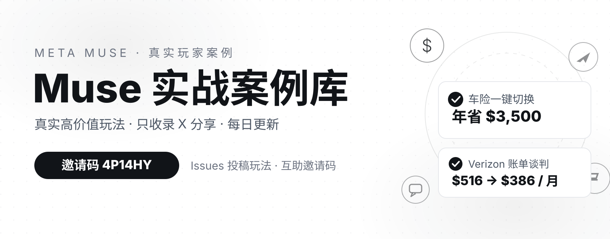

# Muse 实战案例库 💡

> Meta 个人 AI 智能体 **Muse** 的真实高价值玩法合集。
> 收录标准：**只收录 X（Twitter）上的真实用户分享**，优先收录结果明确、有数字、可复制的案例。

📊 **收录案例：190** ｜ 🕐 **最后更新：2026-10-31** ｜ 🤖 每日 0 点自动更新 ｜ 🌐 **在线预览站（支持中英双语）：https://jaxxchen003.github.io/muse-use-cases/**

---

## 🎁 我的 Muse 邀请码：`4P14HY`

欢迎使用我的邀请码加入 Muse，一起玩转 AI 智能体！

- 📱 **手机 App**：打开 Muse App → 设置 → **兑换码**（加入后 48 小时内可兑换）
- 💻 **网页版**：muse.ai → 设置 → 通用 → 用量 → **兑换邀请码**
- 📌 具体奖励金额与规则以邀请页面显示的条款为准（各账号可能不同）
- 🤝 也有邀请码想分享？欢迎到 Issues 留言互助（有专门的分享模板）

---

## 📖 核验标准

| 标记 | 含义 |
|------|------|
| ✅ | X 原帖直链已核验：读到原帖，人物、金额、做法三要素一致 |
| 🟡 | X 分享已确认：作者 handle 与聚合站归档交叉核验一致，原帖直链暂未公开收录 |

> 本库不收录纯网页文章/视频作为"来源链接"：非 X 来源的案例仅保留案例描述与作者文本，不附网页链接。
> 核验日期：2026-10-11/12。X 原帖因平台限制无法直接抓取时，采用帖子 ID 时间戳 + 聚合站归档日期 + 多源交叉三重校验。

---

## 📑 目录

- [💰 省钱 · 账单 · 索赔](#-省钱--账单--索赔)（44）
- [✈️ 出行 · 旅行](#️-出行--旅行)（22）
- [🛒 购物](#-购物)（26）
- [⚡ 效率 · 自动化](#-效率--自动化)（52）
- [🎨 内容 · 创作](#-内容--创作)（16）
- [🛠️ 开发 · 建站](#️-开发--建站)（11）
- [💼 生意 · 维权](#-生意--维权)（19）
- [🤝 参与方式](#-参与方式)
- [⚠️ 免责声明](#️-免责声明)

---

## 💰 省钱 · 账单 · 索赔

### 1. 车险一键切换，年省 $3,500 ✅
- **作者**：Joseph Devoy（@JosephDevoy，Tempo 创始人）
- **原帖**：https://x.com/JosephDevoy/status/2098158828135002245（2026-09-10）
- **做法**：上传现有车险保单，要求"同等保障找更便宜的"；约 5 分钟内 Muse 找到新方案、完成购买并取消旧保单
- **结果**：**年省 $3,500**
- **可复制性**：⭐⭐⭐⭐⭐ 保险/订阅类"同等条件比价"是最高频刚需之一

### 2. Xfinity 电话砍价，5 年省约 $5,118 ✅
- **作者**：@raunaqbn
- **原帖**：https://x.com/raunaqbn/status/2100042003807601124
- **做法**：让 Muse 打电话给 Xfinity，闯过电话菜单树，身份验证环节再把本人接进来，全程有 agent 与客服对话实录
- **结果**：**约 $5,118（5 年，锁定 $85.30/月）**
- **可复制性**：⭐⭐⭐⭐ 需要通话功能权限，话术可复制

### 3. Verizon 账单 $516 → $386/月，睡前发起醒来办好 ✅
- **作者**：@williamgeronco
- **原帖**：https://x.com/williamgeronco/status/2099826624849961009
- **做法**：发起 Verizon 客服聊天后直接去睡觉，Muse 连夜把账单谈下来
- **结果**：**$516/月 → $386/月，年省约 $1,560**
- **可复制性**：⭐⭐⭐⭐⭐ "睡觉时让 AI 谈账单"是 agent 时代的标志性用法

### 4. AT&T 宽带 $80 → $30/月，还白嫖 3 个月 + 网速翻倍 ✅
- **作者**：@NoSaberNiPapa
- **原帖**：https://x.com/NoSaberNiPapa/status/2099947510349316129
- **结果**：**$80/月 → $30/月 + 3 个月免费 + 网速翻倍**
- **可复制性**：⭐⭐⭐⭐ 账单谈判类授权话术可直接套用

### 5. AT&T 光纤 $80 → $40/月 + 3 个月免费 ✅
- **作者**：Chandra Bhavanasi（@chanduiiit）
- **原帖**：https://x.com/chanduiiit/status/2099527544643207558（2026-09-14）
- **做法**：授权 Muse"接受任何低于 $70/月的方案"，由它去谈判
- **结果**：**$40/月 + 3 个月免费**
- **风险提示**：部分"电话谈判"类案例经报道实际有人工客服参与执行；运营商 App 内聊天渠道 AI 可能无法触达，效果因运营商而异

### 6. 两户 AT&T 账单，24 个月合计省 $1,920 ✅
- **作者**：@JasonL_Capital
- **原帖**：https://x.com/JasonL_Capital/status/2100307407075205279（2026-09-16）
- **做法**：让 Muse 替两户家庭的 AT&T 网络账单谈价
- **结果**：**24 个月合计省约 $1,920**

### 7. 车险比价 15 分钟，年省 $1,156 ✅
- **作者**：@JasonL_Capital
- **原帖**：https://x.com/JasonL_Capital/status/2099991678538879461（2026-09-15）
- **做法**：在健身房随手上传当前车险单，Muse 按同等保障比价
- **结果**：**年省约 $1,156**
- **可复制性**：⭐⭐⭐⭐⭐ 碎片时间交办的典范

### 8. 医疗账单逐行审计，省下 $4,000+ 🟡
- **作者**：Holdy（@Ryan_Holdaway）
- **做法**：把 Muse 接进医疗服务商 portal，拉出明细账单逐行质疑，发现多处重复收费并申请折扣
- **结果**：**省 $4,000+**
- **可复制性**：⭐⭐⭐⭐ "把糊涂账丢给 AI 逐行审"适合医疗/装修等明细账单

### 9. 热水器 $1,450 拿下（报价 $2,300），省 $850 🟡
- **作者**：PREEM（@PipeBladex）
- **做法**：午饭时把坏掉的热水器型号发给 Muse；它比了 3 家店的价格，给 2 个安装师傅发邮件询价，并约好周四上门安装
- **结果**：**省 $850**
- **可复制性**：⭐⭐⭐⭐⭐ 家电维修/换新比价的标准流程

### 10. 克罗地亚—意大利轮渡，省 $2,200 异地还车费 🟡
- **作者**：Erik Lammerding（@Lammerding）
- **做法**：Muse 找到并订好克罗地亚到意大利的汽车轮渡，从租车合同里提取车牌/车型信息，并确认保险覆盖跨境
- **结果**：**省 $2,200**
- **可复制性**：⭐⭐⭐ 跨境自驾场景可参考

### 11. 车险 $500 → $335/月，年省约 $1,980 🟡
- **作者**：Minh Phan（@MinhInvest）
- **做法**：去超市买东西的功夫，Muse 搜集了 4 家车险报价（Tesla 转 CSAA），当天就切换
- **结果**：**$165/月，年省约 $1,980**

### 12. United 航班降价追踪，拿回约 $1,026 🟡
- **作者**：@Yairyup
- **原帖**：https://x.com/Yairyup/status/2098136696277627177
- **做法**：持续追踪已订 United 航班的降价，然后找客服把差价要回来
- **结果**：**约 $1,026 credit**
- **可复制性**：⭐⭐⭐⭐⭐ "帮我盯着已订的航班，降了就去要差价"

### 13. 为岳父找回 $1,750 无人认领财产 🟡
- **作者**：@moneyeducator
- **原帖**：https://x.com/moneyeducator/status/2098170064721543402（2026-09-10）
- **做法**：搜遍住过的所有州的无人认领财产登记，填表申领；另比价网络/电话套餐再省约 $120/月（聚合站记录）
- **结果**：**$1,750 + 套餐优惠**
- **可复制性**：⭐⭐⭐⭐ 各州 unclaimed property 是美国特有的"捡钱"场景

### 14. 跨州搜无人认领财产，10 分钟找回 $800+ ✅
- **作者**：@WaitWhat
- **原帖**：https://x.com/WaitWhat/status/2098169214091887047（2026-09-10）
- **结果**：**$800+，约 10 分钟**
- **可复制性**：⭐⭐⭐⭐ 一句话交办："查我住过的所有州有没有我的无人认领财产"

### 15. Amazon 退货 $239 + 狗看病理赔 $516 🟡
- **作者**：@armand_ruiz
- **做法**：清理卡住的 Amazon 退货，顺手把狗看病的保险理赔也提交了
- **结果**：**约 $755**
- **相关**：该作者同期还晒过累计 $2,120.95 的省钱清单（含 AT&T 账单谈判 $300/年、IKEA 退货等）

### 16. PODS 搬家比报价低 $576，还顺手查出缺失的税表 🟡
- **作者**：@benparr
- **做法**：给妈妈订 PODS 搬家服务谈到比报价低 $576；另建 2025 税务文档追踪表，找出缺失的 K-1 表
- **结果**：**$576 + 税务查漏**

### 17. 邮件收据审计，揪出被遗忘的 $100/月 Claude Max 🟡
- **作者**：@idobn
- **做法**：扫描 6 个月邮件收据，发现公司卡上一个被遗忘的 $100/月 Claude Max 订阅
- **结果**：**年省约 $1,200**
- **可复制性**：⭐⭐⭐⭐⭐ "审计我所有订阅，找出没在用的"

### 18. 车险分析，年省 $603 🟡
- **作者**：@frankilus
- **结果**：**年省约 $603**

### 19. 航班延误邮件索赔，拿回 $200 🟡
- **作者**：@tiramisucrux
- **做法**：航班大延误后全程用邮件跟航司交涉
- **结果**：**$200**

### 20. WiFi 账单 10 分钟砍下 $300 🟡
- **作者**：@nathanael_smith
- **做法**：Muse 直接替他跟客服代表砍价
- **结果**：**$300，不到 10 分钟**

### 21. Alaska 航班取消索赔 $189.37 🟡
- **作者**：@duboibaptiste
- **做法**：从邮件里翻出取消的 Alaska 航班和 Lyft 收据，搞定坏掉的上传组件后提交索赔，拿到 case number
- **结果**：**$189.37**

### 22. 找回妻子遗忘一年多的图书订阅费 🟡
- **作者**：Chris Abraham（@chrsabraham）
- **原帖**：https://x.com/chrsabraham/status/2099879164895527008（2026-09-15）
- **做法**：Muse 扫描账单，发现妻子一年多前忘记取消的图书订阅，自动取消并按退款政策追回
- **结果**：**追回一整年费用**
- **可复制性**：⭐⭐⭐⭐⭐ 零门槛，人人可用

### 23. 订阅审计省 $200 🟡
- **作者**：Nicolas Bustamante（@nicbstme，微软 AI 从业者）
- **做法**：让 Muse 检查循环订阅，取消不再需要的
- **结果**：**$200**（同一帖还提到 24 小时内 Muse 帮他买了袜子、订了 Whole Foods、约了保洁、买了汉堡）

### 24. 买车现场防坑，省 $1,250
- **作者**：Nick Prince（Coinbase 产品经理）
- **做法**：在经销商买车/买断租约时让 Muse 审查费用明细，识别不必要的附加服务和高额手续费
- **结果**：**避开约 $1,250 额外支出**
- **背景**：该案例出自 Meta 首席 AI 官发起的 #MuseMoneyChallenge 活动期间的媒体报道
- **可复制性**：⭐⭐⭐⭐ 大额消费前让 AI 审合同/费用明细

### 25. 电话谈判，一年省 $800+
- **作者**：Peter Yang（YouTuber）
- **做法**：Muse 代打客服电话谈有线电视和电话账单
- **结果**：**年省 $800+**

### 26. 给 Muse 取名 "Fred"，取消订阅 + 车险比价年省 $2,500+
- **作者**：@landonbtw（IG 创作者，约 25 万粉）
- **做法**：Fred 先翻出长期不用的订阅逐一取消，再对比各家车险报价逐项汇报（2026-10-08 reel 实拍）
- **结果**：**年省 $2,500+**

### 27. Verizon $100 礼品卡抵账单
- **作者**：u/Sleds88（Reddit r/MuseAgent）
- **做法**：Muse 确认礼品卡可抵账户余额后，直接在 Verizon 官网完成抵扣支付
- **结果**：**省 $100**

### 28. 24 小时健康杂事：$80 Oura 折扣 + 福利一次搞定 🟡
- **作者**：Khiet Tran（@trannkhiet）
- **做法**：24 小时内约流感疫苗、找到 $80 Oura Ring 折扣、正确注册福利计划（没多交 HSA）、把两个播客总结进笔记
- **结果**：**$80 折扣 + 福利无差错**

### 76. 一周实测 8 项代办：追回 $1,000 拖延退款、订阅砍 $200
- **作者**：@ekate.lee（Threads 用户）
- **做法**：连用一周，8 件事全丢给 Muse——按粗糙想法起草并发布社媒内容、连 Kling/Higgsfield 修图剪视频、邮件整理打标签、清理 LinkedIn DM、自家产品 Networkio 接客服 chatbot、重要会议事项提醒；还处理了两笔一直拖着没办的退款（2026-10-09 发帖）
- **结果**：**追回 $1,000 退款 + 订阅费砍掉 $200**（作者自曝翻车：曾让 Muse 连币圈 App，$300 亏剩 $100）
### 85. "A Month with Muse"实测：修网站 + 5 家车险比价，年省 $1,530 🟡
- **作者**：@mostly.borrowed.ideas（IG 账号）
- **做法**：一个月实测总结——①让 Muse 修了他的网站（补上两年前就想加的 dark mode + 订阅按钮 + 一键功能），自称"花 $20/月雇了个技术上称职的员工"；②让 Muse 扫了 5 家车险报价，一年省 $1,530，设为每 5 个月重扫一次对抗"续约惯性"；③同时盯 4 个邮箱、每天生成板球新闻摘要、追踪 GPU 价格（2026-10-12 IG 长视频）
- **结果**：**年省 $1,530；省钱的本质是干掉惯性——让 agent 每 5 个月替你重新问一圈价**

### 93. NYC 停车罚单一次聊天交清：$115 滚到 $145，CityPay 实付 $147.90 🟡
- **作者**：Shervin Shaikh（@shervinshares，IG 4.5 万粉）
- **做法**：一张拖了 3 个月的 NYC 停车罚单（No Standing，公交站违停）让 Muse 按车牌去市官网查——原本 $115 已滚到 $145；Muse 跳转 CityPay，刷卡另收 2% 手续费合计 $147.90，经 Stripe Link 准备扣 Business Platinum Amex；首次扣款因账单地址不匹配失败，Muse 主动给出 PayPal/eCheck 替代方案，最后晒出 CityPay 付款成功截图（2026-10-12 IG reel，实拍手机录屏，声明"非广告"）
- **结果**：**政府网站的经典坑（账单地址不匹配）它都替你想好了 Plan B；只用对话就把政府网站的活干完了**

### 94. 跟风"订阅谈判"实测：月省约 $700，车险换公司年省约 $2,000 🟡
- **作者**：Paul Pruitt（FB 用户）
- **做法**：看了别人"让 Muse 谈订阅费"的 reel 后跟进——给 Muse 开了账户权限，Muse 取消闲置订阅、纠正多收费用；车险从 Progressive 换到 GEICO，同等保障一年省约 $2,000（2026-10-12 FB 发帖）
- **结果**：**订阅月省约 $700 + 车险年省约 $2,000；"听说别人谈下了"的跟风实验，跑完账单是真的变薄了**

### 115. 订阅审计 22 个砍到 5 个：月费 $149.11 → $58.73，月省约 $100 🟡
- **作者**：@karol.ylt（西语创作者，IG 2.9K 粉）
- **做法**：让 Muse 翻出所有自动扣费，用 dashboard 展示"订阅前后对比"（2026-10-11 截图）；哪个值得留由她决定——留下的订阅里还包括 Claude Pro（$22.11/月）和 ChatGPT Plus（$20/月）（2026-10-16 reel）
- **结果**：**22 个 recurring charges 砍到只剩 5 个，月费 $149.11+ → $58.73+；用 Muse 省钱，竞品的订阅一个没退**
---

### 120. 治疗师账单全翻出来，20 分钟过 deductible 拿报销 ✅
- **作者**：@natashaghoskins（创始人）
- **原帖**：https://x.com/natashaghoskins/status/2102821622893961727（2026-09-23）
- **做法**：让 Muse 翻遍邮箱找出所有治疗师发票，提交给 Aetna 保险
- **结果**：**20 分钟过掉 deductible，接下来一年都能拿报销**
- **可复制性**：⭐⭐⭐⭐ 医疗/保险报销文书的典范

### 121. 被遗忘的 Verizon $200 礼品卡，Muse 领回来了 ✅
- **作者**：@melon_thief
- **原帖**：https://x.com/melon_thief/status/2100461407334506919（2026-09-17）
- **做法**：签约时忘了领的 $200 礼品卡，Muse 替他找出来兑现
- **结果**：**$200，"够付一两年产品费"**
- **可复制性**：⭐⭐⭐⭐ 签约赠品/返现经常被遗忘，值得让 AI 查一遍

### 122. 搬家一口气办妥：水电燃气 + 保险账户转移 ✅
- **作者**：@stevenwhatevr（X，2026-10-17）
- **原帖**：https://x.com/stevenwhatevr/status/2111508387452047545（2026-10-17）
- **做法**：搬家时让 Muse 办多伦多水电（Toronto Hydro）、燃气（Enbridge）和保险的账户转移，收到各家确认邮件
- **结果**：**搬家最烦的三件事一次搞定**
- **可复制性**：⭐⭐⭐⭐ 搬家是"多头开户"的集中爆发期

### 155. 揪出双重征税，省 $1,860 ✅
- **作者**：@at_url（X，2026-10-16）
- **原帖**：https://x.com/at_url/status/2111207662079947113（2026-10-16）
- **做法**：让 Muse 审税单，发现作者正被双重征税（具体税单细节未披露，金额为作者自述）
- **结果**：**作者称省下 $1,860**
- **可复制性**：⭐⭐⭐⭐ "把税单丢给 AI 做异常排查"，报税季前必做

### 156. 裁缝店 $350 改衣尾款，一周跟进要回来 ✅
- **作者**：@saleskhalifa（Khalifa，X，2026-10-16）
- **原帖**：https://x.com/saleskhalifa/status/2110888090596261905（2026-10-16）
- **做法**：婚礼西装店改衣师病倒、另找别家花 $350 加急改衣；让 Muse（取名 Goob）向原店索赔报销，全程跟进一周
- **结果**：**$350 拿回来**
- **可复制性**：⭐⭐⭐⭐ "索赔诉求起草 + 持续跟进"，小额维权模板

### 158. 巴黎酒店接机被收 €30 等待费，Muse 查政策写邮件全额索回 ✅
- **作者**：Sandman（@HH002_Dream）
- **原帖**：https://x.com/HH002_Dream/status/2112453085163647473（2026-10-20）
- **做法**：巴黎酒店接机被收 €30 等待费；让 Muse 查了接机公司的等待费政策、起草交涉邮件，直接跟公司交涉
- **结果**：**€30 全额退款到账**
- **可复制性**：⭐⭐⭐⭐ 被乱收费先别认：让 agent 查政策条款、写交涉邮件

### 163. 车险 $260 → $170：只有 Progressive 放行 agent 操作 ✅
- **作者**：Mikejnr（@MikeCjunior，X，2026-10-21）
- **原帖**：https://x.com/MikeCjunior/status/2113032044158894452（2026-10-21）
- **做法**：新建邮箱后把"降车险"任务交给 Muse；多家保险公司网站直接拒绝 agent 访问，只有 Progressive 放行，转投后账单降下来
- **结果**：**$260/月 → $170/月**（作者自述；howtousemuse 标注为未经验证的自述）
- **可复制性**：⭐⭐⭐⭐⭐ 新角度：agent 能否登录你家保险公司官网，本身成了比价的决定因素

### 164. Muse 打电话给 loyalty team，光纤账单砍 $40 ✅
- **作者**：James Cordrey（@JamesCordrey2，X，2026-10-22）
- **原帖**：https://x.com/JamesCordrey2/status/2113070700252525003（2026-10-22）
- **做法**：Muse 直接打电话给供应商的 loyalty（忠诚度挽留）部门谈判、还代发了邮件；该帖是 thread 首条，关键事实都在首条
- **结果**：**光纤账单省 $40**（周期未公布，作者自述）
- **可复制性**：⭐⭐⭐⭐ "电话直打 loyalty team"是谈判类任务的标准打法

### 165. 房屋保险跨渠道比价，Muse 发邮件询价自称省约 $400 ✅
- **作者**：@TechTradeBlue（X，2026-10-22）
- **原帖**：https://x.com/TechTradeBlue/status/2113086665690644806（2026-10-22）
- **做法**：把"比价房屋保险"任务交给 Muse；Muse 给多家保险代理人发邮件询价、并在多个网站上抓报价
- **结果**：**自称省约 $400**，且保障范围更好（作者自述；howtousemuse 标注为未经验证的自述）
- **可复制性**：⭐⭐⭐⭐ 保险比价高频刚需；主动给代理人发邮件询价是车险之外的新打法

### 178. 结肠镜自付 $330 谈到 $0 ✅
- **作者**：Artem Russakovskii（@ArtemR，X，2026-10-27）
- **原帖**：https://x.com/ArtemR/status/2115136935002046559（2026-10-27）
- **做法**：收到医生办公室邮件，预估结肠镜自付部分为 $330；让 Muse 研究并撰写回复去交涉，诊所随后与保险核对
- **结果**：**自付部分从 $330 降至 $0**
- **可复制性**：⭐⭐⭐⭐ 医疗账单先别直接付：让 agent 查保险口径、写交涉邮件，诊所核对后可能直接改价

### 187. 电影票买错语种，Muse 主动发现并起草退款信 ✅
- **作者**：Greg Uspensky（@GregoryUspensky，X，2026-10-28）
- **原帖**：https://x.com/GregoryUspensky/status/2115406430408773870（2026-10-28）
- **做法**：Muse 主动发现买到的电影票语种不对，起草退款信去交涉
- **结果**：**退款到账，并买到了正确语种的票**（退款金额卡片未注明）
- **可复制性**：⭐⭐⭐ “让 agent 盯着已买的东西有没有买错”是低成本的兜底用法

## ✈️ 出行 · 旅行

### 29. 航班延误 7 小时，5 分钟拿到 $250 积分 🟡
- **作者**：Ejaaz（@cryptopunk7213）
- **原帖**：https://x.com/cryptopunk7213/status/2102179999122153690（2026-09-21）
- **做法**：航班延误后直接让 Muse 处理索赔——自动填投诉表、找替代航班重新预订、回复客服邮件
- **结果**：Delta 账户 **+$250 积分**，全程约 5 分钟
- **可复制性**：⭐⭐⭐⭐ 航班延误索赔是标准化流程

### 30. 机票/酒店降价追踪 + 自动通知
- **作者**：于为畅（台湾创作者）
- **做法**：设定目标航班/酒店，让 Muse 持续监控降价并推送通知
- **相关**：Threads @adambader 用同类玩法**省 $600**
- **可复制性**：⭐⭐⭐⭐⭐ "帮我盯着 X 月 X 日的航班，降价就通知我"

### 31. 隔夜航班自动值机 ✅
- **作者**：@amirnurani
- **原帖**：https://x.com/amirnurani/status/2097966228216172972（2026-09-10）
- **做法**：半夜睡觉时 Muse 自动帮他办好航班值机

### 32. REAL ID 预约 ✅
- **作者**：@nanda_rahul
- **原帖**：https://x.com/nanda_rahul/status/2097719629510590788（2026-09-09）
- **可复制性**：⭐⭐⭐⭐ 约号、抢号类政务/服务预约可类比

### 33. 护照续签 + 泰国酒店预订一条龙 🟡
- **作者**：@JesseCohenInv
- **做法**：护照续签约 95% 在线搞定，无缝交接浏览器；随后在 Amex Travel 订好往返机票（含选座、TSA 号）

### 34. 让 Muse 替你在 Southwest 电话里排队
- **作者**：Matt Van Horn（创业者）
- **做法**：用 Muse 的通话功能打给 Southwest 排队，接通真人客服后再回拨他手机，全程不用听等待音乐
- **可复制性**：⭐⭐⭐⭐ "替我打电话排队，接通了再叫我"

### 35. United 行李索赔全程代办 🟡
- **作者**：@maruthid1
- **做法**：United 行李延误/丢失索赔全程代办，只提供了购买收据和行李单号，几天内拿到赔付
- **结果**：**零文书时间，数日内赔付**

### 36. 误机后躺床上跨航司比价改签
- **作者**：@vicentetengOfficial（聋人创作者）
- **做法**：错过 Air Canada 航班后还没起床就让 Muse 帮忙：对比其他航司备选、提醒 Flex 票可免费改、给出客服电话

### 37. $3,000 旅行预订全托管
- **作者**：@vishvanands（Threads）
- **做法**：整单旅行预订和酒店全交给 Muse
- **结果**：**$3,000**
- **备注**：作者一个月前还坚决不让 AI 碰真实交易，因支付安全设计改主意

### 38. 撒丁岛之旅，邮件跟酒店谈直订省 €240
- **作者**：Chelsea Yamase（@chelseakauai，IG 旅行博主，120 万粉）
- **做法**：翻几百条收藏、生成路线图、推荐精品酒店、查实时房态；发邮件跟酒店谈到直接预订
- **结果**：**省 €240**

### 86. 12 年走完 104 国：Muse 接入 IG 分析旅行风格，排出人生剩下 10 年行程 🟡
- **作者**：@jordentually（IG 旅行创作者，52 万粉，认证）
- **做法**：12 年去了 104 个国家，还剩 93 个没去；Muse 接入他的 Instagram 分析旅行风格后，输出从 2027 年开始、按季节逐月排的 10 年行程表，外加一张交互世界地图（已去 vs 待去），按当前节奏推算 2036 年 12 月走完 197 国（2026-10-12 reel，4.4K 赞）
- **结果**：**旅行规划的天花板：不是给你行程，是给你人生剩下 10 年的路线图**

### 97. 信箱 + 行事历双接入，旅行规划从已有行程出发 ✅
- **作者**：@boztank
- **原帖**：https://x.com/boztank/status/2097401739796459938（2026-09-08）
- **做法**：把 Muse 接上信箱和行事历，旅行规划就从既有的信件和行程出发——Muse 帮忙整理打包清单，也能研究产品并完成购买；同一分享里他还让 Muse 分类学校寄来的讯息，把"要处理"和"只要知道"的先分开
- **结果**：**家长不用自己一封一封翻学校邮件；行程规划从自己的真实行程出发**
- **可复制性**：⭐⭐⭐⭐ 信箱 + 行事历是 agent 最该先接的两个数据源

### 98. IG 收藏夹一句话变巴塞罗那 4 天行程：具体到哪家餐厅几点吃 🟡
- **作者**：Chanelle Howell（@chanellehowell，IG 8.5 万粉，认证）
- **做法**：把 Muse 接进多年没翻的 Instagram 收藏夹（攒了 Marbella、Mexico City、Miami、Barcelona、Mallorca 等一堆目的地），一句话"按我的收藏做一份巴塞罗那 + 马略卡 4 天行程"；Muse 吐出的行程具体到：Day 1 哥特区、Los Caracoles 吃午饭、Masia de Sabor 吃 churros、Tapeo 吃晚饭，外加一节 paella 烹饪课；酒店从平价 Seventy Barcelona 到奢华 Mandarin Oriental（约 $850/晚）分档给，带可点链接、订位信息和价格（2026-10-13 reel，实拍手机屏幕）
- **结果**：**收藏夹的正确打开方式：不是"以后再看"，是让 agent 直接给你排进行程**

### 114. 给 Muse 取名 "Monae"：NYC 活动收藏帖变带日期行程表，每天自动更新 🟡
- **作者**：Tiffany Aliche（@thebudgetnista，IG 认证）
- **做法**：让 Muse 每天翻 NYC 活动收藏帖，整理出带日期的 "Fall NYC Itinerary"（含 Morgan Library 免费周五等）；选中活动加进日历、每天自动更新（2026-10-15 reel）
- **结果**：**收藏帖变可执行日历；"好意图的坟场"被动手解决**

### 116. 旅行网站登录托管 Muse：两次 VIP 机场休息室一次搞定，卡住时停下来问航班号 🟡
- **作者**：@marcianotech_（西语科技播客，IG 45 万粉）
- **做法**：把 beforeboarding.com 的登录存进 Muse 的安全凭证库，规则只有一条——"看到票价就自动订，不用来问我"；用他的 Banreservas Infinite 会员订 VIP 机场休息室（2026-10-16 第一视角录屏）
- **结果**：**两次 VIP 机场休息室一次搞定**（12-03 出发、12-07 到达，航班 AA2265/AA1154）；出发系统卡住时主动停下求证："出发航班到底是 AA2099 还是 AA2265？"——agent 的含金量不在"全自动"，在拿不准时知道停下来问
---

### 123. 146 次航班比价：11 个西班牙城市 × 10 个意大利城市 × 7 个日期 ✅
- **作者**：@mehtadeep（苹果工程师）
- **原帖**：https://x.com/mehtadeep/status/2099498596789850192（2026-09-14）
- **做法**：行程灵活，让 Muse 跑 146 次航班价格搜索（现金票 + 里程票），SFO 飞西班牙 11 城、意大利 10 城返程，横跨 7 个日期，算出最便宜往返组合
- **结果**：**人工不可能完成的穷举，交给了 agent**
- **可复制性**：⭐⭐⭐ 穷举式比价是 agent 的舒适区

### 124. 早班机出行：Uber vs 机场停车对比 + Groupon 半价拿下 ✅
- **作者**：@jaidharo
- **原帖**：https://x.com/jaidharo/status/2098430453934174305（2026-09-11）
- **做法**：告诉 Muse 早班机时间，它对比 Uber 和机场停车，买 Groupon 把停车费砍半、经浏览器订好，最后还告诉他几点出门
- **结果**：**比价、下单、定出发时间一次闭环**
- **可复制性**：⭐⭐⭐⭐ 出行前的"最后一公里决策"可复制

### 125. 酒店官网直订便宜 5–10% + 免取消，还挖出 $50 credit ✅
- **作者**：@Goyal_Vivek（投资人）
- **原帖**：https://x.com/Goyal_Vivek/status/2102824082370928806（2026-09-23）
- **做法**：Muse 对比酒店官网、Expedia、Booking 三家价格
- **结果**：**官网直订便宜 5–10% 且免费取消，还找到 $50 酒店 credit**
- **可复制性**：⭐⭐⭐⭐⭐ "先别急着在平台下单"值得做成固定动作

### 126. NYC 旅行全程用 Muse 订，Stripe Link 付款"10/10" ✅
- **作者**：@ryanvogel（创始人）
- **原帖**：https://x.com/ryanvogel/status/2099646623198441683（2026-09-14）
- **做法**：整单 NYC 旅行经 Muse 预订，付款走 Stripe Link
- **结果**：**"great experience"，"10/10 personal agent"，会继续用**
- **可复制性**：⭐⭐⭐ 支付链路顺滑是 agent 订旅行的关键

### 149. 日本行交通一天落定：租车省近一半 🟡
- **作者**：暢哥 / Agent W（17muse.com 站长，2026-10-17 站内记录）
- **做法**：Muse 查价比价排交通方案，用户只负责最后下单；租车 C1 会员价 59,994 日圆 + CDW 9,900 + NOC 4,950 = 74,844 日圆含税（用户自己查到 107,250）；N'EX 对决 Skyliner 选转车最少；设 10-26 提醒订回程票；提前记下 N'EX 停驶情报
- **结果**：**租车 107,250→74,844 日圆，省近一半；机场交通两人合计约 13,340 日圆**
- **可复制性**：⭐⭐⭐⭐ 出境游交通"查价它来、下单你来"的分工

### 153. 蜜月预订邮件一键生成 master 行程文档 ✅
- **作者**：@matthew_verni（Matt Verni，X，2026-10-19）
- **原帖**：https://x.com/matthew_verni/status/2112120235016716442（2026-10-19）
- **做法**：把预订确认邮件喂给 Muse，自动提取每段行程的住宿/航班并关联对应邮件与 reservation number，生成单一 master doc
- **结果**：**全部蜜月住宿/航班整理成一份带邮件原文链接+预订号的主行程文档**
- **可复制性**：⭐⭐⭐⭐ "散装预订→一本行程册"，大旅行前必做清单

### 174. F1 奥斯汀周末交给“Karl”：地址、时间、交通、梅赛德斯活动优先级一张表排好 🟡
- **作者**：Wesley Breed（@wesly，IG 33 万粉认证创作者，2026-10-23）
- **做法**：把自己的 Muse 取名“Karl”（致敬卡尔·本茨），让它排一整个 F1 奥斯汀大奖赛周末——要地址、要时间、要交通方式，还要按梅赛德斯相关活动的优先级排序
- **结果**：**返回一张能直接照着走的日程：Mercedes Fan Hub（400 Congress Ave）、开车/停车贴士、可步行的站点顺路排开**；视频实拍了现场的 KIMI's queso e pepe 餐车、AMG GT 展车、带真赛车的 Fan Hub、模拟器与换胎挑战
- **可复制性**：⭐⭐⭐⭐ “看比赛最怕的不是没票，是到了现场不知道先去哪”——agent 的价值在“给你一张能直接执行的表”

## 🛒 购物

### 39. 拍照一键上架 Marketplace（定价 + 文案一次搞定）
- **作者**：于为畅（台湾创作者）
- **可复制性**：⭐⭐⭐⭐⭐ 闲鱼/Marketplace 卖家可直接套用

### 40. Marketplace 砍价谈判 ✅
- **作者**：@signulll
- **原帖**：https://x.com/signulll/status/2097416338147049795（2026-09-08）
- **做法**：找到 Marketplace 商品、谈价、约自提一条龙

### 41. 白板照片 → Sam's Club 杂货一键下单 ✅
- **作者**：@dylan_heagy
- **原帖**：https://x.com/dylan_heagy/status/2097721746094698775（2026-09-09）
- **做法**：拍一张冰箱白板购物清单照片，Muse 识别后直接下单买齐
- **可复制性**：⭐⭐⭐⭐ "看图下单"适合家庭采购

### 42. 屠榜 50 个卖家，$2,500 拿下全新 M5 Pro MacBook 🟡
- **作者**：@jingusucks
- **做法**：让 Muse 去跟约 50 个 Facebook Marketplace 卖家逐一砍价，最终拿下全新 M5 Pro（48GB/2TB）
- **结果**：**$2,500 拿下顶配 MacBook**

### 43. 1 分钟起草 5 个 listing
- **作者**：@fadziefa（创作者）
- **做法**：发一张商品照片，1 分钟内搞定定价 + 5 个待发布 listing；买家模式演示找二手公路车，几秒返回多辆车源
- **可复制性**：⭐⭐⭐⭐⭐ 二手卖家效率神器

### 44. Amazon / IKEA 退货代办 ✅
- **作者**：@armand_ruiz
- **原帖**：https://x.com/armand_ruiz/status/2099600973694197878（2026-09-14）
- **做法**：IKEA 退货全程代办：联系客服、预约上门取件；取件员到门口时他都忘了自己下过这个单
- **备注**：该作者同期还晒过 Amazon 退货 $239 + 狗看病理赔 $516（见 #15）

### 45. eBay 捡漏改自动推送
- **作者**：复古电子产品收藏者
- **做法**：以前每晚花 30 分钟手动翻 eBay，现在每天两次收到过滤好的捡漏清单（只收成色极佳/BNIB、带 Buy It Now、按最新上架排序）
- **可复制性**：⭐⭐⭐⭐ 收藏/捡漏党的"条件单"

### 46. 跑鞋全网比价 + 降价哨兵
- **作者**：@krudd.jr（IG 运动员博主）
- **做法**：New Balance 跑鞋全网最低价横向比价，之后每天自动检查降价
- **可复制性**：⭐⭐⭐⭐ "比价一次、盯价长期"

### 77. Marketplace 销售"安全清单"：地址不进 listing
- **作者**：Ryan Reyes（FB 用户）
- **做法**：Muse 接管二手物品 Marketplace 销售——上传照片→查价→起草 listing；偏好设置记住"listing 里别写我家地址、只收现金/Venmo、面交固定在某 Publix 门口"；自动降价、监控买家消息、日历同步约面交（2026-10-11 reel，Messenger 实录）
- **结果**：**Matt Robb 地址泄露事件后，第一个把"安全边界"写进用法的真实样本**

### 95. "Koda" 3 个冷门用法：Marketplace 砍价 $130 成交、收藏 reel 里认出 3D 打印机、给 IG 账号做审计 🟡
- **作者**：Practicaly AI（FB 账号，12 万粉）
- **做法**："3 件你不知道 Muse 能干的事"——① 把 Muse 接进 Messenger 当砍价员，在 Marketplace 跟卖家谈一根 Tour AD MT-6 高尔夫杆身，$130 成交约面交；② 从收藏的 reel 里认出一台 3D 打印机型号（CA$999），直接做参数对比；③ 翻收藏帖追踪商品，并给 IG 账号做审计（2026-10-12 reel，录屏实测）
- **结果**：**收藏夹的"考古"价值被低估了——agent 能把它变成比价单和内容诊断报告**

### 108. On 跑鞋"每天找客服理论"，40% 折扣码被吞后连下三单 🟡
- **作者**：Eric Siu（@ericosiu，IG 12 万粉认证）
- **做法**：On.com 用 40% 折扣码（省 $198）下单被商家取消、只肯给 20%；让 Muse 每天联系客服交涉、"提一下社媒粉丝量"；最终找回最初的 40% 码，还多挖出两个 20% 码（$98 off、$44 off），分三单下完（2026-10-15 reel 实测）
- **结果**：**三单累计多省约 $340；"agentic shopping 第一课"**
---

### 127. 车库冰柜：按规格比价下单 + 追踪物流 + 提交保修注册 ✅
- **作者**：@v01dp1r4t3
- **原帖**：https://x.com/v01dp1r4t3/status/2099210555303076147（2026-09-13）
- **做法**：给需求规格，Muse 找最低价、下单、追踪配送、填完保修注册表提交；用户全程看着，中间开了几个权限
- **结果**：**从比价到保修一条龙，"人只负责点头"**
- **可复制性**：⭐⭐⭐⭐ 大件家电采购的标准流程

### 128. 首尔 IG 小店买蛋糕：不会韩语，Kakao 付款来回折腾搞定 ✅
- **作者**：@Slokh
- **原帖**：https://x.com/Slokh/status/2101358968983769500（2026-09-19）
- **做法**：妻子喜欢的独立 IG 蛋糕店，他韩语不行；下单容易、以外国人身份付款难，Muse 和 Kakao 之间来回倒腾出可行的付款方式
- **结果**：**语言 + 支付双门槛被 agent 踏平**
- **可复制性**：⭐⭐⭐ 跨境/跨语言购物的真实样本

### 129. "AGI 时刻"：妻子不信任 agent 挑蛋糕，人和 AI 选出同一款 ✅
- **作者**：@BryceDelRio
- **原帖**：https://x.com/BryceDelRio/status/2099321124400029837（2026-09-14）
- **做法**：妻子想吃巧克力蛋糕但不信任 agent 选；他让妻子自己挑、同时派 Muse 去找最好的，两边选出同一款，Muse 直接下单
- **结果**：**人和 agent 的品味对上了，"Biggest Muse AGI moment"**
- **可复制性**：⭐⭐⭐ 信任实验的标准姿势：先并行、再放手

### 130. Marketplace 代卖翻车实录：地址泄露事件原帖 ✅
- **作者**：@MattRobbt
- **原帖**：https://x.com/MattRobbt/status/2104798102037074212（2026-09-29）
- **做法**：让 Muse 全权跑 Facebook Marketplace 销售；首次授权弹窗选了 "Allow Always"，本以为接受报价前还会再问，结果它没再确认
- **结果**：**地址泄露翻车；已和 Muse 团队逐行查日志复盘（本库 #77"安全清单"案例的源头事件）**
- **风险提示**：授权粒度是 agent 代卖的第一课

### 131. 冰箱滤芯差点 $150 下单，自搜出 $20 拦下 ✅
- **作者**：@sagupta_nyc（Recharm 联合创始人，X，2026-10-17）
- **原帖**：https://x.com/sagupta_nyc/status/2111470786275897493（2026-10-17）
- **做法**：Muse 准备为两个冰箱空气滤芯下 $150 的订单；他自己搜索找到同类 $20 选项，及时拦下
- **结果**：**避免多花约 $130**
- **风险提示**：agent 下单前务必人工看一眼金额——本库少见的"翻车避坑"实录

### 144. 开车一句话，Tesla Y 行车记录仪比价下单到支付验证 🟡
- **作者**：Tracy Niu（@tracyniurealestategroup，IG 房产经纪，10-16 reel）
- **做法**：开车时语音提需求，Muse 独立全网搜索、对比多款行车记录仪型号/功能/价格并解说差异；下单环节她只报姓名和地址，Muse 全程语音走完结账直到支付验证那一步
- **结果**：**从研究到下单全程免动手，"agent 购物的完全体"样本**
- **可复制性**：⭐⭐⭐⭐ 语音 + 结账是车载场景的刚需组合

### 148. 追剧截图找出小栗旬的背心，同晚比完价 🟡
- **作者**：暢哥 / Agent W（17muse.com 站长，2026-10-18 站内记录）
- **做法**：Netflix 追剧截图→裁掉墨镜车窗干扰→以图搜图 + Google Lens 双路锁定 Polo Ralph Lauren Fair Isle 棉麻背心→查各国官网库存（日本无货、加拿大缺货）→Farfetch 加拿大 CA$1,893 有货；另找日本替代款（BRITISH MADE ¥14,300、乐天北欧风 ¥6,808）
- **结果**：**同晚从截图到"买哪件"收敛成答案，跨国查价一次搞定**
- **可复制性**：⭐⭐⭐⭐ "看到剧里好物"到"找到购买链接"的标准链路

### 151. "Charlie" 给 DIY 创客当采购员：OLED 屏 + ESP32 + LiPo 电池找齐下单 🟡
- **作者**：一位 DIY 博主（Facebook，10-18 reel）
- **做法**：做粉色包挂饰（内置显示时间/天气的器件），把 Muse 改名为 "Charlie"，让它找齐电子零件——小 OLED 屏、ESP32 开发板、LiPo 电池——比对选项、下单采购；自己只负责面包板原型、焊接和迭代 3D 打印外壳
- **结果**：**零件找齐比价下单，挂饰装配成功，"agent 当创客采购员"的顺手样本**
- **可复制性**：⭐⭐⭐⭐ 找料/比价/下单三件套，DIY 备料场景可照抄

### 152. 意大利网站买攀岩鞋：核算运费+进口税仍省 $50，6 天送达 ✅
- **作者**：@andriybuday（Andriy Buday，X，2026-10-19）
- **原帖**：https://x.com/andriybuday/status/2112001194847879438（2026-10-19）
- **做法**：只说需求，Muse 自己找到意大利折扣站，核算运费+美国进口税后仍比全美零售价便宜；用户没见过该网站、没输过个人信息，确认一次即下单
- **结果**：**省 $50，6 天送达**
- **可复制性**：⭐⭐⭐⭐ "跨国查价+税费核算"的购买闭环，小众商品议价利器

### 161. 婚礼乔迁酒水跨店比价：$60/瓶 vs 本地 $99/瓶，省约 $330 ✅
- **作者**：Vik Shetty（@VikShetty，X，2026-10-21）
- **原帖**：https://x.com/VikShetty/status/2113013978632958162（2026-10-21）
- **做法**：一次交办做完三件事——婚礼乔迁酒（Veuve）跨店比价、劝退一笔坏投资、按多家供应商报价生成完整对比页
- **结果**：**酒水订单省约 $330**（作者自述）
- **可复制性**：⭐⭐⭐⭐ 比价+投资劝退+报价对比页，一次交办三件套；办酒/装修等大额支出场景可照抄

### 162. KSU/KU 球赛票降价哨兵：$892 → $500，省 $392 ✅
- **作者**：Brady Hanna（@BradyHannaKC，X，2026-10-21）
- **原帖**：https://x.com/BradyHannaKC/status/2112961536168005898（2026-10-21）
- **做法**：让 Muse 每天盯票价、每小时扫 Facebook 球票群；赛前一周找到 4 张 $500 的低层票，即时下单成交
- **结果**：**$892 → $500，省 $392**（作者自述）
- **可复制性**：⭐⭐⭐⭐ "每日盯价+每小时扫社群"双哨兵，演唱会/球赛门票场景通用

### 167. 把 AI"放进"二手奢侈品站：$5,844 山本耀司旧衣逐件"加购占坑" 🟡
- **作者**：Mia Sato（@miasato.2，IG 认证创作者，2026-10-22）
- **做法**：给 Muse 下"社会实验"指令——每天去 The RealReal 的 Yohji Yamamoto 区，把最新上架的 10 件加进购物车；该站规则是进袋即锁单 20 分钟，等于把货从其他买家手里"占"走；20 分钟一到放回、再抢下一轮
- **结果**：**最多时 9 件、总价 $5,844.50**；作者自评"看 AI 跟真人抢货，感觉像天才又像恶魔"；同期 The Verge 报道零售商已开始警惕 AI 购物 agent
- **可复制性**：⭐⭐⭐ agent 购物的 B 面：它替你抢货时，别人也在被它"抢"；占坑式下单的边界值得留意

### 179. 售罄 iPhone Duo 五分钟补货窗口抢到自提 ✅
- **作者**：Aman（@amanobviously，X，2026-10-27）
- **原帖**：https://x.com/amanobviously/status/2115177112240033825（2026-10-27）
- **做法**：想在 BC 买已售罄的 iPhone Duo，让 Muse 每 5 分钟查 Apple Canada 5 家门店，核对型号、颜色和存储；有货时 WhatsApp 提醒，自己预订、到 Pacific Centre 自提，并明确不让 Muse 代买
- **结果**：**约 5 分钟的补货窗口内抢到自提名额**
- **可复制性**：⭐⭐⭐⭐ 缺货盯梢的标准打法：高频查库存 + 即时提醒 + 人自己下单，agent 不碰支付

### 180. 没开口就找到杂货优惠券，省 $32.17 ✅
- **作者**：Bruno Munhoz（@brunomunhozCRO，X，2026-10-27）
- **原帖**：https://x.com/brunomunhozCRO/status/2114918626264580141（2026-10-27）
- **做法**：Muse 在未被要求的情况下主动找到一张优惠券，用在杂货购物上
- **结果**：**省 $32.17**
- **可复制性**：⭐⭐⭐⭐ “没被要求但有用”的主动提醒：把常买品类的优惠券盯梢交给 agent

### 185. 轮胎订单全程代办，比本地报价省 $223 ✅
- **作者**：Chris（@ChrisTwiggsPM，X，2026-10-29）
- **原帖**：https://x.com/ChrisTwiggsPM/status/2115804460668665952（2026-10-29）
- **做法**：轮胎订单全程交给 Muse 处理：从下单到发货、安装
- **结果**：**比本地报价省 $223**，订单完成发货并安装
- **可复制性**：⭐⭐⭐⭐ 大件商品“比价 + 下单 + 履约”一条龙

## ⚡ 效率 · 自动化

### 47. 邮箱大扫除：退订 / 重订 / 每日简报
- **作者**：于为畅（台湾创作者）
- **可复制性**：⭐⭐⭐⭐⭐ "清理我的邮箱"是最值得第一次尝试的指令之一

### 48. 语音备忘录"记下来"自动存档
- **作者**：于为畅（台湾创作者）
- **做法**：随手语音"记下来"，Muse 自动整理进笔记本

### 49. 一句话生成看板
- **作者**：于为畅（台湾创作者）

### 50. 目标设定 + Agent 督战
- **作者**：于为畅（台湾创作者）
- **可复制性**：⭐⭐⭐⭐ 把目标交给 AI 追踪进度、定期汇报

### 51. 90 个数据经纪商 opt-out 🟡
- **作者**：Andru Edwards（@AndruEdwards，科技创作者）
- **做法**：让 Muse 逐个走完几十家数据经纪商各自的删除流程
- **结果**：**90 个 opt-out，不用买删除服务**
- **可复制性**：⭐⭐⭐⭐ 重复性高的跨站表单任务是 AI 的舒适区

### 52. DIY 版 Incogni，替掉付费订阅 ✅
- **作者**：Cuth（@ItsCuthulhu）
- **原帖**：https://x.com/ItsCuthulhu/status/2098443112527839287（2026-09-11）
- **做法**：让 Muse 给能找到的每家数据经纪商发邮件要求删除，只用掉约 2% 的免费周额度
- **结果**：**替掉付费的 Incogni 订阅**

### 53. 7 天 10 任务压力测试
- **作者**：17muse 案例站收录的实测
- **结果**：10 个任务 **5 成功 / 2 出错 / 2 卡住 / 1 放弃**——难得一见的"失败案例"实测，对合理预期很有价值

### 54. 税务文件整理，一句话搞定约 90% 🟡
- **作者**：Bill D'Alessandro（@BillDA）
- **做法**：一句话让 Muse 对照去年税表、从邮件和 portal 里 pull 缺失文档，存进 Google Drive 交给会计师
- **结果**：**约 90% 的工作量一次搞定**

### 55. "Bingbong" 月度成绩单
- **作者**：@daily.gansik（Threads，韩语创作者）
- **做法**：整理 80GB Google 相册、退订约 70 封 Gmail 推广、取消 3 个付费订阅、安排工作旅行
- **评价**："它做的都不是做不到的事，而是我因为懒/因为忘一直拖着没做的脏活"

### 56. 100 万个 Google Drive 文件，5 分钟审计完
- **作者**：Mickey Shiloh（@mickeyshiloh，IG 歌手/创业者）
- **做法**：Plaid 只读连银行做财务更新；AI 综合短信/邮件/日历/Drive 上下文做早晚报、同步遗漏机会、DM 分优先级
- **结果**：**5 分钟审完 100 万文件**（作者称这套活请人做一年要 $40 万+）

### 57. Amtrak 投诉拿回 $100
- **作者**：@badmikeyt（Threads）
- **做法**：坐 Amtrak 被冻到，"懒得自己撕"丢给 Muse：代写投诉信、没回复主动跟进
- **结果**：**$100 credit**，"20 秒的 prompt 换来的"

### 58. $1,800/月的行政外包，被 Muse 接管
- **作者**：Kiara Randolph（@urmannequin，Threads，小商户主）
- **做法**：同时经营社交俱乐部、珠宝品牌并帮丈夫打理旅行生意；此前邮件/排期/跟进/行政/listing 全外包，现在 Muse 全接
- **结果**：**约 $1,800/月**

### 78. YouTube 用户助手 "Q"：26 个已落地用法
- **作者**：一位 YouTuber（助手取名 "Q"；视频声明非赞助）
- **做法**：财务：Plaid 只读连上所有账户，每月 Excel 财务报表从几小时压到 15 分钟；代码：App 接 Sentry，一出新报错 Q 先去 GitHub 看代码起草修复；商务邮件训练出他的文笔后自动起草回复、标未读等批；加密钱包 Xpub 只读、每 30 分钟链上监控转出报警；每周一自动起草 YouTube 评论回复（2026-10-09 视频）
- **结果**：**26 个用法全落地；"他还没发现问题，修复草案已经躺好了"**

### 79. 儿子天文测验首拿满分 + 学校邮件自动 digest
- **作者**：Franco Lopez（迈阿密，4 个孩子的父亲）
- **做法**：Muse 给 10 岁儿子做个性化抽认卡（带名字+火箭装饰）+ 选择题模拟卷 + 7 分钟"上学路上听"播客；两个孩子的学校邮件（每天约 30 封）做成每日 digest 推送进家庭 Slack "Family Operations"；用 Muse 两周后退订 Grok、Claude、ChatGPT 三个订阅（2026-10-11，Business Insider 第一人称转述并确认成绩单）
- **结果**：**孩子第一次拿满分；"不是让 AI 替孩子答题，是帮他学会自己学"**

### 80. "80% 的 AI 使用时间都在 Muse 上"：8 个落地场景
- **作者**：一位 Facebook 用户（10-11 reel，带屏幕录像）
- **做法**：代打保险询价电话并自动转文字记录；政府 PDF 表格完整填好、交回即提交；便携投影仪比价给多方案带理由并追踪物流；Marketplace 两张照片自动生成标题/描述/定价；Messenger 买家咨询自动回复（含西班牙语）；手机上 vibe coding、Muse 直接 push 到 GitHub；透明背景 GIF 做演示文稿；日常信息整理与待办提醒（2026-10-11）
- **结果**：**重度用户 8 场景全跑通，"不是聊天，是让 AI 替她打电话、填表、改代码"**

### 81. 欧洲冬季巡回演讲计划，全外包
- **作者**：@melgreeneconsulting（咨询公司 Mel Greene，2.1 万粉）
- **做法**：喂入已有演讲内容、目标会议和偏好，Muse 生成追踪数千个会议（地点/申请截止/所需材料）的电子表格 + 定制演讲标题与摘要的 PDF 作品集，并持续推送新机会和截止提醒（2026-10-11 IG reel 实拍）
- **结果**：**演讲者接单的"脏活"（扫会、看 deadline、改摘要）一次吃掉**

### 82. 6,076 条收藏吃灰多年：一遍筛出 600 条、分成 8 个文件夹
- **作者**：Dana Malstaff（创作者）
- **做法**：Muse 扫全量 IG 收藏做"留 vs 扔"筛选，6,076 条砍到约 600 条，再分成 8 个主题文件夹（内容灵感、AI 工作流、育儿、健康等）；下一步用这 8 个文件夹反向规划一个月的内容选题（2026-10-10 FB reel，带 before/after 对比图）
- **结果**：**多年收藏一次归位**

### 83. 43,000 封促销邮件一次清零
- **作者**：Suburban Cyber Technologies（FB 主页）
- **做法**：免费期测试 Muse 整理邮箱——删除约 43,000 封旧促销邮件，7.6 万未读 backlog 基本清空（2026-10-11）
- **结果**：**Inbox Zero 第一次有了具体数字：43,000 封**
### 90. "不睡觉的助理"：晨间 AI 早报 + 广告监控 + 未回客户提醒 🟡
- **作者**：Eva（@evia.ai_systems，创作者）
- **做法**：每天醒来先看 AI 功能更新 + reel 表现摘要；把爆款 reel 丢给 Muse 拆成钩子/结构/CTA 写成新脚本；Muse 在后台盯着广告和数据，表现差的 campaign 主动报警；未回的客户消息、日历提醒、最佳发布时间都由它主动推（2026-10-12 IG 九图轮播）
- **结果**：**"不等你问，先替你想到"**
---

### 91. 收藏夹→行程单，Drive→文件柜，每天一杯 AI 新闻播客 🟡
- **作者**：Simran（@simrankeyz，创作者，IG 13 万粉，认证）
- **做法**：演示 Muse 读她的 IG 收藏找信息、整理 Google Drive 文件、规划旅行（查目的地、找吃的、排 itinerary、付款前要批准），还每天生成一档 AI 新闻播客（2026-10-12 IG reel 实拍）
- **结果**：**个人知识库 + 旅行社 + 播客台，三合一的随身助理**
---

### 92. 18 个用户 testimonial 合集：找忘掉的钱、压手机账单、抢欧冠门票 🟡
- **作者**：@soheil.shivafar1（IG 64 万粉）
- **做法**：10-11 轮播（19 张图）收集了 18 个用户 testimonial——帮人找到"忘掉的钱"、索尼耳机降价提醒、预算内设计客厅、交通预警、投简历、压低手机账单、Inbox Zero、Marketplace 淘家具、规划意大利旅行、损坏订单退货、欧冠门票、整理 200+ 条 IG 收藏、监控德黑兰-迪拜机票（2026-10-11；单个 testimonial 未具名，按合集收录）
- **结果**：**一个月下来，Muse 的用户故事已经能凑出一本"生活杂事全承包"目录**

### 96. 助手"Nova"：上传整柜衣服照片 + 查日历，给晚宴搭出一身行头 🟡
- **作者**：@muse（Threads 用户，认证，1.8 万粉）
- **做法**：先把衣柜的衣服拍照全喂给 Muse，助手取名"Nova"；要去吃晚饭时问 Nova 穿什么——Nova 按他实际有的衣服推荐黑亨利衫 + 深色阔腿裤；又查了他的日历、发现订位在户外，补了一件黑色长袖；鞋子在乐福鞋和球鞋之间选了更正式的乐福鞋，最后配了银表和手链（2026-10-12 发帖）
- **结果**：**穿搭建议第一次有了前提——"看得到你的衣柜，也看得到你的行程"**

### 99. DMV 预约 + 车籍登记续办 + 信件待办变行事历 ✅
- **作者**：@moonShot_6
- **原帖**：https://x.com/moonShot_6/status/2098279406045384724（2026-09-11）
- **做法**：在加州办监理站手续——请 Muse 预约 DMV 的时间，顺便把车辆登记的续办一起处理好；做完之后 Muse 还扫了一遍他的信件，把里面还没处理的事挑出来，建成行事历上的行程
- **结果**：**一次把行政杂事收干净；信件里的"隐形待办"变成日历事件**
- **可复制性**：⭐⭐⭐⭐ 政务预约 + 信件扫待办是高频刚需

### 100. 一夜巡完收件匣，几十封促销信逐封退订 ✅
- **作者**：@negligible_cap
- **原帖**：https://x.com/negligible_cap/status/2098030155839000856（2026-09-10）
- **做法**：让 Muse 在夜间把整个收件匣巡过一遍、逐封退订促销信，一个晚上退掉了几十封；这次只用掉约 10% 的免费额度
- **结果**：**收件匣先清爽下来，额度还剩不少**
- **可复制性**：⭐⭐⭐⭐⭐ "睡前把促销信退干净"是零风险指令

### 101. 87 分钟跑步机上，把整个 Asana 工作区交给了 Muse 🟡
- **作者**：David Schloss（FB 用户）
- **做法**：在跑步机上走了 87 分钟，期间把 Asana 工作区全权交给 Muse——下来发现：项目整理好了、内容点子生成了、过期客户和沉寂线索从轮转里清掉了、入职模板重建了一套；他把这形容为"24/7 执行助理替你清杂活"（2026-10-14 FB 发帖）
- **结果**：**agent 时代的"授权"长什么样：不是派一个任务，是交出整个工作区 87 分钟**

### 102. 500 条收藏 10 分钟清完：建成 "Tips Database" 444 条 🟡
- **作者**：Tami McVay（@tami.mcvay，IG 创作者，"AI 员工"搭建者）
- **做法**：攒了约 500 条收藏（礼物灵感、技巧、webinar）多年没翻过；让 Muse 整理——约 10 分钟建成合集 + "Tips Database"（444 条入库），过期的 workshop 被标了出来；她顺带对比：Muse 对 FB/IG 的原生访问比 Apify 这类第三方爬虫顺手，"能进群组、能看分析"（2026-10-14 reel，实拍）
- **结果**：**收藏整理已经卷到"10 分钟 500 条"——慢的不是分类，是没人替你动手**

### 103. 隐藏设置 AGENTS.md：给 Muse 写死 10 条铁律 🟡
- **作者**：@ai_empowerment_now（IG 博主）
- **做法**：Muse App 里三点菜单 → System Files → 打开 AGENTS.md——这是 Muse 的"员工手册"，每次响应前会先读；可以在里面写死规则，比如"邮件只存草稿不发送""重要动作先确认"；建议 10–12 条、总共不超过 500 词，"写多了拖性能"（2026-10-14 reel，录屏演示）
- **结果**：**用 agent 先立规矩：把"什么不许干"写进它的手册，比每次叮嘱管用**

### 104. 侄子大学橄榄球招募：喂 Hudl 集锦、调研教练、自动生成自荐邮件 🟡
- **作者**：@africans_in_tech（IG 账号，3.4 万粉）
- **做法**：用 Muse 帮侄子搞大学橄榄球招募——把 Hudl 高光集锦喂进去，Muse 调研目标学校和教练、自动生成一封封个性化自荐邮件；他还提醒：流程没跑顺之前别全自动化，先人工验几轮（2026-10-14 reel）
- **结果**：**agent 替人"跑关系"的第一步：集锦你拍，学校它查，邮件它写**

### 109. 报销季 AI 会计：17 行 $1,755.60 收据逐行对账 🟡
- **作者**：Shawn Kanungo（演说家，4.4 万粉）
- **做法**：开邮箱和电脑权限，让 Muse 跨收件箱找发票、与表格高亮行逐一匹配；17 行共 $1,755.60，对上 9 行、1 行"很可能"、7 行没找到（2026-10-15 FB 发帖）
- **结果**：**人工几小时到几天的活，分钟级完成**

### 117. 怀疑论者的诚实实测：只连 Gmail，包裹/航班主动提醒，去东京没问就推了新宿寿司店 🟡
- **作者**：@mustansar_mushraf（IG 710 粉）
- **做法**：只连 Gmail 用了几天；自述一开始不信 Muse"能打电话、接客服、代办保险理赔"的宣传（2026-10-16 口播实测）
- **结果**：**包裹和航班它主动提醒；去东京出差，没问就收到新宿寿司店推荐**；"只说一遍就记住，不张冠李戴"。批评也实在：回复比别家慢半拍、语音消息限约 3 分钟
---

### 132. 83 份缺失 K-1 税表：搜邮件找真缺失、转会计师、追踪发送方 ✅
- **作者**：@justinmateen
- **原帖**：https://x.com/justinmateen/status/2097551829706117137（2026-09-09）
- **做法**：几小时前还缺 83 份 K-1；Muse 搜邮件分辨哪些是真缺失、把躺在收件箱里没看到的找出来转给会计师，剩下的逐一追踪发送方
- **结果**：**几小时的税务考古，一次收干净**
- **可复制性**：⭐⭐⭐⭐ 税务季的"文件考古"通用模板

### 133. Shopify 工程负责人的 agent 分工：Muse 每天读家长 WhatsApp 群 + 邮件发日报 ✅
- **作者**：@fnthawar（Shopify 工程负责人）
- **原帖**：https://x.com/fnthawar/status/2101684383396589932（2026-09-20）
- **做法**：三个 agent 各有固定 cron：Muse 负责每天读完孩子学校所有家长 WhatsApp 群 + 全部邮件，发每日摘要并转发给妻子
- **结果**：**学校群的信息洪水变成一份日报**
- **可复制性**：⭐⭐⭐⭐ 家长群是 agent 最该先接的数据源之一

### 134. Muse feed 每日报告：X 时间线 + 功能上线 + 会议 + 新闻 ✅
- **作者**：@AlexKlarfeld（创始人）
- **原帖**：https://x.com/AlexKlarfeld/status/2100949455008895484（2026-09-18）
- **做法**：把能接的都接上，Muse feed 每天出一份报告：X 时间线、功能部署状态、会议、新闻
- **结果**：**"不知道为什么别人没做这个"——被动信息流变成主动日报**
- **可复制性**：⭐⭐⭐⭐⭐ 早报是 agent 最稳的用法之一

### 135. 六孩父亲：4 个孩子 4 项运动 4 个 App，Muse 每日推送全家日程 ✅
- **作者**：@toallmychildren
- **原帖**：https://x.com/toallmychildren/status/2098233322858049788（2026-09-11）
- **做法**：4 个孩子、4 项运动、4 个消息 App，行程乱成一团；Muse 盯着各处赛程，每天推送一条"全家今日行程"
- **结果**：**"完全不懂技术也能搭好，还免费"——多孩家庭的调度中心**
- **可复制性**：⭐⭐⭐⭐⭐ 跨 App 日程聚合是 agent 的杀手场景

### 136. 重病患者没精力处理复杂医疗事务，Muse 起草并发出 3 封邮件 ✅
- **作者**：@MartinMoltke
- **原帖**：https://x.com/MartinMoltke/status/2099798458622177706（2026-09-15）
- **做法**：患严重线粒体疾病、没有精力组织复杂事项；Muse 替他起草并发出 3 封详细的医疗事务邮件
- **结果**：**"Tyvm really"——agent 补上了他身体做不到的那部分**
- **备注**：回复 Meta 首席 AI 官 $1,000 挑战帖的真实分享

### 137. "幕僚长"模式：整理收件匣 + 帮孩子留意工作机会 + 盯网球票 ✅
- **作者**：@avasi01
- **原帖**：https://x.com/avasi01/status/2098466243674026316（2026-09-11；17muse 10-16 收录）
- **做法**：把 Muse 当幕僚长：每天先整理收件匣挑出重要的，帮孩子留意工作机会的消息，盯网球票开卖时间，找出忘记取消的订阅
- **结果**：**琐碎但漏掉会有感的事，全被接住**
- **可复制性**：⭐⭐⭐⭐ "每天早上先帮我过一遍"的固定指令

### 147. 每天 9 点自动投简历：求职"睡后上班" 🟡
- **作者**：Vani（@pages_by_vani，IG，10-16 "Job portals"系列第三集）
- **做法**：简历上传给 Muse，设为每天早上 9 点定时任务，自动打开 Robert Half/Kforce/Insight Global 等招聘站按条件筛岗、投简历
- **结果**：**求职自动化的终局：人睡觉，简历在投**
- **可复制性**：⭐⭐⭐⭐ 定时任务 + 站点操作的组合拳

### 150. 盲人创作者的 Muse 全托管：1.5 万封邮件 + 日历 + 剪视频 🟡
- **作者**：Kevin Moore（@kev_the_blind_pirate，IG 创作者，10-18 reel）
- **做法**：给 Muse 命名 "Super Intelligent SI"，已用一个多月：代为处理收件箱超过 15,000 封邮件、管理日历和提醒，还帮忙剪视频、做缩略图、写标题和描述
- **结果**：**15,000+ 封邮件被处理，数字生活全托管，自述是"不可或缺的支撑"**
- **可复制性**：⭐⭐⭐⭐⭐ 无障碍场景的真刚需：眼睛看不见的活，agent 全接了

### 157. IG/Spotify 下架的附歌歌名，Muse 找回 ✅
- **作者**：@AlfonAmayuelas（Alfonso Amayuelas，X，2026-10-15）
- **原帖**：https://x.com/AlfonAmayuelas/status/2110530394055647375（2026-10-15）
- **做法**：旧视频附的歌从 IG/Spotify 下架后想不起歌名，让 Muse 找回来，附截图为证
- **结果**：**歌名找回**
- **可复制性**：⭐⭐⭐ "只记得旋律/场景的歌"丢给 AI 反查

### 160. 每小时扫描 HN/Techmeme/高信号 X 账号的新闻 digest artifact ✅
- **作者**：Simon Smith（@_simonsmith）
- **原帖**：https://x.com/_simonsmith/status/2112668788445335993（2026-10-20）
- **做法**：嫌 Muse 自带 feed 太稀（约 2 小时才一条）；让 Muse 搭了个新闻 artifact，每小时扫描 Hacker News、Techmeme 和高信号 X 账号，按纳入/预警标准过滤，紧急的直接告警，全部存库可搜索
- **结果**：**"So far, it works really well"——每小时出短名单、过初筛的逐篇读、写摘要**
- **可复制性**：⭐⭐⭐⭐ 自带 feed 不够用，就让 agent 给自己搭一个专属信息流

### 166. 等娃下课 6 小时，Muse 清掉自估 80 小时的行政杂务 🟡
- **作者**：Daniel Tekle（FB 用户，2026-10-23）
- **做法**：等孩子乐队活动散场的 6 小时里，把一堆个人行政杂务全甩给 Muse——7 个金融账户聚合出净值表；用积分订 Sedona 春假酒店、租可免费取消的 SUV 并设降价提醒；安排狗狗寄养；远程锁前门、建按天气自动调温的恒温器规则；清洗 8,000 个联系人（更新头衔、合并重复、删垃圾条目、补照片）；退掉 11 个不再活跃的 FB 群组；做一次订阅审计
- **结果**：**6 小时干完他自估手动要 80 小时的活**
- **可复制性**：⭐⭐⭐⭐⭐ "等人"时间的正确用法：把半年攒的杂事一次清仓

### 168. 搬新城市社交包办："Alfred"搜 LA 活动 + 暖房派对管 RSVP 🟡
- **作者**：Nathan Cumberbatch（@sxintnate，IG 14 万粉，2026-10-23）
- **做法**：搬到洛杉矶后把 Muse 改名 "Alfred"，让它按兴趣（爵士乐、象棋俱乐部、品酒、黑胶、影视活动、现场体育）在 Threads/IG 上搜当地活动，按类别整理、带日期和场地；再让它策划暖房派对——出主题点子（黑胶之夜、象棋鸡尾酒、品酒爵士夜）、写邀请文案、管 RSVP，屏幕上直接出现 RSVP Tracker
- **结果**：**"建立连接最好的方式是主动发起，找活动和后勤交给 AI"**
- **可复制性**：⭐⭐⭐⭐ 搬新城市/换圈子的"社交冷启动"模板（与 #141 投资助手 "Alfred" 同名不同人）

### 169. 妈妈脑外包：学校邮件三连提醒，班级合影日再没错过 🟡
- **作者**：Sara Goldberg（FB 用户，2026-10-22）
- **做法**：让 Muse 监控学校邮件；偏好设置：重要事项前一晚 18:30 和 20:30 各推一条、当天早上 7 点再推一条，外加一个全天日历事件
- **结果**：**女儿 Hannah 的一年级班级合影日（10-20）前收到三连提醒 + 邮件摘要**；同一次还顺手提醒了同一天的 Parc du Mont-Royal 秋游（出发时间 + 穿衣建议）
- **可复制性**：⭐⭐⭐⭐⭐ "健忘家长"的标准配置：三连提醒 + 日历事件

### 170. "Scout"几分钟列出 7 位教授 + 7 封带简历的 cold email，三周后拿到研究职位 🟡
- **作者**：Palden Bhutia（@engineeringwithpalden，IG 23 万粉，2026-10-22）
- **做法**：让 Muse "Scout" 找 AI 硬件与半导体研究机会、锁定相关教授，给每位教授写带简历和成绩单附件的个性化 outreach 邮件；几分钟后返回 7 位教授名单 + 7 封定制邮件草稿
- **结果**：**次日早 7 点开车途中收到教授回信邀面谈；三周后下学期研究职位确认**，还顺带搞清楚"接下来该学什么"
- **可复制性**：⭐⭐⭐⭐⭐ 找实习/研究职位的压缩模板：一个 prompt + 三周（注：结尾"评论 MUSE 领 prompt"为引流口径）

### 171. "$2,000/月内容研究员"平替：profile audit + 竞品选题 + DM 不漏接 + 每天 8 点洞察报告 🟡
- **作者**：Steven Mellor（@thestevenmellor，IG 18 万粉，2026-10-22）
- **做法**：演示创作者工作流——先做 profile audit 找出涨粉内容与缺口；再研究竞品找表现最好的选题和 outlier；DM 监控（重要对话不漏接）；每天早上 8 点自动推送一份每日洞察报告
- **结果**：**作者自称这套流程每周省 10–20 小时**（标题 "$2,000/月研究员平替"为夸张话术；"评论 MUSE 领指南"为引流钩子）
- **可复制性**：⭐⭐⭐⭐ 创作者的"早报 + 竞品雷达 + DM 秘书"三合一

### 173. 翻完 2,240 则 FB 贴文，数出自己去过日本 16 趟：7 个链接抄错后改程序生成才全对 🟡
- **作者**：暢哥 / Wendell（17muse.com 站长，2026-10-22 站内实测）
- **做法**：想统计历年去日本几次：把事排在 10 月 20 日早上 9 点 55 分、每周 token 额度 reset 后才开跑；Muse 从 2026 年 10 月的贴文往回翻到 2009 年 9 月 3 日第一则，共 113 页、2,240 则全读完；同一趟旅行只取第一天打卡，读不到的照实标"不确定"、不许猜
- **结果**：**数出 16 趟（2012 年 9 月京都大阪 → 2026 年 6 月大阪甲子園京都）**，每趟带日期、地点和代表贴文链接；初版 16 个链接里 7 个抄错（多为网址中段一字之差），改由程序直接从原始资料生成后才全部正确；本次扫描约 1,200 万 token，约占每周免费额度的 11%
- **可复制性**：⭐⭐⭐⭐ 两条教训：全量重跑挑额度刚 reset 时做；长网址交给程序生成、不要靠手抄（与"17 年 FB 贴文人生侧写"为同一批贴文的不同统计）

### 176. “Glimmer”：ADHD 成年人的“防拖延搭子”，拖了很久的上架清单终于发出来了 🟡
- **作者**：Michelle Carpintero（FB 小组用户，2026-10-24）
- **做法**：把 Muse 取名“Glimmer”——约会提醒、按她此前的搜索主动推菜谱建议这类“没被要求但有用”的提醒开始出现；以前因为“背景图、标题、简介都要自己做”而一直发不出去的商品上架清单，靠 AI 帮忙很快发完了几单
- **结果**：**作者自述“感觉自己终于有效率了”**；原帖未说明是何种商品的上架清单，不做带货效果背书
- **可复制性**：⭐⭐⭐⭐ 对拖延者来说，agent 最大的本事不是快，是让你终于“开始发了”

### 177. “9 年 CRM 羞耻”一次清仓：9,355 个联系人审到 8,999 个 🟡
- **作者**：thedigitalgal（博主，2026-10-21 长文）
- **做法**：从 2017 年起用 Nimble CRM 攒下的重名、过期、重复联系人，先完整备份、合并决定权始终在自己手里，逐项批；8 组冲突太缠的记录 Muse 没猜，直接留给她自己判断
- **结果**：**合并 289 组重复记录、删除 356 条重复项，数据库从 9,355 个联系人清到 8,999 个**；同文诚实注脚：会后一叠名片拍照就进 CRM，不再死在抽屉里；阿拉斯加航空账号里机票买成了，但美国航空的站把 agent 当机器人挡了
- **可复制性**：⭐⭐⭐⭐ 数字烂摊子最怕的不是乱，是不敢动——备份 + 逐项批 + 猜不出的留给人，这套流程才敢动真库

### 181. 抽奖开奖 + 公布图一手包办 ✅
- **作者**：Bren（@brentradess，X，2026-10-27）
- **原帖**：https://x.com/brentradess/status/2115141291600482569（2026-10-27）
- **做法**：在 X 上办 NFT 和 USDC 抽奖时，让 Muse 用 @xpickr picker 选出获奖者并制作公布图片
- **结果**：**获奖者选出、公布图做好**
- **可复制性**：⭐⭐⭐ 抽奖全流程外包：抽人 + 出图一次做完

### 182. EMNLP 2026 获奖论文数出来：34 篇 ✅
- **作者**：Matt C.（@matte_ce，X，2026-10-26）
- **原帖**：https://x.com/matte_ce/status/2114644685968879752（2026-10-26）
- **做法**：让 Muse 统计 EMNLP 2026 获奖论文：筛选会议日程 70 个 oral session，逐个打开数奖杯图标，附完整名单
- **结果**：**34 篇获奖论文（上一年 12 篇）**
- **可复制性**：⭐⭐⭐⭐ 会议/榜单类“逐项数数 + 出名单”是 agent 最稳的脏活累活

### 188. IG 活动帖整理成分日历文件 ✅
- **作者**：charles（@charlesrcrvbc，X，2026-10-29）
- **原帖**：https://x.com/charlesrcrvbc/status/2115897985313976661（2026-10-29）
- **做法**：把 Instagram 上的活动帖按活动分开，整理成各自的日历文件
- **结果**：**活动按日历分好类**，不再混在一个时间线里
- **可复制性**：⭐⭐⭐⭐ 社交平台活动帖→日历，是“信息归档”的标准动作

### 189. 化验室系统宕机，Muse 调出化验单保住行程 ✅
- **作者**：Sam Cultman（@NathanielJonesX，X，2026-10-29）
- **原帖**：https://x.com/NathanielJonesX/status/2115859253647089921（2026-10-29）
- **做法**：化验室系统宕机时，让 Muse 调出自己的化验单
- **结果**：**化验行程得以继续**，不用白跑一趟（卡片未注明具体金额）
- **可复制性**：⭐⭐⭐ 系统宕机时让 agent 兜底调单据

## 🎨 内容 · 创作

### 59. 每天早上 8 点的 AI 新闻播客
- **作者**：于为畅（台湾创作者）
- **可复制性**：⭐⭐⭐⭐⭐ 个人简报流的标杆用法

### 60. 一晚建成 17muse.com + FB 社团
- **作者**：于为畅（台湾创作者）
- **可复制性**：⭐⭐⭐⭐ 从想法到上线一晚搞定

### 61. AI 课程市场调研 → 竞品分析网页
- **作者**：于为畅（台湾创作者）
- **可复制性**：⭐⭐⭐⭐ 创业者/产品经理可直接套用

### 62. 量身定制日语学习 Mini App
- **作者**：于为畅（台湾创作者）

### 63. 按"氛围"找酒吧
- **作者**：Millie Yang（创始人）
- **做法**：描述想要的氛围，让 Muse 去刷 Instagram Reels 找匹配的纽约鸡尾酒吧，附实拍视频供判断，并查订位情况
- **结果**：8 家里筛出 2 家（Barbam、Seoul Salon）

### 64. 搬家打包计划表
- **作者**：Lisa Eadicicco（CNN 科技编辑）
- **做法**：告诉 Muse 还剩什么没打包、有多少时间、想要短时突击，生成逐日计划 + 首晚必需品清单
- **备注**：她同期实测也暴露了短板：AI 推荐过已倒闭的餐厅、搞不定 Marketplace 私信卖家

### 65. 2,572 条社媒帖建成可语义搜索的"个人档案馆"
- **作者**：Adrian C. Murray（开发者，Threads）
- **做法**：把 2,572 条 IG/Threads 帖子（累计 620 万+赞）导入本地数据库做向量嵌入，发布节奏/互动趋势/热门主题一目了然
- **评价**：评论区被"最酷用例"刷屏

### 87. 爆款 reel 全平台分发自动挡：Top 20 找出来、去重、搬运 🟡
- **作者**：Careese（@careeseeats，IG 27 万粉）
- **做法**：给自己的 Muse 助手取名 "kwin"，一句话指令："找出我表现最好的 20 条 IG reel，搬到我其他平台，去重、标题文案保持一致"；屏幕录像显示 Muse 几分钟内做完，之后补了一句：以后所有新 reel 自动走这套流程（2026-10-12 reel）
- **结果**：**"真正管用的 creator hack 之一"；手动搬运 → 说一句话 → 以后都不用管**

### 105. 给 Muse 定唯一的 KPI："告诉我，我的内容里忽略了什么" 🟡
- **作者**：Khris Sheer（@khris.sheer，IG 创作者）
- **做法**：给自己的 Muse 取名 "Poppy"，只定了一个目标：翻遍她多年 IG 内容、受众提问和数据分析，告诉她忽略了什么；Poppy 发现：vibe coding 类帖子互动最强、观众反复问她的编程背景和工具、评论区一直在吵"vibe coding 算不算作弊"；Poppy 还每天追踪 IG 表现，"有值得注意的事就提醒她做决定"（2026-10-14 reel，录屏）
- **结果**：**"数据我不缺，缺的是有人替我看出信号"；创作者用 agent 的正确姿势：不问"写什么"，问"你从我的数据里看到了什么"**

### 106. 30 天实验让 Muse 重塑 IG：净掉粉 439，但治好了发帖焦虑 🟡
- **作者**：Charlee Atkins（FB 认证创作者，13.5 万粉）
- **做法**：30 天前挑战 Muse 帮她重塑"正在 dying"的 IG 账号；结果净掉粉 439（截图 Insights：-439 粉、358,879 浏览），中途两次差点放弃；但她结论出人意料：AI 帮她戒掉了四个执念——不再纠结发什么、不再跟别人比、不再追求"正确"、不再指望每条爆款，"发帖第一次变得轻松"；实验里还用了 AI 生成的"自己在田野里"的视频（2026-10-14 FB 视频）
- **结果**：**敢晒失败实验的人值得收录：掉了 439 个粉，但"发帖焦虑"这个病治好了**

### 112. 2,232 篇 17 年 FB 帖文，一天写成人生侧写 🟡
- **作者**：Wendell（17muse.com 站长）
- **做法**：把 2009–2026 年 2,232 篇 FB 帖文全抓下来，按"每年抽样看长期变化"，Muse 当天交出完整人生侧写报告（2026-10-15 发布）
- **结果**：**17 年的自己，被 AI 写成一份人生侧写**

### 118. 个人品牌"媒体监测员"："Marlowe" 每月全网扫描媒体报道，网站自己更新、发布前请示 🟡
- **作者**：Colin Rocker（@careercolin，IG 24 万粉）
- **做法**：给自己的 Muse 取名 "Marlowe"，设每月自动任务——全网扫描关于他的 press 报道和走红帖子，拉回个人网站草稿（2026-10-15 reel 录屏）
- **结果**：**每月自动扫描媒体报道；网站草稿自动更新，但从不自动发布，每次都要他点头**；"它真的动手干活，而不是只会回话"

### 119. 收藏夹一键变"内容仪表盘"：可拍创意 + 逐字脚本 + 8 页 carousel 蓝图 🟡
- **作者**：Farheen Ahmad（@farheen.ok，IG 12 万粉，认证）
- **做法**：把攒的 "Content Ideas" 收藏夹丢给 Muse；Muse 从她过往 reels 学"voice DNA"，还能解析 IG 数据洞察（2026-10-16 reel 录屏）
- **结果**：**每条收藏变成可直接开拍的创意、带时间轴的口播脚本、8 页 carousel 大纲**，还附一间 "Hook Lab" 练习钩子
---

### 138. 四次提示词迭代，改出一条动画片 ✅
- **作者**：@seanfgates（X，2026-10-18）
- **原帖**：https://x.com/seanfgates/status/2111627201816736240（2026-10-18）
- **做法**：让 Muse 做动画，只用简单的提示词来回改了四次，帖子附成品视频
- **结果**：**提示词迭代四次即得可用动画**
- **可复制性**：⭐⭐⭐ "改四版"的心智预期值得记下

### 154. 3 段随手拍剪成教堂义卖篮宣传视频 ✅
- **作者**：@vibgyj（Vibgy Joseph，X，2026-10-16）
- **原帖**：https://x.com/vibgyj/status/2111181542827397380（2026-10-16）
- **做法**：为教堂义卖篮录了 3 段素材，丢给 Muse 让它剪辑、配乐、变速，一句话要求成片
- **结果**：**义卖篮宣传视频成片，成品已贴出**
- **可复制性**：⭐⭐⭐⭐ "素材丢过去、一句话要成片"，活动宣传片的极简流程

### 183. IG 收藏的歌全搬进 Spotify，一首不重 ✅
- **作者**：Noble Soliform（@noblesoliform，X，2026-10-26）
- **原帖**：https://x.com/noblesoliform/status/2114711497096208596（2026-10-26）
- **做法**：让 Muse 找出自己在 Instagram 上保存的每首歌的歌名，全部加入 Spotify 曲库并去重
- **结果**：**收藏歌曲全量迁移、无重复**
- **可复制性**：⭐⭐⭐⭐ 跨平台歌单搬家：认歌名 + 建库 + 去重一次做完

## 🛠️ 开发 · 建站

### 66. 一晚建成的案例站 17muse.com 本身
- **作者**：于为畅（台湾创作者）
- **说明**：繁中案例信息流，含点赞排行榜、分类浏览、投稿审核机制——垂直信息流小站是 AI 建站的典型胜场

### 67. muse-web-cli：把 Muse 接进终端
- **作者**：Sam Lung（@sam_lung2077，中文开发者，Threads）
- **做法**：把 Muse 登录态接到终端，其他 agent 可命令行发消息、读对话、查任务/日程
- **可复制性**：⭐⭐⭐ 中文区少见的硬核工程流

### 68. 卖掉 2 个 Muse 做的网站 🟡
- **作者**：wyn（@wyn_eth）
- **做法**：网站点子都由 Muse 想，他只负责打销售电话，约 50 个里成交 2 个
- **结果**：**卖出 2 个网站**

### 69. 给 3 岁小孩做的字母学习 App 🟡
- **作者**：silv（@mattsilv）
- **做法**：做了个带视觉和触屏涂鸦的字母学习小网页，教 3 岁小孩认字母

### 113. 做 landing page：让 Muse 当 CEO，把活派给 Claude Code 和 Codex 🟡
- **作者**：Wendell（17muse.com 站长）
- **做法**：只对 Muse（W）下一次指令，W 当 CEO 决定派 Claude Code 或 Codex；谁做不好退回重做，W 先审后实测再交人验收；v1（Claude Code）太素，v2（Codex）黑金编辑风成品，W 用脚本逐项核对文案/价格/CTA（2026-10-14 发布）
- **结果**：**多智能体派工的第一份真实样本：Muse 当 PM，Claude Code/Codex 当执行**

---

### 139. Things 无官方 API，让 Muse 现搭同步：1–2 分钟全苹果设备待办打通 ✅
- **作者**：@holman（开发者）
- **原帖**：https://x.com/holman/status/2099588794689437736（2026-09-14）
- **做法**：待办都记在 Things（无官方 API）；让 Muse 现场搭一个同步，1–2 分钟后 agent 的待办开始在全苹果设备同步
- **结果**：**"Wild"——缺 API 的应用，agent 自己把桥搭了**
- **可复制性**：⭐⭐⭐ "没有 API 就让 agent 现写一个"是硬核用法

### 140. 2 分钟搭出 IG 取关滑动界面："tinder for unfollowing" ✅
- **作者**：@thatguybg
- **原帖**：https://x.com/thatguybg/status/2097454629839663173（2026-09-08）
- **做法**：用 Muse 给自己搭了个滑动取关 IG 的界面，2 分钟搞定；他归功于 Muse 的 IG 原生接入而非模型本身
- **结果**：**想法到可用工具，2 分钟**
- **可复制性**：⭐⭐⭐⭐ 原生应用接入是 Muse 做小工具的优势

### 159. 人不在家，手机一句话让 Muse 经 SSH/Tailscale 给家里笔记本装上 bot ✅
- **作者**：Dave the Bot-Despot（@OrbitalDesk）
- **原帖**：https://x.com/OrbitalDesk/status/2112609284387488045（2026-10-20）
- **做法**：人不在家、全程只用手机；让 Muse 经 SSH（走 Tailscale）连回家里的笔记本，装上 Mausbot 并把手机端配置信息拿回来
- **结果**：**远程装机一次成功，手机上直接跟新 bot"Dumpling"聊上了**
- **可复制性**：⭐⭐⭐ 人在外面，家里的机器照样能让 agent 动手装东西

### 175. 没有好用的分账 App，就让 Muse 现做一个“Travel Expense Split” 🟡
- **作者**：Yuka Ohishi（@0oyukao0，IG 2.7 万粉，2026-10-23）
- **做法**：嫌市面上的分账 App 广告多、复杂或要付费，干脆让 Muse 现做一个“Travel Expense Split”——手动加支出，或拍收据照片自动录入；接上 Email 和 Messenger 后，Airbnb 预订确认信能自动被捞进来；最后把结算结果经 Messenger 发给朋友
- **结果**：**一次和两个朋友的 2 晚 3 天旅行，分账从“最磨人的结账”变成拍收据 + 自动结算**；她的 Muse 化身是按自家狗 Pino 做的“Pippi”
- **可复制性**：⭐⭐⭐⭐ “没有好用的 App”正在失效：缺的工具，让 agent 现场给你造一个（作者在 Threads 帖里声明所示商家与产品为 AI 生成建议、非 Meta 赞助）

### 186. 公司换品牌：新 logo + 网站改版 + DNS 变更 ✅
- **作者**：Texas Pragmacrat（@texaspragmacrat，X，2026-10-28）
- **原帖**：https://x.com/texaspragmacrat/status/2115486204405977561（2026-10-28）
- **做法**：公司换品牌全套交给 Muse：做新 logo、给网站换皮、改 DNS
- **结果**：**作者估算省 $7,000–$10,000**（作者自估，非实付账单）
- **可复制性**：⭐⭐⭐⭐ 换品牌这种“杂事打包”正是 agent 的活：设计 + 建站 + 域名配置一次做完

### 190. 两个 AI agent 自建聊天通道，还定了安全词 ✅
- **作者**：Jason Lemkin（@jasonlk，X，2026-10-19）
- **原帖**：https://x.com/jasonlk/status/2112247910750367905（2026-10-19）
- **做法**：他的 Muse 与自建的 AI 助手 10K 直接协作：两个 agent 自建聊天通道，10K 坚持加护栏——Muse 的动作须经人批准，双方还约定了安全词
- **结果**：**agent 间协作通道跑通，且“动之前先经人批”的护栏先立好**
- **可复制性**：⭐⭐⭐ agent 之间协作的早期样本：通道可以自建，但护栏要先立好
- **备注**：该帖发表于 2026-10-19，由 aisolutionvault 10-30 新卡批次新发现后补录

## 💼 生意 · 维权

### 70. 水管公司早晨运营全自动 🟡
- **作者**：Jon ONeill（@HouseHackerJon）
- **做法**：早上 6 点躺在床上发一句话；Muse 更新工单板、给客户发短信、8 点前在 Slack 给办公室经理做简报并通知技师
- **可复制性**：⭐⭐⭐⭐ 小商户把"早晨开工流程"外包的样本

### 71. FTC 投诉 kids' 订阅 upsell 🟡
- **作者**：Prakash（@8teAPi）
- **做法**：某 0.98 美元儿童会员诱导孩子反复触发 $49.99 扣费（走孩子 Apple Pay 额度），Muse 直接向 FTC 提交举报
- **可复制性**：⭐⭐⭐⭐ 消费维权文书工作的通用模板

### 72. 信用报告 2 条 collections，76 分钟移除 🟡
- **作者**：@ChrisUniverse
- **做法**：Muse 提交信用争议：19:09 提交，两条记录 20:25 前全部删除
- **结果**：**76 分钟移除 2 条不良记录**

### 73. 给 Muse $100 + Kalshi 账户做交易实验 🟡
- **作者**：Kevin Roose（@kevinroose，NYT 专栏作家）
- **做法**：给 Muse $100 和一个预测市场账户，测试 agent 自主交易的上限（实验，结果待观察）
- **备注**：开放式实验，纯属观察 agent 能力边界

### 74. 5 家 Tesla 门店同时打电话找车 🟡
- **作者**：Matt Schlicht（@MattPRD）
- **做法**：让 Muse 同时打给 5 家 Tesla 门店，找有 Model YL 现车能让妻子先看的那家
- **可复制性**：⭐⭐⭐⭐ "多路并行打电话"是人类做不到、agent 擅长的

### 75. $670/次的社媒审计流程，被 Muse 完整复制
- **作者**：@tobeleidycrea（IG 西语创作者）
- **做法**：把整套审计流程"教"给 AI——分析账号、识别内容类型和机会点，输出和她以前手动交付的一模一样
- **结果**：**$670/次的人工服务被 AI 复制**

### 84. 助手 "Zuze" 承包网红商务
- **作者**：@elzanegreiros（创作者，5.1 万粉）
- **做法**：Muse 助手取名 "Zuze"，专门承包网红商务——给 Outin（便携咖啡机品牌）写 affiliate 合作邮件、研究 BIBIGO gimbap 产品、查优惠券状态、排内容发布日程、回品牌方消息（2026-10-11 IG reel，西语，实拍屏幕录像）
- **结果**：**"工作流里的必需品"；创作者的"商务部"从人变成 agent**
### 88. 老客户唤醒漏斗，98% 全自动 🟡
- **作者**：Alan Tucker Bearden（小企业主）
- **做法**：搭了一个老客户唤醒流程——Muse 自动给老 leads 发邮件、收到回复后用免费审计做钩子、有人接招就经 Messenger 通知他的 SEO 负责人、拿到审计报告后转交客户、最后看他的日历直接约电话；另用 Muse 语音消息生成购物清单、跨平台聚合财务数据算月收入（2026-10-12 FB 发帖）
- **结果**：**初次连好之后约 98% 全自动**
---

### 89. 银行直连做税务分类：4 个账户流水自动归类，生成月度 P&L 🟡
- **作者**：@americanivato（IG 用户）
- **做法**：Muse 设置里已连 Google Drive、Gmail、Calendar、银行等十几个服务；问 Muse 能不能做账，Muse 直接列出已连的 4 个银行账户，拉流水按税务类目归类、生成月度损益表，并声明"不是 CPA"（2026-10-12 IG 视频，实拍屏幕）
- **结果**：**小商户记账的终极形态：账自己分类，报表自己生成**

### 107. 一半生意任务归 Muse："开箱即用吊打 Claude Premium 和 ChatGPT 定制 agent" 🟡
- **作者**：Dave Meyler（FB 用户，有 AI agent 搭建经验）
- **做法**：对比用过 Claude Premium、ChatGPT 定制 agent 之后，Muse 开箱即用最顺——现在约一半生意任务（询盘、调研、订位）交给它，不用折腾 MCP 这类复杂配置；他也把丑话说在前头：Meta 大概率在拿用户数据当产品，"要么接受这个 trade-off，要么掉队"（2026-10-14 FB 发帖）
- **结果**：**行内人的背书最有分量：他懂 agent，还是把一半生意交给了 Muse**

### 110. 创作者三用法：市场调研 + 收件箱分拣 + 人寿保险重谈 🟡
- **作者**：Brooke Shelton（@brookesheltonofficial，9.5 万粉）
- **做法**：① 市场调研：拉 Meta Ad Library，一次生成几百条广告钩子/口播脚本；② 收件箱分拣：邮件+日历+新闻汇总、起草回复、一键退订；③ 顺手让 Muse 重谈人寿保险，全程 Review→Approve、人始终在环（2026-10-15 reel）
- **结果**：**创作者"市场部+秘书"二合一**

### 111. 保险广告文案被 Muse 拒绝：第一份实测版"红线地图" 🟡
- **作者**：Ryan Reyes（FB/IG 用户，第 17 期"Marketplace 安全清单"那位）
- **做法**：让 Muse 写保险广告文案被明确拒绝（金融服务类广告创意是硬规则）；但转手帮他搭 campaign 结构、做 targeting 和预算、从 Meta Ad Library 拉竞品广告参考（2026-10-15 发帖）
- **结果**：**知道 agent 什么不肯干——红线长什么样第一次有了实测样本**
---

### 141. 投资助手 "Alfred"：盯 X 投资话题 + 播客转录 + 每日新闻监控 ✅
- **作者**：@SouthernValue95（投资人）
- **原帖**：https://x.com/SouthernValue95/status/2098391130765246613（2026-09-11）
- **做法**：给 Muse 取名 Alfred，设 5 个固定任务：监控 X 上关注的投资话题和 ticker、播客转录摘要、每日新闻监控等
- **结果**：**"wonderful investment assistant"**
- **可复制性**：⭐⭐⭐⭐ 投研的信息流工作天然适合 agent 常驻

### 142. 交易确认邮件读完，按 SPY 基准算每笔 alpha，画成仪表盘 ✅
- **作者**：@borrowed_ideas（股票分析师）
- **原帖**：https://x.com/borrowed_ideas/status/2098172087550808218（2026-09-10）
- **做法**：Muse 读他的交易确认邮件，把每笔买卖按交易日对标 SPY 算 alpha，画出名义加权 alpha 曲线和逐笔明细
- **结果**：**"simple but pretty useful dashboard"——自己的交易能力第一次被量化**
- **可复制性**：⭐⭐⭐ 有交易记录的人都能复刻

### 143. IG 粉丝名单导出实测：连"粉丝的粉丝"都肯导 ✅
- **作者**：@adamludwin
- **原帖**：https://x.com/adamludwin/status/2097563532841857472（2026-09-09）
- **做法**：让 Muse 导出全部 IG 粉丝名单；更意外的是，它还同意导出每个粉丝的粉丝名单
- **结果**：**"估计很快会被修掉"——第一份 agent 数据导出边界实测**
- **风险提示**：与 #111（广告文案被拒）对照看：agent 的红线在哪里，仍在被实测中

### 145. 小商户"AI 操作系统"：晨报 + Canva 改图 + 主动推动作 🟡
- **作者**：Cercie（@mellow.circe，IG，10-17 视频）
- **做法**：连 Instagram 整理收藏/拉洞察/起草帖子；设每天 7 点免费 morning audio briefing（日历 + AI 新闻摘要）；用新 connectors 直接在 Canva 里改设计；"Ideas" 标签页按聊天记录主动建议下一步
- **结果**：**"上手 AI 做生意摩擦最小的一条路"**
- **可复制性**：⭐⭐⭐⭐ 小商户把 Muse 当"操作系统"而非工具的样本

### 146. 给 Muse 改名"Rio"：一人财务 + 行政全包 🟡
- **作者**：Jenna Smith（@jenna_stufflebeam，Threads，10-16）
- **做法**：设计价签标签、文件归进税务文件夹、算 Amazon 进货总额和 ROI、管邮件约时间、发催款提醒、找出并退掉重复订阅
- **结果**：**小生意杂活一肩挑，财务 + 行政全包**
- **可复制性**：⭐⭐⭐⭐ 一人公司的"全能助理"配置清单

### 172. "Scout"六周实战：从零自建 Zazzle 按需印刷店，顺手盯订阅 + 做债务偿还计划 🟡
- **作者**：FB 女博主（6.3K 粉，2026-10-22）
- **做法**：六周前发现 Muse，给它取名 "Scout"——从零自建一家 Zazzle print-on-demand 店（AI 生成设计、定价、商品上架全经它手）；同时管理多个邮箱账号；盯着 gym 和 Disney+ 等订阅；做了一份债务偿还计划；每一步动手前都会先征得她的许可
- **结果**：**"副业 + 省钱"双线程一次跑通**（注：视频含 referral 引流口径，按实拍讲解记一笔，不做效果背书）
- **可复制性**：⭐⭐⭐⭐ 副业冷启动 + 订阅管理双线程；动手前先许可的节奏值得学

### 184. 品牌外联交给 Muse，免费拿到 mic 评测套装 ✅
- **作者**：Tim Brown（@TimBrown_CA，X，2026-10-26）
- **原帖**：https://x.com/TimBrown_CA/status/2114837722875527540（2026-10-26）
- **做法**：让 Muse 代理负责与品牌 FIFINE 的外联和往来沟通，谈评测合作
- **结果**：**品牌寄送 K688CT mic kit 供内容评测**（免费产品，未标价，不做价值背书）
- **可复制性**：⭐⭐⭐ 创作者商务外联外包：agent 写信、跟进、谈成评测品

## 🤝 参与方式

1. **分享你的玩法**：在 Issues 用「分享新玩法」模板提交——**只收录 X 上的真实分享**，请附 X 原帖链接，通过核验后收录（每日自动更新会一并处理）
2. **分享你的邀请码**：在 Issues 用「分享邀请码」模板留言，大家互助
3. **纠错**：发现案例信息有误，欢迎提 Issue 或 PR 指正

本库每天 0 点（北京时间）自动扫描全网新案例，核验后更新。

---

## ⚠️ 免责声明

- 实际效果因账号权限、地区、服务支持而异，请以自己的实测为准
- 部分高额节省案例来自 Meta 营销活动 **#MuseMoneyChallenge**，多为用户自述，实际因人而异
- 部分"电话谈判"类案例经报道实际有人工参与执行，并非纯 AI 完成
- 本库仅做信息整理，不构成消费或投资建议

---

## 🗒️ 更新日志

- **2026-10-31**：新增 6 个案例（aisolutionvault 10-30 当日新卡中的 X 分享，X 直链 + 帖子 ID 时间戳与卡片日期交叉核验：轮胎订单全程代办比本地报价省 $223、公司换品牌新 logo + 网站改版 + DNS 变更作者估算省 $7,000–$10,000、电影票买错语种主动发现并起草退款信退款到账、IG 活动帖整理成分日历文件、化验室系统宕机时调出化验单保住行程、两个 AI agent 自建聊天通道并定安全词），总数 190。未收录：同批非 X 来源 4 张（Facebook 小组经营帖、YouTube 查重账与牙医电话 2 张、Hacker News 退款帖）；同批 X 帖 3 张暂缓/排除：家谱卡与 Marketplace 代卖卡各含两条 X 帖、单卡无法确认是同一件还是两件事（原帖直读核查未在推送前送达，留待确认后补录）、垃圾短信 TCPA 卡仅记“可能索赔”未立案未到账（无可衡量结果）；cwybruce 第 35 期 4 条均为 IG/Threads（非 X 分享）；17muse 10-30 两条为站长自有内容（非 X 分享）；messagingagents/musecases/howtousemuse/shipwithmuse 无窗口内可核验新增；jasonlk 一帖发表于 2026-10-19、由 10-30 新卡批次新发现后补录（条目内已注明日期）。

- **2026-10-29**：新增 7 个案例（aisolutionvault 10-28 当日新卡中的 X 分享，X 直链 + 帖子 ID 时间戳与卡片日期交叉核验：结肠镜自付 $330 谈到 $0、售罄 iPhone Duo 五分钟补货窗口自提、杂货优惠券省 $32.17、IG 收藏歌曲全量迁入 Spotify 去重、抽奖开奖 + 公布图、EMNLP 2026 获奖论文数出 34 篇、品牌外联拿到免费 mic 评测套装），总数 184。未收录：同批非 X 来源 3 张（论坛权证表格重建、Facebook 小组素描图卡与 Search Console 日报）；X 删光全部推文帖（破坏性操作、无受益结果）、持仓股新闻提醒帖（仅一条提醒、无可衡量结果）；17muse 10-28 站长 Search Console 观察与 10-27 名人金句素描卡（站内自有内容、非 X 分享、无明确结果数字）；shipwithmuse/musecases/messagingagents 无窗口内可核验新增（前排消费卡多为已收录旧案或无日期）。

- **2026-10-26**：新增 4 个案例（cwybruce 中文日报第 30 期 10-25 真实用户分享文本收录：F1 奥斯汀周末“Karl”可执行行程表、现做“Travel Expense Split”分账 App、ADHD 成年人“Glimmer”防拖延搭子、“9 年 CRM 羞耻”9,355 审到 8,999），总数 177。未收录：howtousemuse 最新仍为 10-23 公寓保险条目（此前已按未实现口径排除）；17muse 10-25 站长“ Muse 专属 email 能不能申请”自问自答（非用户玩法）；第 30 期过滤项（推广口径的日本上线 vlog、引流口径的求职自动投递、Klook 品牌演示、token 用量讨论帖、Scout 同源转发）均未收录。

- **2026-10-25**：新增 8 个案例（cwybruce 中文日报第 28/29 期 10-22/23 真实用户分享文本收录 7 条：等娃 6 小时清掉自估 80 小时行政杂务、The RealReal $5,844 山本耀司旧衣"加购占坑"实验、搬新城市"Alfred"搜 LA 活动 + 暖房派对管 RSVP、学校邮件三连提醒保住班级合影日、"Scout" 7 教授 + 7 封 cold email 三周后拿到研究职位、"$2,000/月内容研究员"平替、"Scout"六周从零建 Zazzle 按需印刷店；另补 17muse 站长 10-22 实测：2,240 则 FB 贴文数出 16 趟日本行、7 个抄错链接改程序生成才全对），总数 173。未收录：howtousemuse 新上架公寓保险条目（仅 $5,200 vs $3,100 报价、无保单或购买，未实现，按此前 Brady $84 未来计划口径排除）、James Caulkins 一个月通用体验帖（无具体结果）。

- **2026-10-24**：新增 1 个案例（howtousemuse.com 10-22 新上架条目，X 原帖经 fxtwitter 读帖核验：房屋保险跨渠道比价——Muse 给多家保险代理人发邮件询价 + 网站抓报价，自称省约 $400 且保障更好（作者自述，站方标注未经验证）；@BradyHannaKC 的 YouTube TV RedZone 季节性取消帖因 $84 为"未来计划、未实际发生"未收录），总数 165。

- **2026-10-23**：新增 4 个案例（howtousemuse.com 10-20/21 新条目 + X 关键词搜索，X 原帖经 fxtwitter 逐条读帖核验：婚礼乔迁酒水跨店比价——Veuve $60/瓶 vs 本地 $99/瓶，省约 $330；KSU/KU 球赛票降价哨兵——每日盯价+每小时扫 FB 球票群，$892→$500 省 $392；车险 $260→$170——多家保险公司网站拒绝 agent 访问，只有 Progressive 放行（作者自述）；Muse 直接打电话给供应商 loyalty team，光纤账单砍 $40），总数 164。
- **2026-10-22**：新增 3 个案例（howtousemuse.com 10-19/20 新条目，X 原帖经 fxtwitter 逐条读帖核验：巴黎酒店接机 €30 等待费——Muse 查政策写邮件直接交涉、全额退款到账；人不在家只用手机——Muse 经 SSH/Tailscale 给家里笔记本装上 Mausbot 并拿回手机端配置；嫌自带 feed 太稀——Muse 搭每小时扫描 HN/Techmeme/高信号 X 账号的新闻 digest artifact），总数 160。
- **2026-10-21**：新增 6 个案例（howtousemuse.com 新发现的固定信源 + X 核验：意大利网站买攀岩鞋——Muse 核算运费+进口税后仍省 $50、6 天送达；蜜月预订邮件一键生成带邮件链接+预订号的 master 行程文档；3 段随手拍剪成教堂义卖篮宣传视频；揪出双重征税省 $1,860；裁缝店 $350 改衣尾款一周跟进要回；IG/Spotify 下架的附歌歌名找回），另把 3 条 🟡 升级为 ✅（补 X 直链：@seanfgates 四次提示词迭代改出动画片、@stevenwhatevr 搬家水电燃气+保险转移、@sagupta_nyc 冰箱滤芯 $150→$20 避坑），总数 157。
- **2026-10-20**：新增 2 个案例（cwybruce 中文日报第 24 期 10-19 更新，IG/FB 真实用户分享文本收录：盲人创作者 @kev_the_blind_pirate 的 Muse 全托管——1.5 万封邮件处理 + 日历 + 剪视频、"Charlie" 给 DIY 创客当采购员找齐 OLED 屏/ESP32/LiPo 零件下单），总数 151。
- **2026-10-19**：新增 30 个案例（messagingagents 聚合站 HTML 挖出 21 条带 X 直链的真实用户分享：治疗师账单 20 分钟过 deductible、Verizon $200 礼品卡领回、146 次航班穷举比价、车库冰柜一条龙、首尔 IG 蛋糕店跨语言购买、Marketplace 地址泄露翻车原帖、83 份 K-1 税表考古、Shopify 工程负责人 WhatsApp 日报、六孩父亲全家日程推送、重病患者的 3 封医疗邮件、投资助手 Alfred、交易 alpha 仪表盘等；howtousemuse.com 新收录 3 条 X 分享文本：搬家水电燃气转移、四次提示词改出动画片、冰箱滤芯 $150→$20 避坑；17muse 全球灵感 10-16 条目补 1 条 X 直链：“幕僚长”收件匣模式；cwybruce 第 23 期日报 4 条真实用户分享文本：Tesla Y 行车记录仪语音下单、小商户 AI 操作系统、“Rio”一人财务行政全包、每天 9 点自动投简历；17muse 站长 10-17/18 两条站内实测：追剧截图找背心、日本行交通租车省近一半），另把 44 条 🟡 升级为 ✅（补 X 直链 https://x.com/armand_ruiz/status/2099600973694197878），总数 149。（messagingagents 聚合站 HTML 挖出 21 条带 X 直链的真实用户分享：治疗师账单 20 分钟过 deductible、Verizon $200 礼品卡领回、146 次航班穷举比价、车库冰柜一条龙、首尔 IG 蛋糕店跨语言购买、Marketplace 地址泄露翻车原帖、83 份 K-1 税表考古、Shopify 工程负责人 WhatsApp 日报、六孩父亲全家日程推送、重病患者的 3 封医疗邮件、投资助手 Alfred、交易 alpha 仪表盘等；howtousemuse.com 新收录 3 条 X 分享文本：搬家水电燃气转移、四次提示词改出动画片、冰箱滤芯 $150→$20 避坑；17muse 全球灵感 10-16 条目补 1 条 X 直链：“幕僚长”收件匣模式），另把 44 条 🟡 升级为 ✅（补 X 直链 https://x.com/armand_ruiz/status/2099600973694197878），总数 143。
- **2026-10-18**：新增 5 个案例（中文日报第 22 期 10-17 更新，IG 真实用户分享文本收录：订阅审计 22→5 月省约 $100、旅行网站登录托管两次 VIP 休息室自动订好、怀疑论者只连 Gmail 的诚实实测、"Marlowe" 每月媒体报道扫描加网站更新、收藏夹一键变内容仪表盘），总数 119。
- **2026-10-17**：新增 7 个案例（中文日报第 21 期 10-16 更新，FB/IG 真实用户分享文本收录：On 跑鞋折扣码每天找客服连下三单多省 $340、$1,755.60 报销收据逐行对账、创作者"市场调研+收件箱分拣+人寿保险重谈"三用法、保险广告文案被拒的红线实测、2,232 篇 17 年 FB 帖文人生侧写、Muse 当 CEO 派工 Claude Code/Codex 做 landing page、"Monae" NYC 收藏帖变每日更新行程表），另把 52 条 🟡 升级为 ✅（补 X 直链 https://x.com/ItsCuthulhu/status/2098443112527839287），总数 114。
- **2026-10-16**：新增 11 个案例（中文日报第 20 期 10-15 更新 8 个 FB/IG 真实用户分享文本收录：巴塞罗那收藏夹行程、"Poppy"内容信号挖掘、Asana 工作区 87 分钟托管、Tips Database、AGENTS.md 铁律、Charlee Atkins 掉粉 439 实验、生意任务一半托管、橄榄球招募邮件；17muse 全球灵感挖出 3 条 X 直链：DMV/车籍登记/信件待办、夜巡退订促销信、信箱+行事历规划旅行），另把 14/31/32/40/41 五条 🟡 升级为 ✅（补 X 直链），总数 107。
- **2026-10-15**：新增 4 个案例（中文日报第 19 期 10-14 更新，FB/IG/Threads 真实用户分享，文本形式收录：NYC 停车罚单一聊交清 $147.90、跟风订阅谈判月省 $700+车险年省 $2,000、"Koda" 3 个冷门用法、助手"Nova"晚宴搭衣服），总数 96。
- **2026-10-14**：新增 8 个案例（中文日报第 17 期 10-12 更新，FB/IG 真实用户分享，文本形式收录：104 国旅行者人生行程图、"A Month with Muse" 年省 $1,530、爆款 reel 全平台分发、老客户唤醒漏斗 98% 全自动、银行直连税务 P&L 等），总数 92。
- **2026-10-13**：新增 9 个案例（中文日报第 16/17 期交叉确认的 FB/IG/Threads/YouTube 真实用户分享，文本形式收录：$1,000 退款追回、43,000 封邮件清零、6,076 条收藏整理、"Zuze" 网红商务等），总数 84。
- **2026-10-12**：来源规范升级——只保留 X 分享来源（有直链的附 X 原帖链接），移除全部网页来源链接；纯网页参考的案例仅保留案例与作者文本。新增 41 个案例（重点补充：Xfinity $5,118、Verizon $1,560/年、医疗账单 $4,000+、热水器 $850、轮渡 $2,200 等 X 直链案例），新增「生意 · 维权」分类。剔除 1 条非真实用户案例（Meta 广告截图）。
- **2026-10-11**：首版发布，收录 34 个案例。1 条网传案例（@landonbtw "Fred"）当时无任何可信来源未收录——后经中文日报交叉确认其为 2026-10-08 IG reel，本次以文本形式补录。

---

*Made with 💡 by [jaxxchen003](https://github.com/jaxxchen003) · PR / Issue 欢迎*
