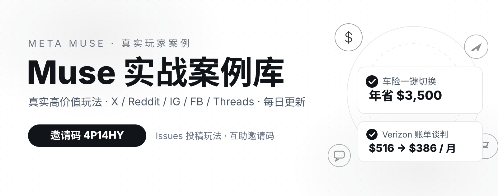

# Muse Use Cases 💡

> A curated collection of real, high-value ways people use **Muse**, Meta's personal AI agent.
> Inclusion rule: **real user shares from X, Reddit, Instagram, Facebook, and Threads** — we prioritize cases with clear results, real numbers, and high replicability.

📊 **324 cases** ｜ 🕐 **Last updated: 2026-11-11** ｜ 🤖 Auto-updated daily at 00:00 (Beijing time) ｜ 🌐 **Live site (Chinese/English): https://jaxxchen003.github.io/muse-use-cases/**

---

## 🎁 My Muse invite code: `4P14HY`

- 📱 **Mobile app**: Muse App → Settings → **Redeem token** (available within 48 hours of joining)
- 💻 **Web**: muse.ai → Settings → General → Usage → **Redeem invite code**
- 📌 Rewards and terms are shown on the invitation screen and may vary by account
- 🤝 Have your own code to share? Drop it in Issues — there's a template for that

---

## 📖 Verification standard

| Badge | Meaning |
|-------|---------|
| ✅ | Original post verified: original post read, person/amount/method all match |
| 🟡 | Share confirmed: author + aggregator archives cross-checked, direct post URL not yet publicly exposed |

> This library only includes real user shares from X, Reddit, Instagram, Facebook, and Threads; web articles/videos are references only, never source *links*.
> Verified 2026-10-11/12. When posts can't be fetched directly, we triple-check via post timestamps (Snowflake IDs for X) + archive dates + multi-source cross-checks.

## Categories

- 💰 [Money saving · bills · claims](#-money-saving--bills--claims) (69)
- ✈️ [Travel](#️-travel) (38)
- 🛒 [Shopping](#-shopping) (35)
- ⚡ [Productivity · automation](#-productivity--automation) (101)
- 🎨 [Content · creation](#-content--creation) (24)
- 🛠️ [Dev · building](#️-dev--building) (20)
- 💼 [Business · consumer rights](#-business--consumer-rights) (37)

---

## 💰 Money saving · bills · claims

**1. One-click car insurance switch, $3,500/yr saved** ✅ — Joseph Devoy ([@JosephDevoy](https://x.com/JosephDevoy), Tempo founder). Uploaded his policy, asked for cheaper identical coverage; in ~5 min Muse found a new plan, bought it and cancelled the old one. [Original post](https://x.com/JosephDevoy/status/2098158828135002245) (2026-09-10).

**2. Xfinity phone haggle, ~$5,118 over 5 years** ✅ — [@raunaqbn](https://x.com/raunaqbn). Had Muse call Xfinity, navigate the phone tree, patch him in live at verification — with a full agent–rep transcript. Locked $85.30/mo. [Original post](https://x.com/raunaqbn/status/2100042003807601124).

**3. Verizon $516 → $386/mo, negotiated overnight** ✅ — [@williamgeronco](https://x.com/williamgeronco). Started a support chat, went to bed; Muse brought the bill down overnight. ~$1,560/yr. [Original post](https://x.com/williamgeronco/status/2099826624849961009).

**4. AT&T broadband $80 → $30/mo + 3 months free + doubled speed** ✅ — [@NoSaberNiPapa](https://x.com/NoSaberNiPapa). [Original post](https://x.com/NoSaberNiPapa/status/2099947510349316129).

**5. AT&T fiber $80 → $40/mo + 3 months free** ✅ — Chandra Bhavanasi ([@chanduiiit](https://x.com/chanduiiit)). Authorized Muse to "accept anything under $70/mo". [Original post](https://x.com/chanduiiit/status/2099527544643207558) (2026-09-14). Caveat: some viral "phone negotiation" cases reportedly involved human agents.

**6. Two households' AT&T bills, ~$1,920 over 24 months** ✅ — [@JasonL_Capital](https://x.com/JasonL_Capital). [Original post](https://x.com/JasonL_Capital/status/2100307407075205279) (2026-09-16).

**7. Car insurance shopped in 15 min, ~$1,156/yr saved** ✅ — [@JasonL_Capital](https://x.com/JasonL_Capital). Uploaded his policy at the gym; Muse shopped identical coverage. [Original post](https://x.com/JasonL_Capital/status/2099991678538879461) (2026-09-15).

**8. Medical bills audited line by line, $4,000+ saved** 🟡 — Holdy (@Ryan_Holdaway). Logged Muse into the medical provider portal, questioned every line, found double billings, requested discounts.

**9. Water heater $1,450 vs $2,300 quote ($850 saved)** 🟡 — PREEM (@PipeBladex). Texted the model number at lunch; Muse compared 3 shops, emailed 2 installers, booked Thursday install.

**10. Croatia–Italy car ferry, $2,200 drop-off fees saved** 🟡 — Erik Lammerding (@Lammerding). Muse found and booked the ferry, pulled plate/model from the rental agreement, confirmed insurance coverage.

**11. Car insurance $500 → $335/mo (~$1,980/yr)** 🟡 — Minh Phan (@MinhInvest). Muse gathered 4 quotes while he grocery-shopped (Tesla → CSAA); switched the same day.

**12. United price-drop tracking, ~$1,026 credit** 🟡 — [@Yairyup](https://x.com/Yairyup). Tracked a booked United flight, chatted with United to secure the credit. [Original post](https://x.com/Yairyup/status/2098136696277627177).

**13. $1,750 unclaimed property recovered for father-in-law** 🟡 — [@moneyeducator](https://x.com/moneyeducator). Searched every lived-in state's unclaimed-property registry; plus ~$120/mo off bills via plan comparison (per catalog entry). [Original post](https://x.com/moneyeducator/status/2098170064721543402) (2026-09-10).

**14. Unclaimed property sweep, $800+ in ~10 min** ✅ — @WaitWhat. One prompt: check every state lived in; Muse filled the claim forms too (~10 min total). [Original post](https://x.com/WaitWhat/status/2098169214091887047) (2026-09-10).

**15. Amazon returns ($239) + dog vet claim ($516)** 🟡 — @armand_ruiz. ~$755 recovered. (He also posted a $2,120.95 cumulative savings list incl. AT&T negotiation $300/yr and IKEA returns.)

**16. PODS move $576 under quote + missing tax K-1s found** 🟡 — @benparr. Booked mom's PODS move under quote; built a 2025 tax-doc tracker.

**17. Email receipt audit found forgotten $100/mo Claude Max** 🟡 — @idobn. Scanned 6 months of receipts; ~$1,200/yr saved.

**18. Car insurance analysis, ~$603/yr saved** 🟡 — @frankilus.

**19. Flight-delay claim by email, $200 back** 🟡 — @tiramisucrux.

**20. WiFi bill haggled down $300 in under 10 min** 🟡 — @nathanael_smith.

**21. Alaska cancellation claim $189.37** 🟡 — @duboibaptiste. Dug the cancelled flight + Lyft receipts out of email, fought a broken upload widget, filed with case number.

**22. Recovered a year of forgotten subscription fees** 🟡 — Chris Abraham ([@chrsabraham](https://x.com/chrsabraham)). Muse scanned bills, found a book subscription his wife forgot to cancel 1+ years ago, cancelled and recovered a full year. [Original post](https://x.com/chrsabraham/status/2099879164895527008) (2026-09-15).

**23. Subscription audit saved $200** 🟡 — Nicolas Bustamante (@nicbstme, Microsoft). (Same thread: socks bought, Whole Foods ordered, cleaner booked, burger fetched in 24h.)

**24. Dodged $1,250 in dealership upsells** — Nick Prince (Coinbase PM). Had Muse review the fee breakdown when buying/buying out a lease. Reported during Meta's #MuseMoneyChallenge.

**25. Phone negotiation, $800+/yr saved** — Peter Yang (YouTuber). Muse called to negotiate cable + phone bills.

**26. Muse named "Fred": subscriptions cancelled + insurance compared, $2,500+/yr** — @landonbtw (IG creator, ~250k followers). 2026-10-08 reel.

**27. $100 Verizon gift card applied to bill** — u/Sleds88 (Reddit r/MuseAgent).

**28. 24h health errands: $80 Oura discount + benefits done right** 🟡 — Khiet Tran (@trannkhiet). Flu shot scheduled, $80 Oura Ring discount found, benefits enrolled without HSA over-contribution.

**76. A week, 8 errands: $1,000 in stalled refunds recovered, $200 in subscriptions cut** ✅ — @ekate.lee (Threads user). Social drafts, photo/video edits via Kling/Higgsfield, inbox triage, LinkedIn DM cleanup, a support chatbot for her product Networkio — plus two long-delayed refunds (posted 2026-10-09).
**85. "A Month with Muse" test: website fixes + 5 car insurance quotes, $1,530/yr saved** 🟡 — @mostly.borrowed.ideas (IG account). A month of real-world testing: had Muse fix his website (added the dark mode + subscribe button he'd wanted for two years — "like hiring a competent dev for $20/mo"); shopped 5 car insurance quotes, saving $1,530/yr, and set it to re-shop every 5 months against "renewal inertia"; also monitors 4 inboxes, sends a daily cricket news digest and tracks GPU prices (2026-10-12 IG long-form video).
**93. NYC parking ticket cleared in one chat: $115 → $145 fine, $147.90 paid via CityPay** 🟡 — Shervin Shaikh (@shervinshares, IG, 45K followers). A 3-month-overdue NYC parking ticket ("No Standing" at a bus stop): Muse looked it up by license plate on the city site — $115 had grown to $145; it went to CityPay, where a 2% card fee brought the total to $147.90, ready to charge via Stripe Link; the first charge failed on billing-address mismatch, and Muse proactively offered PayPal/eCheck alternatives, ending with a CityPay payment screenshot (2026-10-12 IG reel, screen-recorded, marked "not an ad").
**94. Jumped on the "subscription negotiation" trend: ~$700/mo saved, car insurance switch saves ~$2,000/yr** 🟡 — Paul Pruitt (Facebook user). After seeing reels of Muse negotiating subscriptions, he gave Muse account access: it canceled idle subscriptions and fixed overcharges, saving ~$700/month; he also switched car insurance from Progressive to GEICO for the same coverage, saving ~$2,000/year (2026-10-12 FB post).
**115. Subscription audit: 22 cut to 5, monthly fees $149.11 → $58.73, ~$100/mo saved** 🟡 — @karol.ylt (Spanish creator, 2.9K IG followers). Asked Muse to surface every recurring charge, shown on a before/after dashboard (screenshot 2026-10-11); she decided what was worth keeping — the keepers still included Claude Pro ($22.11/mo) and ChatGPT Plus ($20/mo) (2026-10-16 IG reel).
--- [Original post](https://www.threads.com/@ekate.lee/post/DeR4okrm9Lb) (2026-10-09).

**120. Therapist invoices dug out of email → Aetna reimbursement in 20 minutes** ✅ — @natashaghoskins (founder). Muse found every therapist invoice in her email and submitted them to Aetna (https://x.com/natashaghoskins/status/2102821622893961727, 2026-09-23); 20 minutes to cross the deductible, reimbursements for the rest of the year.

**121. A forgotten $200 Verizon gift card, claimed back by Muse** ✅ — @melon_thief. The $200 signup gift card he forgot to claim — Muse dug it out and redeemed it; "paid for itself for the next year or two" (https://x.com/melon_thief/status/2100461407334506919).

**122. One move, all utilities transferred: power, gas + insurance** ✅ — @stevenwhatevr (X, 2026-10-17). Had Muse transfer his Toronto Hydro power, Enbridge gas and insurance accounts for a move; confirmation emails from each arrived ([Original post](https://x.com/stevenwhatevr/status/2111508387452047545)).

**155. Double taxation caught, $1,860 saved** ✅ — @at_url (X, 2026-10-16). Had Muse review his tax documents; it found he was being double-taxed. The $1,860 figure is the author's own claim; document details weren't disclosed ([Original post](https://x.com/at_url/status/2111207662079947113)).

**156. $350 tailor bill reimbursed after a week of follow-ups** ✅ — @saleskhalifa (Khalifa, X, 2026-10-16). His wedding suit needed tailoring but the shop's tailors were out sick, so he paid $350 to rush it elsewhere. He had his Muse ("Goob") ask the original shop for reimbursement and follow up for a week — the money came back ([Original post](https://x.com/saleskhalifa/status/2110888090596261905)).
---

**158. €30 Paris hotel-pickup waiting fee refunded in full** ✅ — @HH002_Dream (Sandman, X, 2026-10-20). Charged a €30 waiting fee on a Paris hotel pickup; Muse reviewed the pickup company's waiting-time policy, drafted the dispute email and took it up with the company directly — the full refund landed back in his account ([Original post](https://x.com/HH002_Dream/status/2112453085163647473)).
**163. Car insurance $260 → $170: only Progressive lets the agent in** ✅ — @MikeCjunior (Mikejnr, X, 2026-10-21). Created a fresh email and handed Muse the "lower my insurance bill" task; several insurers' websites refused agent access and only Progressive let it work — the bill dropped from $260 to $170 a month (author's own claim; flagged as unverified self-report by howtousemuse) ([Original post](https://x.com/MikeCjunior/status/2113032044158894452)).
**164. Muse called the loyalty team and cut $40 off the fiber bill** ✅ — @JamesCordrey2 (James Cordrey, X, 2026-10-22). Muse called the provider's loyalty/retention team directly to negotiate and handled the follow-up emails; first post of a thread, key facts up front ([Original post](https://x.com/JamesCordrey2/status/2113070700252525003)).
**165. Home-insurance cross-channel comparison: Muse emailed agents, self-reported ~$400 saved** ✅ — @TechTradeBlue (X, 2026-10-22). Handed Muse the "shop my home insurance" task; it emailed multiple insurance agents for quotes and pulled quotes from several websites — self-reported savings of about $400 with better coverage (author's own claim; flagged as unverified self-report by howtousemuse) ([Original post](https://x.com/TechTradeBlue/status/2113086665690644806)).

**178. Colonoscopy copay negotiated from $330 to $0** ✅ — Artem Russakovskii (@ArtemR, X, 2026-10-27). After a doctor's office email estimated his colonoscopy copay at $330, he had Muse research and draft a reply; the clinic rechecked with insurance and cut his share to $0 ([Original post](https://x.com/ArtemR/status/2115136935002046559)).

**187. Wrong-language movie tickets caught, refund letter drafted, refund received** ✅ — Greg Uspensky (@GregoryUspensky, X, 2026-10-28). Muse caught unprompted that his movie tickets were in the wrong language, drafted the refund letter, the refund came through and he bought the right tickets ([Original post](https://x.com/GregoryUspensky/status/2115406430408773870)).

**199. Discount code hunted before a subscription renewal: $50 off Monarch** ✅ — Julian Norton (@JulianNorton, X, 2026-11-01). Before renewing his Monarch subscription he had Muse find a working discount code and test it before paying — $50 saved, and he says Muse has already paid for itself ([Original post](https://x.com/JulianNorton/status/2116710782725652562)).

**201. FTC Amazon settlement $12.99 chased all the way to PayPal** ✅ — André (@andr3barroso, X, 2026-10-31). After receiving an FTC Amazon settlement check in September he handed the follow-up to Muse, which kept pushing until the $12.99 landed in his PayPal while he was at work ([Original post](https://x.com/andr3barroso/status/2116530634382340242)).

**204. 401(k) taken over end to end: rebalanced, fees cut, dashboard built** ✅ — cubeqube (@cubeqube, X, 2026-09-22). Handed his 401(k) to Muse: rebalanced it, switched similar funds to lower-fee versions, built a dashboard of all his financial accounts and transactions with budgets and subscription alerts; it also manages his electric and internet bills, tracks HSA expenses and receipts, and hunts tax-loss harvesting opportunities — all within the free plan's limits ([Original post](https://x.com/cubeqube/status/2102187698127569173)).

**209. Resy dinner booked — then came the $200 cancellation fee** ✅ — zopatoli (@zopatoli, X, 2026-10-20). Had Muse book dinner on Resy; plans changed 15 minutes later and he cancelled — only then did it mention the $200 + tax cancellation fee and that it had used his saved card. He says he would never have booked had he known ([Original post](https://x.com/zopatoli/status/2112680170037588101)). Cautionary case: the booking worked, but the fine print surfaced after the fact.

**210. Every manually-activated credit card offer, activated by Muse** ✅ — Pierre (@Pierre5x, X, 2026-10-22). Had Muse go in and activate all the manually-activated discount offers on his credit cards ([Original post](https://x.com/Pierre5x/status/2113279598980898925)).

**211. The rep spotted the AI — so Muse smoothly transferred the call to its owner** ✅ — Adebowale Ojo (@ifeoluwadebo, X, 2026-10-22). Had Muse call his insurance provider for a quote with certain deductible changes; the person on the other end realized they were speaking with an AI agent and asked to speak with the account owner, and Muse transferred the call to him ([Original post](https://x.com/ifeoluwadebo/status/2113311789370712458)).

**212. Unclaimed property $97 recovered — plus data-broker opt-outs and Amex offers activated** ✅ — Aaron Skrivan ([@AaronSkrivan](https://x.com/AaronSkrivan), X, 2026-09-10). Had Muse find unclaimed property and file the paperwork ($97), opt out of major data brokers, and activate all his Amex offers — saving ~200 manual clicks ([Original post](https://x.com/AaronSkrivan/status/2098183632120840423)).
**213. Six months of email receipts turned up a forgotten $100/mo Claude Max sub — $1,200/yr saved** ✅ — [@idobn](https://x.com/idobn) (X, 2026-09-09). Had Muse go through 6 months of email receipts; it found a $100/mo Claude Max subscription on his corporate card that he had forgotten about while the company already had an enterprise license ([Original post](https://x.com/idobn/status/2097570513107272175)).
**214. The hospital bill “on hold” was never on hold — Muse called and proved it** ✅ — Lucus Bendzsa ([@RealLucusB](https://x.com/RealLucusB), X, 2026-10-24). A hospital bill placed on hold for review arrived anyway; his Muse agent called, navigated the IVR, confirmed the account, and confirmed there was no hold ([Original post](https://x.com/RealLucusB/status/2113984571276415053)).
**215. Tesla valet parking refund: first call failed, second call approved in full** ✅ — Kyle G ([@kylemissionai](https://x.com/kylemissionai), X, 2026-10-21). A valet refused his Tesla over a phone key, but he had already paid for parking; Muse's first refund call failed for lack of details, it asked him two questions, called again — full refund approved, no hold music for him ([Original post](https://x.com/kylemissionai/status/2113022477152776628)).
**216. Internet bill went up unannounced — Muse called and talked it down, plus two months' credit back** ✅ — [@CryptoTamilza](https://x.com/CryptoTamilza) (X, 2026-10-20). His internet bill rose without notice; Muse negotiated live with customer care, brought the monthly bill down and got a credit back for the past two months (no amount given in the post) ([Original post](https://x.com/CryptoTamilza/status/2112648082496053496)).
**217. Pharmacy copay beaten: a discount card cheaper than insurance** ✅ — Nan ([@SuperNanTX](https://x.com/SuperNanTX), X, 2026-10-24). Muse compared prescription discount cards and found one cheaper than her insurance copay (no amount given) ([Original post](https://x.com/SuperNanTX/status/2113991981462392963)).

**227. Car insurance shopped and switched: GEICO $2,123 → Progressive $1,536, $1,174/yr saved** ✅ — Mike Nichols ([@MistrDeplorable](https://x.com/MistrDeplorable), X, 2026-10-28). His GEICO renewal came in at $2,123; Muse found a Progressive policy for $1,536 with better coverage, then called GEICO to cancel the old policy — he only joined the call for about a minute to verify his identity. Tagged #MuseMoneyChallenge; 170k+ views ([Original post](https://x.com/MistrDeplorable/status/2115495145437093938)).

**231. 300+ shopping receipts from 6 years of Gmail turned into an accountant-ready collectibles tracker in 30 minutes** ✅ — Austin Evans (via @muse official repost, Threads, 2026-10-31). Had his Muse Lotus search six years of Gmail receipts and build a collectibles tracker in about 30 minutes; the same video also checks F1 US Grand Prix tickets, adds calendar events and delivers a morning tech news briefing. ([Original post](https://www.threads.com/@muse/post/DfKpRPJkZfp)) (2026-10-31).

**232. A $49.99 AppleCare+ charge found in email, refunded in full after a 16-minute call by the assistant** ✅ — MARCIANOTECH (@marcianotech_, Instagram, 2026-11-02). His Muse Baby Muse spotted a $49.99 AppleCare+ charge for an iPad he never activated, then had its assistant Hailey call Apple for 16 minutes to cancel it and refund the full amount to his Amex. ([Original post](https://www.instagram.com/reel/DfQGLrUJ1A0/)) (2026-11-02).

**233. Daily stock alerts with price triggers used for over a month; a car insurance check confirmed his policy was already cheapest** ✅ — Sriram Arumelli (@srirams_chronicles, Instagram, 2026-10-11). Has Muse send daily stock alerts and research ideas with tickers, price triggers, targets and stops; separately had it research cheaper California car insurance from his policy documents, and it concluded his current policy was already competitive. ([Original post](https://www.instagram.com/reel/DeXid7ESXvl/)) (2026-10-11).

**234. About $7,000 in wrong university charges cleared after Muse pulled the records and routed the dispute to the right office** ✅ — u/vainjuggler (Reddit r/MuseAgent, 2026-09-29). Withdrew within the refund deadline but was left with about $7,000 in charges and collections threats after months of unanswered emails; Muse logged into his university account, pulled records showing when he withdrew, found later-semester courses he was never enrolled in, and routed the dispute to the office with authority to fix it. ([Original post](https://www.reddit.com/r/MuseAgent/comments/1wszqn5/meta_muse_just_saved_me_over_7000_in_bs/)) (2026-09-29).

**235. AT&T bill negotiated down $50 a month in about 45 minutes of support chat** ✅ — u/RaiderMike824 (Reddit, 2026-10-03). Had Muse negotiate his AT&T bill; about 45 minutes of support chat with details filled in along the way, and the monthly bill came down $50. ([Original post](https://www.reddit.com/r/MuseAgent/comments/1wwnysh/comment/pdmexe0/)) (2026-10-03).

**236. Muse called SiriusXM, cancelled an unrecognized subscription, declined a $72/year retention offer, $37.65 credit on the way** ✅ — u/Equivalent-Draft9248 (Reddit r/MuseAgent). Muse called SiriusXM, verified the account holder's name and billing ZIP, confirmed an XM radio subscription nobody recognized, declined a $72-a-year retention offer and cancelled it the same day, with a $37.65 credit eligible for refund within three to five business days. ([Original post](https://www.reddit.com/r/MuseAgent/comments/1xoz533/muse_phones_sirius_xm_to_save_me_500/)).

**237. Read the hosting fine print and got a $359.88 refund** ✅ — Greg Hung (Instagram). Had Muse read the hosting renewal terms he had never read, find the refund window and map the whole plan move before he talked to support; $359.88 came back. ([Original post](https://www.instagram.com/reel/DfU5vYSjyaG/)).

**238. Google Workspace cancelled in one chat, ¥13,200 a month saved** ✅ — Katsutoshi Kitamura (Facebook). One chat cancelled the Google Workspace Business Plus subscription for sozo.art before its November 1 billing date. ([Original post](https://www.facebook.com/groups/1905039367540244/permalink/1905662027477978/)).

**239. A 10:44 alert saved his same-day payout deadline after a 9:36 email** ✅ — Reirei (Instagram). An email at 9:36 said his note sales proceeds had to be claimed that very day, a deadline he had completely missed until Muse flagged it at 10:44, then walked him step by step through the payee menu until the claim was done. ([Original post](https://www.instagram.com/p/DfKTyOQExUy/)).

**240. $54 back from subscriptions he forgot he was paying** ✅ — Kailash Sarma (Instagram). Connected his inbox and bank account, found subscriptions he was not using and saved $54 so far, while it also watches restaurant reservation sites for tables and delivers a morning briefing on what mattered overnight. ([Original post](https://www.instagram.com/reel/DfJctTSJqw2/)).

**241. Cancelled his “predatory” pest control contract, only joining the final call** ✅ — flick (Threads). Asked Muse to cancel a pest control contract he calls predatory and near its end; Muse handled most of the cancellation itself, then brought him into the final call with support, where a few personal questions ended the service. ([Original post](https://www.threads.com/@0xflick/post/De8AEPVlsUk)).

**317. "Finch": 38 subscriptions at $2,285.21 a month, 4 canceled in one click** 🟡 — @pjacefilms (Facebook; reposted by @muse on Threads the same day). He connected his Muse agent "Finch" to his bank (Plaid, read-only) and asked it to list every subscription he was paying: 38 items totaling $2,285.21 a month ($27,422.52 a year), including duplicate streaming and accounting subscriptions and long-unused services. He ticked 4 to cancel and approved Finch's cancellation emails; the confirmation screen showed a gym membership, a streaming subscription, a duplicate accounting package and an entertainment package canceled, with refunds requested for unused months, and the goal board updated to "Save money - 4 subscriptions canceled". He says he lost thousands of dollars to forgotten subscriptions over two years. ([Original post](https://www.facebook.com/reel/1471540751575508/)). Subscription totals are from the video's dashboard; refunds are not yet confirmed as received.

## ✈️ Travel

**29. 7-hour delay → $250 Delta credit in 5 min** 🟡 — Ejaaz ([@cryptopunk7213](https://x.com/cryptopunk7213)). Muse filed the complaint, rebooked an alternative flight, replied to support emails. [Original post](https://x.com/cryptopunk7213/status/2102179999122153690) (2026-09-21).

**30. Flight/hotel price-drop tracking with notifications** — 于為暢 (Wei Chang Yu, Taiwan creator). Related: Threads @adambader saved **$600** the same way.

**31. Overnight flight auto check-in** ✅ — @amirnurani. His flight's online check-in opened at 4:15 AM; instead of waking up, he let Muse complete it in the background. [Original post](https://x.com/amirnurani/status/2097966228216172972) (2026-09-10).

**32. REAL ID appointment booking** ✅ — @nanda_rahul. Handed the whole appointment flow to Muse, from finding a slot to completing the booking. [Original post](https://x.com/nanda_rahul/status/2097719629510590788) (2026-09-09).

**33. Passport renewal + Thailand hotel booking, end to end** 🟡 — @JesseCohenInv. ~95% of US passport renewal done online, then couple flights on Amex Travel.

**34. Had Muse wait on hold with Southwest** — Matt Van Horn (entrepreneur). Muse called, waited, called him back when a rep was live.

**35. United baggage claim handled end to end** 🟡 — @maruthid1. Reimbursement within days, zero paperwork — only receipts + baggage ref provided.

**36. Missed flight → rebooked from bed across airlines** — @vicentetengOfficial (Deaf creator). Compared alternatives, flagged free Flex-ticket change, gave the support number.

**37. $3,000 trip booking fully managed** — @vishvanands (Threads).

**38. Sardinia trip: emailed hotel for direct booking, saved €240** — Chelsea Yamase (@chelseakauai, IG travel creator, 1.2M followers).

**86. 104 countries in 12 years: Muse mapped the next 10 years of his life** 🟡 — Jorden Tually (@jordentually, IG travel creator, 520K followers, verified). 104 countries down, 93 to go. Connected Muse to his Instagram to analyze his travel style; it produced a month-by-month, season-aware 10-year itinerary starting 2027 plus an interactive world map (visited vs remaining), projecting he'll finish all 197 by Dec 2036 (2026-10-12 reel, 4.4K likes).

**97. Inbox + calendar wired in, trip planning starts from his real schedule** ✅ — @boztank. With email and calendar connected, trip planning starts from his existing messages and itinerary — Muse assembles the packing list, researches and buys products; the same share has Muse sorting school emails into "needs action" vs "FYI only" so a parent doesn't read them one by one. [Original post](https://x.com/boztank/status/2097401739796459938) (2026-09-08).

**98. IG saves → 4-day Barcelona itinerary, down to which restaurant at what time** 🟡 — Chanelle Howell (@chanellehowell, IG creator, 85K followers, verified). Connected Muse to years of untouched IG saves (Marbella, Mexico City, Miami, Barcelona, Mallorca); one prompt — "build me a 4-day Barcelona + Mallorca itinerary from my saves." Day 1: Gothic Quarter, lunch at Los Caracoles, churros at Masia de Sabor, dinner at Tapeo, plus a paella cooking class; hotels tiered from Seventy Barcelona to Mandarin Oriental (~$850/night), with clickable links, booking info and prices (2026-10-13 IG reel, phone screen recording).

**114. Named her Muse "Monae": NYC event saves → dated itinerary, auto-refreshed daily** 🟡 — Tiffany Aliche (@thebudgetnista, IG verified). Muse digs through her saved NYC event posts daily and keeps a dated "Fall NYC Itinerary" (including free Fridays at the Morgan Library); picked events go into the calendar with daily auto-updates (2026-10-15 IG reel).
**116. Handed Muse his travel-site login: two VIP airport lounge bookings on autopilot — it stopped to ask when unsure** 🟡 — @marcianotech_ (Spanish tech podcaster, 450K IG followers). Stored his beforeboarding.com login in Muse's secure credential vault with one rule: "book whenever you see the fare, don't ask." Used his Banreservas Infinite membership to book two VIP airport lounge visits (Dec-03 departure, Dec-07 arrival, flights AA2265/AA1154). When the departure system stalled, it stopped and asked: "is the departure flight AA2099 or AA2265?" before continuing (2026-10-16 first-person screen recording).
---

**123. 146 flight searches: 11 Spanish cities × 10 Italian cities × 7 dates** ✅ — @mehtadeep (Apple engineer). With a flexible schedule, had Muse run 146 price searches (cash + award) from SFO to 11 cities in Spain and back from 10 Italian cities across 7 dates, to find the cheapest round trip (https://x.com/mehtadeep/status/2099498596789850192).

**124. Early flight: Uber vs airport parking compared, Groupon halved the parking** ✅ — @jaidharo. Told Muse about his morning flight; it compared Uber vs airport parking, bought a Groupon to halve parking, booked it in the browser, then told him when to leave (https://x.com/jaidharo/status/2098430453934174305).

**125. Hotel site 5–10% cheaper than Expedia/Booking + free cancellation, plus a $50 credit** ✅ — @Goyal_Vivek (investor). Muse checked the hotel's own site against Expedia and Booking; direct booking was 5–10% cheaper with free cancellation, and it found a $50 hotel credit (https://x.com/Goyal_Vivek/status/2102824082370928806).

**126. Whole NYC trip booked via Muse, Stripe Link checkout "10/10"** ✅ — @ryanvogel (founder). Booked a New York trip through Muse with the Stripe Link payment step; calls it a great experience and a 10/10 personal agent (https://x.com/ryanvogel/status/2099646623198441683).

**149. Japan trip transport settled in one day: rental car nearly half price** 🟡 — 暢哥 / Agent W (17muse.com webmaster, 2026-10-17 site log). Muse researched and ranked transport options, the human only placed the final orders: rental car at member price ¥59,994 + CDW ¥9,900 + NOC ¥4,950 = ¥74,844 tax-in (he had found ¥107,250 himself); N'EX vs Skyliner picked by fewest transfers; a 10-26 reminder set for return tickets.

**153. Honeymoon booking emails turned into one master itinerary doc** ✅ — @matthew_verni (Matt Verni, X, 2026-10-19). Fed booking confirmation emails to Muse; it extracted every stay and flight, linked each with the original email and reservation number, and generated a single master doc ([Original post](https://x.com/matthew_verni/status/2112120235016716442)).

**174. F1 Austin weekend handed to "Karl": addresses, times, transport and Mercedes priorities in one executable table** 🟡 — Wesley Breed (@wesly, verified IG creator, 330K followers, 2026-10-23). He named his Muse "Karl" (after Karl Benz) and had it plan an entire F1 Austin Grand Prix weekend — addresses, times, transport, plus Mercedes-related events ranked by priority. It returned a schedule he could walk through directly: Mercedes Fan Hub (400 Congress Ave), driving/parking tips and walkable stops in order; his video shows the on-site KIMI's queso e pepe food truck, an AMG GT show car, the Fan Hub with a real race car, simulators and a pit-stop challenge. His point: the agent's value isn't telling you what exists, it's handing you a table you can execute.

**206. Cheapest Jeep near LAX for his wife's 30th, with an Amex offer stacked on top** ✅ — hottakefinance (@hottakefinance, X, 2026-09-18). Mid-flight to LA for his wife's 30th birthday trip, he had Muse find the closest and cheapest Jeep Wrangler to rent the next day; it knew he had an Amex Gold card with a $30-back-on-$150+ Turo offer, then routed through Rakuten for another 2% back ([Original post](https://x.com/hottakefinance/status/2101093352519372983)).

**208. He did the meme: Muse booked his flights, sorted airport pickup, and built an itinerary app** ✅ — Qui Vincit (@vincit_amore, X, 2026-10-23). Did the meme and had Muse book his flights, sort out ground transport from the airport, and build a whole itinerary app for the trip ([Original post](https://x.com/vincit_amore/status/2113776908412596573)).

**218. US passport renewed online (95% done by Muse) plus Amex Travel flights for two** ✅ — Cyrus ([@cy_zanfar](https://x.com/cy_zanfar), X, 2026-09-15). Asked Muse to renew his US passport online — it did 95% of the work, handing off only SSN entry and photo upload — then booked his and his wife's flight tickets end to end on Amex Travel ([Original post](https://x.com/cy_zanfar/status/2099684668391969009)).

**242. Las Vegas trip with a senior dog: checked dog-friendly places and called to book restaurants and hotels** ✅ — Andy Cheng (@firerock31, Threads, 2026-10-29). For a Las Vegas trip with his senior dog, Muse checked which places allow dogs and called restaurants and hotels to book, without him having to step in. ([Original post](https://www.threads.com/@firerock31/post/DfFkM2nGKUH)) (2026-10-29).

**243. 106 saved Instagram restaurants turned into a filterable personal map in 5 minutes** ✅ — Mitchell Saron (@mitchellsaron, Instagram, 2026-11-03). Handed Muse the 106 restaurants saved in his Instagram collection and got a personal map in 5 minutes: sorted by cuisine and vibe, 37 marked Clean and 69 Absolute slop, each pin showing address, distance and the matching food Reel, with booking apps linked for tables. ([Original post](https://www.instagram.com/reel/DfRM5WVvomV/)) (2026-11-03).

**244. 31 saved New York restaurant posts became a map; one voice question returned three ~$30 dinner picks** ✅ — Matt Bitter (@bitterbuilds, Instagram, 2026-11-05). Had his Muse Champ turn 31 saved New York restaurant posts into an interactive Manhattan map with addresses, photos and notes, then asked by voice for a Saturday dinner for two in the East Village around $30 with a relaxed vibe; Champ suggested three places, led with Lil' Frankie's, and started booking. ([Original post](https://www.instagram.com/reel/DfXyEXqJtX3/)) (2026-11-05).

**245. A full Chinese itinerary remade in Japanese for the host family, dates, cities and lodging only** ✅ — Wendell Yu (Facebook group, 2026-11-03). Kept his full 11-day Chinese trip plan with flights, rental car and costs for himself, and had Muse make a separate version entirely in Japanese for the Japanese family looking after his daughter Mia: a short thank-you letter up front, two key points (picking up Mia on Nov 7, dinner together on Nov 15), and a table with only dates, cities and lodging. ([Original post](https://www.facebook.com/groups/1412054144392596/permalink/1448423130755697/)) (2026-11-03).

**246. Sold-out restaurant table grabbed by checking OpenTable every 10 minutes** ✅ — u/FloppyDX (Reddit r/MetaAI, 2026-09-17). Set Muse to check for a restaurant cancellation every 10 minutes using the OpenTable connector; when a slot opened for the next day it booked a table for three right away, and the confirmation showed up in his OpenTable account. ([Original post](https://www.reddit.com/r/MetaAI/comments/1wj7ejv/muse_successfully_scanned_for_restaurant/)) (2026-09-17).

**247. He gave Muse his credit card, and it booked a whole month of flights and hotels** ✅ — Austin Armstrong (Instagram). Handed Muse his credit card, and its assistant Dahlia booked his whole month of travel, including a Delta First Class nonstop from RDU to Austin on November 8 for $338.41, another Delta leg to Orlando, and all his hotels. ([Original post](https://www.instagram.com/reel/DfQvZCCOtaI/)).

**248. Four free Huntington tickets booked on the first try after she kept forgetting to apply** ✅ — Storus Marketing (Threads). She knew she could apply for a free ticket on the last Thursday of every month but kept forgetting and missing it; she left it to Muse and it booked on the first try. ([Original post](https://www.threads.com/@storusmarketing/post/DfFgTCkmsB_)).

**249. A boat ride at Takachiho Gorge, watched and booked for her guests** ✅ — YUMIKO (Threads). With Muse keeping watch, she was able to book a Takachiho Gorge boat ride for her guests. ([Original post](https://www.threads.com/@yumiko.fully/post/DfFCDGyH7D1)).

**250. Five months of daily checks failed; Muse's alert landed her Grand Wailea free night in two weeks** ✅ — Lazy Sunday Morning (Threads). After five months of manually checking daily for a standard room, she set Muse alerts, and within two weeks a standard room opened up, letting her secure the full four-night stay at Grand Wailea on her free-night voucher. ([Original post](https://www.threads.com/@hello.outlander/post/DfDuLD5DPZ9)).

**251. December dinner booked, plus concert merch, movie times and parking sorted** ✅ — Teri Watkins (Facebook). Muse booked her December dinner, and in the same post also found concert T-shirts, looked up movie times, reminded her to buy shoes and worked out parking options. ([Original post](https://www.facebook.com/johanna.watkins.3/posts/pfbid02RTBuJZdzwGLNtJrD5UnBF5XbdShXe6cYi9dmkVzSATsH9ZRNNWpKv3T7q9Cpc2Ftl)).

**252. In Japan, Muse booked the stay itself, payment and calendar included** ✅ — 森田松之助 (Threads). A Japanese vacation-rental operator tested Muse on a real stay booking: it completed the reservation on its own, including payment and calendar registration, with no human intervention. ([Original post](https://www.threads.com/@matsunosuke3/post/De6kGUkEzDO)).

**253. She calls her Muse “Holly”: it plans her trips and runs her business** ✅ — Heather Bayer (Facebook). For the last few weeks she has used her Muse Holly: it planned her entire Berlin and Barcelona trip — flights, hotels, a packing list based on the actual weather, and check-in reminders — while also keeping her calendar organized and drafting inbox replies for her approval. ([Original post](https://www.facebook.com/heather.bayer/posts/pfbid0PYt8vGaadz6VSEx5c61DGfBjgFYmh8yM3CxKcqCnS4Wn56pZyypR69A2jcU4sE5Ql)).

**318. "Madam Muse" watched a flight drop from $950 to $350 a person, saving about $915 on two tickets** 🟡 — Krupa (@krupaandbooks, Instagram). The digital-publishing founder handed her business to her Muse, "Madam Muse": it built her company portfolio site (KR Media Global), posted to social media with approval, made slide decks, checked email every 4 hours and managed her calendar. The most concrete job was flights: Montreal to Boston started at about $950 a person, and Muse pinged her twice as the price fell — first to about $700, then to about $350 a person for a January trip — saving about $915 across two tickets. ([Original post](https://www.instagram.com/reel/DfeEHdexkmE/)). Fares and savings are self-reported by the author and not independently verified.

## 🛒 Shopping

**39. Photo → Marketplace listing (pricing + copy in one shot)** — 于為暢 (Wei Chang Yu).

**40. Marketplace price negotiation** ✅ — @signulll. Found the item, negotiated, arranged pickup. [Original post](https://x.com/signulll/status/2097416338147049795) (2026-09-08).

**41. Whiteboard photo → Sam's Club grocery order** ✅ — @dylan_heagy. Photographed a messy fridge whiteboard list; Muse read it and ordered everything at Sam's Club. [Original post](https://x.com/dylan_heagy/status/2097721746094698775) (2026-09-09).

**42. Lowballed ~50 sellers, $2,500 for a brand-new M5 Pro MacBook** 🟡 — @jingusucks. 48GB/2TB MacBook Pro for $2,500.

**43. 5 listings drafted in 1 minute** — @fadziefa (creator). One product photo → pricing + 5 listings; buyer-mode demo found used road bikes in seconds.

**44. Amazon / IKEA returns handled** ✅ — @armand_ruiz. IKEA return handled end to end — customer service, pickup scheduling; the collector arrived at his door and he'd genuinely forgotten he'd even asked (https://x.com/armand_ruiz/status/2099600973694197878, 2026-09-14). The same author also posted an Amazon $239 return + $516 dog-vet insurance claim (see #15).

**45. eBay deal-hunting turned into auto-digests** — vintage electronics collector. From 30 min/night manual browsing to twice-daily filtered deal lists.

**46. Running-shoe price comparison + drop sentinel** — @krudd.jr (IG athlete). Lowest price across the web, then daily drop checks.

**77. Marketplace selling with a "safety checklist": home address stays out of listings** — Ryan Reyes (Facebook). Photo→price→listing automation with saved prefs: no home address in listings, cash/Venmo only, meetups fixed at one Publix entrance (2026-10-11 reel, Messenger transcript).
**95. "Koda"'s 3 hidden tricks: $130 Marketplace haggle, ID'ing a 3D printer from saved reels, IG account audit** 🟡 — Practicaly AI (Facebook account, 120K followers). "3 things you didn't know Muse could do": ① plugged Muse into Messenger as a haggler, negotiated a Tour AD MT-6 golf shaft on Marketplace down to a $130 in-person deal; ② identified a 3D printer model (CA$999) from saved reels and ran a spec comparison; ③ mined saved posts to track products and audited an IG account (2026-10-12 reel, screen-recorded).

**108. Haggled with On support "daily" until the 40% code came back — three orders placed** 🟡 — Eric Siu (@ericosiu, IG creator, 120K followers, verified). A 40% discount code ($198 off) order got cancelled and the merchant would only honor 20%; Muse took over daily customer-service negotiations, name-dropping his follower count — recovered the original 40% code and dug up two extra 20% codes ($98 off, $44 off), placed across three orders (2026-10-15 reel). Three orders saved ~$340 total — "agentic shopping 101."
---

**127. Garage freezer: spec-matched price hunt, order, delivery tracking, warranty filed** ✅ — @v01dp1r4t3. Muse shopped for a garage freezer to his required specs, got the best price, ordered it, tracked delivery, then filled out and submitted the warranty registration while he watched each step (https://x.com/v01dp1r4t3/status/2099210555303076147).

**128. Cake from a Seoul indie IG shop: no Korean, Kakao payment wrestled through** ✅ — @Slokh. Bought his wife a cake from an independent Instagram shop she likes; he doesn't speak Korean well, and paying as a foreigner was the hard part — Muse shuttled between him and Kakao until an acceptable payment went through (https://x.com/Slokh/status/2101358968983769500).

**129. "AGI moment": wife didn't trust the agent with cake — both picked the same one** ✅ — @BryceDelRio. His wife wanted chocolate cake but didn't trust the agent to choose; she picked one herself while his Muse hunted for the best — they chose the same cake, and Muse ordered it (https://x.com/BryceDelRio/status/2099321124400029837).

**130. Marketplace selling gone wrong: the address-leak incident, first-hand** ✅ — @MattRobbt. Let Muse run a Facebook Marketplace sale; chose "Allow Always" at the first permission prompt expecting it to still ask before accepting offers — it didn't. He has since gone through the logs with the Muse team (the incident behind case #77's "safety checklist") (https://x.com/MattRobbt/status/2104798102037074212).

**131. Fridge filters nearly ordered at $150 — his own search found $20** ✅ — @sagupta_nyc (Recharm co-founder, X, 2026-10-17). Muse was about to place a $150 order for two fridge air filters; his own search found equivalents for $20 and he stopped it — about $130 not overspent. A rare "caught the agent overpaying" sample ([Original post](https://x.com/sagupta_nyc/status/2111470786275897493)).

**144. One voice command while driving: Tesla Y dashcam researched, compared and ordered** 🟡 — Tracy Niu (@tracyniurealestategroup, IG realtor, 10-16 reel). Voiced the need while driving; Muse independently searched the web, compared dashcam models/features/prices and explained the differences; at checkout she only gave her name and address while Muse walked through payment by voice up to the verification step.

**148. A drama screenshot becomes the exact vest: Oguri Shun's Fair Isle, priced across countries** 🟡 — 暢哥 / Agent W (17muse.com webmaster, 2026-10-18 site log). Screenshot from Netflix → cropped out distractions → reverse image + Google Lens locked onto the Polo Ralph Lauren Fair Isle vest → checked stock by country (Japan sold out, Canada short) → Farfetch Canada had it at CA$1,893, plus Japan alternatives (BRITISH MADE ¥14,300, Rakuten Nordic style ¥6,808).

**151. "Charlie" as a DIY maker's procurement agent: OLED screen + ESP32 + LiPo battery sourced and ordered** 🟡 — A DIY creator (Facebook, 10-18 reel). Building a pink bag charm with a built-in time/weather display, she renamed her Muse "Charlie" and had it source a small OLED screen, ESP32 dev board and LiPo battery, compare options and place orders — while she handled breadboard prototyping, soldering and iterating the 3D-printed case. The charm was assembled successfully.

**152. Climbing shoes from an Italian site: $50 saved after shipping + import tax, delivered in 6 days** ✅ — @andriybuday (Andriy Buday, X, 2026-10-19). Only told Muse what he needed; it found an Italian discount site on its own, did the math on shipping + US import tax and still beat every US retail price. He never saw the site or typed his details — confirmed once after full research; shoes arrived in 6 days ([Original post](https://x.com/andriybuday/status/2112001194847879438)).
**161. Housewarming wine cross-store comparison: $60/bottle vs $99 local, ~$330 saved** ✅ — @VikShetty (Vik Shetty, X, 2026-10-21). One handoff completed three jobs — housewarming wine (Veuve) cross-store price comparison, talking him out of a bad investment, and building a full quote-comparison page from competing vendors ([Original post](https://x.com/VikShetty/status/2113013978632958162)).
**162. KSU/KU game-ticket price watchdog: $892 → $500, $392 saved** ✅ — @BradyHannaKC (Brady Hanna, X, 2026-10-21). Asked Muse to monitor ticket prices daily and scan Facebook ticket groups hourly; a week before the game it found 4 lower-level tickets for $500 and he bought them on the spot ([Original post](https://x.com/BradyHannaKC/status/2112961536168005898)).

**167. AI let loose on a luxury resale site: $5,844 of Yohji Yamamoto "cart-squatted" piece by piece** 🟡 — Mia Sato (@miasato.2, verified IG creator, 2026-10-22). Her "social experiment": send Muse to The RealReal's Women's Yohji Yamamoto section daily and add the 10 newest listings to the cart. The site's rule — an item in the bag is locked for 20 minutes — meant Muse was effectively holding stock away from other buyers; at peak 9 items totalling $5,844.50, then released and re-grabbed each round. Her verdict: "watching AI compete with real people feels genius and demonic at once"; The Verge reported the same week that retailers are getting wary of shopping agents.

**179. Sold-out iPhone Duo caught in a 5-minute restock window** ✅ — Aman (@amanobviously, X, 2026-10-27). He had Muse check 5 Apple Canada stores in BC every 5 minutes for the exact model, color and storage; a WhatsApp alert arrived when one store restocked, and he booked and picked it up at Pacific Centre himself, with Muse explicitly not buying on his behalf ([Original post](https://x.com/amanobviously/status/2115177112240033825)).

**180. An unprompted grocery coupon saved $32.17** ✅ — Bruno Munhoz (@brunomunhozCRO, X, 2026-10-27). Without being asked, Muse found a coupon and applied it to his grocery shop, saving $32.17 ([Original post](https://x.com/brunomunhozCRO/status/2114918626264580141)).

**185. Tire order handled start to finish, $223 under the local quote** ✅ — Chris (@ChrisTwiggsPM, X, 2026-10-29). He handed the tire order to Muse end to end, from ordering to shipping and installation, $223 under the local quote ([Original post](https://x.com/ChrisTwiggsPM/status/2115804460668665952)).

**192. First Marketplace sale: negotiation, pickup scheduling, progress updates** ✅ — Larry Welnowski Jr. (@plasticboss, X, 2026-10-28). Muse helped him sell his first item on Facebook Marketplace: negotiating with the buyer, arranging pickup time and reporting progress ([Original post](https://x.com/plasticboss/status/2115486337373507869)). The post names no item or sale price.

**193. Agent Sparky runs Marketplace, two more Ruggable items sold** ✅ — Shams Muhammad (@ShamsETubriz, X, 2026-10-29). His Muse agent Sparky ran his Facebook Marketplace selling while he focused on TikTok live selling, and two more Ruggable items sold with almost no effort from him ([Original post](https://x.com/ShamsETubriz/status/2115890606304035194)). The post names no sale price.

**197. Print shops called in parallel: poster quoted at $115 with tax, pickup time set** ✅ — Nijansh (@nijansh, X, 2026-10-31). Needing a large conference poster printed and getting no reply to emailed quotes, he had Muse call three Sunnyvale print shops: FedEx Office got stuck in a phone menu, a second shop's call transcript showed an abusive interruption, and Oakmead Printing confirmed the specs, quoted $115 including tax and set pickup timing ([Original post](https://x.com/nijansh/status/2116566709016662287)).

**198. Grocery app coupons clipped so he never opens the app** ✅ — S D Winkler (@sdwinkler, X, 2026-10-31). Before his grocery run he had Muse open his grocery store account and clip every digital coupon matching his usual buys, so he gets the best prices without opening the app himself ([Original post](https://x.com/sdwinkler/status/2116559019376865508)).

**205. 1966 beach badge authenticated via eBay and an 800-person Facebook collector group** ✅ — Jared Kubin (@JaredKubin, X, 2026-09-12). Found a vintage 1966 beach badge on eBay; Muse verified the listing was legit, dug through an 800-person Facebook collector group for older examples to compare, and made him a printable 5U soccer practice plan — all before his kids' breakfast ([Original post](https://x.com/JaredKubin/status/2098736865780060177)).

**219. Son's old tires and rims sold on Marketplace: $470 in 13 days, Substack marketing down 7 hrs/week** — Vincent Kurtis (Substack essay, 2026-10-08). Asked Muse to sell his son's tires from a photo — it drafted the ad and handled buyer replies; tires sold for $250, rims for $220. Muse also took over his Substack marketing (21 Notes, 7 TikToks, 7 Pinterest pins, 7 YouTube Shorts a week), saving about 7 hours a week.

**254. Muse talked a store into taking back his shirt past the return window** ✅ — Joshua McNichols (KUOW journalist, Instagram, 2026-11-06). Gave Muse access to his email and asked it to negotiate a late return of a shirt with a store, past the eligibility window, and the seller agreed to take it back. ([Original post](https://www.instagram.com/reel/DfYl_xSjOxn/)) (2026-11-06).

**255. Amazon blocked his agent, so Muse bought his chocolate on Rakuten without him opening the site** ✅ — Koyama Daisuke (Facebook). Amazon blocked his AI agent, so he tried Rakuten instead, and Muse went from research to checkout without him opening the site once, picking five chocolates including his usual 72% cacao bar. ([Original post](https://www.facebook.com/100049285164736/posts/pfbid02CZDEX8wHQhzPjYgrrwF8WSCE4NUkJRUi98azXma71PsXQQi6uTZUGkbXsv1Ua6o4l/)).

**319. The cheapest iPhone 17 had hidden defects — Muse flagged them, then reported three in-stock options the next morning** 🟡 — contentkaki (IvanEe, Instagram, Singapore). He asked Muse to find the cheapest iPhone 17 on Carousell from a reputable seller; it returned a S$800 Sage 256GB but read the listing and flagged the defects — a loose camera button that won't press and distorted 0.5x zoom. The next morning Muse messaged him unprompted: all three candidates were still in stock, and it recommended the most reliable one over the cheapest. The same video also shows Gmail connected, with Muse listing monthly software subscriptions and booking a Hyperframes chat. ([Original post](https://www.instagram.com/reel/DfhTt9TkzLf/)). A screen-recorded demo; no purchase is claimed.

## ⚡ Productivity · automation

**47. Inbox zero: unsubscribes / resubscribes / daily digest** — 于為暢 (Wei Chang Yu).

**48. Voice memo "note this down" auto-archived** — 于為暢 (Wei Chang Yu).

**49. One-sentence Kanban board generation** — 于為暢 (Wei Chang Yu).

**50. Goal setting with agent accountability** — 于為暢 (Wei Chang Yu).

**51. 90 data-broker opt-outs** 🟡 — Andru Edwards (@AndruEdwards, tech creator). No need for a removal service.

**52. DIY Incogni, replaced a paid subscription** ✅ — Cuth ([@ItsCuthulhu](https://x.com/ItsCuthulhu)). Emailed every data broker found; used ~2% of the free weekly quota. [Original post](https://x.com/ItsCuthulhu/status/2098443112527839287) (2026-09-11).

**53. 7-day, 10-task stress test** — via 17muse case feed: 5 succeeded / 2 errored / 2 stuck / 1 abandoned — a rare honest failure report.

**54. Tax docs gathered, ~90% in one prompt** 🟡 — Bill D'Alessandro (@BillDA). Compared last year's return, pulled missing docs from email/portals into Drive for his accountant.

**55. "Bingbong" monthly report** — @daily.gansik (Threads, Korean creator). 80GB Google Photos organized, ~70 Gmail promos unsubscribed, 3 paid subs cancelled. "Not things I couldn't do — things I kept putting off."

**56. 1M Google Drive files audited in 5 minutes** — Mickey Shiloh (@mickeyshiloh, IG singer/entrepreneur).

**57. Amtrak complaint, $100 credit back** — @badmikeyt (Threads). "A 20-second prompt."

**58. $1,800/mo of outsourced admin taken over by Muse** — Kiara Randolph (@urmannequin, Threads, small-business owner).

**78. YouTuber's assistant "Q": 26 use cases live** — a YouTuber (video marked unsponsored). Monthly financials via Plaid read-only: hours → 15 min; Sentry errors get fix drafts before he notices; business emails auto-drafted in his voice; wallet Xpub watched on-chain every 30 min (video ~2026-10-09).

**79. Son aces astronomy vocab quiz + school emails auto-digested** — Franco Lopez (Miami, father of four). Personalized flashcards + quiz + 7-min commute podcast; ~30 school emails/day digested into the family Slack; cancelled Grok, Claude and ChatGPT after two weeks (2026-10-11, Business Insider first-person, report card verified).

**80. "80% of my AI time is in Muse": 8 live scenarios** — a Facebook user (screen-recorded reel, 2026-10-11). Insurance quote calls, government PDF forms, projector comparison with tracking, Marketplace listings from two photos, Messenger auto-replies (incl. Spanish), vibe-coding pushed to GitHub, transparent GIFs, daily triage.

**81. European winter speaking tour, fully outsourced** — @melgreeneconsulting (Mel Greene consultancy, 21k followers). A spreadsheet tracking thousands of conferences (venue/deadline/materials) + a PDF portfolio of custom talk titles and abstracts, with ongoing opportunity alerts (2026-10-11 IG reel).

**82. 6,076 saved posts gathering dust → 600 kept, filed into 8 folders** — Dana Malstaff (creator). Muse screened everything keep-vs-toss, then sorted survivors into 8 themed folders; next: a month of content planned from the folders (2026-10-10 FB reel, before/after pics).

**83. 43,000 promo emails deleted in one go** — Suburban Cyber Technologies (Facebook). A 76k-unread backlog essentially cleared during the free trial (2026-10-11).
**90. The "never-sleeping" assistant: morning AI brief + ad watchdog + unanswered-client nudges** 🟡 — Eva (@evia.ai_systems, creator). Wakes up to AI feature updates + reel performance summaries; feeds winning reels to Muse to break down hooks/structure/CTA into new scripts; Muse watches ads and data in the background, flagging underperforming campaigns, and proactively pushes unanswered client messages, calendar reminders and best posting times (2026-10-12 IG carousel).

**91. Saved posts → itinerary, Drive → file cabinet, daily AI news podcast** 🟡 — Simran (@simrankeyz, creator, IG 130K followers, verified). Muse reads her IG saves for info, organizes her Google Drive, plans trips (destinations, food, itinerary — approval required before payment) and generates a daily AI news podcast (2026-10-12 IG reel, screen recording).

**92. 18 user testimonials in one carousel: found money, phone bills, Champions League tickets** 🟡 — @soheil.shivafar1 (IG, 640K followers). A 19-slide carousel collecting 18 user testimonials — found forgotten money, Sony headphone price alerts, living-room design on a budget, traffic alerts, job applications, phone bill reductions, inbox zero, Marketplace furniture finds, Italy trip planning, damaged-order returns, Champions League tickets, 200+ saved posts sorted, Tehran–Dubai flight tracking (2026-10-11; individual testimonials unattributed, included as a collection).
**96. Assistant "Nova": photographed his whole wardrobe + checked his calendar to style a dinner outfit** 🟡 — @muse (Threads user, verified, 18K followers). He fed Muse photos of everything in his closet and named the assistant "Nova"; when asked what to wear to dinner, Nova picked a black henley + dark wide-leg trousers from what he actually owns, checked his calendar, saw the reservation was outdoors and added a black long sleeve, chose loafers over sneakers, and finished with a silver watch and bracelet (2026-10-12 post).

**99. DMV appointment + vehicle registration renewal + inbox to-dos turned into calendar events** ✅ — @moonShot_6. Dealing with the CA DMV: Muse booked the appointment and handled the vehicle registration renewal; then scanned his inbox, pulled out the unfinished items and turned them into calendar events. [Original post](https://x.com/moonShot_6/status/2098279406045384724) (2026-09-11).

**100. One overnight inbox sweep: dozens of promo emails unsubscribed one by one** ✅ — @negligible_cap. Let Muse patrol his entire inbox overnight and unsubscribe promo emails one by one; dozens gone in a night, using only ~10% of the free quota. [Original post](https://x.com/negligible_cap/status/2098030155839000856) (2026-09-10).

**101. Handed his entire Asana workspace to Muse — from a treadmill, for 87 minutes** 🟡 — David Schloss (Facebook). Walked on a treadmill for 87 minutes while Muse ran his whole Asana workspace: projects organized, content ideas generated, stale clients and dead leads cleared from rotation, an onboarding template rebuilt. His description: "a 24/7 executive assistant clearing your busywork" (2026-10-14 FB post).

**102. 500 saves cleared in 10 minutes: a 444-entry "Tips Database"** 🟡 — Tami McVay (@tami.mcvay, IG creator, "AI employee" builder). Years of ~500 saves (gift ideas, tips, webinars) she'd never revisited; Muse built collections plus a "Tips Database" (444 entries) in ~10 minutes and flagged expired workshops. She notes Muse's native FB/IG access beats third-party scrapers like Apify — "it can enter groups and read analytics" (2026-10-14 IG reel, screen recording).

**103. Hidden setting AGENTS.md: 10 iron rules hard-coded for Muse** 🟡 — @ai_empowerment_now (IG creator). In the Muse app: three-dot menu → System Files → AGENTS.md — Muse's "employee handbook," read before every response. Hard-code rules like "save emails as drafts, never send" and "confirm before important actions"; she recommends 10–12 rules, under 500 words total ("too many words drag performance") (2026-10-14 IG reel, screen demo).

**104. Nephew's college football recruiting: Hudl highlights fed in, coaches researched, personalized emails auto-written** 🟡 — @africans_in_tech (IG account, 34K followers). Used Muse for his nephew's college football recruiting: fed in Hudl highlight reels, Muse researched target schools and coaches and auto-wrote personalized outreach emails; his advice: don't fully automate until the flow is proven — verify manually for a few rounds first (2026-10-14 IG reel).

**109. Reimbursement season AI accountant: $1,755.60 across 17 receipt lines** 🟡 — Shawn Kanungo (speaker, 44K followers). Gave Muse email + computer access; it hunted invoices across inboxes and matched them against highlighted spreadsheet rows — 17 lines totaling $1,755.60: 9 matched, 1 "likely," 7 not found (2026-10-15 FB post). Hours-to-days of manual work, done in minutes.
**117. A skeptic's honest test: Gmail only — proactive parcel/flight alerts, unasked Shinjuku sushi rec in Tokyo** 🟡 — @mustansar_mushraf (710 IG followers). Connected only Gmail, having started skeptical of Muse's calling/concierge claims. Days later: parcels and flights were proactively flagged; on a Tokyo trip, a Shinjuku sushi restaurant recommendation arrived unasked — "say it once and it remembers." Criticisms were honest too: slower replies, ~3-minute voice-message limit (2026-10-16 IG reel).
---

**132. 83 missing K-1s: email archaeology, forwards to the accountant, senders chased** ✅ — @justinmateen. Was missing 83 K-1s a few hours earlier; Muse searched his email to find which were genuinely missing, forwarded the ones sitting unread to his accountant, then tracked down whoever sent each remaining one (https://x.com/justinmateen/status/2097551829706117137).

**133. Shopify engineering lead's agent roster: Muse reads every parents' WhatsApp group daily** ✅ — @fnthawar (Shopify head of engineering). Three agents with standing crons; Muse's job: a daily read of all parents' WhatsApp groups for the kids' schools plus all email, sent as a daily summary and forwarded to his wife (https://x.com/fnthawar/status/2101684383396589932).

**134. A daily Muse feed briefing: X timeline, deploy status, meetings, news** ✅ — @AlexKlarfeld (founder). Hooked up everything he uses; the Muse feed now gives him a daily report of his X timeline, feature deployment status, meetings and news (https://x.com/AlexKlarfeld/status/2100949455008895484).

**135. Father of six: 4 kids, 4 sports, 4 apps — Muse sends the family's daily schedule** ✅ — @toallmychildren. Four kids in four sports across four messaging apps; Muse monitors the schedules and sends a daily push notification laying out everyone's day — "not tech savvy at all, super easy to set up and free" (https://x.com/toallmychildren/status/2098233322858049788).

**136. Severe illness, no energy for admin — Muse drafted and sent 3 complex medical emails** ✅ — @MartinMoltke. Living with a severe acquired mitochondrial disease that leaves him without energy; Muse drafted and sent three detailed emails about a complex medical matter he couldn't assemble himself (https://x.com/MartinMoltke/status/2099798458622177706).

**137. "Chief of staff" mode: inbox triage, kids' job leads, tennis-ticket watch** ✅ — @avasi01. Uses Muse as a chief of staff: daily inbox triage surfacing what matters, watching for job-opportunity messages for his kids, tracking tennis ticket on-sale times, and finding forgotten subscriptions (https://x.com/avasi01/status/2098466243674026316; surfaced via 17muse on 2026-10-16).

**147. Resumes sent automatically at 9am daily: job hunting while asleep** 🟡 — Vani (@pages_by_vani, IG, 10-16 "Job portals" episode 3). Uploaded her resume to Muse as a daily 9am scheduled task: it opens Robert Half/Kforce/Insight Global job boards, filters postings by criteria and applies automatically.

**150. Blind creator's fully managed Muse: 15,000 emails + calendar + video editing** ✅ — Kevin Moore (@kev_the_blind_pirate, IG creator, 10-18 reel). Named his Muse "Super Intelligent SI" and has used it for over a month: it cleared 15,000+ emails from his inbox, manages his calendar and reminders, and helps edit videos, make thumbnails, and write titles and descriptions — calls it an "indispensable support" for his digital life. [Original post](https://www.instagram.com/reel/Dep34EvJeJd/).

**157. Recovered a song name after IG/Spotify removed the track** ✅ — @AlfonAmayuelas (Alfonso Amayuelas, X, 2026-10-15). A song attached to an old video was removed from Instagram and Spotify and he'd forgotten its name; Muse found it — screenshot attached ([Original post](https://x.com/AlfonAmayuelas/status/2110530394055647375)).

**160. Hourly news-digest artifact scanning HN, Techmeme and high-signal X accounts** ✅ — @_simonsmith (Simon Smith, X, 2026-10-20). Found Muse's built-in feed too sparse (about one item every two hours); had Muse build a custom news artifact that scans Hacker News, Techmeme and high-signal X accounts every hour, filters against inclusion criteria, alerts on urgent items and stores everything searchable — "so far, it works really well" ([Original post](https://x.com/_simonsmith/status/2112668788445335993)).

**166. 6 hours waiting for his kid, 80 hours of admin cleared** 🟡 — Daniel Tekle (Facebook user, 2026-10-23). While waiting for his son Isaiah's band event to end at the Circleville Pumpkin Show, he handed Muse a pile of personal admin: 7 financial accounts merged into one net-worth sheet; a Sedona spring-break hotel booked on points plus a free-cancellation SUV rental with a price-drop alert; dog boarding arranged; the front door locked remotely and a weather-based thermostat rule set; 8,000 contacts cleaned (titles updated, duplicates merged, junk removed, photos added); 11 dead Facebook groups left; plus a subscription audit — work he estimates would have taken 80 hours by hand.

**168. New-city social fixer: "Alfred" finds LA events and runs the housewarming RSVP list** 🟡 — Nathan Cumberbatch (@sxintnate, IG, 140K followers, 2026-10-23). After moving to Los Angeles he renamed his Muse "Alfred" and had it search Threads and Instagram for events matching his interests (jazz, chess clubs, wine tasting, vinyl, film events, live sports), returned sorted by category with dates and venues; then had Alfred plan a housewarming party to meet people — theme ideas (vinyl night, chess cocktails, wine-and-jazz night), invitation copy and an on-screen "RSVP Tracker". His take: "the best way to build connections is to initiate; let AI handle finding events and logistics" (a different "Alfred" from #141's investment assistant).

**169. "Mom brain" outsourced: triple school-email reminders so class photo day is never missed** 🟡 — Sara Goldberg (Facebook user, 2026-10-22). She set Muse to watch school emails with a fixed preference: a nudge at 18:30 and 20:30 the night before plus one at 07:00 on the day, plus an all-day calendar event. It caught her daughter Hannah's Grade 1 class photo day (2026-10-20) with three reminders and an email summary, and in the same pass flagged that day's Parc du Mont-Royal field trip with departure time and clothing advice. Her verdict, verbatim: this is built for forgetful parents.

**170. "Scout" lists 7 professors + 7 tailored cold emails in minutes; research position confirmed 3 weeks later** 🟡 — Palden Bhutia (@engineeringwithpalden, IG, 230K followers, 2026-10-22). Instead of manually hunting professors as he did for his first research role, he had Muse "Scout" find AI-hardware/semiconductor research openings, shortlist matching professors and draft a personalized outreach email per professor with résumé and transcript attached — 7 professors and 7 drafts back in minutes. At 07:00 the next morning, driving, he got a professor's reply inviting him to meet in person; three weeks later his next-semester research position was confirmed, along with clarity on "what to learn next" (the video's "comment MUSE for my prompt" hook is a lead-gen device).

**171. A "$2,000/mo content researcher" replacement: profile audit + competitor topics + DM watch + 8am insight brief** 🟡 — Steven Mellor (@thestevenmellor, IG, 180K followers, 2026-10-22). His demoed creator workflow: a profile audit to find what's growing and where the gaps are; competitor research for the best-performing topics and outliers; DM monitoring so important conversations never slip; and an automatic daily insight report pushed at 08:00. He claims the flow saves 10–20 hours a week (the "$2,000/mo researcher" headline is hype copy; the "comment MUSE for the guide" hook is lead-gen).

**173. Read all 2,240 of his Facebook posts, counted 16 Japan trips — 7 links miscopied, fixed by generating them programmatically** 🟡 — Wendell (17muse.com webmaster, in-site field test, 2026-10-22). To answer how many Japan trips he'd actually taken, he scheduled the job for 09:55 on 2026-10-20, right after the weekly token quota reset, and had Muse read all 2,240 posts across 113 pages back to his first post on 2009-09-03, counting one record per trip (first check-in only) and marking the undatable ones "uncertain" rather than guessing. Result: 16 trips from Kyoto/Osaka in September 2012 to Osaka/Koshien/Kyoto in June 2026, each with date, place and a representative post link. The first draft miscopied 7 of the 16 links (mostly one wrong character mid-URL); regenerating the list programmatically from the source data fixed all of them. The scan cost ~12M tokens, about 11% of the weekly free quota (a different cut of the same post archive as the "17-year life profile" case).

**176. "Glimmer": an anti-procrastination buddy for an adult with ADHD — the listing backlog finally went live** 🟡 — Michelle Carpintero (Facebook group user, 2026-10-24). She named her Muse "Glimmer": appointment reminders plus unasked-but-useful nudges like recipe suggestions based on her earlier searches started appearing; and the product-listing backlog she had never shipped because "the background image, title and description all had to be done by hand" went out in a few listings with AI help. Her verdict: she finally feels productive. The post doesn't say what kind of products were listed, so no sales-effect endorsement.

**177. A "9-year CRM shame" cleanout: 9,355 contacts audited down to 8,999** 🟡 — thedigitalgal (blogger, long post, 2026-10-21). Nine years of Nimble CRM contacts — duplicates, stale and expired entries — audited with Muse: full backup first, merge decisions always hers, item by item; 8 tangled conflict groups Muse didn't guess at, left for her to judge. Result: 289 duplicate groups merged, 356 duplicate entries deleted, the database cut from 9,355 to 8,999 contacts. Two honest footnotes in the same post: a stack of business cards now goes into the CRM by photo instead of dying in a drawer; and while Muse completed a flight purchase in her Alaska Airlines account, American Airlines' site blocked the agent as a bot.

**181. Giveaway winners picked and the announcement graphic made** ✅ — Bren (@brentradess, X, 2026-10-27). Running an NFT and USDC giveaway on X, his Muse used the @xpickr picker to draw winners and made the announcement graphic ([Original post](https://x.com/brentradess/status/2115141291600482569)).

**182. EMNLP 2026 award papers counted: 34** ✅ — Matt C. (@matte_ce, X, 2026-10-26). He had Muse count EMNLP 2026 award papers by screening 70 oral sessions in the program, opening each and counting trophy icons, with a full list — 34 award papers, up from 12 the year before ([Original post](https://x.com/matte_ce/status/2114644685968879752)).

**188. Instagram event posts sorted into separate calendar files** ✅ — charles (@charlesrcrvbc, X, 2026-10-29). Muse sorted event posts from Instagram into separate calendar files ([Original post](https://x.com/charlesrcrvbc/status/2115897985313976661)).

**189. Lab order pulled up when the lab's system was down** ✅ — Sam Cultman (@NathanielJonesX, X, 2026-10-29). With the lab's system down, Muse pulled up his lab order for the staff ([Original post](https://x.com/NathanielJonesX/status/2115859253647089921)). The post does not explicitly say whether the test itself was then completed.

**191. Family-tree project: Ancestry first pass, multi-database checks, archive letters** ✅ — aburd (@aburd, X, 2026-10-28). Muse worked through his Ancestry material and open questions, cross-checked with newspapers.com and Fold3 subscriptions, verified more on FamilySearch, and wrote to state and local archives with forms and a $107 money order, producing a sourced family tree estimated at about $160–$170 for the whole project ([Original post](https://x.com/aburd/status/2115462217030045899)).

**195. Spam callers from voicemail reported to the FCC in bulk** ✅ — Aaron Ng (@localghost, X, 2026-11-01). He asked Muse to do something about spam calls; it went through his voicemail and recent calls and filed FCC complaints against the hundreds of spam callers in it ([Original post](https://x.com/localghost/status/2116932093351727197)).

**196. Front-door replacement quotes from local contractors: $7,500–$17,000** ✅ — Derek Reynolds (@derekreyn22, X, 2026-10-31). He gave Muse the specs and photos for a new front door; it found local contractors, emailed them and filled out their web quote forms, and quotes so far run from $7,500 to $17,000 ([Original post](https://x.com/derekreyn22/status/2116579704110985606)).

**207. A grocery receipt photo keeps the pantry — and the meal plan — up to date** ✅ — digicodermon (@digicodermon, X, 2026-09-21). Connected Muse to his Notion meal planner: a photo of a grocery receipt registers each purchase to a pantry ingredient, updates stock, tracks per-item cost and suggests meals based on what's actually in stock — and it also fixed all the broken image links in his recipes database ([Original post](https://x.com/digicodermon/status/2102030969654136880)).

**220. Weekend trial: restaurant + parking booked, best of 700+ podcast episodes researched** ✅ — David ([@never_offseason](https://x.com/never_offseason), X, 2026-09-14). Skeptical at first, he had Muse book a restaurant and a parking reservation, then research the best of 700+ episodes of a podcast series he likes — both done in one weekend ([Original post](https://x.com/never_offseason/status/2099326880998395949)).

**228. Utility call: through the phone bots to a human in ~4 minutes, then dialed him in** ✅ — Gagan Bansal ([@bansalg_](https://x.com/bansalg_), X, 2026-10-27). Asked Muse to call his utility company to change his account; it worked through the automated phone menus to a human in about four minutes, then dialed him into the call when the rep needed him ([Original post](https://x.com/bansalg_/status/2114877645053890947)).

**230. One health dashboard from Whoop, Apple Health and Cronometer in about an hour** ✅ — Mike McMahon ([@ProShopGuyMF1](https://x.com/ProShopGuyMF1), X, 2026-10-30). Pulled exports from Whoop (recovery and sleep), Apple Health and Cronometer (food and nutrition) and had Muse build one dashboard from them in about an hour ([Original post](https://x.com/ProShopGuyMF1/status/2116308259930075434)).

**256. Norris builds three tools on demand: Reels trend finder, morning email digest, flight-price watch** ✅ — Declann Drostan Tan (@__diditee__, Instagram, 2026-10-28). Connected his Muse Norris to Instagram and email, then had it build web apps on the spot: a weekly Reels trend tool for his niche, a morning digest of important emails, a Tokyo flight-price watch that alerts below budget, and a Gear Tracker that logs purchases from a photo and shows an angry avatar over a $50 budget. ([Original post](https://www.instagram.com/reel/DfBTv8ziy63/)) (2026-10-28).

**257. Every “I'll get back to you” in Gmail turned into an unfinished-promises tracker** ✅ — Midi (@midiforreal, Instagram, 2026-10-28). Named her Muse Husband no.2: it searched Gmail for every “I'll get back to you” and built an unfinished-promises tracker, built a dinner voting site that decides at 6 p.m., and turned her saved Singapore cafes and restaurants into an interactive map with location, cuisine, price and hours. ([Original post](https://www.instagram.com/reel/DfBTrHmTLdo/)) (2026-10-28).

**258. A lawyer who warned agents were dangerous changed her mind: daily 7 a.m. briefings, clashes flagged early** ✅ — Eleni Apostolopoulos Katsoulis (@elevatedwitheleni, Instagram, 2026-10-29). A lawyer who once warned AI agents were dangerous changed her mind after two weeks: with calendar and email access, Muse delivers a 7 a.m. daily briefing, flags schedule clashes days ahead (three kids in three suburbs on the same day), turns a summer-camp confirmation email into a calendar event, and drafts texts to the nanny for approval. ([Original post](https://www.instagram.com/reel/DfFKteXuWGG/)) (2026-10-29).

**259. A 12-week half-marathon plan from calendar and Health data, rain days swapped to the gym** ✅ — Kenneth Lee (@iamkennethlee, Instagram, 2026-10-28). Asked his Muse Kopi by voice to build a 12-week half-marathon plan from his calendar and Health data; got local running routes, and when he asked about rain, Kopi swapped the Tuesday 5 a.m. run for a gym session and wrote the whole schedule into his Wellness calendar. ([Original post](https://www.instagram.com/reel/DfBUjKMzdXG/)) (2026-10-28).

**260. Her agent Lucie ran fashion month: shows logged, glam blocked, triple-bookings stopped** ✅ — Tina Leung (@tinaleung, Instagram, 2026-10-30). During fashion month her Muse Lucie ran the schedule: confirmed shows logged into Google Calendar with time, seat number and address, two-hour glam slots blocked before each show, friend meetups fitted into gaps without triple-booking, and unanswered emails flagged with drafted replies back in New York. ([Original post](https://www.instagram.com/reel/DfHu3vRxvzg/)) (2026-10-30).

**261. Muse is the third AI relationship: a secretary that pushes what matters, reminds birthdays, clears marketing mail** ✅ — Samantha Stier (@gourmettegirl, Instagram, 2026-10-29). Three AIs, three jobs: ChatGPT for communication and finding restaurants, Claude for executive-level admin, and Muse as personal secretary — with email and calendar connected, it pushes important messages first, reminds her about birthday gifts and unsubscribes marketing mail. ([Original post](https://www.instagram.com/reel/DfFqwbsA9kx/)) (2026-10-29).

**262. Two years waiting for usable AI: subscription problems solved, plus a newsletter built on the spot** ✅ — @short.term.gems (Threads, 2026-11-02). After about two years waiting for an AI that felt right — early OpenClaw crashed daily — she tested Muse and Instinct side by side in a week: both were quick to start and both solved subscription problems, and Muse also produced a finished newsletter on the spot. ([Original post](https://www.threads.com/@short.term.gems/post/DfN-5wdFVSd)) (2026-11-02).

**263. Home Assistant handed over: Zigbee, Shelly lights and the boiler bot fixed after Claude couldn't** ✅ — Chanoch Goldfeder (Facebook, 2026-11-01). Handed his whole Home Assistant setup to Muse: old bugs Claude never fixed got solved — new Shelly smart lights connected, the Zigbee install repaired, camera-based reminders wired up, the boiler push-notification bot debugged, air-conditioning state synced with power use, and Shabbat lighting and climate left to run on its own. ([Original post](https://www.facebook.com/cgoldfeder/posts/pfbid02XyAfoQcb4MLMWZhKEQDURfyQYWYYSXXUf1Ytvzu2dyuNvfpfaH7RVL9eXJWWKsfCl)) (2026-11-01).

**264. Gmail drafted, Instagram folders reviewed, brain-dumps turned into action lists** ✅ — Natasha Ibrahim (@thenatashaibrahim, Instagram, 2026-11-03). After a few weeks with Muse: it reads her Gmail and drafts replies, sees her Instagram folders, content and data to judge what performs, connects to Shopify and QuickBooks, and turns her brain-dumps into executable action lists. ([Original post](https://www.instagram.com/reel/DfSCSLtxEU_/)) (2026-11-03).

**265. Loopy texts only for truly urgent mail: five inboxes checked every five minutes** ✅ — @carlyassistant (Instagram, 2026-11-03). Named her Muse Loopy and built an only-urgent-mail filter: it watches five inboxes, checks every five minutes, and texts her phone only for genuinely urgent mail, ignoring newsletters and receipts entirely. ([Original post](https://www.instagram.com/reel/DfSKoatiebb/)) (2026-11-03).

**266. Spark's trio: training handout written, five YouTube comments drafted every other day, Pixel issue diagnosed and fixed** ✅ — Krista Neher (@kristaneher, Instagram, 2026-11-05). Named her Muse Spark: it produced a one-page small-business training handout on its own, finds recent videos in her field and drafts thoughtful YouTube comments — five every other day for her review, never posted without approval — and when her site's Pixel broke, it checked her Meta account, located the problem and walked her through the fix. ([Original post](https://www.instagram.com/reel/DfXrZelFUPB/)) (2026-11-05).

**267. ID photo watermarked before handing over: three diagonal lines, original untouched** ✅ — Wendell Yu (Facebook group, 2026-11-01). He had to hand over a passport photo for a pet-transport booking and knew he couldn't get it back, so he sent Muse a sample of the watermark he wanted and it added a semi-transparent gray diagonal watermark in three lines across the photo; the original stayed untouched and only the watermarked copy was handed over. ([Original post](https://www.facebook.com/groups/1412054144392596/permalink/1446533990944611/)) (2026-11-01).

**268. Two Muses linked through Messenger relay appointments between spouses** ✅ — Gigi (Facebook group, 2026-11-03). Gigi and his wife each have their own Muse, linked through a shared Messenger thread with no coding or API keys: when one Muse learns about an appointment for the other person, it relays it and the other Muse adds it to the right calendar automatically; day to day they also handle email triage and appointment reminders. ([Original post](https://www.facebook.com/groups/metasmuse/permalink/3198450817014935/)) (2026-11-03).

**269. Marathon coach “Anthony”: weekly mileage plan and check-ins, $11,309.52 raised** ✅ — Cory Wharton (@corywharton_ig, Instagram, 2026-10-09). Renamed his Muse Anthony to act as a world-class marathon coach while training for the NYC Marathon and raising money for Children's Heart Disease research in honor of his daughter Maya: a weekly mileage plan starting at 10 miles, check-in notifications, fundraising strategy help, and a Marathon Prep Tracker showing 10 of 10 miles complete. ([Original post](https://www.instagram.com/reel/DeSTyhvy7kd/)) (2026-10-09).

**270. A Muse Space that logs food by voice replaced MyFitnessPal** ✅ — u/Competitive_Theme_80 (Reddit r/MuseAgent). Replaced MyFitnessPal with a Muse Space that logs food and workouts by voice: he tells his Muse what he did or ate, it logs it and verifies food nutrition facts online; the dashboard also shows a heart-coherence score described as a lifestyle signal, not a medical reading. ([Original post](https://www.reddit.com/r/MuseAgent/comments/1xpmyqw/i_was_able_to_replace_myfitnesspal_with_a_space/)).

**271. His Muse reads him his store numbers before he's finished his coffee** ✅ — Jay Lewis (Threads). He already starts his mornings with Muse reading his store numbers before he has finished his coffee; with real-time voice, that work can now happen in the truck between stores, hands busy and eyes on the road. ([Original post](https://www.threads.com/@jvy.l/post/DfYySJuD722)).

**272. 780 saved Instagram videos sorted into collections, no manual sorting** ✅ — Jacques Potts (Threads). Had Muse file 780 saved Instagram videos from @jackybang1212's account — plus 52 from his own — into collections like Content growth and AI tools & prompts, with no manual sorting required. ([Original post](https://www.threads.com/@jacqbots/post/DfP2V7qCGHi)).

**273. 20 services, one entry point: a week with Muse as his task manager** ✅ — Notthi (Threads). A week after wiring more than 20 services into Muse, he no longer remembers which app to open for each errand — one entry point takes every request, from booth bookmarks on a business trip to checking a return Shinkansen ticket change. ([Original post](https://www.threads.com/@notthi/post/DfLvmTBoGOt)).

**274. Two inboxes, one morning digest, and a server that warns him before it fills up** ✅ — Hiroaki Saito (Threads). After a week with Muse, his mornings start with one digest drawn from two Gmail accounts — order confirmations, shipping updates and card payment notices only — while the same assistant watches his home recording server's free space and tracks when new plastic model kits open for pre-order. ([Original post](https://www.threads.com/@hirosai73/post/DfKMKAWj8gz)).

**275. 3,000 saved posts sorted in under 60 seconds, then Muse started answering from them** ✅ — Joshua Stevenson (Instagram). He asked Muse to sort his 3,000 saved Instagram posts — in under 60 seconds it proposed 10 collections, filed every save, and then answered personal questions straight from those saves, like what to cook tonight or how to spend a weekend in Kyoto. ([Original post](https://www.instagram.com/reel/DfHqUUCDdLE/)).

**276. No more hand-typing his schedule: Muse now runs his Cybozu calendar** ✅ — Takato Nozaki (Facebook). He connected Muse to Cybozu Office to end daily hand-entry: reminders suppressed on days off, scheduled reminders otherwise, and calendar menu colors fixed by keyword. Gmail parsing of booked transport is still a future plan, not yet done. ([Original post](https://www.facebook.com/takato.nozaki/posts/pfbid0MFeprn39TgpsewpgwZDXQGytaDe6SgJ9akuxiiHVHUnQ8bE3eS1PAqd5hFPopEWAl)).

**277. He gave Muse a robot body: it booked Paris, applied to 80+ jobs, and ran his smart home** ✅ — kenneth_linn_freedom (Threads). He gave Muse a physical robot body and built and tested four projects with it: a planned and booked Paris trip, 80+ job applications for his sister, smart-home automation via Home Assistant, and a Reachy Mini robot brought to life with the Muse Gadgets SDK. ([Original post](https://www.threads.com/@kenneth_linn_freedom/post/DfBNY5ZI9BJ)).

**278. He said the wrong date in his promo video; Muse revoiced it in under five minutes** ✅ — Manuel Suarez (Facebook). He said the wrong date in his promo video — at 1:10 he said 12 instead of 10 — so he gave the whole video to Muse and asked it to swap the word 12 for 10; less than five minutes later he had a video with his own voice saying October 10th. ([Original post](https://www.facebook.com/theninjamarketer/posts/pfbid02Q7kxtsXnipYM4Dj1bqUdSTmYWjKcZtwWKwypYJTg4wVir5FA6Q9GjrLAvctm4H3Pl)).

**279. Three weeks with Muse: inbox, morning brief, subscriptions, the busywork is gone** ✅ — Jayson Stefanek (Facebook). He started using Muse on October 4, 2026, and in just a few weeks it quietly took over the busywork: cleaned up his email inboxes and maintains them every day, streamlined recurring tasks, sends automated emails right on schedule, and puts together a daily morning brief. ([Original post](https://www.facebook.com/DJCOCreator/posts/pfbid0fxKqhVsEq8VoB2gzwRDx8tDiaCPB1EvaMqSSaTzMCb1KK97jxxEkr7A1uV2tX5Wml)).

**280. Two weeks with Muse: 9,000 unread emails down to under 20, plus a robot** ✅ — Dave Wilson (Facebook). Two weeks into trying AI systems for everyday life, he calls free Muse the most capable of the three he tried: Gmail cleaned from over 9,000 unread to under 20 with a weekly re-check, a Pokémon Go tracker app, daily observance posts, nightly game screenshot posts, a self-balancing robot build, and step and food tracker apps. ([Original post](https://www.facebook.com/Durghan/posts/pfbid0AVBmwGz8AaMyM2Vbq22Fi8Q7RsnqgizaS7Jn8LRs7CuG19rGXad8tCrxQJjCYW85l)).

**281. 36 hours, 2,813 actions: his Muse usage dashboard, by the numbers** ✅ — Kosuke Sekiguchi (Facebook). He shared his Muse usage dashboard: 2,813 actions in about 36 hours from October 23 to 25; 335 inputs produced 31 tasks, 18 completed (58.1%), with login waits and pending confirmations among the bottlenecks. ([Original post](https://www.facebook.com/reel/2760429924391823/)).

**282. His Muse “Alfred” finds the events, fills the calendar, and helps host the dinner party** ✅ — sxintnate (Instagram). He is trying out his Muse Alfred for event ideas, social plans and hosting dinner parties: connected to Instagram, email and OpenTable, Alfred finds nearby events on Threads and Instagram and adds them to his calendar. ([Original post](https://www.instagram.com/reel/De2JffVoWxU)).

**283. Muse cross-checked his calendar against the league site and caught his own scheduling mistake** ✅ — Kevin Evers (Threads). After weeks with Muse, it cross-checked a basketball game in his calendar against the league site schedule and flagged a conflict — he confirmed the error was his; it also auto-cleans duplicate calendar entries. ([Original post](https://www.threads.com/@vdsolutionsai/post/Dex__6gkVH6)).

**284. Muse sat through a 25-minute support call so he didn't have to** ✅ — Chris Pirillo (Threads). His Chromebook charger broke, so he handed the whole replacement to Muse: a roughly 25-minute support call, mostly on hold, documented with a transcript screenshot. The call itself was completed. ([Original post](https://www.threads.com/@chrispirillo/post/De0JnG_GaDQ)).

**285. A month of daily Muse: reminders, flight searches, grocery lists, inventory sheets** ✅ — James Caulkins (Facebook). About a month of daily Muse use: future reminders for personal and work tasks, flight searches from various airports, grocery lists, a one-sheet portfolio summary, day/week/month scheduling, and an inventory spreadsheet. ([Original post](https://www.facebook.com/james.caulkins.7/posts/pfbid032gWNy4tfh8chpZo6ouSaWLzjqXmQn3dV1RtdFt25BXxrSwTExVWkkQQtYRAMLQTol)).

**286. Exactly what Gemini and Siri should have been: Muse picked his store purchase** ✅ — Chris Pirillo (Threads). In a store, he explained his preferences to Muse — what he liked and didn't like — and with relative speed, Muse told him exactly what he needed to get; he calls it exactly what Gemini and Siri should have been all along. ([Original post](https://www.threads.com/@chrispirillo/post/DevF1JlkrzT)).

**287. Muse recalled a forgotten New Year's Eve trip to Sudan from 2022** ✅ — @jwang815 (Threads). When someone asks about a trip he took years ago and he has forgotten the answer, he asks Muse to pull the data: a forgotten New Year's Eve trip to Sudan from 2022. ([Original post](https://www.threads.com/@jwang815/post/Dd9e6y_Gn0W)).

**288. A Columbia student hands her admin load to Muse** ✅ — Ellie (@ellharve, Instagram). In a “make a late start day productive” vlog, the Columbia student hands her administrative tasks to her Muse Buttons (an owl avatar): she types commands for it to pull upcoming school meetings from email and handle the admin load. ([Original post](https://www.instagram.com/reel/DerbXHXx6Gu/)).

**289. Two weeks with Muse: a neurodivergent creator's work setup** ✅ — Tomayia Colvin (Facebook). Two weeks with Muse: it can send her emails, write captions, plan content for the week, help edit reels, sort out her to-do list and write the words on her website; she says she doesn't do any of that alone anymore and just talks to it like a person. ([Original post](https://www.facebook.com/groups/2141454752849625/permalink/4691407831187625/)).

**290. School dates, dinner plans, one email: Muse as family assistant** ✅ — Nai Robi (Facebook). After downloading Muse, it organized all event dates for her boys' school into her calendar, reminds her to make dinner at a certain time and plan around what she wants to cook, and even emailed the school to update her phone number — confirming everything with her first before anything is sent. ([Original post](https://www.facebook.com/kdgunn/posts/pfbid02Vn3FpWEDASZZGzbpuBuKoG9zHCe4p6tBwTih44YPmaSMk7Gr5oJMDuHUztnvQxNEl)).

**312. Actress's "fairy agent" Pixie: up at 6:30, auditions summarized by morning, production-company website built in a gap** ✅ — Lauren Fitzmaurice (@lolofitzmo, Instagram). She named her Muse "Pixie": while she runs, journals and reads in the morning, Pixie condenses emails, auditions and casting calls into one text; while she plays basketball, Pixie builds a website for her production company and sends a homepage preview; audition sides due October 30 land in her hands, and 9pm to midnight stays protected writing time. ([Original post](https://www.instagram.com/reel/Dfc3SO8PPCo/)).

**313. "Prep me for my meeting" in one sentence: a Friday 3pm AI project catch-up, three sections ready** ✅ — Elroy Chua (@elroy_chua, Instagram). One sentence — "Prep me for my AI PROJECT catchup on Friday 6 Nov, 3-4pm" — and Muse pulls Google Calendar and Gmail into three sections: what's done, what needs deciding (with suggestions), and who's doing what; it also drafts the follow-up email for his review first, sending nothing without his approval (tested on a demo project). ([Original post](https://www.instagram.com/reel/DfbnVYAzxfd/)).

**315. "No ChatGPT, no Claude": calendar, texts, Gmail and spending watched passively, with a weekly subscription report** 🟡 — Daniel Manole (@itsdanmanole, Instagram). He says he uses neither ChatGPT nor Claude, only Muse: it continuously tracks his calendar, texts, Gmail and spending, puts out a weekly subscription report, and reminds him of upcoming certification exams and rent payments. The same video also introduces Instinct, a shopping agent that only compares prices and places orders — Muse handles life admin, Instinct handles buying. ([Original post](https://www.instagram.com/reel/DfcgtanB87e/)). Self-reported by a small account, with no screen recording.

**316. Fully automated backlink scraping and auto-publishing to his website, with a backlink dashboard Space** ✅ — Mileson07 (@Mileson07, X). He had Muse build an AI workflow that scrapes backlinks automatically and publishes them to his website, plus a backlink dashboard Space to track them all; the screenshot shows 144 backlinks logged with domain, discovery date, type, replicability, status, competitor source and suggested action. ([Original post](https://x.com/Mileson07/status/2120057863145947259)).

**320. "Get Muse to do your errands": cancel the old trash service, move to a new one, and plan meals from the receipts** 🟡 — Christopher Lynn (Facebook). Two jobs: canceling the old trash service and migrating to a new provider, with Muse drafting the confirmation email for one-tap sending; and groceries — Muse reads Walmart and Sam's Club receipts, tells him what to buy, sends the list to his wife, and plans a week's meals from what's already at home, factoring in upcoming trips, anniversaries and birthdays. ([Original post](https://www.facebook.com/reel/1154024577539791/)). A user self-report with no amounts or screenshots.

**322. Interview rehearsal first, confirmation email after: Muse Voice role-plays the interviewer** 🟡 — @mongbee_marketing (Threads). He asked Muse Voice, "Can we role play my interview, then email the recruiter to confirm the date?" Muse opened as the interviewer; he answered as "Sarah" (10 years in sales, an MBA, founded a coffee company), and Muse coached him on the spot — "lead with the coffee company, it proves owner mindset" — then emailed the recruiter to confirm the date as agreed. ([Original post](https://www.threads.com/@mongbee_marketing/post/DffvxhoDLFm)). A staged demo, recorded as a Voice interview-rehearsal sample.

**323. "muse on Tuesday": a self-hosted email filter that moves phishing and spam out before you open your inbox** 🟡 — moonstone_jp (@moonstone_jp, X). "My inbox was 90% noise. So my Muse and I built muse on Tuesday: a tiny program on my own server that sorts all my real mail — business & private — and moves phishing and spam out before I open my inbox." It watches all his IMAP accounts 24/7. ([Original post](https://x.com/moonstone_jp/status/2119956400990531877)). Post confirmed by author, Snowflake timestamp and bio; full caption via aggregator excerpt.

## 🎨 Content · creation

**59. Daily 8am AI-news podcast** — 于為暢 (Wei Chang Yu).

**60. Built 17muse.com + FB community in one night** — 于為暢 (Wei Chang Yu).

**61. AI-course market research → competitor-analysis page** — 于為暢 (Wei Chang Yu).

**62. Personalized Japanese-learning mini app** — 于為暢 (Wei Chang Yu).

**63. Finding a bar by "vibe"** — Millie Yang (founder). Described the vibe; Muse browsed Instagram Reels, narrowed 8 spots to 2 (Barbam, Seoul Salon) with video previews + availability.

**64. Moving-day packing schedule** — Lisa Eadicicco (CNN tech editor). Day-by-day plan with short sessions + first-night essentials. (Her test also exposed limits: it recommended long-closed restaurants.)

**65. 2,572 social posts turned into a searchable "personal archive"** — Adrian C. Murray (developer, Threads). 6.2M+ likes embedded locally; cadence/engagement/topics at a glance.

**87. Viral-reel autopilot: top 20 reels, deduped, cross-posted** 🟡 — Careese (@careeseeats, IG, 270K followers). Named her Muse assistant "kwin"; one command: "take my top 20 IG reels, move them to my other platforms, dedupe, keep titles consistent." Done in minutes on screen recording; new reels now follow the same pipeline automatically (2026-10-12 reel).

**105. One KPI for Muse: "tell me what I'm ignoring in my content"** 🟡 — Khris Sheer (@khris.sheer, IG creator). Named her Muse "Poppy" and gave it a single goal: comb through her years of IG content, audience questions and analytics, and tell her what she's missing. Poppy found: vibe-coding posts get the most engagement, viewers keep asking about her coding background and tools, and the comments are fighting over "does vibe coding count as cheating." Poppy also tracks IG performance daily and "flags decisions worth her attention" (2026-10-14 IG reel, screen recording). Her line: "I'm not short on data — I'm short on someone to read the signals."

**106. 30-day "let Muse reshape my IG" experiment: 439 followers lost, posting anxiety cured** 🟡 — Charlee Atkins (Facebook verified creator, 135K followers). 30 days ago she challenged Muse to rescue her "dying" IG account. Result: net -439 followers (screenshot: -439 followers, 358,879 views), twice nearly quit. Unexpected verdict: AI killed four of her obsessions — no more agonizing over what to post, no more comparing, no more chasing "correct," no more needing every post to go viral: "posting feels easy for the first time." She also used an AI-generated video of "herself in a field" during the experiment (2026-10-14 FB video). Worth including precisely because she published a failed experiment.

**112. 2,232 Facebook posts across 17 years, turned into a life profile in a day** 🟡 — Wendell (17muse.com founder). Downloaded all 2,232 of his 2009–2026 Facebook posts, sampled year by year for long-term change; Muse delivered a full life-profile report the same day (published 2026-10-15).
**118. Personal-brand "media watchdog": "Marlowe" scans the web monthly for press coverage, drafts site updates, always asks before publishing** 🟡 — Colin Rocker (@careercolin, 240K IG followers). Named his Muse "Marlowe" and set a monthly scheduled task: scan the web for press coverage and viral posts about him, pull them back as website drafts — but never auto-publish; every post needs his OK. "It actually does the work, not just chats" (2026-10-15 IG reel, screen recording).
**119. Saved reels become a "Content Ideas Dashboard": shootable ideas + word-for-word scripts + 8-page carousel blueprints** 🟡 — Farheen Ahmad (@farheen.ok, 120K IG followers, verified). Dumped her "Content Ideas" saved folder into Muse; it learned her "voice DNA" from past reels and parsed IG insights. Each saved reel became a shootable idea, a timed talking-head script, and an 8-page carousel outline, plus a "Hook Lab" for practicing hooks (2026-10-16 IG reel, screen recording).
---

**138. Four prompt iterations to a finished animation** ✅ — @seanfgates (X, 2026-10-18). Had Muse make an animation, iterating with simple prompts four times; the post includes the finished video ([Original post](https://x.com/seanfgates/status/2111627201816736240)).

**154. Three raw clips edited into a church auction promo video** ✅ — @vibgyj (Vibgy Joseph, X, 2026-10-16). Recorded 3 clips for a church silent-auction gift basket and asked Muse to edit them, add music and vary the speed; the finished video is posted ([Original post](https://x.com/vibgyj/status/2111181542827397380)).

**183. Every song saved on Instagram moved to Spotify, no duplicates** ✅ — Noble Soliform (@noblesoliform, X, 2026-10-26). Muse identified every song he had saved on Instagram and added them all to his Spotify library with no duplicates ([Original post](https://x.com/noblesoliform/status/2114711497096208596)).

**229. Saved Instagram posts turned into a real ski training plan** ✅ — Brie ([@briechong](https://x.com/briechong), X, 2026-10-28). Had Muse turn the posts she had saved on Instagram into a real ski training plan — and tidy up her saved collection along the way ([Original post](https://x.com/briechong/status/2115303444118643034)).

**291. An NBA shooting coach had Muse plan a shooting workout into a PDF, then trained with it** ✅ — Chris Matthews (@lethalshooter, Instagram, 2026-11-02). The NBA shooting coach had his own Muse plan a shooting workout on the spot: spot shooting, catch and shoot, off the dribble and shooting on the move, all written into a PDF he then went and trained with. ([Original post](https://www.instagram.com/reel/DfQDAMKBNg3/)) (2026-11-02).

**292. Famous quotes turned into sketch-portrait quote cards for social media** ✅ — Wendell Yu (Facebook group, 2026-10-26). He gave Muse a few famous quotes and asked it to turn them into image cards; real photos of the people didn't feel right to use, so it switched to sketch portraits, each landscape card with the sketch on one side and the quote and book title on the other, ready for social media. ([Original post](https://www.facebook.com/groups/1412054144392596/permalink/1440654184865925/)) (2026-10-26).

**293. Blogging workflow handed over: 50+ articles published across two sites** ✅ — Uzair Khan (Facebook group, 2026-10-30). He trained his Muse to run most of his blogging workflow for two websites: it did keyword research on its own, found almost 100 keywords and topics, planned the content strategy, and wrote and published 50+ articles with publishing automated at 15 a day; one still-new site already shows 1,000+ impressions, 15 clicks and an average position around 7. ([Original post](https://www.facebook.com/groups/1625655219228182/permalink/1665287235264980/)) (2026-10-30).

**294. Tonight Muse created his group, set his bio and test-posted his daily cards while he was at work** ✅ — Faisal Hanif (Facebook). Tonight Muse created his group, set his bio and test-posted his daily cards — while he was at work. ([Original post](https://www.facebook.com/groups/1812256339803048/permalink/1812266746468674/)).

**295. 550 wedding photos into a 79-page photo book** ✅ — @soashley_m (Threads). The author shares a progress update on tasks their Muse completed, including turning 550 wedding photos into a 79-page photo book and cleaning the inbox, unsubscribing from twelve unwanted mailing lists. ([Original post](https://www.threads.com/@soashley_m/post/Det_P82IJbg)).

**314. One week, zero prompts: 188 videos, 229 images, and a 3D rebuild of 13,633 Asakusa buildings** 🟡 — Marcio Lima (Facebook @tbe.predador). In his "MUSE DAY 8" roundup: a week of only talking, directing and giving feedback, no structured prompts. He produced 188 videos (about 40 minutes) and 229 images; installed Blender and rebuilt all 13,633 buildings in Asakusa from public government 3D data for a five-story pagoda documentary; had Muse read all 1,382 of his Instagram posts since 2018 plus 5,000 Facebook posts and distill 44 life stories; and got a monetization plan for his shop "LDI Games" and a content strategy for X. ([Original post](https://www.facebook.com/tbe.predador/posts/pfbid0Ns97TNr8hfDextuTPrtzThCyq1VWv6qKeRXvSpU89L9b96KuGkRgNdUHo5JZ4Ftgl)). Output figures are self-reported by the author and not independently verified.

**324. An AI video workflow Space: from a one-sentence idea to a finished-film task list, 6 shots with storyboard, prompts and voiceover all done** ✅ — M. (@wlzh, X). He had Muse build an "AI video workflow Space": a 204-prompt library in 13 categories (synced from a GitHub prompt collection), an 8-stage planning desk (idea → script → storyboard → art direction → prompts), a node canvas with drag-and-drop and a timeline editor, a batch and director desk that compiles one idea into prompt versions for Muse Video, Veo, Kling, Sora, Wan and Hunyuan, and a finished-film zone (one-sentence film mode plus a local-first board); tested it on an orange cat delivering takeout on a rainy night — 6 shots with storyboard, prompts and voiceover all done. The Space only plans, prompts and manages tasks; it does not generate video itself, and the post shares the full prompt used to build it. ([Original post](https://x.com/wlzh/status/2120027833762537491)).

## 🛠️ Dev · building

**66. 17muse.com itself — a case-feed site built in one night** — 于為暢 (Wei Chang Yu). Traditional-Chinese case feed with like-leaderboard and moderated submissions.

**67. muse-web-cli: Muse in the terminal** — Sam Lung (@sam_lung2077, Chinese developer, Threads). Other agents can message/read chats via CLI.

**68. Sold 2 websites Muse made** 🟡 — wyn (@wyn_eth). Muse came up with the ideas; he only made sales calls — 2 of ~50 closed.

**69. Alphabet web app for a 3-year-old** 🟡 — silv (@mattsilv). Visuals + touch drawing to teach the alphabet.

**113. Landing page build: Muse as CEO, delegating to Claude Code and Codex** 🟡 — Wendell (17muse.com founder). One instruction to Muse (W); W as CEO decided whether to dispatch Claude Code or Codex — poor work got sent back, W reviewed and tested before human acceptance; v1 (Claude Code) was too plain, v2 (Codex) shipped as a black-and-gold editorial design, with W verifying copy/pricing/CTAs item by item via script (published 2026-10-14).

---

**139. Things has no official API — Muse built the sync in a minute or two** ✅ — @holman (developer). Keeps all to-dos in Things, which has no official API; told Muse to build the sync, and a minute or two later his agent's to-dos were syncing across all his Apple devices (https://x.com/holman/status/2099588794689437736).

**140. A swipe-through Instagram unfollow UI in 2 minutes** ✅ — @thatguybg. Built himself a Tinder-style interface for unfollowing people on Instagram in about two minutes, crediting Muse's native Instagram access rather than the model (https://x.com/thatguybg/status/2097454629839663173).

**159. Remote bot install on a home laptop via SSH/Tailscale — phone only** ✅ — @OrbitalDesk (Dave the Bot-Despot, X, 2026-10-20). Away from home with only his phone; had Muse SSH (over Tailscale) into his home laptop, install Mausbot and hand back the phone-app setup info — then chatted with the new bot "Dumpling" straight from his phone ([Original post](https://x.com/OrbitalDesk/status/2112609284387488045)).

**175. No good expense-splitting app? Have Muse build one: "Travel Expense Split"** ✅ — Yuka Ohishi (@0oyukao0, IG, 27K followers, 2026-10-23). Fed up with split apps that were ad-heavy, complicated or paid, she had Muse build "Travel Expense Split": add expenses manually or snap a receipt photo for auto-entry; with Email and Messenger connected, Airbnb booking confirmations get pulled in automatically; the final split goes out to friends via Messenger. Her Muse avatar is "Pippi", modelled on her dog Pino. The concrete scene: a 2-night, 3-day trip with two friends where settling up is the painful part (she notes in her Threads post that the merchants and products shown are AI-generated suggestions, not Meta sponsorship). [Original post](https://www.instagram.com/reel/De0Y5NbPa7L/) (2026-10-23).

**186. Company rebrand: new logo, website reskin and DNS changes** ✅ — Texas Pragmacrat (@texaspragmacrat, X, 2026-10-28). Muse handled a full company rebrand — a new logo, a website reskin and DNS changes — saving an estimated $7,000 to $10,000 by the author's estimate ([Original post](https://x.com/texaspragmacrat/status/2115486204405977561)).

**190. Two AI agents set up their own chat channel, with a safe word** ✅ — Jason Lemkin (@jasonlk, X, 2026-10-19). His Muse and a self-built agent set up their own chat channel, with a human-approval guardrail and a safe word agreed between them ([Original post](https://x.com/jasonlk/status/2112247910750367905)). Note: post dated 2026-10-19, newly surfaced in aisolutionvault's Oct 30 new-card batch.

**200. 30+ WordPress plugin updates tested one by one on a staging site** ✅ — Guy Malachi (@guy, X, 2026-10-31). He had let 30+ plugin updates pile up for months; with access to his staging site, Muse applied them one at a time, tested each against the edge cases he listed, and replaced an abandoned plugin with new code — saving him about 2 days of work every few weeks ([Original post](https://x.com/guy/status/2116394420824408138)).

**202. iOS app built from scratch, LCARS theme toggle added the next day** ✅ — Mr-Quiyst (@MrQuiyst, X, 2026-10-31). He had Muse build an iOS app from scratch and says it did a decent job; the next day he had it add a Star Trek-style LCARS interface as a toggle option, and says it nailed it ([Original post](https://x.com/MrQuiyst/status/2116598527635927165)).

**221. A personal finance tracker app built from scratch: savings goals + full insights** ✅ — Justin ([@swizzy071](https://x.com/swizzy071), X, 2026-09-11). Made a fully fledged finance tracking app with savings goals, tracking and full insights — better than any financial app he had used, since the better features on those are paid ([Original post](https://x.com/swizzy071/status/2098210684828029348)).
**222. Photo calorie-tracker app built by Muse — paid tracker subscription cancelled** ✅ — Pavuluri Gopikrishna ([@gopikrishna_p1](https://x.com/gopikrishna_p1), X, 2026-09-12). Muse built him a calorie tracker: photograph food to log calories, matched against goals he set — so he cancelled his calorie-tracker subscription ([Original post](https://x.com/gopikrishna_p1/status/2099734634695197121)).
**223. Siri AI Unlocked website created and published by Muse** ✅ — kottley ([@kottley](https://x.com/kottley), X, 2026-09-22). Used Muse to create and publish a blog dedicated to real-world Siri AI use cases, successes and failures ([Original post](https://x.com/kottley/status/2102358067220287964)).
**224. Granny's Tales storytelling app: loved ones' voices, auto-fed to Instagram** ✅ — Sai Krishna Manapragada ([@its_me_msk](https://x.com/its_me_msk), X, 2026-09-11). Building an app for tales from around the world to be heard in the voice of loved ones, which feeds his Instagram channel automatically ([Original post](https://x.com/its_me_msk/status/2098652523028521348)).
**225. Claude multi-agent workflows migrated to Muse, running every morning** ✅ — Newton Jones ([@NewtonJonesIV](https://x.com/NewtonJonesIV), X, 2026-09-10). Migrated multi-agent workflows built for Claude 4.6 to Muse by handing it the master prompt; it executed flawlessly and now runs the prompt every morning at a fraction of the cost, and cleaned up his emails (no cost figure given) ([Original post](https://x.com/NewtonJonesIV/status/2098022398721143207)).

**296. Password-maker web app thought up, built and published in one day** ✅ — Davey “Sillie Nelson” Duncan (Facebook group, 2026-11-02). He thought of a password tool one morning, and Muse helped him build it and publish it that night: the Sneaky See-It Snake turns words you can remember into passwords made of symbols and numbers (for example, “cat” becomes something like {@T-1d3@), and it stores nothing. ([Original post](https://www.facebook.com/groups/metasmuse/permalink/3198189723707711/)) (2026-11-02).

**297. A personal trainer built a strength-program app just by talking to Muse** ✅ — @willscott_v2 (Threads). On Monday he showed Muse to Randy, his trainer; two days later Randy showed him a strength-program app he built by talking to Muse — no command line, no debugging random code. ([Original post](https://www.threads.com/@willscott_v2/post/DdWrUReiJKJ/)).

## 💼 Business · consumer rights

**70. Plumbing company morning ops on autopilot** 🟡 — Jon ONeill (@HouseHackerJon). One 6am message from bed: job board updated, customer texted, office manager briefed on Slack before 8am.

**71. FTC complaint against a kids' subscription upsell** 🟡 — Prakash (@8teAPi). A $0.98 kids' membership rolled into repeated $49.99 charges on the child's Apple Pay; Muse filed with the FTC.

**72. Two credit collections removed in 76 minutes** 🟡 — @ChrisUniverse. Disputes filed 7:09pm, both deleted by 8:25pm.

**73. $100 + a Kalshi account for a trading experiment** 🟡 — Kevin Roose (@kevinroose, NYT columnist). Testing how far an agent gets trading autonomously (open experiment).

**74. Five Tesla stores called simultaneously** 🟡 — Matt Schlicht (@MattPRD). Finding a Model YL in stock for his wife to see first.

**75. A $670/session social-media audit, replicated by Muse** — @tobeleidycrea (IG Spanish creator). Taught the AI her whole audit flow; output identical to her manual deliverables.

**84. Assistant "Zuze" runs an influencer's business ops** — @elzanegreiros (creator, 51k followers). Brand partnership emails, product research, coupon checks, content scheduling, brand DMs — "a necessity in the workflow" (2026-10-11 IG reel, Spanish, screen-recorded).
**88. Old-lead reactivation funnel, ~98% automated** 🟡 — Alan Tucker Bearden (small business owner). Muse emails old leads, follows up replies with a free audit hook, pings his SEO lead via Messenger when someone bites, hands over the audit report, then checks his calendar to book the call; also generates grocery lists from voice messages and aggregates cross-platform finances into monthly income (2026-10-12 FB post).

**89. Bank-connected bookkeeping: 4 accounts auto-categorized into monthly P&L** 🟡 — @americanivato (IG). With Google Drive, Gmail, Calendar, banks and a dozen other services connected, asked Muse to do the books; it listed the 4 connected bank accounts, pulled transactions, categorized them by tax line and generated a monthly P&L (disclaiming it's "not a CPA") (2026-10-12 IG video, screen recording).

**107. Half his business tasks now go to Muse: "out-of-the-box it beats Claude Premium and custom ChatGPT agents"** 🟡 — Dave Meyler (Facebook, has built AI agents). After comparing Claude Premium and custom ChatGPT agents, Muse worked best out of the box — roughly half his business tasks (inquiries, research, reservations) now go to it, no MCP-style plumbing required. He also states the trade-off upfront: Meta is probably using your data as the product — "accept the trade-off or fall behind" (2026-10-14 FB post).

**110. A creator's triple play: market research + inbox triage + life-insurance renegotiation** 🟡 — Brooke Shelton (@brookesheltonofficial, 95K followers). ① Market research: pulled Meta Ad Library, generated hundreds of ad hooks/talking-head scripts in one go; ② inbox triage: email + calendar + news digest, drafted replies, one-click unsubscribes; ③ had Muse renegotiate her life insurance — Review → Approve flow with a human always in the loop (2026-10-15 reel).

**111. Muse refused to write insurance ad copy: the first tested "red-line map"** 🟡 — Ryan Reyes (FB/IG; the "Marketplace safety checklist" author from issue 17). Asked Muse to write insurance ad copy and got a firm refusal (financial-services ad creative is a hard rule); it then built the campaign structure, targeting and budget, and pulled competitor ads from Meta Ad Library for reference (2026-10-15 post).
---

**141. Investment assistant "Alfred": X topic watch, podcast transcripts, daily news** ✅ — @SouthernValue95 (investor). Named his Muse agent Alfred with five standing jobs: monitor and summarize X activity on investing topics and tickers he follows, transcribe and summarize podcasts, run a daily news check on the names he covers (https://x.com/SouthernValue95/status/2098391130765246613).

**142. Trade confirmations benchmarked against SPY, alpha plotted on a dashboard** ✅ — @borrowed_ideas (equity analyst). Had Muse read his trade confirmation emails, benchmark every buy and sell against the S&P 500 from the day of the trade, and plot the notional-weighted alpha over time (https://x.com/borrowed_ideas/status/2098172087550808218).

**143. IG follower export test: it even agreed to export each follower's followers** ✅ — @adamludwin. Had Muse export all his Instagram followers; more surprisingly, it agreed to export each of his followers' followers — "guessing this gets patched soon". A first field test of where the agent's data-export lines are (https://x.com/adamludwin/status/2097563532841857472).

**145. A small business "AI operating system": morning brief + Canva edits + proactive nudges** 🟡 — Cercie (@mellow.circe, IG, 10-17 video). Connected Instagram to organize saves/pull insights/draft posts; a free 7am morning audio briefing (calendar + AI news); new connectors to edit designs directly in Canva; the "Ideas" tab proactively suggests next steps from chat history.

**146. Muse renamed "Rio": one-person finance + admin, all covered** 🟡 — Jenna Smith (@jenna_stufflebeam, Threads, 10-16). Designed price-tag labels, filed documents into tax folders, computed Amazon sourcing totals and ROI, managed email scheduling, sent payment reminders, found and cancelled duplicate subscriptions.

**172. "Scout" in 6 weeks: a Zazzle print-on-demand store built from zero, plus subscription watch and a debt plan** 🟡 — A Facebook creator (6.3K followers, 2026-10-22). Six weeks after discovering Muse she named it "Scout" and had it build a Zazzle print-on-demand store from scratch (AI-generated designs, pricing, listings all through it), manage multiple email accounts, watch gym and Disney+ subscriptions, and draw up a debt-repayment plan — asking her permission before each step. Recorded as a filmed walkthrough, not an endorsement of results (the video carries a referral-code hook).

**184. Brand outreach by Muse landed a free mic kit for review** ✅ — Tim Brown (@TimBrown_CA, X, 2026-10-26). His Muse handled outreach and follow-ups with the brand FIFINE, which sent a K688CT mic kit for him to review in his content ([Original post](https://x.com/TimBrown_CA/status/2114837722875527540)).

**194. Small-claims suit over an unpaid contract: settled 20 minutes after service, paid within ten days** ✅ — Phillip Jackson (@philwinkle, X, 2026-10-30). His three-person company had chased another company since March over a defaulted contract; he had Muse prepare the Florida small-claims filing (he signed and submitted it himself), the clerk issued a summons two days later, the company offered a settlement within 20 minutes of being served, and within ten days it paid in full plus recovery expenses; Muse then drafted the motion to dismiss, which the court accepted ([Original post](https://x.com/philwinkle/status/2116180121447014434)). Note: held in the two previous rounds for lack of a direct X link; admitted this round after the aggregator's new card supplied the link and the post-ID timestamp (2026-10-30) cross-checked against the InShorts Oct 31 report and the All Things Muse filing timeline.

**203. Ad account leaking $1,742 a week — Muse found 4 dead ads, a broken trial event, and 194 double-counted purchases** ✅ — korzhov_dm (@korzhov_dm, X, 2026-09-21). Asked one question about his ad spend; Muse pulled Meta, his pixel and GA4, found the numbers didn't match, split it by age, device and creative to find 4 dead ads eating the budget, caught a 4.1s mobile LCP on the landing page, found a Tuesday deploy in GitHub that had dropped the trial event, restored the event, backfilled 4 days and deduped 194 double-counted purchases — and kept watching the pixel for 48 hours ([Original post](https://x.com/korzhov_dm/status/2102170898153304475)).

**226. His son dreamed up a dizzy-eyed rat — Muse designed it, stocked the store, ordered samples** ✅ — Michael Perry ([@michaelperry](https://x.com/michaelperry), X, 2026-10-25). His son had an idea for a rat with 😵 eyes; they designed it with Muse, which then updated their Shopify store and ordered samples ([Original post](https://x.com/michaelperry/status/2114381024323117169)).

**298. Cosmo landed three hotel collaborations in a day with five media-kit pitch emails** ✅ — Sonam Midha (@sonammidhax, Instagram, 2026-10-27). Had her Muse Cosmo handle creator business: in one day it sent pitch emails with her media kit to five hotels — including Shanghai's Upper House and Beijing's EAST in the screenshots — and landed three paid hotel collaborations the same day. ([Original post](https://www.instagram.com/reel/DfADK4PAxII/)) (2026-10-27).

**299. Buried work invitations found by scanning a month of DMs and email** ✅ — Carri Nelow (@carrinelow, Threads, 2026-10-28). Named her Muse Mumu: afraid of missing work while traveling, she had it scan the past month of DMs and emails, find buried work invitations, and draft a reply for each for her review — explicitly never sending on its own. ([Original post](https://www.threads.com/@carrinelow/post/DfBUyS6DiIN)) (2026-10-28).

**300. A one-person team: overnight research, inquiry emails, market validation and editing** ✅ — Tomas Sadilek (@sadilekinnovation, Instagram, 2026-11-03). He tested Muse across personal and business lines: overnight research with a prototype by morning, drafted client inquiry emails, validated product-market fit for a new product, and built a video-editing pipeline — jump cuts, visuals, subtitles and end cards automated. ([Original post](https://www.instagram.com/reel/DfTBCKVK4yw/)) (2026-11-03).

**301. A one-person operations team: voice notes become scheduled posts, Pinterest 4.6K to 34K in five weeks** ✅ — Yanina Oyarzo (@yanina_oyarzo, Instagram, 2026-11-04). She uses Muse as her operations team: weekly creator task planning, voice notes turned into schedulable posts, old content reused to grow Pinterest monthly views from 4.6K to 34K in five weeks, brand collaboration progress and late payments tracked, affiliate codes across platforms in one dashboard, saved Instagram recipes turned into clickable shopping lists, and Vinted secondhand listings managed while she only ships. ([Original post](https://www.instagram.com/p/DfVXSgrElSs/)) (2026-11-04).

**302. Dash handles invoicing, payroll, weekly close and inbox: $37,500 collected this month** ✅ — Amanda Sabreah (via @muse official repost, Threads, 2026-11-05). She built a business manager called Dash into her Muse: invoicing and chasing payments, organizing payroll, weekly close, clearing inbox spam and drafting replies for her approval, and preparing briefing points before meetings; clear-rule work runs on its own, while writing, sending or spending always asks her first. ([Original post](https://www.threads.com/@muse/post/DfYEJF4keqH)) (2026-11-05).

**303. Keeps a business owner on revenue work, calls out tangents** ✅ — Richard Bryan (Facebook group, 2026-10-28). He asked Muse to keep him focused on his important tasks and call out tangents: it helped set up his website with fillable forms collecting client information for the wills, trusts and other legal documents he prepares, and when he asks for tables on Roberto Clemente's batting average it tells him that project may not be the best use of his time because it doesn't bring in revenue. ([Original post](https://www.facebook.com/groups/1625655219228182/permalink/1663249482135422/)) (2026-10-28).

**304. Cleaning company run day to day: lead briefings, quote escalations, review follow-ups** ✅ — Austin Richey (Facebook group, 2026-10-30). He runs a carpet cleaning company in Mount Juliet, Tennessee, and set Muse up as his operator: every morning it briefs him on leads and booked jobs, watches his business email around the clock and escalates any quote request nobody has answered within 15 minutes, runs review follow-ups after every job, and drafts his daily posts for every platform — with a day-one rule that he sees everything first and nothing starts until he approves. ([Original post](https://www.facebook.com/groups/metasmuse/permalink/3194535247406492/)) (2026-10-30).

**305. Yoga and wellness studio back office run by Muse** ✅ — Yumi Urata (Facebook group, 2026-11-04). She runs a yoga and wellness studio and uses Muse for the back-office work: it writes class descriptions, sub-request emails and workshop flyers, replies to reviews, and keeps projects and follow-ups in one place, all in plain language she can review. ([Original post](https://www.facebook.com/groups/1625655219228182/permalink/1670639231396447/)) (2026-11-04).

**306. Investment due diligence with call brief** ✅ — Igor J Weisbrot (@heretic_777, Threads, 2026-10-11). His Muse identified an investment banking opportunity, conducted due diligence on it, and prepared a call brief and pitch sheet before he engaged. ([Original post](https://www.threads.com/@heretic_777/post/DeXA4bMj3w6)) (2026-10-11).

**307. His dealership's listings now update themselves, prices, sold cars and all** ✅ — Michael Charles (Instagram). Five weeks into Muse, his dealership's listings look after themselves — a vehicle database that updates prices and pulls sold cars, on top of calendar, email and follow-ups handled by the same assistant. ([Original post](https://www.instagram.com/reel/DfOC5zjtRNp/)).

**308. Her assistant Murphy caught the website button sending customers to the wrong store** ✅ — Talk Shop with Ali (Facebook). Her assistant Murphy scanned her emails, spotted that a button on her website was linking to the old ordering site instead of the current one, and offered to fix it — the kind of task she always forgets, handled automatically and correctly. ([Original post](https://www.facebook.com/reel/4768715130014977/)).

**309. His Muse runs the weekly content machine: 8-hour YouTube uploads, scheduled posts, Gumroad shop** ✅ — Sirkel Media (Threads). His weekly content operations run through Muse by chat instruction: 8-hour videos uploaded to YouTube, multiple Instagram and Facebook videos scheduled, and the Gumroad shop managed — the recurring publishing grind, handed over. ([Original post](https://www.threads.com/@sirkel.media13/post/DfC8Wy1Dvsy)).

**310. 60 days of real analytics, then an autopilot content planner** ✅ — Book yello (Facebook). After connecting Instagram to Muse, he got 60 days of real analytics — the first two posts drove 83% of likes, reaching 74,224 accounts, 98% of them non-followers — then wired Muse to a Google Sheets content planner for daily reports and weekly audits on autopilot, and appointed it his Chief Instagram Officer. (A future follower goal is a plan, not a result, and is not stated.) ([Original post](https://www.facebook.com/reel/1524814599674608/)).

**311. This creator automated his entire business with Muse** ✅ — Rifat Ahmed (Instagram). Muse proactively scans his email and found brand opportunities sitting in his spam folder; it replies to brands, sends his invoices, cross-posts his videos with captions, and trims the silent parts from his edits. ([Original post](https://www.instagram.com/reel/De14uVTxGbO)).

**321. Ad numbers vs real sales, reconciled: Shopify's $1.1M in 30 days vs Meta's ~$1.2M — the 14% gap is repeat buyers** 🟡 — A Spanish-speaking creator (Facebook). He wired Shopify, Meta Ads, GoHighLevel CRM and Muse together to check whether Meta's reported revenue matches Shopify's real sales: Shopify showed $1.1M over 30 days (1,066 orders, 1.7% conversion) against Meta's ~$1.2M, and Muse calculated that 14% of Meta's figure was repeat customers who never came through ads — exactly the gap. The same session also showed Muse spotting a delayed order and messaging the customer via CRM. ([Original post](https://www.facebook.com/reel/2180571456186381/)). Figures are from the video's dashboard and not independently verified.

## 🤝 Contribute

1. **Share your use case**: open an Issue with the "Share a use case" template — **shares from X, Reddit, Instagram, Facebook, or Threads**, include the original post link; added after verification (the daily auto-update processes them too)
2. **Share your invite code**: open an Issue with the "Share invite code" template
3. **Corrections**: Issues or PRs welcome

Auto-updated daily at 00:00 (Beijing time).

## ⚠️ Disclaimer

- Results vary by account permissions, region and service support — always test yourself
- Some big-savings cases come from Meta's **#MuseMoneyChallenge** campaign and are self-reported
- Some viral "phone negotiation" cases reportedly involved human agents, not pure AI
- Informational only; not consumer or investment advice

## 🗒️ Changelog

- **2026-11-11**: 7 new cases added (6 from cwybruce issue 46, Facebook/Instagram/Threads shares from 2026-11-08/09: @pjacefilms' "Finch" subscription audit — 38 subscriptions at $2,285.21 a month, 4 canceled in one click; Krupa's "Madam Muse" flight-price watch — Montreal to Boston $950 down to $350 a person, about $915 saved on two tickets; contentkaki's cheapest iPhone 17 at S$800 with hidden defects, three in-stock options reported the next morning; Christopher Lynn's "Get Muse to do your errands" — trash-service cancel and move plus grocery and meal planning in one go; a Spanish-speaking creator's Shopify vs Meta ad reconciliation — $1.1M over 30 days, 1,066 orders, the 14% gap is repeat buyers; @mongbee_marketing's Muse Voice interview rehearsal plus confirmation email; plus one from shipwithmuse's 2026-11-10 intake: moonstone_jp's "muse on Tuesday" self-hosted email filter. All 7 marked 🟡: the original-post links resolve to the right authors and topics — Jina returned matching Facebook/Instagram titles, the Threads @muse repost confirms @pjacefilms, a direct Threads fetch confirms the mongbee post ID, and the X post is triple-confirmed by Snowflake timestamp, Jina publish time and the author's bio — but Facebook CAPTCHA, Instagram/Threads/X login walls and two Jina 429 rate limits blocked full captions, so details follow the digest summary and aggregator excerpt and figures are self-reported). Total: 323. Not included: issue 46's @burberrykiss travel-insurance cancel ($157.55, promo tone), @y_.kitagawa's ¥38,980 loss-avoidance (paid Note link), @fadzieai's four-use generic demo (comment-to-get-link), hlilly73's company-usage overview (no concrete result), a Facebook user's "saved thousands" (no details), @groovebak's "Maya" intro (no concrete task), @rutinelabo's Spaces golf booking and @thecheatcodetech's "Gary" voice demo (both duplicate issue 43), the Mexico launch first test (duplicate) and @aiwithsachi's risk video (duplicates issues 36/41); the 3 industry observations (Muse Ember launch, UK launch within weeks, Active Memory 76% to 90%) are not user cases; messagingagents/musecases/17muse/musewins link sets are unchanged from yesterday; shipwithmuse rotated in 17 posts, 16 of them April–September backlog (one in-window case, moonstone_jp); useofmuse.com's latest entry is still 2026-10-13 with zero November entries; agentusecases.ai's Muse count is still 68, no new items; X keyword search returned only official Muse Ember/Watch news and September–October posts (Sid Saladi's month-long test and the Barron's $25/month piece are October/September web articles, not platform shares); Issues gained 4 invite-code posts (#16 Q2JV5R, #17 4VHPC9, #18 9OMJ2Q, #19 ARKHZZ), no new case submissions; r/MuseAgent's RSS was bot-walled again for the third day running, leaving a Reddit coverage gap.

- **2026-11-11 (user-requested)**: 1 new case added at the user's request (@wlzh's X post, verified by reading the original post directly plus a screenshot of the Space: an AI video workflow Space taking a one-sentence idea to a finished-film task list — tested on an orange cat delivering takeout on a rainy night, 6 shots with storyboard, prompts and voiceover all done; one idea compiles into 6 model prompt versions; the post shares the full build prompt). Total: 324.

- **2026-11-10**: 2 new cases added (from cwybruce issue 45, Facebook/Instagram shares from 2026-11-07: Marcio Lima's "MUSE DAY 8" one-week, zero-prompt roundup — 188 videos, 229 images, a 3D rebuild of 13,633 Asakusa buildings, 44 life stories; Daniel Manole's "No ChatGPT, no Claude" — calendar, texts, Gmail and spending watched passively, with a weekly subscription report; both marked 🟡: the original-post links resolve to the right authors and topics — Jina returned the Facebook title "One week with AI agent Muse" and the Instagram title "Muse and Instinct, make AI work for you", and the Instagram embed confirms the author and small account — but a Facebook CAPTCHA wall and the Instagram login wall blocked the full captions, so details follow the digest summary and output figures are self-reported). Total: 315. Not included: the same issue's Sasha DiGiulian "Arlo", Ashton Hall "Ash" and John Bucog folder-organizing items are brand-partnership/ad formats; the Phillip Jackson small-claims retelling video duplicates the source of #37; the Jeff Rossen "AI just buys" item is industry commentary, not a user case; the muse300.com downstream English collection in Issue #14 overlaps the library entirely with no new cases; messagingagents/musecases/17muse/musewins link sets are unchanged from yesterday; shipwithmuse rotated in 15 August–September posts, none in-window; useofmuse.com's latest entry is still 2026-10-13 with zero November entries; agentusecases.ai still lists only the 2 known Muse entries; X keyword search returned only September posts (e.g. @AZJedi2000's $1,800/year car-insurance reply, logged as backlog); Issues gained 1 invite-code post (#15 WGPJ6J); r/MuseAgent's RSS was bot-walled again, leaving a Reddit coverage gap.

- **2026-11-10 (user-requested)**: 1 new case added at the user's request (Mileson07's X post, verified by reading the original post directly: a fully automated backlink-scraping and auto-publishing workflow with a backlink dashboard Space; the screenshot shows 144 backlinks logged). Total: 316.

- **2026-11-09**: 2 new cases added (from cwybruce issue 44, two Instagram reels from 2026-11-07: actress Lauren Fitzmaurice's "fairy agent" Pixie — auditions and emails summarized by morning, a production-company website built in a free gap; Singapore creator Elroy Chua's one-sentence meeting prep — three sections pulled from calendar and email; both verified by opening the original Instagram posts: HTTP 200 plus matching author, date and caption via Jina). Total: 313. Not included: the same issue's Cory marathon fundraiser duplicates #269; a Times journalist's week-long test is a newspaper article, not a platform share; the newly found aggregator useofmuse.com (255 entries) has nothing from November — all September–October backlog, left for a later round; usage.incidental.site's 7 X links are all Grok Bot guides/comparisons, not Muse cases; agentusecases.ai added no new Muse items; messagingagents/musecases/17muse/shipwithmuse/musewins link sets are unchanged from yesterday; X keyword search found no new in-window posts; Issues gained 4 invite-code posts (#10 YE877J, #11 I99BU7, #12 EC1RFD, #13 WM1OR5), no new case submissions; r/MuseAgent's RSS was bot-walled twice and Arctic Shift timed out, leaving a Reddit coverage gap.

- **2026-11-08 (backfill)**: 81 non-X cases added (total 311): batches previously rejected under the old X-only rule — cwybruce issues 34–43 (24), musewins.dev (45), aisolutionvault / working-ref.com (12) — re-verified one by one under the new rule, all with direct Reddit / Instagram / Facebook / Threads post links (links taken from aggregator archives and domain-matched to the platform; original posts were not opened in-site due to login walls). Three older cases also gained their original-post links (#76 ekate.lee's week of errands, #150 the blind creator's setup, #175 the Travel Expense Split app; all 🟡 → ✅). Not included: vague amounts, demos calling the author's own business, posts with no result numbers, second-hand summaries, advice-only pricing suggestions, forum posts, posts saying only “Muse” with no Meta qualifier, and four cases already in the library (#194 Phillip Jackson's small-claims case, #150, #175, #76). Amounts kept to the record: SiriusXM uses the $37.65 from the call transcript (not the post's $500 headline); Teri Watkins' confirmation number appears only in the aggregator's title and is not cited; Chris Pirillo's entry says only the ~25-minute support call was completed (whether the replacement shipped is unconfirmed).

- **2026-11-08**: 4 new cases added (older X shares newly surfaced by agentstacklist.com, cross-checked by X link plus post-ID timestamp against the aggregator's archive dates: car insurance shopped from GEICO $2,123 to Progressive $1,536, $1,174/yr saved; a utility call through the phone bots to a human in ~4 minutes, then dialed him in; saved Instagram posts turned into a ski training plan; a health dashboard from Whoop, Apple Health and Cronometer built in about an hour). Total: 230. Not included: @sethrose's TCPA spam-text case was already assessed twice and rejected (possible claim amounts only, no case filed, nothing recovered), so it is not re-listed; agentstacklist's remaining items are official announcements, model benchmarks, prompt packs and industry news (not user cases); musewins.dev's latest batch (Nov 6–7) is all Reddit/Instagram/Facebook/Threads (not X shares); cwybruce issue 43's 3 user cases are all Instagram/WEEL second-hand summaries (not X shares) and its 2 industry observations are not user shares; messagingagents/musecases/17muse/shipwithmuse are still at September with no in-window additions; X search found no new in-window user cases (overnight news was the official Muse Spaces/Voice launches); Issues gained no new case submissions. Same-day sourcing rule expanded: no longer X-only — real user shares from Reddit, Instagram, Facebook, and Threads are now included (verification standard unchanged).

- **2026-11-07**: 15 new cases added (older X shares newly surfaced by musewins.dev and shipwithmuse.live, cross-checked by X link plus post-ID timestamp against the aggregators' archives: $97 in unclaimed property plus data-broker opt-outs and Amex offers activated; a forgotten $100/mo Claude Max subscription found in 6 months of email receipts, $1,200/yr saved; a hospital bill's "on hold" status proven false by one call; a Tesla valet parking refund approved in full on the second call; an unannounced internet bill hike talked down with two months' credit back; a pharmacy copay beaten by a discount card; a US passport renewed online (95% by Muse) plus Amex Travel flights for two; a son's old tires and rims sold on Marketplace for $470 in 13 days with Substack marketing down 7 hrs/week (Substack essay, text-only); a weekend trial booking a restaurant and parking plus a 700+ episode podcast deep-dive; a finance tracker app built from scratch; a photo calorie-tracker app that replaced a paid subscription; the Siri AI Unlocked site created and published; the Granny's Tales storytelling app; Claude multi-agent workflows migrated to Muse, running every morning; and a dizzy-eyed rat plush designed, listed and sampled). Total: 226. Not included: musewins' ~30 @thsottiaux X posts turned out to be Codex usage-reset announcements (not Muse use cases), closing that open item; the site's @heretolrn bomber-jacket post (soft result, no amount); cwybruce issue 42's 3 user cases were all Threads/Instagram (not X shares) and its 2 industry observations are not user shares; 3 shipwithmuse X posts (a YouTube channel audit with no stated outcome, a wedding-planning testimonial with no concrete result, a 50-prompt list that is not a user case); agentusecases.ai's $1,500 unclaimed-property case (claim filed but unpaid, no X link to verify) and its Costco microwave purchase (no result stated); messagingagents/musecases/17muse are still at September with no in-window additions; Issues gained no new case submissions.

- **2026-11-06**: 9 new cases added (older X shares newly surfaced by the newly discovered aggregator musewins.dev, cross-checked by X link plus post-ID timestamp against the aggregator's archive: an ad account leaking $1,742 a week with 4 dead ads found and a dropped trial event fixed; a 401(k) taken over end to end with rebalancing, lower fees and a dashboard; a 1966 beach badge authenticated via eBay and a collector group; the cheapest Jeep near LAX with an Amex offer and Rakuten cashback stacked; a grocery receipt photo keeping a Notion pantry and meal plan up to date; the meme flight booking with airport pickup and an itinerary app; a Resy booking whose $200 cancellation fee surfaced only after cancelling — a cautionary case; manually-activated credit card offers all activated; and an insurer call transferred smoothly once the rep spotted the AI). Total: 211. Not included: 3 X posts from the same site (a store order call too thin on detail, a shopping-trip and outfit plan with a soft result and no numbers, standby-seat monitoring with no stated outcome); cwybruce issue 41's 4 user cases were all Instagram/Facebook (not X shares) and its 2 industry observations are not user shares; working-ref.com's CLEAR+ $304 case (YouTube), the $7,000 university dispute and the $50/mo AT&T case (Reddit), and the German marathon haggling (YouTube) are all non-X sources; messagingagents/musecases/17muse/howtousemuse/shipwithmuse/aisolutionvault showed no verifiable in-window additions; Issues gained 2 invite-code posts (#6 FUMWN1, #7 RAEF7Q), no new case submissions; about 30 @thsottiaux X posts and a batch of Instagram/Facebook/Threads entries on musewins were not individually verified yet and are left for later rounds.

- **2026-11-03**: 9 new cases added (X shares from aisolutionvault's Nov 2 new cards, cross-checked by X link plus post-ID timestamp against the card date: a small-claims suit over an unpaid contract settled 20 minutes after service and paid within ten days; spam callers from voicemail reported to the FCC in bulk; front-door replacement quotes from local contractors at $7,500–$17,000; print shops called in parallel for a $115 poster quote with tax; grocery app coupons clipped without opening the app; a Monarch discount code saving $50; 30+ WordPress plugin updates tested on a staging site; an FTC Amazon settlement of $12.99 chased to PayPal; an iOS app built from scratch with an LCARS theme toggle). Total: 202. The small-claims case was held in the two previous rounds for lack of a direct X link and is admitted now that the @philwinkle link cross-checks against the InShorts report and the All Things Muse filing timeline. Not included: 5 non-X cards from the same batch (Facebook group cleaning-company ops, a blogging workflow, YouTube uploads, a Medium home-server post, a Facebook group ID-photo watermark); cwybruce issue 38's only user case was a Threads video (not an X share); 17muse/messagingagents/musecases/howtousemuse/shipwithmuse showed no verifiable in-window additions; Issues still hold only 2 invite-code posts, no new case submissions.

- **2026-10-31**: 6 new cases added (X shares from aisolutionvault's Oct 30 new cards, cross-checked by X link plus post-ID timestamp against the card date: a tire order handled end to end $223 under the local quote, a company rebrand with a new logo, website reskin and DNS changes saving an estimated $7,000–$10,000, wrong-language movie tickets caught with a refund letter and refund received, Instagram event posts sorted into separate calendar files, a lab order pulled up when the lab's system was down, and two AI agents setting up their own chat channel with a safe word). Total: 190. Not included: 4 non-X cards from the same batch (a Facebook group post, two YouTube posts, a Hacker News post); 3 X cards held or excluded (a family-tree card and a Marketplace-selling card each bundling two X posts that cannot be confirmed as one job or two from the card alone, pending original-post reads; a spam-text TCPA card logging only possible claims with nothing filed or paid); cwybruce issue 35's 4 cases were all Instagram/Threads (not X shares); 17muse's Oct 30 items were site-owner content (not X shares); messagingagents/musecases/howtousemuse/shipwithmuse showed no verifiable in-window additions; the jasonlk post is dated 2026-10-19 and was newly surfaced by the Oct 30 batch (date noted in the entry).
- **2026-10-31 (supplement)**: 3 more cases added (the original-post reads that arrived after the first push resolved the two held merged cards: the family-tree and Marketplace cards each turned out to be two different people's separate jobs, and the @aburd family-tree project, the @plasticboss first Marketplace sale and the @ShamsETubriz two Ruggable sales all have clear realized outcomes, each confirmed by reading the original post; the @congressdj family-tree post states no concrete outcome and the @sethrose TCPA post's $500–$1,500 is a possible per-violation figure, not money recovered, so both stay excluded). Total: 193. Case 189's wording was also tightened: the lab order was retrieved and the stuck step unblocked, but the post does not explicitly say the test itself was then completed.

- **2026-10-29**: 7 new cases added (X shares from aisolutionvault's Oct 28 new cards, cross-checked by X link plus post-ID timestamp against the card date: a colonoscopy copay negotiated from $330 to $0, a sold-out iPhone Duo caught in a 5-minute restock window, an unprompted grocery coupon saving $32.17, Instagram saved songs moved to Spotify with no duplicates, giveaway winners picked plus an announcement graphic, EMNLP 2026 award papers counted at 34, and brand outreach landing a free mic review kit). Total: 184. Not included: 3 non-X cards from the same batch (a forum warrants spreadsheet rebuild, Facebook group sketch cards and a Search Console diary); an X post about deleting all of one's tweets (destructive, no benefit); a stock-news heads-up post (a single alert, no measurable outcome); 17muse's Oct 28 Search Console note and Oct 27 quote cards (site-owner content, not X shares, no clear result number); shipwithmuse/musecases/messagingagents showed no verifiable in-window additions (front consumer cards were mostly already-listed cases or undated).

- **2026-10-26**: 4 new cases added (real-user shares from cwybruce's Chinese daily digest issue 30, 2026-10-25, text-only: an F1 Austin weekend "Karl" executable itinerary, a built-on-the-spot "Travel Expense Split" app, an ADHD adult's "Glimmer" anti-procrastination buddy, and a "9-year CRM shame" cleanout from 9,355 to 8,999 contacts). Total: 177. Not included: howtousemuse's latest entry is still the 2026-10-23 condo-insurance quote (already excluded as unrealized); 17muse's 2026-10-25 "can you apply for a Muse email" self-Q&A (not a user use case); and issue 30's filtered items (promotional Japan-launch vlogs, lead-gen job auto-apply demo, Klook brand demo, token-usage discussion, a "Scout" repost).

- **2026-10-25**: 8 new cases added (7 real-user shares from cwybruce's Chinese daily digest issues 28/29, 2026-10-22/23, text-only: 6 hours waiting for his kid clearing an estimated 80 hours of admin, a $5,844 Yohji Yamamoto "cart-squat" experiment on The RealReal, a new-city "Alfred" finding LA events and running a housewarming RSVP list, triple school-email reminders saving class photo day, "Scout" writing 7 professor cold emails with a research position confirmed 3 weeks later, a "$2,000/mo content researcher" replacement workflow, and "Scout" building a Zazzle print-on-demand store from zero in 6 weeks; plus a 17muse webmaster field test from 2026-10-22: 2,240 Facebook posts read to count 16 Japan trips, with 7 miscopied links fixed by programmatic generation). Total: 173. Not included: a new howtousemuse condo-insurance entry (quotes only, $5,200 vs $3,100, no policy or purchase — unrealized, excluded under the earlier Brady $84 future-plan rule) and a generic one-month testimonial from James Caulkins (no concrete outcome).

- **2026-10-24**: 1 new case added (a fresh 2026-10-22 entry from howtousemuse.com, X original read and verified via fxtwitter: home-insurance cross-channel comparison — Muse emailed multiple insurance agents for quotes plus website quote scraping, self-reported ~$400 saved with better coverage (author's own claim; flagged as unverified self-report). A YouTube TV RedZone seasonal-cancellation post by @BradyHannaKC was not included: the $84 is a future plan, not a realized saving). Total: 165.

- **2026-10-23**: 4 new cases added (fresh 2026-10-20/21 entries from howtousemuse.com + X keyword search, each X original read and verified via fxtwitter: housewarming wine cross-store comparison — Veuve at $60/bottle vs $99 local, ~$330 saved; KSU/KU game-ticket price watchdog — daily price monitoring plus hourly Facebook group scans, $892 → $500 with $392 saved; car insurance $260 → $170 — several insurer websites refused agent access, only Progressive let it work (author's own claim); Muse called the provider's loyalty team directly and cut $40 off the fiber bill). Total: 164.
- **2026-10-22**: 3 new cases added (fresh 2026-10-19/20 entries from howtousemuse.com, each X original read and verified via fxtwitter: a €30 Paris hotel-pickup waiting fee — Muse reviewed the policy, drafted the dispute email and got the full refund; away from home with only a phone — Muse SSH'd (via Tailscale) into the home laptop to install Mausbot and return the phone-app setup; a custom news artifact scanning HN/Techmeme/high-signal X accounts hourly after the built-in feed proved too sparse). Total: 160.
- **2026-10-21**: 6 new cases added (a newly adopted standing source, howtousemuse.com, cross-verified on X: climbing shoes ordered from an Italian site — Muse did the shipping + import-tax math and still saved $50, delivered in 6 days; honeymoon booking emails turned into one master itinerary doc with email links and reservation numbers; 3 raw clips edited into a church auction promo video; double taxation caught, $1,860 saved; a $350 tailor bill reimbursed after a week of follow-ups; a song name recovered after IG/Spotify removed the track). Cases 138, 122 and 131 upgraded 🟡→✅ with X originals added. Total: 157.
- **2026-10-20**: 2 new cases added (real-user IG/FB shares from cwybruce Chinese daily digest issue 24, 2026-10-19, text-only: blind creator @kev_the_blind_pirate's fully managed Muse — 15,000 emails cleared + calendar + video editing, and "Charlie" sourcing OLED screen/ESP32/LiPo battery for a DIY maker's bag charm). Total: 151.
- **2026-10-19**: 30 new cases added (21 real-user X shares with direct links dug out of messagingagents' HTML: 20-minute Aetna reimbursement over the deductible, a forgotten $200 Verizon gift card claimed back, a 146-search flight price sweep, a garage-freezer buy from spec to warranty filing, a Seoul IG cake shop purchase across language barriers, the first-hand Marketplace address-leak post, 83 missing K-1s tracked down, a Shopify engineering lead's WhatsApp daily digest, a father-of-six's daily family schedule push, 3 medical emails drafted for a severely ill user, an "Alfred" investment assistant, a trade-alpha dashboard, etc.; 3 X shares from howtousemuse.com's new entries in text form: moving-day utility transfers, a 4-iteration animation, a $150-vs-$20 fridge-filter save; 1 X original via 17muse's 10-16 global feed: "chief of staff" inbox mode). plus 4 real-user shares from cwybruce daily digest issue 23 (voice-ordered Tesla Y dashcam, a small-business AI OS, "Rio" the one-person finance/admin, 9am daily auto job applications) and 2 in-site field tests from the 17muse webmaster (drama-screenshot vest hunt, Japan trip transport at nearly half price). Case 44 upgraded 🟡→✅ with the X original. Total: 149.
- **2026-10-18**: 5 new cases added (real-user IG shares from Chinese daily digest issue 22, 2026-10-17, text-only: subscription audit 22→5 saving ~$100/mo, travel-site login handover with two VIP lounge bookings on autopilot, a skeptic's Gmail-only honest test, "Marlowe" monthly press-coverage scan plus site updates, saved reels turned into a Content Ideas Dashboard). Total: 119.
- **2026-10-17**: 7 new cases added (real-user FB/IG shares from Chinese daily digest issue 21, 2026-10-16, text-only: On sneakers support haggling for the 40% code across 3 orders, $1,755.60 reimbursement receipt audit, creator's triple play with life-insurance renegotiation, insurance ad-copy refusal as a tested red-line map, 2,232 FB posts turned into a life profile, Muse-as-CEO delegating a landing page to Claude Code/Codex, assistant "Monae" turning NYC event saves into a daily-updated itinerary). Case 52 upgraded 🟡→✅ with the X original added. Total: 114.
- **2026-10-16**: 11 new cases (8 real-user FB/IG shares from Chinese daily digest issue 20, 2026-10-15, text-only: Barcelona itinerary from IG saves, "Poppy" content-signal mining, 87-minute Asana workspace handoff, Tips Database, AGENTS.md iron rules, Charlee Atkins' -439 followers experiment, half of business tasks handed to Muse, college football recruiting emails; 3 X originals dug up via 17muse's global inspiration feed: DMV appointment + registration + inbox-to-calendar, overnight promo-email unsubscribe sweep, inbox + calendar trip planning). Cases 14/31/32/40/41 upgraded 🟡→✅ with X originals added. Total: 107.
- **2026-10-15**: 4 new cases added (real-user shares from FB/IG/Threads cross-confirmed via the Chinese daily digest issue 19, 2026-10-14, text-only: NYC parking ticket paid in one chat $147.90, subscription-negotiation bandwagon ~$700/mo + $2,000/yr insurance switch, "Koda"'s 3 hidden tricks, assistant "Nova" dinner styling). Total: 96.
- **2026-10-14**: 8 new cases added (real-user shares from FB/IG cross-confirmed via the Chinese daily digest issue 17, 2026-10-12, text-only: 104-country traveler's life itinerary, "A Month with Muse" $1,530/yr saved, viral-reel autopilot, ~98%-automated lead funnel, bank-connected P&L, etc.). Total: 92.
- **2026-10-13**: 9 new cases added (real-user shares from FB/IG/Threads/YouTube cross-confirmed via the Chinese daily digest, text-only: $1,000 refund recovery, 43,000 emails cleared, 6,076 saved posts sorted, influencer-ops assistant "Zuze", etc.). Total: 84.
- **2026-10-12**: Sourcing overhaul — X shares only (direct X links where available); all web source links removed; non-X cases keep text + author only. 41 new cases added (incl. Xfinity $5,118, Verizon $1,560/yr, medical bills $4,000+, water heater $850, ferry $2,200 with direct X links); new "Business · consumer rights" category. Removed 1 non-user case (a Meta ad screenshot).
- **2026-10-11**: First release — 34 cases. 1 rumored case (@landonbtw "Fred") initially excluded for lack of sources — later cross-confirmed as a 2026-10-08 IG reel and re-added as text.

---

*Made with 💡 by [jaxxchen003](https://github.com/jaxxchen003) · PRs / Issues welcome*
