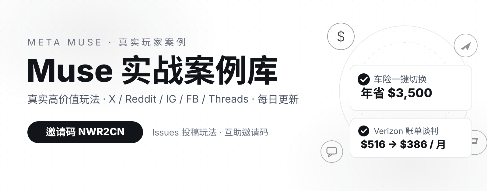

# Muse Use Cases 💡

> A curated collection of real, high-value ways people use **Muse**, Meta's personal AI agent.
> Inclusion rule: **real user shares from X, Reddit, Instagram, Facebook, and Threads** — we prioritize cases with clear results, real numbers, and high replicability.

📊 **526 cases** ｜ 🕐 **Last updated: 2026-11-24** ｜ 🤖 Auto-updated daily at 00:00 (Beijing time) ｜ 🌐 **Live site (Chinese/English): https://jaxxchen003.github.io/muse-use-cases/**

 

---

## 🎁 My Muse invite code: `NWR2CN`

- 📱 **Mobile app**: Muse App → Settings → **Redeem token** (available within 48 hours of joining)
- 💻 **Web**: muse.ai → Settings → General → Usage → **Redeem invite code**
- 📌 Rewards and terms are shown on the invitation screen and may vary by account
- 🤝 Have your own code to share? Drop it in Issues — there's a template for that

---

## 📌 Share to pin: 3 homepage slots every week

The homepage banner and invite-page slots are no longer ads: only **3 slots** each week, first come first served, reset every Monday at 00:00 (Beijing time).

1. Post on X sharing this repo — the post must link `github.com/jaxxchen003/muse-use-cases` and be published within the current week;
2. File an Issue with the [“Apply for this week's pin”](https://github.com/jaxxchen003/muse-use-cases/issues/new?template=apply-pin.yml) template: your X handle, the share-post link, and the case number to pin;
3. A scheduled job verifies daily at 00:30: the post exists, you wrote it, and the case's original author is you. Verified entries take the open slots in submission order; overflow waits in line, and an application stays valid for 7 days from submission.

You can only pin your own case; failed verifications are not notified individually.

---

## 📖 Verification standard

| Badge | Meaning |
|-------|---------|
| ✅ | Original post verified: original post read, person/amount/method all match |
| 🟡 | Share confirmed: author + aggregator archives cross-checked, direct post URL not yet publicly exposed |

> This library only includes real user shares from X, Reddit, Instagram, Facebook, and Threads; web articles/videos are references only, never source *links*.
> Verified 2026-10-11/12. When posts can't be fetched directly, we triple-check via post timestamps (Snowflake IDs for X) + archive dates + multi-source cross-checks.

## Categories

- 💰 [Money saving · bills · claims](#-money-saving--bills--claims) (90)
- ✈️ [Travel](#️-travel) (61)
- 🛒 [Shopping](#-shopping) (51)
- ⚡ [Productivity · automation](#-productivity--automation) (185)
- 🎨 [Content · creation](#-content--creation) (39)
- 🛠️ [Dev · building](#️-dev--building) (50)
- 💼 [Business · consumer rights](#-business--consumer-rights) (50)

> Each category shows its Top 5 picks by default; click to expand the rest. The changelog shows only the latest entry by default.

---

## 💰 Money saving · bills · claims
> ⭐ Top 5 picks: the most verifiable, highest-impact cases in this category; the other 85 are in the collapsed section below.

<!-- Top 5 rule: ✅ direct source link + ⭐⭐⭐⭐/⭐⭐⭐⭐⭐ replicability + clear outcome; change only on owner request or a clearly stronger new case; new cases go into the collapsed section below. -->

**1. One-click car insurance switch, $3,500/yr saved** ✅ — Joseph Devoy ([@JosephDevoy](https://x.com/JosephDevoy), Tempo founder). Uploaded his policy, asked for cheaper identical coverage; in ~5 min Muse found a new plan, bought it and cancelled the old one. [Original post](https://x.com/JosephDevoy/status/2098158828135002245) (2026-09-10).

**2. Xfinity phone haggle, ~$5,118 over 5 years** ✅ — [@raunaqbn](https://x.com/raunaqbn). Had Muse call Xfinity, navigate the phone tree, patch him in live at verification — with a full agent–rep transcript. Locked $85.30/mo. [Original post](https://x.com/raunaqbn/status/2100042003807601124).

**3. Verizon $516 → $386/mo, negotiated overnight** ✅ — [@williamgeronco](https://x.com/williamgeronco). Started a support chat, went to bed; Muse brought the bill down overnight. ~$1,560/yr. [Original post](https://x.com/williamgeronco/status/2099826624849961009).

**234. About $7,000 in wrong university charges cleared after Muse pulled the records and routed the dispute to the right office** ✅ — u/vainjuggler (Reddit r/MuseAgent, 2026-09-29). Withdrew within the refund deadline but was left with about $7,000 in charges and collections threats after months of unanswered emails; Muse logged into his university account, pulled records showing when he withdrew, found later-semester courses he was never enrolled in, and routed the dispute to the office with authority to fix it. ([Original post](https://www.reddit.com/r/MuseAgent/comments/1wszqn5/meta_muse_just_saved_me_over_7000_in_bs/)) (2026-09-29).

**359. He calls his Muse Sparx — it dug up 17 forgotten subscriptions and cancelled them, saving him over $4,000 a year** ✅ — u/AdEvening6998 (Reddit r/MuseAgent, 2026-11-14). He asked his Muse, Sparx, to go looking for subscriptions he had signed up for and forgotten over the years; it found more than 17 he no longer needed, and — with his permission — cancelled them, including accounts that used to send him on a wild goose chase when he tried to cancel himself. ([Original post](https://www.reddit.com/r/MuseAgent/comments/1xwbe6p/muse_has_saved_me_over_4000_a_year/)). A user self-report; the $4,000-a-year figure appears only in the post's title, and the body lists no amounts.

Show the other 85 cases

**4. AT&T broadband $80 → $30/mo + 3 months free + doubled speed** ✅ — [@NoSaberNiPapa](https://x.com/NoSaberNiPapa). [Original post](https://x.com/NoSaberNiPapa/status/2099947510349316129).

**5. AT&T fiber $80 → $40/mo + 3 months free** ✅ — Chandra Bhavanasi ([@chanduiiit](https://x.com/chanduiiit)). Authorized Muse to "accept anything under $70/mo". [Original post](https://x.com/chanduiiit/status/2099527544643207558) (2026-09-14). Caveat: some viral "phone negotiation" cases reportedly involved human agents.

**6. Two households' AT&T bills, ~$1,920 over 24 months** ✅ — [@JasonL_Capital](https://x.com/JasonL_Capital). [Original post](https://x.com/JasonL_Capital/status/2100307407075205279) (2026-09-16).

**7. Car insurance shopped in 15 min, ~$1,156/yr saved** ✅ — [@JasonL_Capital](https://x.com/JasonL_Capital). Uploaded his policy at the gym; Muse shopped identical coverage. [Original post](https://x.com/JasonL_Capital/status/2099991678538879461) (2026-09-15).

**8. Medical bills audited line by line, $4,000+ saved** 🟡 — Holdy (@Ryan_Holdaway). Logged Muse into the medical provider portal, questioned every line, found double billings, requested discounts.

**9. Water heater $1,450 vs $2,300 quote ($850 saved)** 🟡 — PREEM (@PipeBladex). Texted the model number at lunch; Muse compared 3 shops, emailed 2 installers, booked Thursday install.

**10. Croatia–Italy car ferry, $2,200 drop-off fees saved** 🟡 — Erik Lammerding (@Lammerding). Muse found and booked the ferry, pulled plate/model from the rental agreement, confirmed insurance coverage.

**11. Car insurance $500 → $335/mo (~$1,980/yr)** 🟡 — Minh Phan (@MinhInvest). Muse gathered 4 quotes while he grocery-shopped (Tesla → CSAA); switched the same day.

**12. United price-drop tracking, ~$1,026 credit** 🟡 — [@Yairyup](https://x.com/Yairyup). Tracked a booked United flight, chatted with United to secure the credit. [Original post](https://x.com/Yairyup/status/2098136696277627177).

**13. $1,750 unclaimed property recovered for father-in-law** 🟡 — [@moneyeducator](https://x.com/moneyeducator). Searched every lived-in state's unclaimed-property registry; plus ~$120/mo off bills via plan comparison (per catalog entry). [Original post](https://x.com/moneyeducator/status/2098170064721543402) (2026-09-10).

**14. Unclaimed property sweep, $800+ in ~10 min** ✅ — @WaitWhat. One prompt: check every state lived in; Muse filled the claim forms too (~10 min total). [Original post](https://x.com/WaitWhat/status/2098169214091887047) (2026-09-10).

**15. Amazon returns ($239) + dog vet claim ($516)** 🟡 — @armand_ruiz. ~$755 recovered. (He also posted a $2,120.95 cumulative savings list incl. AT&T negotiation $300/yr and IKEA returns.)

**16. PODS move $576 under quote + missing tax K-1s found** 🟡 — @benparr. Booked mom's PODS move under quote; built a 2025 tax-doc tracker.

**17. Email receipt audit found forgotten $100/mo Claude Max** 🟡 — @idobn. Scanned 6 months of receipts; ~$1,200/yr saved.

**18. Car insurance analysis, ~$603/yr saved** 🟡 — @frankilus.

**19. Flight-delay claim by email, $200 back** 🟡 — @tiramisucrux.

**20. WiFi bill haggled down $300 in under 10 min** 🟡 — @nathanael_smith.

**21. Alaska cancellation claim $189.37** 🟡 — @duboibaptiste. Dug the cancelled flight + Lyft receipts out of email, fought a broken upload widget, filed with case number.

**22. Recovered a year of forgotten subscription fees** 🟡 — Chris Abraham ([@chrsabraham](https://x.com/chrsabraham)). Muse scanned bills, found a book subscription his wife forgot to cancel 1+ years ago, cancelled and recovered a full year. [Original post](https://x.com/chrsabraham/status/2099879164895527008) (2026-09-15).

**23. Subscription audit saved $200** 🟡 — Nicolas Bustamante (@nicbstme, Microsoft). (Same thread: socks bought, Whole Foods ordered, cleaner booked, burger fetched in 24h.)

**24. Dodged $1,250 in dealership upsells** — Nick Prince (Coinbase PM). Had Muse review the fee breakdown when buying/buying out a lease. Reported during Meta's #MuseMoneyChallenge.

**25. Phone negotiation, $800+/yr saved** — Peter Yang (YouTuber). Muse called to negotiate cable + phone bills.

**26. Muse named "Fred": subscriptions cancelled + insurance compared, $2,500+/yr** — @landonbtw (IG creator, ~250k followers). 2026-10-08 reel.

**27. $100 Verizon gift card applied to bill** — u/Sleds88 (Reddit r/MuseAgent).

**28. 24h health errands: $80 Oura discount + benefits done right** 🟡 — Khiet Tran (@trannkhiet). Flu shot scheduled, $80 Oura Ring discount found, benefits enrolled without HSA over-contribution.

**76. A week, 8 errands: $1,000 in stalled refunds recovered, $200 in subscriptions cut** ✅ — @ekate.lee (Threads user). Social drafts, photo/video edits via Kling/Higgsfield, inbox triage, LinkedIn DM cleanup, a support chatbot for her product Networkio — plus two long-delayed refunds (posted 2026-10-09).

**85. "A Month with Muse" test: website fixes + 5 car insurance quotes, $1,530/yr saved** 🟡 — @mostly.borrowed.ideas (IG account). A month of real-world testing: had Muse fix his website (added the dark mode + subscribe button he'd wanted for two years — "like hiring a competent dev for $20/mo"); shopped 5 car insurance quotes, saving $1,530/yr, and set it to re-shop every 5 months against "renewal inertia"; also monitors 4 inboxes, sends a daily cricket news digest and tracks GPU prices (2026-10-12 IG long-form video).

**93. NYC parking ticket cleared in one chat: $115 → $145 fine, $147.90 paid via CityPay** 🟡 — Shervin Shaikh (@shervinshares, IG, 45K followers). A 3-month-overdue NYC parking ticket ("No Standing" at a bus stop): Muse looked it up by license plate on the city site — $115 had grown to $145; it went to CityPay, where a 2% card fee brought the total to $147.90, ready to charge via Stripe Link; the first charge failed on billing-address mismatch, and Muse proactively offered PayPal/eCheck alternatives, ending with a CityPay payment screenshot (2026-10-12 IG reel, screen-recorded, marked "not an ad").

**94. Jumped on the "subscription negotiation" trend: ~$700/mo saved, car insurance switch saves ~$2,000/yr** 🟡 — Paul Pruitt (Facebook user). After seeing reels of Muse negotiating subscriptions, he gave Muse account access: it canceled idle subscriptions and fixed overcharges, saving ~$700/month; he also switched car insurance from Progressive to GEICO for the same coverage, saving ~$2,000/year (2026-10-12 FB post).

**115. Subscription audit: 22 cut to 5, monthly fees $149.11 → $58.73, ~$100/mo saved** 🟡 — @karol.ylt (Spanish creator, 2.9K IG followers). Asked Muse to surface every recurring charge, shown on a before/after dashboard (screenshot 2026-10-11); she decided what was worth keeping — the keepers still included Claude Pro ($22.11/mo) and ChatGPT Plus ($20/mo) (2026-10-16 IG reel).
--- [Original post](https://www.threads.com/@ekate.lee/post/DeR4okrm9Lb) (2026-10-09).

**120. Therapist invoices dug out of email → Aetna reimbursement in 20 minutes** ✅ — @natashaghoskins (founder). Muse found every therapist invoice in her email and submitted them to Aetna (https://x.com/natashaghoskins/status/2102821622893961727, 2026-09-23); 20 minutes to cross the deductible, reimbursements for the rest of the year.

**121. A forgotten $200 Verizon gift card, claimed back by Muse** ✅ — @melon_thief. The $200 signup gift card he forgot to claim — Muse dug it out and redeemed it; "paid for itself for the next year or two" (https://x.com/melon_thief/status/2100461407334506919).

**122. One move, all utilities transferred: power, gas + insurance** ✅ — @stevenwhatevr (X, 2026-10-17). Had Muse transfer his Toronto Hydro power, Enbridge gas and insurance accounts for a move; confirmation emails from each arrived ([Original post](https://x.com/stevenwhatevr/status/2111508387452047545)).

**155. Double taxation caught, $1,860 saved** ✅ — @at_url (X, 2026-10-16). Had Muse review his tax documents; it found he was being double-taxed. The $1,860 figure is the author's own claim; document details weren't disclosed ([Original post](https://x.com/at_url/status/2111207662079947113)).

**156. $350 tailor bill reimbursed after a week of follow-ups** ✅ — @saleskhalifa (Khalifa, X, 2026-10-16). His wedding suit needed tailoring but the shop's tailors were out sick, so he paid $350 to rush it elsewhere. He had his Muse ("Goob") ask the original shop for reimbursement and follow up for a week — the money came back ([Original post](https://x.com/saleskhalifa/status/2110888090596261905)).
---

**158. €30 Paris hotel-pickup waiting fee refunded in full** ✅ — @HH002_Dream (Sandman, X, 2026-10-20). Charged a €30 waiting fee on a Paris hotel pickup; Muse reviewed the pickup company's waiting-time policy, drafted the dispute email and took it up with the company directly — the full refund landed back in his account ([Original post](https://x.com/HH002_Dream/status/2112453085163647473)).

**163. Car insurance $260 → $170: only Progressive lets the agent in** ✅ — @MikeCjunior (Mikejnr, X, 2026-10-21). Created a fresh email and handed Muse the "lower my insurance bill" task; several insurers' websites refused agent access and only Progressive let it work — the bill dropped from $260 to $170 a month (author's own claim; flagged as unverified self-report by howtousemuse) ([Original post](https://x.com/MikeCjunior/status/2113032044158894452)).

**164. Muse called the loyalty team and cut $40 off the fiber bill** ✅ — @JamesCordrey2 (James Cordrey, X, 2026-10-22). Muse called the provider's loyalty/retention team directly to negotiate and handled the follow-up emails; first post of a thread, key facts up front ([Original post](https://x.com/JamesCordrey2/status/2113070700252525003)).

**165. Home-insurance cross-channel comparison: Muse emailed agents, self-reported ~$400 saved** ✅ — @TechTradeBlue (X, 2026-10-22). Handed Muse the "shop my home insurance" task; it emailed multiple insurance agents for quotes and pulled quotes from several websites — self-reported savings of about $400 with better coverage (author's own claim; flagged as unverified self-report by howtousemuse) ([Original post](https://x.com/TechTradeBlue/status/2113086665690644806)).

**178. Colonoscopy copay negotiated from $330 to $0** ✅ — Artem Russakovskii (@ArtemR, X, 2026-10-27). After a doctor's office email estimated his colonoscopy copay at $330, he had Muse research and draft a reply; the clinic rechecked with insurance and cut his share to $0 ([Original post](https://x.com/ArtemR/status/2115136935002046559)).

**187. Wrong-language movie tickets caught, refund letter drafted, refund received** ✅ — Greg Uspensky (@GregoryUspensky, X, 2026-10-28). Muse caught unprompted that his movie tickets were in the wrong language, drafted the refund letter, the refund came through and he bought the right tickets ([Original post](https://x.com/GregoryUspensky/status/2115406430408773870)).

**199. Discount code hunted before a subscription renewal: $50 off Monarch** ✅ — Julian Norton (@JulianNorton, X, 2026-11-01). Before renewing his Monarch subscription he had Muse find a working discount code and test it before paying — $50 saved, and he says Muse has already paid for itself ([Original post](https://x.com/JulianNorton/status/2116710782725652562)).

**201. FTC Amazon settlement $12.99 chased all the way to PayPal** ✅ — André (@andr3barroso, X, 2026-10-31). After receiving an FTC Amazon settlement check in September he handed the follow-up to Muse, which kept pushing until the $12.99 landed in his PayPal while he was at work ([Original post](https://x.com/andr3barroso/status/2116530634382340242)).

**204. 401(k) taken over end to end: rebalanced, fees cut, dashboard built** ✅ — cubeqube (@cubeqube, X, 2026-09-22). Handed his 401(k) to Muse: rebalanced it, switched similar funds to lower-fee versions, built a dashboard of all his financial accounts and transactions with budgets and subscription alerts; it also manages his electric and internet bills, tracks HSA expenses and receipts, and hunts tax-loss harvesting opportunities — all within the free plan's limits ([Original post](https://x.com/cubeqube/status/2102187698127569173)).

**209. Resy dinner booked — then came the $200 cancellation fee** ✅ — zopatoli (@zopatoli, X, 2026-10-20). Had Muse book dinner on Resy; plans changed 15 minutes later and he cancelled — only then did it mention the $200 + tax cancellation fee and that it had used his saved card. He says he would never have booked had he known ([Original post](https://x.com/zopatoli/status/2112680170037588101)). Cautionary case: the booking worked, but the fine print surfaced after the fact.

**210. Every manually-activated credit card offer, activated by Muse** ✅ — Pierre (@Pierre5x, X, 2026-10-22). Had Muse go in and activate all the manually-activated discount offers on his credit cards ([Original post](https://x.com/Pierre5x/status/2113279598980898925)).

**211. The rep spotted the AI — so Muse smoothly transferred the call to its owner** ✅ — Adebowale Ojo (@ifeoluwadebo, X, 2026-10-22). Had Muse call his insurance provider for a quote with certain deductible changes; the person on the other end realized they were speaking with an AI agent and asked to speak with the account owner, and Muse transferred the call to him ([Original post](https://x.com/ifeoluwadebo/status/2113311789370712458)).

**212. Unclaimed property $97 recovered — plus data-broker opt-outs and Amex offers activated** ✅ — Aaron Skrivan ([@AaronSkrivan](https://x.com/AaronSkrivan), X, 2026-09-10). Had Muse find unclaimed property and file the paperwork ($97), opt out of major data brokers, and activate all his Amex offers — saving ~200 manual clicks ([Original post](https://x.com/AaronSkrivan/status/2098183632120840423)).

**213. Six months of email receipts turned up a forgotten $100/mo Claude Max sub — $1,200/yr saved** ✅ — [@idobn](https://x.com/idobn) (X, 2026-09-09). Had Muse go through 6 months of email receipts; it found a $100/mo Claude Max subscription on his corporate card that he had forgotten about while the company already had an enterprise license ([Original post](https://x.com/idobn/status/2097570513107272175)).

**214. The hospital bill “on hold” was never on hold — Muse called and proved it** ✅ — Lucus Bendzsa ([@RealLucusB](https://x.com/RealLucusB), X, 2026-10-24). A hospital bill placed on hold for review arrived anyway; his Muse agent called, navigated the IVR, confirmed the account, and confirmed there was no hold ([Original post](https://x.com/RealLucusB/status/2113984571276415053)).

**215. Tesla valet parking refund: first call failed, second call approved in full** ✅ — Kyle G ([@kylemissionai](https://x.com/kylemissionai), X, 2026-10-21). A valet refused his Tesla over a phone key, but he had already paid for parking; Muse's first refund call failed for lack of details, it asked him two questions, called again — full refund approved, no hold music for him ([Original post](https://x.com/kylemissionai/status/2113022477152776628)).

**216. Internet bill went up unannounced — Muse called and talked it down, plus two months' credit back** ✅ — [@CryptoTamilza](https://x.com/CryptoTamilza) (X, 2026-10-20). His internet bill rose without notice; Muse negotiated live with customer care, brought the monthly bill down and got a credit back for the past two months (no amount given in the post) ([Original post](https://x.com/CryptoTamilza/status/2112648082496053496)).

**217. Pharmacy copay beaten: a discount card cheaper than insurance** ✅ — Nan ([@SuperNanTX](https://x.com/SuperNanTX), X, 2026-10-24). Muse compared prescription discount cards and found one cheaper than her insurance copay (no amount given) ([Original post](https://x.com/SuperNanTX/status/2113991981462392963)).

**227. Car insurance shopped and switched: GEICO $2,123 → Progressive $1,536, $1,174/yr saved** ✅ — Mike Nichols ([@MistrDeplorable](https://x.com/MistrDeplorable), X, 2026-10-28). His GEICO renewal came in at $2,123; Muse found a Progressive policy for $1,536 with better coverage, then called GEICO to cancel the old policy — he only joined the call for about a minute to verify his identity. Tagged #MuseMoneyChallenge; 170k+ views ([Original post](https://x.com/MistrDeplorable/status/2115495145437093938)).

**231. 300+ shopping receipts from 6 years of Gmail turned into an accountant-ready collectibles tracker in 30 minutes** ✅ — Austin Evans (via @muse official repost, Threads, 2026-10-31). Had his Muse Lotus search six years of Gmail receipts and build a collectibles tracker in about 30 minutes; the same video also checks F1 US Grand Prix tickets, adds calendar events and delivers a morning tech news briefing. ([Original post](https://www.threads.com/@muse/post/DfKpRPJkZfp)) (2026-10-31).

**232. A $49.99 AppleCare+ charge found in email, refunded in full after a 16-minute call by the assistant** ✅ — MARCIANOTECH (@marcianotech_, Instagram, 2026-11-02). His Muse Baby Muse spotted a $49.99 AppleCare+ charge for an iPad he never activated, then had its assistant Hailey call Apple for 16 minutes to cancel it and refund the full amount to his Amex. ([Original post](https://www.instagram.com/reel/DfQGLrUJ1A0/)) (2026-11-02).

**233. Daily stock alerts with price triggers used for over a month; a car insurance check confirmed his policy was already cheapest** ✅ — Sriram Arumelli (@srirams_chronicles, Instagram, 2026-10-11). Has Muse send daily stock alerts and research ideas with tickers, price triggers, targets and stops; separately had it research cheaper California car insurance from his policy documents, and it concluded his current policy was already competitive. ([Original post](https://www.instagram.com/reel/DeXid7ESXvl/)) (2026-10-11).

**235. AT&T bill negotiated down $50 a month in about 45 minutes of support chat** ✅ — u/RaiderMike824 (Reddit, 2026-10-03). Had Muse negotiate his AT&T bill; about 45 minutes of support chat with details filled in along the way, and the monthly bill came down $50. ([Original post](https://www.reddit.com/r/MuseAgent/comments/1wwnysh/comment/pdmexe0/)) (2026-10-03).

**236. Muse called SiriusXM, cancelled an unrecognized subscription, declined a $72/year retention offer, $37.65 credit on the way** ✅ — u/Equivalent-Draft9248 (Reddit r/MuseAgent). Muse called SiriusXM, verified the account holder's name and billing ZIP, confirmed an XM radio subscription nobody recognized, declined a $72-a-year retention offer and cancelled it the same day, with a $37.65 credit eligible for refund within three to five business days. ([Original post](https://www.reddit.com/r/MuseAgent/comments/1xoz533/muse_phones_sirius_xm_to_save_me_500/)).

**237. Read the hosting fine print and got a $359.88 refund** ✅ — Greg Hung (Instagram). Had Muse read the hosting renewal terms he had never read, find the refund window and map the whole plan move before he talked to support; $359.88 came back. ([Original post](https://www.instagram.com/reel/DfU5vYSjyaG/)).

**238. Google Workspace cancelled in one chat, ¥13,200 a month saved** ✅ — Katsutoshi Kitamura (Facebook). One chat cancelled the Google Workspace Business Plus subscription for sozo.art before its November 1 billing date. ([Original post](https://www.facebook.com/groups/1905039367540244/permalink/1905662027477978/)).

**239. A 10:44 alert saved his same-day payout deadline after a 9:36 email** ✅ — Reirei (Instagram). An email at 9:36 said his note sales proceeds had to be claimed that very day, a deadline he had completely missed until Muse flagged it at 10:44, then walked him step by step through the payee menu until the claim was done. ([Original post](https://www.instagram.com/p/DfKTyOQExUy/)).

**240. $54 back from subscriptions he forgot he was paying** ✅ — Kailash Sarma (Instagram). Connected his inbox and bank account, found subscriptions he was not using and saved $54 so far, while it also watches restaurant reservation sites for tables and delivers a morning briefing on what mattered overnight. ([Original post](https://www.instagram.com/reel/DfJctTSJqw2/)).

**241. Cancelled his “predatory” pest control contract, only joining the final call** ✅ — flick (Threads). Asked Muse to cancel a pest control contract he calls predatory and near its end; Muse handled most of the cancellation itself, then brought him into the final call with support, where a few personal questions ended the service. ([Original post](https://www.threads.com/@0xflick/post/De8AEPVlsUk)).

**317. "Finch": 38 subscriptions at $2,285.21 a month, 4 canceled in one click** 🟡 — @pjacefilms (Facebook; reposted by @muse on Threads the same day). He connected his Muse agent "Finch" to his bank (Plaid, read-only) and asked it to list every subscription he was paying: 38 items totaling $2,285.21 a month ($27,422.52 a year), including duplicate streaming and accounting subscriptions and long-unused services. He ticked 4 to cancel and approved Finch's cancellation emails; the confirmation screen showed a gym membership, a streaming subscription, a duplicate accounting package and an entertainment package canceled, with refunds requested for unused months, and the goal board updated to "Save money - 4 subscriptions canceled". He says he lost thousands of dollars to forgotten subscriptions over two years. ([Original post](https://www.facebook.com/reel/1471540751575508/)). Subscription totals are from the video's dashboard; refunds are not yet confirmed as received.

**325. "Ernesto" saved nearly $2,000 in under a month: an $80 duplicate charge clawed back, a flight made free with points** 🟡 — Courtney Johnson (@courtlynnjohnson, Instagram, 2026-11-09, 260K followers). She named her Muse "Ernesto" (elephant avatar), and in under a month it saved her nearly $2,000 across five itemized jobs: it spotted an $80 duplicate charge and got the bank to reverse it; it reworked her points strategy to book a flight for free, saving $800 in cash; it reminded her to send a forgotten $400 invoice; it nudged her to finish a $100 online course she had paid for and never opened; and it found a $300-a-year gym membership she never used and canceled it. The point she stresses: most of the interventions were unprompted — Ernesto watches her accounts in the background, comes to her when something is off, and always asks before spending. ([Original post](https://www.instagram.com/reel/Dfh7DLryzbU/)). Amounts are self-reported by the author and not independently verified; the reel is tagged #MetaPartner.

**334. "Leroy Jenkins" flagged a double charge: NBA League Pass billed twice — about $460 a year for the same service** 🟡 — Jamian C. Polk (@jamiancpolk, Threads, 2026-11-10). His Muse "Leroy Jenkins" proactively warned him he was being double-charged for NBA League Pass — Apple monthly at $24.99 (about $299.88 a year) and Prime Video yearly at $159.99 — about $460 a year for the same service. Screenshots show Leroy listing the duplicates, recommending which to cancel, and flagging one more duplicate invoice. He stresses he never asked: Leroy found it on its own. ([Original post](https://www.threads.com/@jamiancpolk/post/Dfk4Qj0kQht)). A user self-report with screenshots; amounts are self-reported and not independently verified.

**335. "Trevor" handled the aftermath of a stolen company card: 3 unauthorized charges she had missed, plus QuickBooks reconfigured so payments kept flowing** 🟡 — Leah Herring (Facebook, 2026-11-10, small-business owner). After her company card details were stolen and funds taken, her Muse "Trevor" found 3 unauthorized transactions she had missed over the past month, with the phone numbers to call, what to say, amounts and dates, and a priority order for who to contact first. It also reconfigured her QuickBooks so card payments kept landing in her personal account during the 7–10 days it took to open a new business account. She calls it "a lifesaver". ([Original post](https://www.facebook.com/leah.herring.56/posts/pfbid02RHUadXLmamd9VyhevLvt4kr4qqy8ZjUx7iRdgiyTgUCPZshu9z6neMPdqabS2ceel)). A user self-report; transaction details are self-reported and not independently verified.

**338. "Hana" dug up unclaimed small money: CVS, GoodRx, an in-store ATM and an Amazon return — one claim each, plus $88.26 still sitting on a Texas "found money" site** ✅ — Kevin Moore (@kev_the_blind_pirate, Instagram, 2026-11-12, blind creator). His Muse "Hana" helped him file a batch of class-action claims he says he would never have gotten to on his own — $5 through the CVS app, $5 on his GoodRx card, $5 in ATM fees, and an Amazon return that was refunded late, plus $88.26 still listed for him on a Texas "found money" site. As a blind user, he says these are the jobs "I never would have got to on my own" that the agent now handles. ([Original post](https://www.instagram.com/reel/Dfnxr0fRRsm/)). Amounts are small and self-reported, not independently verified; his earlier "15,000 emails" case is already in the library — this is a new post from the same author with a different use.

**342. His first days with Muse started with his own insurer: a chat enquiry saved $504** ✅ — James Belias (@sutherlandexp, X, 2026-11-12). Meta Muse is "off to an impressive start", he writes — the agentic experience is strong, he connected it to his personal email, and "the more access you give it, the better". His example: a chat enquiry with an insurer he already uses saved $504. ([Original post](https://x.com/sutherlandexp/status/2120832426847211850)). A user self-report; the policy type and how the saving was made are not stated and not independently verified.

**350. The IRS said he owed tax — his Muse checked the transcripts and found the IRS owed him instead** ✅ — u/Nouvre588 (Reddit r/MuseAgent, 2026-11-13). The IRS sent another notice saying he owed on his taxes, so he loaded his tax transcripts into Muse — which found he had already paid, and that the IRS owed him money instead. It called the IRS representative for him, and the refund is inbound in December. ([Original post](https://www.reddit.com/r/MuseAgent/comments/1xv6ldo/muse_helped_me_dispute_a_tax_error/)). A user self-report; the refund amount is not stated in the post.

**374. Monthly credit-card bills auto-sorted into a one-page summary** ✅ — [@yoojs7](https://www.threads.com/@yoojs7) (Threads, 2026-11-16, in Japanese). Every month Muse pulls the card statement and files it by category into one clean summary — no more digging through spreadsheets and PDFs. [Original post](https://www.threads.com/@yoojs7/post/DfyK5Ixks6W) (2026-11-16). The author calls it "quietly, boringly useful".

**375. ¥13,200 saved in a year with Muse, over ¥50,000 total** ✅ — Yuko Kitagawa ([@y_.kitagawa](https://www.threads.com/@y_.kitagawa)) (Threads, 2026-11-15, in Japanese). A year with Muse saved her an extra ¥13,200, over ¥50,000 since she started; the method and copyable prompts are in her note article. [Original post](https://www.threads.com/@y_.kitagawa/post/Dfwuzs8Cquk) (2026-11-15). Figures are self-reported; the note's method was not opened for verification. (A different case from #238's ¥13,200/month Workspace cancel — same number, coincidence.)

**402. Cancelled but still charged: a CFPB complaint recovered $517.82 — and caught a double-counted refund** ✅ — Donnie Small ([@donnie4ever](https://www.threads.com/@donnie4ever)) (Threads, 2026-11-15). She cancelled her Albert Genius subscription in writing in March 2025, but was still charged $39.99 a month — $517.82 in total. With Muse's help she filed a complaint with the US Consumer Financial Protection Bureau and tracked the refunds as they arrived; along the way Muse spotted that the company's offer double-counted a $119.97 refund already paid, so the true new refund was only $277.88 — and the three credits added up to exactly $517.82. [Original post](https://www.threads.com/@donnie4ever/post/DfxVJcpGVls) (2026-11-15). Figures are self-reported; the post and the author's follow-up comments were read in full.

**403. On the drive to her tax advisor, Muse dug up 5 forgotten invoices** ✅ — Elena Kelava (Facebook, 2026-11-16). Driving to Munich to see her tax advisor, she asked Muse by voice to check the advisor's email correspondence for any tax documents she had missed — Muse found 5 forgotten invoices. [Original post](https://www.facebook.com/reel/1477046321054837/) (2026-11-16). Clip from the marketing show "Online Marketing Insider"; the show's closing promo is not counted.

**419. The day I boarded the ship, it kept watch on 4 Vinted confirmation deadlines** ✅ — Danny J Badalamenti ([@deals_so_good](https://www.threads.com/@deals_so_good)) (Threads, 2026-11-17). Four Vinted purchases needed manual confirmation while he was boarding a ship; miss the deadline and payment releases automatically with no refund possible. His Muse flagged all four the day before and again that morning — all four made it. [Original post](https://www.threads.com/@deals_so_good/post/Df2fC88E5pK) (2026-11-17). The same author's birthday-eve reminder from November 10 is already recorded — this is a different post; the invite-code passage at the end is not adopted.

**448. Muse called State Farm and got the quote mailed — no forms for him to juggle** ✅ — [@sethrose](https://x.com/sethrose) (X, 2026-11-18). @Muse called and got an insurance quote mailed to him, so he didn't have to juggle with forms yesterday. "Was pretty freaking sweet. Shoutout to @StateFarm." [Original post](https://x.com/sethrose/status/2123161288289206764) (2026-11-18; 05:07 Beijing time on November 19 by the Snowflake timestamp).

**467. It cancelled my insurance for me — and I got the refund confirmation too** ✅ — Pokharel Ujwal Gyani (Facebook, 2026-11-18). He shares his own experience with Muse: Gmail connected, he asked it to cancel an insurance policy — name and membership details provided, a verification code arrived on his phone, he authorized it, and Muse completed the process; the refund confirmation came through too. The video is in Nepali with some English. [Original post](https://www.facebook.com/reel/1721357089465164/) (2026-11-18; the page does not display a publish date — counted by the cwybruce issue 56 date. The insurer name and refund amount were not given).

**489. Grok Bot at about $500 a month? No — Muse at $16 a month by his account, versus $45,000 a year for an admin** ✅ — Chris ([@ChrisTwiggsPM](https://x.com/ChrisTwiggsPM)) (X, 2026-11-21). In a thread about what agentic bots should cost, he says Grok Bot usage was heading toward $500 a month or more — worth it, but he did not want to pay it. He was about to hire an admin at about $45,000 a year; instead he uses Muse at $16 a month by his account, $192 a year. [Original post](https://x.com/ChrisTwiggsPM/status/2124160919466848335) (2026-11-21; read in full via fxtwitter; the $16 a month figure is the author's own account, and this is a different post from his recorded #185 tire case).

**501. Shopping in Montreal, comparing as she walked: gloves $40→$17, boots $280→$200** ✅ — Yeonwoo ([@yeonwoowoo501](https://www.instagram.com/yeonwoowoo501)) (Instagram, 2026-11-20). Asking Muse as she walked the stores: black North Face gloves listed at $40, an identical pair found for $17 — $23 saved; winter boots listed around $280, a $200 channel found — $80 saved. On-screen caption: "$100 saved" in "2 hours". [Original post](https://www.instagram.com/reel/Df-FdHrRXUi/) (2026-11-20).

**502. Connected Plaid, caught duplicate subscriptions, moved cash to a high-yield account** ✅ — A Facebook user (Facebook, 2026-11-21). Taking a "find $500 more a month" challenge, he connected Plaid to his Muse "Greg": it found unused subscriptions and two duplicate cloud-storage plans and cancelled them, then suggested moving cash to the highest-interest account — an estimated $300 a month, $6,000 a year. [Original post](https://www.facebook.com/reel/1683815366788983/) (2026-11-21).

**504. Maldives flights ~$1,000 cheaper, home insurance $45,000→$35,000, and a $40,000 interior designer skipped** ✅ — [@ric.r2](https://www.threads.com/@ric.r2) (Threads, 2026-11-21). He lists three things he did with Muse: Maldives flights about $1,000 cheaper, home-insurance premiums negotiated from $45,000 down to $35,000, and skipping an interior designer — a $40,000 fee avoided. [Original post](https://www.threads.com/@ric.r2/post/DgBVE2NASJp) (2026-11-21).

**513. Holiday budget split per person, every entry tallied live: $500 for gifts + $1,000 for a New York trip** ✅ — Tam Smith ([@runeatandtravel](https://www.instagram.com/runeatandtravel)) (Instagram, 2026-11-22). Travel creator Tam Smith asked her Muse to plan a holiday budget — $500 for gifts for four people (dad, mum, brother, sister) and $1,000 for a three-day trip to New York to visit family. Muse split it $125 per person and set two warning lines per pot (gifts $400/$500, travel $800/$1,000); she confirmed and it went live. When she then logged a $500 flight, Muse updated the tally on the spot: $500 spent on travel, $500 left; $0 spent on gifts; $1,000 left in total. [Original post](https://www.instagram.com/reel/DgDvRc1BcHL/) (2026-11-22).

**514. Tokyo hotel compared first, then stacked with ShopBack cashback: SGD 35.40 back on a $250-a-night budget** ✅ — Jiax ([@jiaxthepiggybanker](https://www.instagram.com/jiaxthepiggybanker)) (Instagram, 2026-11-21). Singapore savings creator Jiax demoed Muse connected to ShopBack: with ShopBack linked in settings, he asked Muse to find a Tokyo hotel for next June — near a metro station, highly rated, $250 a night, three nights. Muse returned options with totals and cashback (example: SGD 35.40 back, SGD 440 after cashback, about SGD 147 a night), and the cashback landed straight in his ShopBack account — the screen showed "Lifetime earnings $151.60". [Original post](https://www.instagram.com/reel/DgAI3QaRBhw/) (2026-11-21).

**515. Verizon bill paid without opening the website — one sentence, and the Avengers tickets booked in the same chat** ✅ — @that_ai_man ([@that_ai_man](https://www.instagram.com/that_ai_man)) (Instagram, 2026-11-21). He demoed two things — first, telling Muse "Pay my Verizon bill": Muse asked for his Verizon login once, saved it in the Secure Store, found the amount due and asked him to tap "Allow" before paying; the bill was paid and the payment card saved too. Then, in the same conversation, it booked tickets for Avengers: Doomsday, picking the seats itself. [Original post](https://www.instagram.com/reel/Df_AEGBTcjl/) (2026-11-21).

## ✈️ Travel
> ⭐ Top 5 picks: the most verifiable, highest-impact cases in this category; the other 56 are in the collapsed section below.

<!-- Top 5 rule: ✅ direct source link + ⭐⭐⭐⭐/⭐⭐⭐⭐⭐ replicability + clear outcome; change only on owner request or a clearly stronger new case; new cases go into the collapsed section below. -->

**125. Hotel site 5–10% cheaper than Expedia/Booking + free cancellation, plus a $50 credit** ✅ — @Goyal_Vivek (investor). Muse checked the hotel's own site against Expedia and Booking; direct booking was 5–10% cheaper with free cancellation, and it found a $50 hotel credit (https://x.com/Goyal_Vivek/status/2102824082370928806).

**208. He did the meme: Muse booked his flights, sorted airport pickup, and built an itinerary app** ✅ — Qui Vincit (@vincit_amore, X, 2026-10-23). Did the meme and had Muse book his flights, sort out ground transport from the airport, and build a whole itinerary app for the trip ([Original post](https://x.com/vincit_amore/status/2113776908412596573)).

**243. 106 saved Instagram restaurants turned into a filterable personal map in 5 minutes** ✅ — Mitchell Saron (@mitchellsaron, Instagram, 2026-11-03). Handed Muse the 106 restaurants saved in his Instagram collection and got a personal map in 5 minutes: sorted by cuisine and vibe, 37 marked Clean and 69 Absolute slop, each pin showing address, distance and the matching food Reel, with booking apps linked for tables. ([Original post](https://www.instagram.com/reel/DfRM5WVvomV/)) (2026-11-03).

**247. He gave Muse his credit card, and it booked a whole month of flights and hotels** ✅ — Austin Armstrong (Instagram). Handed Muse his credit card, and its assistant Dahlia booked his whole month of travel, including a Delta First Class nonstop from RDU to Austin on November 8 for $338.41, another Delta leg to Orlando, and all his hotels. ([Original post](https://www.instagram.com/reel/DfQvZCCOtaI/)).

**360. The day every plane was grounded, her Muse Pip tried three times: $419 sold out, $425 sold out, $325.40 booked** ✅ — Rachel Gainsbrugh (@drrachelgainsbrugh, co-authored with @short.term.gems, Instagram, 2026-11-15). The FAA had grounded every plane in America the day before, and she was stranded in Florida with her son's homecoming that night; packing her suitcase, she talked out loud to her Muse Pip: it found a Miami seat for $419 — she said yes and it sold out — then $425, sold out again — then Miami to Atlanta for $325.40, booked. She paid on a secure link, so Pip never saw her card number, and Pip texted her admin the date, time and confirmation number; the best seat her admin found searching at the same time was $2,000 one way. ([Original post](https://www.instagram.com/reel/DfviPJDEjzn/)). A user self-report; Pip first put her in a last-row middle seat, and her admin moved her to a front window seat — fast AI, human finishing touches.

Show the other 56 cases

**29. 7-hour delay → $250 Delta credit in 5 min** 🟡 — Ejaaz ([@cryptopunk7213](https://x.com/cryptopunk7213)). Muse filed the complaint, rebooked an alternative flight, replied to support emails. [Original post](https://x.com/cryptopunk7213/status/2102179999122153690) (2026-09-21).

**30. Flight/hotel price-drop tracking with notifications** — 于為暢 (Wei Chang Yu, Taiwan creator). Related: Threads @adambader saved **$600** the same way.

**31. Overnight flight auto check-in** ✅ — @amirnurani. His flight's online check-in opened at 4:15 AM; instead of waking up, he let Muse complete it in the background. [Original post](https://x.com/amirnurani/status/2097966228216172972) (2026-09-10).

**32. REAL ID appointment booking** ✅ — @nanda_rahul. Handed the whole appointment flow to Muse, from finding a slot to completing the booking. [Original post](https://x.com/nanda_rahul/status/2097719629510590788) (2026-09-09).

**33. Passport renewal + Thailand hotel booking, end to end** 🟡 — @JesseCohenInv. ~95% of US passport renewal done online, then couple flights on Amex Travel.

**34. Had Muse wait on hold with Southwest** — Matt Van Horn (entrepreneur). Muse called, waited, called him back when a rep was live.

**35. United baggage claim handled end to end** 🟡 — @maruthid1. Reimbursement within days, zero paperwork — only receipts + baggage ref provided.

**36. Missed flight → rebooked from bed across airlines** — @vicentetengOfficial (Deaf creator). Compared alternatives, flagged free Flex-ticket change, gave the support number.

**37. $3,000 trip booking fully managed** — @vishvanands (Threads).

**38. Sardinia trip: emailed hotel for direct booking, saved €240** — Chelsea Yamase (@chelseakauai, IG travel creator, 1.2M followers).

**86. 104 countries in 12 years: Muse mapped the next 10 years of his life** 🟡 — Jorden Tually (@jordentually, IG travel creator, 520K followers, verified). 104 countries down, 93 to go. Connected Muse to his Instagram to analyze his travel style; it produced a month-by-month, season-aware 10-year itinerary starting 2027 plus an interactive world map (visited vs remaining), projecting he'll finish all 197 by Dec 2036 (2026-10-12 reel, 4.4K likes).

**97. Inbox + calendar wired in, trip planning starts from his real schedule** ✅ — @boztank. With email and calendar connected, trip planning starts from his existing messages and itinerary — Muse assembles the packing list, researches and buys products; the same share has Muse sorting school emails into "needs action" vs "FYI only" so a parent doesn't read them one by one. [Original post](https://x.com/boztank/status/2097401739796459938) (2026-09-08).

**98. IG saves → 4-day Barcelona itinerary, down to which restaurant at what time** 🟡 — Chanelle Howell (@chanellehowell, IG creator, 85K followers, verified). Connected Muse to years of untouched IG saves (Marbella, Mexico City, Miami, Barcelona, Mallorca); one prompt — "build me a 4-day Barcelona + Mallorca itinerary from my saves." Day 1: Gothic Quarter, lunch at Los Caracoles, churros at Masia de Sabor, dinner at Tapeo, plus a paella cooking class; hotels tiered from Seventy Barcelona to Mandarin Oriental (~$850/night), with clickable links, booking info and prices (2026-10-13 IG reel, phone screen recording).

**114. Named her Muse "Monae": NYC event saves → dated itinerary, auto-refreshed daily** 🟡 — Tiffany Aliche (@thebudgetnista, IG verified). Muse digs through her saved NYC event posts daily and keeps a dated "Fall NYC Itinerary" (including free Fridays at the Morgan Library); picked events go into the calendar with daily auto-updates (2026-10-15 IG reel).

**116. Handed Muse his travel-site login: two VIP airport lounge bookings on autopilot — it stopped to ask when unsure** 🟡 — @marcianotech_ (Spanish tech podcaster, 450K IG followers). Stored his beforeboarding.com login in Muse's secure credential vault with one rule: "book whenever you see the fare, don't ask." Used his Banreservas Infinite membership to book two VIP airport lounge visits (Dec-03 departure, Dec-07 arrival, flights AA2265/AA1154). When the departure system stalled, it stopped and asked: "is the departure flight AA2099 or AA2265?" before continuing (2026-10-16 first-person screen recording).
---

**123. 146 flight searches: 11 Spanish cities × 10 Italian cities × 7 dates** ✅ — @mehtadeep (Apple engineer). With a flexible schedule, had Muse run 146 price searches (cash + award) from SFO to 11 cities in Spain and back from 10 Italian cities across 7 dates, to find the cheapest round trip (https://x.com/mehtadeep/status/2099498596789850192).

**124. Early flight: Uber vs airport parking compared, Groupon halved the parking** ✅ — @jaidharo. Told Muse about his morning flight; it compared Uber vs airport parking, bought a Groupon to halve parking, booked it in the browser, then told him when to leave (https://x.com/jaidharo/status/2098430453934174305).

**126. Whole NYC trip booked via Muse, Stripe Link checkout "10/10"** ✅ — @ryanvogel (founder). Booked a New York trip through Muse with the Stripe Link payment step; calls it a great experience and a 10/10 personal agent (https://x.com/ryanvogel/status/2099646623198441683).

**149. Japan trip transport settled in one day: rental car nearly half price** 🟡 — 暢哥 / Agent W (17muse.com webmaster, 2026-10-17 site log). Muse researched and ranked transport options, the human only placed the final orders: rental car at member price ¥59,994 + CDW ¥9,900 + NOC ¥4,950 = ¥74,844 tax-in (he had found ¥107,250 himself); N'EX vs Skyliner picked by fewest transfers; a 10-26 reminder set for return tickets.

**153. Honeymoon booking emails turned into one master itinerary doc** ✅ — @matthew_verni (Matt Verni, X, 2026-10-19). Fed booking confirmation emails to Muse; it extracted every stay and flight, linked each with the original email and reservation number, and generated a single master doc ([Original post](https://x.com/matthew_verni/status/2112120235016716442)).

**174. F1 Austin weekend handed to "Karl": addresses, times, transport and Mercedes priorities in one executable table** 🟡 — Wesley Breed (@wesly, verified IG creator, 330K followers, 2026-10-23). He named his Muse "Karl" (after Karl Benz) and had it plan an entire F1 Austin Grand Prix weekend — addresses, times, transport, plus Mercedes-related events ranked by priority. It returned a schedule he could walk through directly: Mercedes Fan Hub (400 Congress Ave), driving/parking tips and walkable stops in order; his video shows the on-site KIMI's queso e pepe food truck, an AMG GT show car, the Fan Hub with a real race car, simulators and a pit-stop challenge. His point: the agent's value isn't telling you what exists, it's handing you a table you can execute.

**206. Cheapest Jeep near LAX for his wife's 30th, with an Amex offer stacked on top** ✅ — hottakefinance (@hottakefinance, X, 2026-09-18). Mid-flight to LA for his wife's 30th birthday trip, he had Muse find the closest and cheapest Jeep Wrangler to rent the next day; it knew he had an Amex Gold card with a $30-back-on-$150+ Turo offer, then routed through Rakuten for another 2% back ([Original post](https://x.com/hottakefinance/status/2101093352519372983)).

**218. US passport renewed online (95% done by Muse) plus Amex Travel flights for two** ✅ — Cyrus ([@cy_zanfar](https://x.com/cy_zanfar), X, 2026-09-15). Asked Muse to renew his US passport online — it did 95% of the work, handing off only SSN entry and photo upload — then booked his and his wife's flight tickets end to end on Amex Travel ([Original post](https://x.com/cy_zanfar/status/2099684668391969009)).

**242. Las Vegas trip with a senior dog: checked dog-friendly places and called to book restaurants and hotels** ✅ — Andy Cheng (@firerock31, Threads, 2026-10-29). For a Las Vegas trip with his senior dog, Muse checked which places allow dogs and called restaurants and hotels to book, without him having to step in. ([Original post](https://www.threads.com/@firerock31/post/DfFkM2nGKUH)) (2026-10-29).

**244. 31 saved New York restaurant posts became a map; one voice question returned three ~$30 dinner picks** ✅ — Matt Bitter (@bitterbuilds, Instagram, 2026-11-05). Had his Muse Champ turn 31 saved New York restaurant posts into an interactive Manhattan map with addresses, photos and notes, then asked by voice for a Saturday dinner for two in the East Village around $30 with a relaxed vibe; Champ suggested three places, led with Lil' Frankie's, and started booking. ([Original post](https://www.instagram.com/reel/DfXyEXqJtX3/)) (2026-11-05).

**245. A full Chinese itinerary remade in Japanese for the host family, dates, cities and lodging only** ✅ — Wendell Yu (Facebook group, 2026-11-03). Kept his full 11-day Chinese trip plan with flights, rental car and costs for himself, and had Muse make a separate version entirely in Japanese for the Japanese family looking after his daughter Mia: a short thank-you letter up front, two key points (picking up Mia on Nov 7, dinner together on Nov 15), and a table with only dates, cities and lodging. ([Original post](https://www.facebook.com/groups/1412054144392596/permalink/1448423130755697/)) (2026-11-03).

**246. Sold-out restaurant table grabbed by checking OpenTable every 10 minutes** ✅ — u/FloppyDX (Reddit r/MetaAI, 2026-09-17). Set Muse to check for a restaurant cancellation every 10 minutes using the OpenTable connector; when a slot opened for the next day it booked a table for three right away, and the confirmation showed up in his OpenTable account. ([Original post](https://www.reddit.com/r/MetaAI/comments/1wj7ejv/muse_successfully_scanned_for_restaurant/)) (2026-09-17).

**248. Four free Huntington tickets booked on the first try after she kept forgetting to apply** ✅ — Storus Marketing (Threads). She knew she could apply for a free ticket on the last Thursday of every month but kept forgetting and missing it; she left it to Muse and it booked on the first try. ([Original post](https://www.threads.com/@storusmarketing/post/DfFgTCkmsB_)).

**249. A boat ride at Takachiho Gorge, watched and booked for her guests** ✅ — YUMIKO (Threads). With Muse keeping watch, she was able to book a Takachiho Gorge boat ride for her guests. ([Original post](https://www.threads.com/@yumiko.fully/post/DfFCDGyH7D1)).

**250. Five months of daily checks failed; Muse's alert landed her Grand Wailea free night in two weeks** ✅ — Lazy Sunday Morning (Threads). After five months of manually checking daily for a standard room, she set Muse alerts, and within two weeks a standard room opened up, letting her secure the full four-night stay at Grand Wailea on her free-night voucher. ([Original post](https://www.threads.com/@hello.outlander/post/DfDuLD5DPZ9)).

**251. December dinner booked, plus concert merch, movie times and parking sorted** ✅ — Teri Watkins (Facebook). Muse booked her December dinner, and in the same post also found concert T-shirts, looked up movie times, reminded her to buy shoes and worked out parking options. ([Original post](https://www.facebook.com/johanna.watkins.3/posts/pfbid02RTBuJZdzwGLNtJrD5UnBF5XbdShXe6cYi9dmkVzSATsH9ZRNNWpKv3T7q9Cpc2Ftl)).

**252. In Japan, Muse booked the stay itself, payment and calendar included** ✅ — 森田松之助 (Threads). A Japanese vacation-rental operator tested Muse on a real stay booking: it completed the reservation on its own, including payment and calendar registration, with no human intervention. ([Original post](https://www.threads.com/@matsunosuke3/post/De6kGUkEzDO)).

**253. She calls her Muse “Holly”: it plans her trips and runs her business** ✅ — Heather Bayer (Facebook). For the last few weeks she has used her Muse Holly: it planned her entire Berlin and Barcelona trip — flights, hotels, a packing list based on the actual weather, and check-in reminders — while also keeping her calendar organized and drafting inbox replies for her approval. ([Original post](https://www.facebook.com/heather.bayer/posts/pfbid0PYt8vGaadz6VSEx5c61DGfBjgFYmh8yM3CxKcqCnS4Wn56pZyypR69A2jcU4sE5Ql)).

**318. "Madam Muse" watched a flight drop from $950 to $350 a person, saving about $915 on two tickets** 🟡 — Krupa (@krupaandbooks, Instagram). The digital-publishing founder handed her business to her Muse, "Madam Muse": it built her company portfolio site (KR Media Global), posted to social media with approval, made slide decks, checked email every 4 hours and managed her calendar. The most concrete job was flights: Montreal to Boston started at about $950 a person, and Muse pinged her twice as the price fell — first to about $700, then to about $350 a person for a January trip — saving about $915 across two tickets. ([Original post](https://www.instagram.com/reel/DfeEHdexkmE/)). Fares and savings are self-reported by the author and not independently verified.

**333. Her saved travel reels became an itinerary: 7 Shanghai reels turned into a multi-day plan with hours and maps** ✅ — Shama Hyder (@shamahyder, Instagram, 2026-11-11, verified, 29K followers). She calls her saved travel reels a "reel graveyard" — Shanghai, London and New York noodle shops all saved, never revisited. She dictated one line to Muse (via Wispr Flow voice input): "pull every Shanghai place from my saved reels and build an itinerary" — and Muse turned 7 Shanghai reels into a multi-day plan, "Shanghai, the way you saved it", with specific spots including Tian An 1000 Trees and the Suzhou Creek waterfront, plus opening hours, maps and a daily plan. Her takeaway: "You already did the research. You just didn't know it yet." ([Original post](https://www.instagram.com/reel/Dfmy3shRLkO/)). A screen-recorded demo; the itinerary is not endorsed as a trip already taken.

**348. "Musie" planned her Gainesville food crawl: 3 stops, a $45–65 budget, and a shot list — all delivered as a PDF** 🟡 — Victoria Liu (@vickiiliu, Instagram, 2026-11-12, 71K followers). She handed picking food-crawl stops to her Muse "Musie": find 3 local spots within walking distance, then check opening hours against "shoot it all in one afternoon" and hand back a budget and a shot list. Muse returned a full PDF, "gainesville-food-crawl-plan.pdf", with 3 stops, introductions, a budget of about $45–65 and a detailed shot list. A screen-recorded demo; the crawl is not endorsed as a trip already taken, and no public direct link to the reel was available — details follow the cwybruce issue 49 summary.

**351. Driving past his 4-hour upgrade window, his watch Muse grabbed the seat in a minute** ✅ — u/shy_sherlock_holmes (Reddit r/MuseAgent, 2026-11-13). His Frontier status lets him pick a free upgrade seat 4 hours before departure — and he was driving at exactly that minute, with no way to pull over. He asked the Muse on his watch to do it; it pulled the confirmation code from Gmail and finished in about a minute, and by the time he got out of the car the flight's four upgradable seats were gone. ([Original post](https://www.reddit.com/r/MuseAgent/comments/1xuwzjl/helped_me_get_a_comfortable_seat_in_flight/)). A user self-report.

**358. The whole family's holiday load, handed over in one day: his mom's flight, gym time, a dinner list for 8–10, his brother's Black Friday basketball gear** 🟡 — Anthony Hamilton Jr (@hamilt0njr, Instagram, 2026-11-13). With Thanksgiving coming, he handed Muse four jobs in a single day: book his mom's Atlanta-to-Los Angeles flight and compare options, find gym time in his schedule and add it to the calendar, write the shopping list for a family dinner of 8–10, and find Black Friday basketball-gear deals for his brother (specific sneaker and Wilson NBA ball picks). The video ends with the family sitting down to Thanksgiving dinner together. A screen-recorded creator demo; no public direct link to the reel was available — details follow the cwybruce issue 50 summary.

**361. She had it call hotels to drop a 2-night minimum: both said no, dogs $25 a night — and it came back and told her so** 🟡 — Snehal (@snehals.playground, Instagram, 2026-11-14). A screen-recorded test: she gave her Muse three small jobs at once — call Avalon's Hermosa Hotel & Cottages and Catalina Canyon Inn to change a 2-night minimum to 1 night for her and a 15-pound Shih Tzu (it first asked for her name, voice preference, callback number and the dog's details, then called and reported back honestly: both hotels held the 2-night minimum and charge $25 a night for the dog, so nothing was booked); find an unpaid toll — a $2.28 SR261 violation from October 13 at the Irvine West exit, paid on her saved Visa after confirming $59.78 was already settled; and watch HYROX San Diego ticket sales — first "not announced yet", then per RoxRadar "on sale November 19 at 12 PM PT", noting the official site still says "soon". A screen-recorded creator test; no public direct link to the reel was available — details follow the cwybruce issue 51 summary.

**368. A music-festival weekend, fully handed to "Chunky": Portola rides, a Burma Love booking, 20,000+ steps on the way home** 🟡 — Priyanka Naik (shared via the official @muse Threads account, 2026-11-14). She named her Muse "Chunky" (a "rather round, greedy seal") and handed it her whole San Francisco Portola music festival weekend: it broke down the plan, gave Portola pickup information, recommended Burma Love and Teakwood and booked a table, and — before a cross-state trip — gave outfit advice in her "eco-chic" style, which she wore both day and night; asked when she got back, it reported 20,000+ steps for the weekend. A user demo shared by the official @muse account; the video's closing line about the agent making the video is brand wording and is not adopted, and no public direct link was available — details follow the cwybruce issue 51 summary.

**376. Muse vs Dot, travel round one: rebooking a hotel and cancelling the old one itself** ✅ — Mete ([@young.mete](https://www.threads.com/@young.mete)) (Threads, 2026-11-15). The same rebooking task went to Muse first, then to OpenAI's Dot: Muse found the hotel cheaper direct than on Hotels.com, rebooked with the Link wallet and cancelled the original with 1Password's help; Dot failed on currency conversion and had no wallet integration. [Original post](https://www.threads.com/@young.mete/post/DfxGsgmm_fv) (2026-11-15).

**377. On the night the FAA grounded flights, Muse texted direct-flight fares every 30 minutes** ✅ — Wei Shing Chen ([@yourbossbaesteph](https://www.facebook.com/yourbossbaesteph)) (Facebook, 2026-11-15). After the FAA ground stop cancelled 9,000+ flights and turned nonstops into connections, Muse watched direct fares overnight and texted Southwest / United / Frontier options every 30 minutes; at the airport it flagged a Southwest early nonstop and she rushed to the counter for standby. [Original post](https://www.facebook.com/yourbossbaesteph/posts/pfbid037xRCh2jX5qXJjYEJ6Y3kGBYhqemmHzoUSWpozcxxGxSLotH8F1j84htxwkCkrYWRl) (2026-11-15). She ended up 8th on standby for the only seat and didn't get it — still flew on a connection. Same grounding as the #360 "Pip booked three times" case, a different person and a different mechanism.

**378. 4,000 saved Instagram posts became “the perfect Saturday in NYC”** ✅ — Ainsley ([@askainsley](https://www.instagram.com/askainsley)) (Instagram, 2026-11-16). One voice prompt — "turn my saves into the perfect Saturday in NYC" — and Muse built a timed itinerary from her saves (9:00 iced latte, 12:30 West Village pasta, 15:00 museum, 19:00 rooftop sunset drinks); mid-way she asked for lunch under $20 and it swapped in a $6 pizza slice live; a bonus prompt turns 3 saved recipes into a week's shopping list. [Original post](https://www.instagram.com/reel/DfzqDRxBwvL/) (2026-11-16).

**431. It remembered the Fuji he missed — and told him where to see it** ✅ — rickhanny ([@rickhanny](https://www.threads.com/@rickhanny)) (Threads, 2026-11-17, in Traditional Chinese). His whole Japan and China trip went to Muse: flights, hotels, places to go, with location on. It reminded him on time — when to head to the airport, when check-in opened, that luggage could be stored first; at lunch it listed nearby sashimi spots with prices and reviews. At Enoshima the fog hid the Fuji he wanted to photograph; the next day in Tokyo it told him the Metropolitan Government Building observatory was free that day and the weather was good — he walked ten-odd minutes up and really photographed it. [Original post](https://www.threads.com/@rickhanny/post/Df2AUQGDgqQ) (2026-11-17). He quotes Jobs — "Great technology is invisible" — and says the trip left him more optimistic about Meta and AI.

**434. The Great Buddha, the crossing, Enoshima — one day, three stops, Muse put them in order** 🟡 — Wendell (17muse site owner's article, 2026-11-18). On the morning of November 16, staying in Ofuna, he wanted to cover three Kamakura stops in one day — the Great Buddha, the Slam Dunk railroad crossing and Enoshima. He asked Muse for the order: Buddha first (it closes at 16:30, safest in the morning), the crossing on the way between Hase and Enoshima, Enoshima in the afternoon. A first-person article by the site owner; author text only, no link; date is the article's publication date.

**436. 42 Melbourne saves became a 24-point interactive map — and Gimlet is booked for December 15** ✅ — Adrian Widjy ([@adrianwidjy](https://www.instagram.com/adrianwidjy)) (Instagram, 2026-11-18). A day-two test after the Australia launch: his Muse "Koko" turned 42 saved Melbourne spots into a 24-point interactive map, closed shops marked; then it booked Gimlet at Cavendish House for two at 14:00 on December 15, with backup slots and menu prices. [Original post](https://www.instagram.com/reel/Df3RlGdTd5F/) (2026-11-18; the page shows November 17 in UTC, counted by the author's local date).

**463. A 15-day Argentina trip planned day by day: tango tickets, weather outfits, rescheduling in one go** ✅ — Andy Chavez De Moore ([@andychavezdemoor](https://www.instagram.com/andychavezdemoor)) (Instagram, 2026-11-19). Spanish-language creator Andy Chavez De Moore planned her Argentina trip with her Muse agent "Andychihua": first it found tango tickets in Buenos Aires, listing three options for her to pick; then it handled the admin — rescheduling her calendar, suggesting daily outfits by the weather, and building a 15-day day-by-day itinerary, "Argentina, día por día". The video cuts in footage of her actually travelling in Buenos Aires (a lakeside, the El Ateneo bookshop, outside a venue at night). [Original post](https://www.instagram.com/reel/Df7dLQYCm__/) (2026-11-19). The Spanish caption confirms Andychihua finding tango tickets and reorganizing the itinerary; the 15-day detail is as summarized by cwybruce issue 56.

**471. No more Google Docs for trip planning: two Spaces, one shared database** ✅ — u/Z4LKY (Reddit r/MuseAgent, 2026-11-19). He hates planning trips in Google Docs — the formatting is a mess — so he built a Space in Muse wired to a database, and his girlfriend can build her own Space against the same database. His view shows the itinerary and budget, hers shows restaurants and the packing list; either side adding something, both sides see it. He adds in the comments that the backend is his own Postgres plus app containers on Azure. [Original post](https://www.reddit.com/r/MuseAgent/comments/1y020z7/no_more_google_docs_for_trip_planning_with_gf/) (2026-11-19). The shared-database backend is the author's own build, not a native Muse feature.

**482. The away-game hotel she struggled to book — Muse got it without a fuss, itinerary and budget included** ✅ — [@aiai5868](https://x.com/aiai5868) (X, 2026-11-21). A Japanese post: after installing Meta's Muse, the away-game hotel she had struggled to book came through "without any trouble at all" — and Muse also built the trip itinerary, budget included. [Original post](https://x.com/aiai5868/status/2124037165936259547) (2026-11-21; read in full via fxtwitter).

**485. A hotel confirmation forwarded to the Muse email comes back as an illustrated trip booklet** ✅ — Kazune ([@04TcTGKIPJHFh5Z](https://x.com/04TcTGKIPJHFh5Z)) (X, 2026-11-21). A Japanese post: after getting a Muse email address, she forwarded a hotel booking email and asked it to register the schedule — it also reported the already-booked flight, so she asked for a trip plan and it was built right away; asked to make it viewable in the app as a memo, it came back as an illustrated "trip booklet" with a timed schedule. [Original post](https://x.com/04TcTGKIPJHFh5Z/status/2124056314011857388) (2026-11-21; read in full via fxtwitter).

**486. Flight booking felt smooth — but he stopped short of handing Meta his passport and card** ✅ — Kaito Yasui ([@yasui_Miuit](https://x.com/yasui_Miuit)) (X, 2026-11-21). A Japanese post: booking a flight in Muse felt smooth and impressive — but when it came to handing Meta his passport details and card information via a link, he did not have the nerve to hand them over. [Original post](https://x.com/yasui_Miuit/status/2123992649279668619) (2026-11-21; read in full via fxtwitter; a mixed field test — the flow is smooth, the trust barrier is real, and the booking did not complete).

**511. The Chrome extension screens Japan hotels: 25㎡+, transit-accessible, book only after confirmation** ✅ — [@fullvaluedan](https://www.instagram.com/fullvaluedan) (Instagram, 2026-11-20). A demo of the extension living in the browser sidebar: no re-login, it picks up the conversation from browser cookies. For a Japan trip he had it screen Agoda, Expedia and Booking.com by price, rating and location, adding "room 25㎡ or bigger" (Japanese hotel rooms run small) and public-transit access — matches found, booking only after his confirmation. [Original post](https://www.instagram.com/reel/Df90nKIknlk/) (2026-11-20).

**516. An award ticket booked six months ago — Muse checks for an upgrade once a week** ✅ — Full Value Dan ([@fullvaluedan](https://www.instagram.com/fullvaluedan)) (Instagram, 2026-11-22). Six months ago he booked an economy ticket with miles and wanted an upgrade; he set his Muse to check the airline's site for upgrade seats once a week, with the calendar ticking week by week in the animation. His warning: checking too often burns quota — every 10 minutes is expensive, once a week is the sweet spot. [Original post](https://www.instagram.com/reel/DgBk4xCHN6K/) (2026-11-22).

**517. Muse went live in Australia — flights switched, concert tickets booked, a playlist for the baby** ✅ — Andrew Poesaste ([@poesaste](https://www.threads.com/@poesaste)) (Threads, 2026-11-23). Once Muse went live in Australia, he posted what it had just done in one go: switched his flight times, booked concert tickets on Ticketek (the payment-link checkout was seamless), made a Spotify playlist for the impending birth of his baby, and turned his Instagram dinner-ideas folder into a database that auto-sends Sunday inspiration. [Original post](https://www.threads.com/@poesaste/post/Df6uK3bAQn8) (2026-11-23).

**518. She mapped 107 New York spots with Muse — day plans, live pins and a shareable guide** ✅ — Teach2ai (Facebook, 2026-11-23). She built a New York recommendations guide with Muse (together with ChatGPT): ready-made day plans, an interactive map of 107 places and Instagram integration — 71 spots confidently mapped. The video ends by inviting viewers to comment "Muse" to receive the prompts she used and the app she built. [Original post](https://www.facebook.com/reel/1756126708780783/) (2026-11-23).

**519. Before visiting a Japanese shrine, ask Muse how to worship: two bows, two claps at Hakusan; two bows, four claps at Yahiko** 🟡 — Wendell (17muse site owner's article, 2026-11-23). Before visiting Hakusan Shrine in Niigata on November 12, he asked Muse for the correct worship sequence: two bows, two claps, one bow — five steps in all, from the bow before the torii gate and the hand-washing ritual to the offering, the bell, two deep bows, two claps, hands pressed together in prayer and a final deep bow. Afterward he photographed the two fortune slips he drew and asked Muse to interpret them. Before Yahiko Shrine on November 14 he asked again — the rite was different, two bows, four claps, one bow — and Muse warned him not to mix it up with the previous shrine, and told him about two "fireball stones" by the approach: make a wish, lift one, and if it feels light the wish will come true. A first-person article by the site owner; author text only, no link; date is the article's publication date, verified via the 17muse WordPress API.

## 🛒 Shopping
> ⭐ Top 5 picks: the most verifiable, highest-impact cases in this category; the other 46 are in the collapsed section below.

<!-- Top 5 rule: ✅ direct source link + ⭐⭐⭐⭐/⭐⭐⭐⭐⭐ replicability + clear outcome; change only on owner request or a clearly stronger new case; new cases go into the collapsed section below. -->

**41. Whiteboard photo → Sam's Club grocery order** ✅ — @dylan_heagy. Photographed a messy fridge whiteboard list; Muse read it and ordered everything at Sam's Club. [Original post](https://x.com/dylan_heagy/status/2097721746094698775) (2026-09-09).

**161. Housewarming wine cross-store comparison: $60/bottle vs $99 local, ~$330 saved** ✅ — @VikShetty (Vik Shetty, X, 2026-10-21). One handoff completed three jobs — housewarming wine (Veuve) cross-store price comparison, talking him out of a bad investment, and building a full quote-comparison page from competing vendors ([Original post](https://x.com/VikShetty/status/2113013978632958162)).

**162. KSU/KU game-ticket price watchdog: $892 → $500, $392 saved** ✅ — @BradyHannaKC (Brady Hanna, X, 2026-10-21). Asked Muse to monitor ticket prices daily and scan Facebook ticket groups hourly; a week before the game it found 4 lower-level tickets for $500 and he bought them on the spot ([Original post](https://x.com/BradyHannaKC/status/2112961536168005898)).

**179. Sold-out iPhone Duo caught in a 5-minute restock window** ✅ — Aman (@amanobviously, X, 2026-10-27). He had Muse check 5 Apple Canada stores in BC every 5 minutes for the exact model, color and storage; a WhatsApp alert arrived when one store restocked, and he booked and picked it up at Pacific Centre himself, with Muse explicitly not buying on his behalf ([Original post](https://x.com/amanobviously/status/2115177112240033825)).

**192. First Marketplace sale: negotiation, pickup scheduling, progress updates** ✅ — Larry Welnowski Jr. (@plasticboss, X, 2026-10-28). Muse helped him sell his first item on Facebook Marketplace: negotiating with the buyer, arranging pickup time and reporting progress ([Original post](https://x.com/plasticboss/status/2115486337373507869)). The post names no item or sale price.

Show the other 46 cases

**39. Photo → Marketplace listing (pricing + copy in one shot)** — 于為暢 (Wei Chang Yu).

**40. Marketplace price negotiation** ✅ — @signulll. Found the item, negotiated, arranged pickup. [Original post](https://x.com/signulll/status/2097416338147049795) (2026-09-08).

**42. Lowballed ~50 sellers, $2,500 for a brand-new M5 Pro MacBook** 🟡 — @jingusucks. 48GB/2TB MacBook Pro for $2,500.

**43. 5 listings drafted in 1 minute** — @fadziefa (creator). One product photo → pricing + 5 listings; buyer-mode demo found used road bikes in seconds.

**44. Amazon / IKEA returns handled** ✅ — @armand_ruiz. IKEA return handled end to end — customer service, pickup scheduling; the collector arrived at his door and he'd genuinely forgotten he'd even asked (https://x.com/armand_ruiz/status/2099600973694197878, 2026-09-14). The same author also posted an Amazon $239 return + $516 dog-vet insurance claim (see #15).

**45. eBay deal-hunting turned into auto-digests** — vintage electronics collector. From 30 min/night manual browsing to twice-daily filtered deal lists.

**46. Running-shoe price comparison + drop sentinel** — @krudd.jr (IG athlete). Lowest price across the web, then daily drop checks.

**77. Marketplace selling with a "safety checklist": home address stays out of listings** — Ryan Reyes (Facebook). Photo→price→listing automation with saved prefs: no home address in listings, cash/Venmo only, meetups fixed at one Publix entrance (2026-10-11 reel, Messenger transcript).

**95. "Koda"'s 3 hidden tricks: $130 Marketplace haggle, ID'ing a 3D printer from saved reels, IG account audit** 🟡 — Practicaly AI (Facebook account, 120K followers). "3 things you didn't know Muse could do": ① plugged Muse into Messenger as a haggler, negotiated a Tour AD MT-6 golf shaft on Marketplace down to a $130 in-person deal; ② identified a 3D printer model (CA$999) from saved reels and ran a spec comparison; ③ mined saved posts to track products and audited an IG account (2026-10-12 reel, screen-recorded).

**108. Haggled with On support "daily" until the 40% code came back — three orders placed** 🟡 — Eric Siu (@ericosiu, IG creator, 120K followers, verified). A 40% discount code ($198 off) order got cancelled and the merchant would only honor 20%; Muse took over daily customer-service negotiations, name-dropping his follower count — recovered the original 40% code and dug up two extra 20% codes ($98 off, $44 off), placed across three orders (2026-10-15 reel). Three orders saved ~$340 total — "agentic shopping 101."
---

**127. Garage freezer: spec-matched price hunt, order, delivery tracking, warranty filed** ✅ — @v01dp1r4t3. Muse shopped for a garage freezer to his required specs, got the best price, ordered it, tracked delivery, then filled out and submitted the warranty registration while he watched each step (https://x.com/v01dp1r4t3/status/2099210555303076147).

**128. Cake from a Seoul indie IG shop: no Korean, Kakao payment wrestled through** ✅ — @Slokh. Bought his wife a cake from an independent Instagram shop she likes; he doesn't speak Korean well, and paying as a foreigner was the hard part — Muse shuttled between him and Kakao until an acceptable payment went through (https://x.com/Slokh/status/2101358968983769500).

**129. "AGI moment": wife didn't trust the agent with cake — both picked the same one** ✅ — @BryceDelRio. His wife wanted chocolate cake but didn't trust the agent to choose; she picked one herself while his Muse hunted for the best — they chose the same cake, and Muse ordered it (https://x.com/BryceDelRio/status/2099321124400029837).

**130. Marketplace selling gone wrong: the address-leak incident, first-hand** ✅ — @MattRobbt. Let Muse run a Facebook Marketplace sale; chose "Allow Always" at the first permission prompt expecting it to still ask before accepting offers — it didn't. He has since gone through the logs with the Muse team (the incident behind case #77's "safety checklist") (https://x.com/MattRobbt/status/2104798102037074212).

**131. Fridge filters nearly ordered at $150 — his own search found $20** ✅ — @sagupta_nyc (Recharm co-founder, X, 2026-10-17). Muse was about to place a $150 order for two fridge air filters; his own search found equivalents for $20 and he stopped it — about $130 not overspent. A rare "caught the agent overpaying" sample ([Original post](https://x.com/sagupta_nyc/status/2111470786275897493)).

**144. One voice command while driving: Tesla Y dashcam researched, compared and ordered** 🟡 — Tracy Niu (@tracyniurealestategroup, IG realtor, 10-16 reel). Voiced the need while driving; Muse independently searched the web, compared dashcam models/features/prices and explained the differences; at checkout she only gave her name and address while Muse walked through payment by voice up to the verification step.

**148. A drama screenshot becomes the exact vest: Oguri Shun's Fair Isle, priced across countries** 🟡 — 暢哥 / Agent W (17muse.com webmaster, 2026-10-18 site log). Screenshot from Netflix → cropped out distractions → reverse image + Google Lens locked onto the Polo Ralph Lauren Fair Isle vest → checked stock by country (Japan sold out, Canada short) → Farfetch Canada had it at CA$1,893, plus Japan alternatives (BRITISH MADE ¥14,300, Rakuten Nordic style ¥6,808).

**151. "Charlie" as a DIY maker's procurement agent: OLED screen + ESP32 + LiPo battery sourced and ordered** 🟡 — A DIY creator (Facebook, 10-18 reel). Building a pink bag charm with a built-in time/weather display, she renamed her Muse "Charlie" and had it source a small OLED screen, ESP32 dev board and LiPo battery, compare options and place orders — while she handled breadboard prototyping, soldering and iterating the 3D-printed case. The charm was assembled successfully.

**152. Climbing shoes from an Italian site: $50 saved after shipping + import tax, delivered in 6 days** ✅ — @andriybuday (Andriy Buday, X, 2026-10-19). Only told Muse what he needed; it found an Italian discount site on its own, did the math on shipping + US import tax and still beat every US retail price. He never saw the site or typed his details — confirmed once after full research; shoes arrived in 6 days ([Original post](https://x.com/andriybuday/status/2112001194847879438)).

**167. AI let loose on a luxury resale site: $5,844 of Yohji Yamamoto "cart-squatted" piece by piece** 🟡 — Mia Sato (@miasato.2, verified IG creator, 2026-10-22). Her "social experiment": send Muse to The RealReal's Women's Yohji Yamamoto section daily and add the 10 newest listings to the cart. The site's rule — an item in the bag is locked for 20 minutes — meant Muse was effectively holding stock away from other buyers; at peak 9 items totalling $5,844.50, then released and re-grabbed each round. Her verdict: "watching AI compete with real people feels genius and demonic at once"; The Verge reported the same week that retailers are getting wary of shopping agents.

**180. An unprompted grocery coupon saved $32.17** ✅ — Bruno Munhoz (@brunomunhozCRO, X, 2026-10-27). Without being asked, Muse found a coupon and applied it to his grocery shop, saving $32.17 ([Original post](https://x.com/brunomunhozCRO/status/2114918626264580141)).

**185. Tire order handled start to finish, $223 under the local quote** ✅ — Chris (@ChrisTwiggsPM, X, 2026-10-29). He handed the tire order to Muse end to end, from ordering to shipping and installation, $223 under the local quote ([Original post](https://x.com/ChrisTwiggsPM/status/2115804460668665952)).

**193. Agent Sparky runs Marketplace, two more Ruggable items sold** ✅ — Shams Muhammad (@ShamsETubriz, X, 2026-10-29). His Muse agent Sparky ran his Facebook Marketplace selling while he focused on TikTok live selling, and two more Ruggable items sold with almost no effort from him ([Original post](https://x.com/ShamsETubriz/status/2115890606304035194)). The post names no sale price.

**197. Print shops called in parallel: poster quoted at $115 with tax, pickup time set** ✅ — Nijansh (@nijansh, X, 2026-10-31). Needing a large conference poster printed and getting no reply to emailed quotes, he had Muse call three Sunnyvale print shops: FedEx Office got stuck in a phone menu, a second shop's call transcript showed an abusive interruption, and Oakmead Printing confirmed the specs, quoted $115 including tax and set pickup timing ([Original post](https://x.com/nijansh/status/2116566709016662287)).

**198. Grocery app coupons clipped so he never opens the app** ✅ — S D Winkler (@sdwinkler, X, 2026-10-31). Before his grocery run he had Muse open his grocery store account and clip every digital coupon matching his usual buys, so he gets the best prices without opening the app himself ([Original post](https://x.com/sdwinkler/status/2116559019376865508)).

**205. 1966 beach badge authenticated via eBay and an 800-person Facebook collector group** ✅ — Jared Kubin (@JaredKubin, X, 2026-09-12). Found a vintage 1966 beach badge on eBay; Muse verified the listing was legit, dug through an 800-person Facebook collector group for older examples to compare, and made him a printable 5U soccer practice plan — all before his kids' breakfast ([Original post](https://x.com/JaredKubin/status/2098736865780060177)).

**219. Son's old tires and rims sold on Marketplace: $470 in 13 days, Substack marketing down 7 hrs/week** — Vincent Kurtis (Substack essay, 2026-10-08). Asked Muse to sell his son's tires from a photo — it drafted the ad and handled buyer replies; tires sold for $250, rims for $220. Muse also took over his Substack marketing (21 Notes, 7 TikToks, 7 Pinterest pins, 7 YouTube Shorts a week), saving about 7 hours a week.

**254. Muse talked a store into taking back his shirt past the return window** ✅ — Joshua McNichols (KUOW journalist, Instagram, 2026-11-06). Gave Muse access to his email and asked it to negotiate a late return of a shirt with a store, past the eligibility window, and the seller agreed to take it back. ([Original post](https://www.instagram.com/reel/DfYl_xSjOxn/)) (2026-11-06).

**255. Amazon blocked his agent, so Muse bought his chocolate on Rakuten without him opening the site** ✅ — Koyama Daisuke (Facebook). Amazon blocked his AI agent, so he tried Rakuten instead, and Muse went from research to checkout without him opening the site once, picking five chocolates including his usual 72% cacao bar. ([Original post](https://www.facebook.com/100049285164736/posts/pfbid02CZDEX8wHQhzPjYgrrwF8WSCE4NUkJRUi98azXma71PsXQQi6uTZUGkbXsv1Ua6o4l/)).

**319. The cheapest iPhone 17 had hidden defects — Muse flagged them, then reported three in-stock options the next morning** 🟡 — contentkaki (IvanEe, Instagram, Singapore). He asked Muse to find the cheapest iPhone 17 on Carousell from a reputable seller; it returned a S$800 Sage 256GB but read the listing and flagged the defects — a loose camera button that won't press and distorted 0.5x zoom. The next morning Muse messaged him unprompted: all three candidates were still in stock, and it recommended the most reliable one over the cheapest. The same video also shows Gmail connected, with Muse listing monthly software subscriptions and booking a Hyperframes chat. ([Original post](https://www.instagram.com/reel/DfhTt9TkzLf/)). A screen-recorded demo; no purchase is claimed.

**341. "Jolly Mall": every morning it flips through your saved Instagram posts and recommends shopping in the style of a 1990s mail-order catalog** 🟡 — @gspark337 (Threads, 2026-11-10, in Korean). He built a Space called "Jolly Mall" with Muse: every morning it goes through his Instagram saves and generates personalized shopping recommendations, presented in a 1990s mail-order catalog style ("MALL IN THE SKY - FALL '95 CATALOG"), with product details on tap (a handmade ceramic cup, among others); the sidebar also holds a "Lunchbox Planner" and a "Pickup and Carpool" Space. ([Original post](https://www.threads.com/@gspark337/post/DfjpIk7AEYM)). A Korean-language screen-recorded demo; same lineage as Emily Higgins' four Spaces in issue 47 — evidence that "one-line mini-apps" are taking shape.

**349. He needed a high-flow skid steer — so it searched Marketplace nationwide and messaged sellers itself** 🟡 — Nathan Brooks (Facebook, 2026-11-12). He needed a high-flow skid steer for his business, so he gave Muse the requirements and a price range; it searched Facebook Marketplace nationwide and messaged sellers, and brought back a machine that fit. His point: Muse's active memory lets it keep working from context — give it the requirements and the budget, and it goes and finds, and asks. A user self-report; whether a purchase closed is not stated and no purchase is claimed, and no public direct link was available — details follow the cwybruce issue 49 summary.

**362. One afternoon, 18 secondhand items listed on four platforms: give it photos, it checks sold prices and writes the listings — it clicked half of them itself** 🟡 — George "Big George" Kokoris (@biggeorgessecondact, Instagram, 2026-11-14). He and his wife run a resale business, and writing eBay listings was always the slowest part; one afternoon he handed product photos to Muse, which checked sold prices for the same items, wrote titles and descriptions, and walked him through listing — about 3 hours, 18 items up on eBay, Vinted, OfferUp and Facebook Marketplace; he says about half were basically clicked by Muse itself, and he only clicked a few buttons on eBay, though some listings were blocked by the platforms and needed a human. A user self-report with seller-dashboard screen recordings — 18 items in 3 hours is the author's own count; no public direct link to the reel was available — details follow the cwybruce issue 51 summary.

**379. A $500 holiday budget split four ways, prices checked hourly** ✅ — Surya Kunju ([@aiwithsurya](https://www.instagram.com/aiwithsurya)) (Instagram, 2026-11-15). A Muse Space tracks the holidays on $500: Jyoti $140, Mom $120, Dad $120, Shanaya $70, with $50 held back for tax and shipping; gifts are attached per person with price watch (Instax Mini 12 $89.99, LEGO $51.99, massage gun $49.99, heated throw $59.99), re-checked every hour. [Original post](https://www.instagram.com/reel/Dfw81dZAMoP/) (2026-11-15).

**404. The night before console prices rose, Muse checked Marketplace's lowest prices every 6 hours** ✅ — Robert Ybarra (Instagram, 2026-11-16). One prompt — "Monitor Facebook Marketplace for the lowest prices on video game consoles" — and Muse returned a local list ($80 to $420) with condition, distance and accessories, re-checkable every 6 hours, daily or weekly. [Original post](https://www.instagram.com/reel/Df0cpyLR5JR/) (2026-11-16). The video's repeated download calls are not counted.

**432. $135, down from $169 — and he saw it on himself first** ✅ — Herbie Duah ([@herbieduah](https://www.instagram.com/herbieduah)) (Instagram, 2026-11-17). He copied the product link, told Muse the goal (find deals and show how it looks on him) and gave it a full-body photo; it opened its own browser, checked the store, looked for promo codes and came back with $135 (down from $169), plus AI try-on photos in both colours (Grey Heather and Roasted Cashew). His four tips: state the outcome, give everything at once (link, size, photo), use a clear full-body photo, and verify the price on the official site before ordering. [Original post](https://www.instagram.com/reel/Df3WjLxPxIo/) (2026-11-17).

**443. He photographed his whole closet — Muse matched every combination and showed the try-on** ✅ — [@ThIsGuYY1010](https://x.com/ThIsGuYY1010) (X, 2026-11-19). Replying to @alexandr_wang's try-on feature post: he had already done this two weeks earlier — photographed his entire wardrobe, asked Muse to match every combination possible, uploaded a picture of himself and saw the try-on. He was blown away. [Original post](https://x.com/ThIsGuYY1010/status/2123393189059109261) (2026-11-19).

**444. Midnight movie seat grab: flow pre-tested in a virtual browser, seats auto-selected while he sleeps** ✅ — [@s_gushi](https://x.com/s_gushi) (X, 2026-11-19). A post in Japanese: using Meta Muse's virtual browser, he pre-tested the whole flow from seat selection to purchase for a movie on-sale, then scheduled the production run for midnight (0:00) when tickets go on sale — midnight is sleeping time, so the seat-grab battle goes to Muse. [Original post](https://x.com/s_gushi/status/2123266384260214978) (2026-11-19). At post time this was a pre-test plus a scheduled run; the actual purchase had not yet been reported.

**451. Chrome Remote Desktop lets his Muse browse Amazon: as long as the laptop stays on, it can shop** ✅ — u/remaur2000 (Reddit r/MuseAgent, 2026-11-19). After many failed methods, a Chrome Remote Desktop session lets Muse browse Amazon on his laptop without friction; the cost is the laptop has to stay on and online. He also mentions Tailscale to reach the machine from anywhere. [Original post](https://www.reddit.com/r/MuseAgent/comments/1xzyvma/my_muse_can_use_amazon/) (2026-11-19; about 11:00 Beijing time by the relative timestamp at fetch). Same author as the recorded #429 Android-phone case — a different post.

**459. "Alfred" picked Christmas gifts for the whole family: under $50, watching Black Friday deals** ✅ — Evan Barbosa ([@ofevan](https://www.instagram.com/ofevan)) (Instagram, 2026-11-19). He asked his Muse assistant "Alfred" to find thoughtful Christmas gifts under $50 for his whole family, just in time for Black Friday. Alfred gave organized suggestions with price tracking and a dated list watching Black Friday discounts. The caption puts the prompts in the comments and disclaims that the businesses and products shown are AI-generated suggestions, not sponsored. [Original post](https://www.instagram.com/reel/Df7mu_gM1-E/) (2026-11-19). Promotional in tone; no specific gifts or prices shown.

**460. ShopBack inside Muse: ask for what you want, get the best price and the cashback in one answer** ✅ — Zixin ([@zixinowyong](https://www.instagram.com/zixinowyong)) (Instagram, 2026-11-19). She says she never pays full price: she has always shopped and booked travel through ShopBack for the cashback — $404.20 banked so far. Now ShopBack is in Muse, so she just asks Muse what she wants and it finds the good deals with the cashback she'll get, all in one answer. She notes ShopBack in Muse is only for users in Singapore for now. [Original post](https://www.instagram.com/reel/Df6zZRgA8Ij/) (2026-11-19). The $404.20 is as she reported.

**474. He photographed a price tag and asked Muse: is this shop pricier than PX Mart?** 🟡 — Wendell (17muse site owner's article, 2026-11-20). Site owner Wendell's latest field test: photograph a price tag and ask Muse whether this shop is pricier than PX Mart — an on-the-spot price check by photo. A first-person article by the site owner; author text only, no link; date is the article's publication date.

**475. Christmas lists for 5 family members: Jimmy picked, carted, paid — with a delivery date for each** ✅ — Evan Era ([@evanrosenman](https://www.instagram.com/evanrosenman)) (Instagram, 2026-11-20). He asked his Muse "Jimmy" to build a gift list for each person at home — Jimmy made personalized picks for Ava, Barbara, Sasha, Jeff and Scarlett by their interests; he approved them, they went into the cart, he paid with a saved payment method, and the screen listed an expected delivery date for every item. [Original post](https://www.instagram.com/reel/Df8GoJIyXIA/) (2026-11-20; the five names and per-item delivery dates appear in the video, not the caption, and the payment detail follows the cwybruce issue 57 summary; cwybruce lists it as November 19, counted by the page date).

**477. $75 per kid, and the gift list locks to $150 on real Walmart prices** 🟡 — Maria Arriaga (@mariaarriagaxo, Instagram, 2026-11-20). She walks through her four most-used Muse routines — content ideas and Instagram analytics, travel research and itineraries, shopping price comparisons and return follow-ups, and Christmas gifts. The gift-list part is the most complete: a list for her son and daughter by age, interests and a $75 budget each, with Muse showing a list priced live from Walmart that locks to the $150 total. (Original Reel not located in logged-out browsing — possibly deleted or unindexed; details follow the cwybruce issue 57 summary.)

**499. Three fall/winter outfits from her saved looks, matched and checked out** ✅ — Kate Bartlett ([@katebartlett](https://www.instagram.com/katebartlett)) (Instagram, 2026-11-20). Her Muse "Peach" matched three complete outfits from her saved outfit photos — a gray knit set, a red turtleneck with a bright-red skirt, a brown suede set — with brands TWP, Witchery and SAU LEE and price links; after her nod it checked out directly, and she wore them on camera. [Original post](https://www.instagram.com/reel/Df-Ws03SPpU/) (2026-11-20).

**512. Where to buy Black Label? Ask Muse what's near Bade** 🟡 — Wendell (17muse site owner's article, 2026-11-22). Back in Taiwan, he wanted a bottle of Johnnie Walker Black Label for his mother: first he asked how Red, Black and Blue Label differ and settled on Black Label 12-year, then asked which physical stores near Bade carry it — Wan Jia Fu Bade store (formerly Carrefour), 700ml around NT$659–729, and Chun Hou Wine Shop Zhongyong store, around NT$550–650. He later found a 1-litre bottle at a hypermarket for NT$800 — Muse said the going rate is about NT$680–900, so not a bad price. A first-person article by the site owner; author text only, no link; date is the article's publication date, verified via the 17muse WordPress API.

## ⚡ Productivity · automation
> ⭐ Top 5 picks: the most verifiable, highest-impact cases in this category; the other 180 are in the collapsed section below.

<!-- Top 5 rule: ✅ direct source link + ⭐⭐⭐⭐/⭐⭐⭐⭐⭐ replicability + clear outcome; change only on owner request or a clearly stronger new case; new cases go into the collapsed section below. -->

**100. One overnight inbox sweep: dozens of promo emails unsubscribed one by one** ✅ — @negligible_cap. Let Muse patrol his entire inbox overnight and unsubscribe promo emails one by one; dozens gone in a night, using only ~10% of the free quota. [Original post](https://x.com/negligible_cap/status/2098030155839000856) (2026-09-10).

**135. Father of six: 4 kids, 4 sports, 4 apps — Muse sends the family's daily schedule** ✅ — @toallmychildren. Four kids in four sports across four messaging apps; Muse monitors the schedules and sends a daily push notification laying out everyone's day — "not tech savvy at all, super easy to set up and free" (https://x.com/toallmychildren/status/2098233322858049788).

**150. Blind creator's fully managed Muse: 15,000 emails + calendar + video editing** ✅ — Kevin Moore (@kev_the_blind_pirate, IG creator, 10-18 reel). Named his Muse "Super Intelligent SI" and has used it for over a month: it cleared 15,000+ emails from his inbox, manages his calendar and reminders, and helps edit videos, make thumbnails, and write titles and descriptions — calls it an "indispensable support" for his digital life. [Original post](https://www.instagram.com/reel/Dep34EvJeJd/).

**228. Utility call: through the phone bots to a human in ~4 minutes, then dialed him in** ✅ — Gagan Bansal ([@bansalg_](https://x.com/bansalg_), X, 2026-10-27). Asked Muse to call his utility company to change his account; it worked through the automated phone menus to a human in about four minutes, then dialed him into the call when the rep needed him ([Original post](https://x.com/bansalg_/status/2114877645053890947)).

**364. One Muse, 96 jobs: six weeks to a household run by an agent** ✅ — u/Destable (Reddit r/MuseAgent, 2026-11-14). Built over about six weeks in evenings and weekends by one non-technical owner and their Muse: 96 capabilities, each with the actual stack spelled out — home network watches (gateway latency, speed vs. plan, a census of every LAN device), a secure credentials vault (Muse signs in without ever seeing a password), HomeKit (32 Apple Home, 160+ accessories), a budget workbook, a family cookbook site and more; the owner's contribution was prompting clearly, making the judgment calls, and helping logic through the places Muse got stuck. ([Original post](https://www.reddit.com/r/MuseAgent/comments/1xwbn4k/when_i_got_muse_i_searched_everywhere_for_ideas/)). A user build log; the original post lists all 96 capabilities with a full methodology for each, and this entry follows a representative selection.

Show the other 180 cases

**47. Inbox zero: unsubscribes / resubscribes / daily digest** — 于為暢 (Wei Chang Yu).

**48. Voice memo "note this down" auto-archived** — 于為暢 (Wei Chang Yu).

**49. One-sentence Kanban board generation** — 于為暢 (Wei Chang Yu).

**50. Goal setting with agent accountability** — 于為暢 (Wei Chang Yu).

**51. 90 data-broker opt-outs** 🟡 — Andru Edwards (@AndruEdwards, tech creator). No need for a removal service.

**52. DIY Incogni, replaced a paid subscription** ✅ — Cuth ([@ItsCuthulhu](https://x.com/ItsCuthulhu)). Emailed every data broker found; used ~2% of the free weekly quota. [Original post](https://x.com/ItsCuthulhu/status/2098443112527839287) (2026-09-11).

**53. 7-day, 10-task stress test** — via 17muse case feed: 5 succeeded / 2 errored / 2 stuck / 1 abandoned — a rare honest failure report.

**54. Tax docs gathered, ~90% in one prompt** 🟡 — Bill D'Alessandro (@BillDA). Compared last year's return, pulled missing docs from email/portals into Drive for his accountant.

**55. "Bingbong" monthly report** — @daily.gansik (Threads, Korean creator). 80GB Google Photos organized, ~70 Gmail promos unsubscribed, 3 paid subs cancelled. "Not things I couldn't do — things I kept putting off."

**56. 1M Google Drive files audited in 5 minutes** — Mickey Shiloh (@mickeyshiloh, IG singer/entrepreneur).

**57. Amtrak complaint, $100 credit back** — @badmikeyt (Threads). "A 20-second prompt."

**58. $1,800/mo of outsourced admin taken over by Muse** — Kiara Randolph (@urmannequin, Threads, small-business owner).

**78. YouTuber's assistant "Q": 26 use cases live** — a YouTuber (video marked unsponsored). Monthly financials via Plaid read-only: hours → 15 min; Sentry errors get fix drafts before he notices; business emails auto-drafted in his voice; wallet Xpub watched on-chain every 30 min (video ~2026-10-09).

**79. Son aces astronomy vocab quiz + school emails auto-digested** — Franco Lopez (Miami, father of four). Personalized flashcards + quiz + 7-min commute podcast; ~30 school emails/day digested into the family Slack; cancelled Grok, Claude and ChatGPT after two weeks (2026-10-11, Business Insider first-person, report card verified).

**80. "80% of my AI time is in Muse": 8 live scenarios** — a Facebook user (screen-recorded reel, 2026-10-11). Insurance quote calls, government PDF forms, projector comparison with tracking, Marketplace listings from two photos, Messenger auto-replies (incl. Spanish), vibe-coding pushed to GitHub, transparent GIFs, daily triage.

**81. European winter speaking tour, fully outsourced** — @melgreeneconsulting (Mel Greene consultancy, 21k followers). A spreadsheet tracking thousands of conferences (venue/deadline/materials) + a PDF portfolio of custom talk titles and abstracts, with ongoing opportunity alerts (2026-10-11 IG reel).

**82. 6,076 saved posts gathering dust → 600 kept, filed into 8 folders** — Dana Malstaff (creator). Muse screened everything keep-vs-toss, then sorted survivors into 8 themed folders; next: a month of content planned from the folders (2026-10-10 FB reel, before/after pics).

**83. 43,000 promo emails deleted in one go** — Suburban Cyber Technologies (Facebook). A 76k-unread backlog essentially cleared during the free trial (2026-10-11).

**90. The "never-sleeping" assistant: morning AI brief + ad watchdog + unanswered-client nudges** 🟡 — Eva (@evia.ai_systems, creator). Wakes up to AI feature updates + reel performance summaries; feeds winning reels to Muse to break down hooks/structure/CTA into new scripts; Muse watches ads and data in the background, flagging underperforming campaigns, and proactively pushes unanswered client messages, calendar reminders and best posting times (2026-10-12 IG carousel).

**91. Saved posts → itinerary, Drive → file cabinet, daily AI news podcast** 🟡 — Simran (@simrankeyz, creator, IG 130K followers, verified). Muse reads her IG saves for info, organizes her Google Drive, plans trips (destinations, food, itinerary — approval required before payment) and generates a daily AI news podcast (2026-10-12 IG reel, screen recording).

**92. 18 user testimonials in one carousel: found money, phone bills, Champions League tickets** 🟡 — @soheil.shivafar1 (IG, 640K followers). A 19-slide carousel collecting 18 user testimonials — found forgotten money, Sony headphone price alerts, living-room design on a budget, traffic alerts, job applications, phone bill reductions, inbox zero, Marketplace furniture finds, Italy trip planning, damaged-order returns, Champions League tickets, 200+ saved posts sorted, Tehran–Dubai flight tracking (2026-10-11; individual testimonials unattributed, included as a collection).

**96. Assistant "Nova": photographed his whole wardrobe + checked his calendar to style a dinner outfit** 🟡 — @muse (Threads user, verified, 18K followers). He fed Muse photos of everything in his closet and named the assistant "Nova"; when asked what to wear to dinner, Nova picked a black henley + dark wide-leg trousers from what he actually owns, checked his calendar, saw the reservation was outdoors and added a black long sleeve, chose loafers over sneakers, and finished with a silver watch and bracelet (2026-10-12 post).

**99. DMV appointment + vehicle registration renewal + inbox to-dos turned into calendar events** ✅ — @moonShot_6. Dealing with the CA DMV: Muse booked the appointment and handled the vehicle registration renewal; then scanned his inbox, pulled out the unfinished items and turned them into calendar events. [Original post](https://x.com/moonShot_6/status/2098279406045384724) (2026-09-11).

**101. Handed his entire Asana workspace to Muse — from a treadmill, for 87 minutes** 🟡 — David Schloss (Facebook). Walked on a treadmill for 87 minutes while Muse ran his whole Asana workspace: projects organized, content ideas generated, stale clients and dead leads cleared from rotation, an onboarding template rebuilt. His description: "a 24/7 executive assistant clearing your busywork" (2026-10-14 FB post).

**102. 500 saves cleared in 10 minutes: a 444-entry "Tips Database"** 🟡 — Tami McVay (@tami.mcvay, IG creator, "AI employee" builder). Years of ~500 saves (gift ideas, tips, webinars) she'd never revisited; Muse built collections plus a "Tips Database" (444 entries) in ~10 minutes and flagged expired workshops. She notes Muse's native FB/IG access beats third-party scrapers like Apify — "it can enter groups and read analytics" (2026-10-14 IG reel, screen recording).

**103. Hidden setting AGENTS.md: 10 iron rules hard-coded for Muse** 🟡 — @ai_empowerment_now (IG creator). In the Muse app: three-dot menu → System Files → AGENTS.md — Muse's "employee handbook," read before every response. Hard-code rules like "save emails as drafts, never send" and "confirm before important actions"; she recommends 10–12 rules, under 500 words total ("too many words drag performance") (2026-10-14 IG reel, screen demo).

**104. Nephew's college football recruiting: Hudl highlights fed in, coaches researched, personalized emails auto-written** 🟡 — @africans_in_tech (IG account, 34K followers). Used Muse for his nephew's college football recruiting: fed in Hudl highlight reels, Muse researched target schools and coaches and auto-wrote personalized outreach emails; his advice: don't fully automate until the flow is proven — verify manually for a few rounds first (2026-10-14 IG reel).

**109. Reimbursement season AI accountant: $1,755.60 across 17 receipt lines** 🟡 — Shawn Kanungo (speaker, 44K followers). Gave Muse email + computer access; it hunted invoices across inboxes and matched them against highlighted spreadsheet rows — 17 lines totaling $1,755.60: 9 matched, 1 "likely," 7 not found (2026-10-15 FB post). Hours-to-days of manual work, done in minutes.

**117. A skeptic's honest test: Gmail only — proactive parcel/flight alerts, unasked Shinjuku sushi rec in Tokyo** 🟡 — @mustansar_mushraf (710 IG followers). Connected only Gmail, having started skeptical of Muse's calling/concierge claims. Days later: parcels and flights were proactively flagged; on a Tokyo trip, a Shinjuku sushi restaurant recommendation arrived unasked — "say it once and it remembers." Criticisms were honest too: slower replies, ~3-minute voice-message limit (2026-10-16 IG reel).
---

**132. 83 missing K-1s: email archaeology, forwards to the accountant, senders chased** ✅ — @justinmateen. Was missing 83 K-1s a few hours earlier; Muse searched his email to find which were genuinely missing, forwarded the ones sitting unread to his accountant, then tracked down whoever sent each remaining one (https://x.com/justinmateen/status/2097551829706117137).

**133. Shopify engineering lead's agent roster: Muse reads every parents' WhatsApp group daily** ✅ — @fnthawar (Shopify head of engineering). Three agents with standing crons; Muse's job: a daily read of all parents' WhatsApp groups for the kids' schools plus all email, sent as a daily summary and forwarded to his wife (https://x.com/fnthawar/status/2101684383396589932).

**134. A daily Muse feed briefing: X timeline, deploy status, meetings, news** ✅ — @AlexKlarfeld (founder). Hooked up everything he uses; the Muse feed now gives him a daily report of his X timeline, feature deployment status, meetings and news (https://x.com/AlexKlarfeld/status/2100949455008895484).

**136. Severe illness, no energy for admin — Muse drafted and sent 3 complex medical emails** ✅ — @MartinMoltke. Living with a severe acquired mitochondrial disease that leaves him without energy; Muse drafted and sent three detailed emails about a complex medical matter he couldn't assemble himself (https://x.com/MartinMoltke/status/2099798458622177706).

**137. "Chief of staff" mode: inbox triage, kids' job leads, tennis-ticket watch** ✅ — @avasi01. Uses Muse as a chief of staff: daily inbox triage surfacing what matters, watching for job-opportunity messages for his kids, tracking tennis ticket on-sale times, and finding forgotten subscriptions (https://x.com/avasi01/status/2098466243674026316; surfaced via 17muse on 2026-10-16).

**147. Resumes sent automatically at 9am daily: job hunting while asleep** 🟡 — Vani (@pages_by_vani, IG, 10-16 "Job portals" episode 3). Uploaded her resume to Muse as a daily 9am scheduled task: it opens Robert Half/Kforce/Insight Global job boards, filters postings by criteria and applies automatically.

**157. Recovered a song name after IG/Spotify removed the track** ✅ — @AlfonAmayuelas (Alfonso Amayuelas, X, 2026-10-15). A song attached to an old video was removed from Instagram and Spotify and he'd forgotten its name; Muse found it — screenshot attached ([Original post](https://x.com/AlfonAmayuelas/status/2110530394055647375)).

**160. Hourly news-digest artifact scanning HN, Techmeme and high-signal X accounts** ✅ — @_simonsmith (Simon Smith, X, 2026-10-20). Found Muse's built-in feed too sparse (about one item every two hours); had Muse build a custom news artifact that scans Hacker News, Techmeme and high-signal X accounts every hour, filters against inclusion criteria, alerts on urgent items and stores everything searchable — "so far, it works really well" ([Original post](https://x.com/_simonsmith/status/2112668788445335993)).

**166. 6 hours waiting for his kid, 80 hours of admin cleared** 🟡 — Daniel Tekle (Facebook user, 2026-10-23). While waiting for his son Isaiah's band event to end at the Circleville Pumpkin Show, he handed Muse a pile of personal admin: 7 financial accounts merged into one net-worth sheet; a Sedona spring-break hotel booked on points plus a free-cancellation SUV rental with a price-drop alert; dog boarding arranged; the front door locked remotely and a weather-based thermostat rule set; 8,000 contacts cleaned (titles updated, duplicates merged, junk removed, photos added); 11 dead Facebook groups left; plus a subscription audit — work he estimates would have taken 80 hours by hand.

**168. New-city social fixer: "Alfred" finds LA events and runs the housewarming RSVP list** 🟡 — Nathan Cumberbatch (@sxintnate, IG, 140K followers, 2026-10-23). After moving to Los Angeles he renamed his Muse "Alfred" and had it search Threads and Instagram for events matching his interests (jazz, chess clubs, wine tasting, vinyl, film events, live sports), returned sorted by category with dates and venues; then had Alfred plan a housewarming party to meet people — theme ideas (vinyl night, chess cocktails, wine-and-jazz night), invitation copy and an on-screen "RSVP Tracker". His take: "the best way to build connections is to initiate; let AI handle finding events and logistics" (a different "Alfred" from #141's investment assistant).

**169. "Mom brain" outsourced: triple school-email reminders so class photo day is never missed** 🟡 — Sara Goldberg (Facebook user, 2026-10-22). She set Muse to watch school emails with a fixed preference: a nudge at 18:30 and 20:30 the night before plus one at 07:00 on the day, plus an all-day calendar event. It caught her daughter Hannah's Grade 1 class photo day (2026-10-20) with three reminders and an email summary, and in the same pass flagged that day's Parc du Mont-Royal field trip with departure time and clothing advice. Her verdict, verbatim: this is built for forgetful parents.

**170. "Scout" lists 7 professors + 7 tailored cold emails in minutes; research position confirmed 3 weeks later** 🟡 — Palden Bhutia (@engineeringwithpalden, IG, 230K followers, 2026-10-22). Instead of manually hunting professors as he did for his first research role, he had Muse "Scout" find AI-hardware/semiconductor research openings, shortlist matching professors and draft a personalized outreach email per professor with résumé and transcript attached — 7 professors and 7 drafts back in minutes. At 07:00 the next morning, driving, he got a professor's reply inviting him to meet in person; three weeks later his next-semester research position was confirmed, along with clarity on "what to learn next" (the video's "comment MUSE for my prompt" hook is a lead-gen device).

**171. A "$2,000/mo content researcher" replacement: profile audit + competitor topics + DM watch + 8am insight brief** 🟡 — Steven Mellor (@thestevenmellor, IG, 180K followers, 2026-10-22). His demoed creator workflow: a profile audit to find what's growing and where the gaps are; competitor research for the best-performing topics and outliers; DM monitoring so important conversations never slip; and an automatic daily insight report pushed at 08:00. He claims the flow saves 10–20 hours a week (the "$2,000/mo researcher" headline is hype copy; the "comment MUSE for the guide" hook is lead-gen).

**173. Read all 2,240 of his Facebook posts, counted 16 Japan trips — 7 links miscopied, fixed by generating them programmatically** 🟡 — Wendell (17muse.com webmaster, in-site field test, 2026-10-22). To answer how many Japan trips he'd actually taken, he scheduled the job for 09:55 on 2026-10-20, right after the weekly token quota reset, and had Muse read all 2,240 posts across 113 pages back to his first post on 2009-09-03, counting one record per trip (first check-in only) and marking the undatable ones "uncertain" rather than guessing. Result: 16 trips from Kyoto/Osaka in September 2012 to Osaka/Koshien/Kyoto in June 2026, each with date, place and a representative post link. The first draft miscopied 7 of the 16 links (mostly one wrong character mid-URL); regenerating the list programmatically from the source data fixed all of them. The scan cost ~12M tokens, about 11% of the weekly free quota (a different cut of the same post archive as the "17-year life profile" case).

**176. "Glimmer": an anti-procrastination buddy for an adult with ADHD — the listing backlog finally went live** 🟡 — Michelle Carpintero (Facebook group user, 2026-10-24). She named her Muse "Glimmer": appointment reminders plus unasked-but-useful nudges like recipe suggestions based on her earlier searches started appearing; and the product-listing backlog she had never shipped because "the background image, title and description all had to be done by hand" went out in a few listings with AI help. Her verdict: she finally feels productive. The post doesn't say what kind of products were listed, so no sales-effect endorsement.

**177. A "9-year CRM shame" cleanout: 9,355 contacts audited down to 8,999** 🟡 — thedigitalgal (blogger, long post, 2026-10-21). Nine years of Nimble CRM contacts — duplicates, stale and expired entries — audited with Muse: full backup first, merge decisions always hers, item by item; 8 tangled conflict groups Muse didn't guess at, left for her to judge. Result: 289 duplicate groups merged, 356 duplicate entries deleted, the database cut from 9,355 to 8,999 contacts. Two honest footnotes in the same post: a stack of business cards now goes into the CRM by photo instead of dying in a drawer; and while Muse completed a flight purchase in her Alaska Airlines account, American Airlines' site blocked the agent as a bot.

**181. Giveaway winners picked and the announcement graphic made** ✅ — Bren (@brentradess, X, 2026-10-27). Running an NFT and USDC giveaway on X, his Muse used the @xpickr picker to draw winners and made the announcement graphic ([Original post](https://x.com/brentradess/status/2115141291600482569)).

**182. EMNLP 2026 award papers counted: 34** ✅ — Matt C. (@matte_ce, X, 2026-10-26). He had Muse count EMNLP 2026 award papers by screening 70 oral sessions in the program, opening each and counting trophy icons, with a full list — 34 award papers, up from 12 the year before ([Original post](https://x.com/matte_ce/status/2114644685968879752)).

**188. Instagram event posts sorted into separate calendar files** ✅ — charles (@charlesrcrvbc, X, 2026-10-29). Muse sorted event posts from Instagram into separate calendar files ([Original post](https://x.com/charlesrcrvbc/status/2115897985313976661)).

**189. Lab order pulled up when the lab's system was down** ✅ — Sam Cultman (@NathanielJonesX, X, 2026-10-29). With the lab's system down, Muse pulled up his lab order for the staff ([Original post](https://x.com/NathanielJonesX/status/2115859253647089921)). The post does not explicitly say whether the test itself was then completed.

**191. Family-tree project: Ancestry first pass, multi-database checks, archive letters** ✅ — aburd (@aburd, X, 2026-10-28). Muse worked through his Ancestry material and open questions, cross-checked with newspapers.com and Fold3 subscriptions, verified more on FamilySearch, and wrote to state and local archives with forms and a $107 money order, producing a sourced family tree estimated at about $160–$170 for the whole project ([Original post](https://x.com/aburd/status/2115462217030045899)).

**195. Spam callers from voicemail reported to the FCC in bulk** ✅ — Aaron Ng (@localghost, X, 2026-11-01). He asked Muse to do something about spam calls; it went through his voicemail and recent calls and filed FCC complaints against the hundreds of spam callers in it ([Original post](https://x.com/localghost/status/2116932093351727197)).

**196. Front-door replacement quotes from local contractors: $7,500–$17,000** ✅ — Derek Reynolds (@derekreyn22, X, 2026-10-31). He gave Muse the specs and photos for a new front door; it found local contractors, emailed them and filled out their web quote forms, and quotes so far run from $7,500 to $17,000 ([Original post](https://x.com/derekreyn22/status/2116579704110985606)).

**207. A grocery receipt photo keeps the pantry — and the meal plan — up to date** ✅ — digicodermon (@digicodermon, X, 2026-09-21). Connected Muse to his Notion meal planner: a photo of a grocery receipt registers each purchase to a pantry ingredient, updates stock, tracks per-item cost and suggests meals based on what's actually in stock — and it also fixed all the broken image links in his recipes database ([Original post](https://x.com/digicodermon/status/2102030969654136880)).

**220. Weekend trial: restaurant + parking booked, best of 700+ podcast episodes researched** ✅ — David ([@never_offseason](https://x.com/never_offseason), X, 2026-09-14). Skeptical at first, he had Muse book a restaurant and a parking reservation, then research the best of 700+ episodes of a podcast series he likes — both done in one weekend ([Original post](https://x.com/never_offseason/status/2099326880998395949)).

**230. One health dashboard from Whoop, Apple Health and Cronometer in about an hour** ✅ — Mike McMahon ([@ProShopGuyMF1](https://x.com/ProShopGuyMF1), X, 2026-10-30). Pulled exports from Whoop (recovery and sleep), Apple Health and Cronometer (food and nutrition) and had Muse build one dashboard from them in about an hour ([Original post](https://x.com/ProShopGuyMF1/status/2116308259930075434)).

**256. Norris builds three tools on demand: Reels trend finder, morning email digest, flight-price watch** ✅ — Declann Drostan Tan (@__diditee__, Instagram, 2026-10-28). Connected his Muse Norris to Instagram and email, then had it build web apps on the spot: a weekly Reels trend tool for his niche, a morning digest of important emails, a Tokyo flight-price watch that alerts below budget, and a Gear Tracker that logs purchases from a photo and shows an angry avatar over a $50 budget. ([Original post](https://www.instagram.com/reel/DfBTv8ziy63/)) (2026-10-28).

**257. Every “I'll get back to you” in Gmail turned into an unfinished-promises tracker** ✅ — Midi (@midiforreal, Instagram, 2026-10-28). Named her Muse Husband no.2: it searched Gmail for every “I'll get back to you” and built an unfinished-promises tracker, built a dinner voting site that decides at 6 p.m., and turned her saved Singapore cafes and restaurants into an interactive map with location, cuisine, price and hours. ([Original post](https://www.instagram.com/reel/DfBTrHmTLdo/)) (2026-10-28).

**258. A lawyer who warned agents were dangerous changed her mind: daily 7 a.m. briefings, clashes flagged early** ✅ — Eleni Apostolopoulos Katsoulis (@elevatedwitheleni, Instagram, 2026-10-29). A lawyer who once warned AI agents were dangerous changed her mind after two weeks: with calendar and email access, Muse delivers a 7 a.m. daily briefing, flags schedule clashes days ahead (three kids in three suburbs on the same day), turns a summer-camp confirmation email into a calendar event, and drafts texts to the nanny for approval. ([Original post](https://www.instagram.com/reel/DfFKteXuWGG/)) (2026-10-29).

**259. A 12-week half-marathon plan from calendar and Health data, rain days swapped to the gym** ✅ — Kenneth Lee (@iamkennethlee, Instagram, 2026-10-28). Asked his Muse Kopi by voice to build a 12-week half-marathon plan from his calendar and Health data; got local running routes, and when he asked about rain, Kopi swapped the Tuesday 5 a.m. run for a gym session and wrote the whole schedule into his Wellness calendar. ([Original post](https://www.instagram.com/reel/DfBUjKMzdXG/)) (2026-10-28).

**260. Her agent Lucie ran fashion month: shows logged, glam blocked, triple-bookings stopped** ✅ — Tina Leung (@tinaleung, Instagram, 2026-10-30). During fashion month her Muse Lucie ran the schedule: confirmed shows logged into Google Calendar with time, seat number and address, two-hour glam slots blocked before each show, friend meetups fitted into gaps without triple-booking, and unanswered emails flagged with drafted replies back in New York. ([Original post](https://www.instagram.com/reel/DfHu3vRxvzg/)) (2026-10-30).

**261. Muse is the third AI relationship: a secretary that pushes what matters, reminds birthdays, clears marketing mail** ✅ — Samantha Stier (@gourmettegirl, Instagram, 2026-10-29). Three AIs, three jobs: ChatGPT for communication and finding restaurants, Claude for executive-level admin, and Muse as personal secretary — with email and calendar connected, it pushes important messages first, reminds her about birthday gifts and unsubscribes marketing mail. ([Original post](https://www.instagram.com/reel/DfFqwbsA9kx/)) (2026-10-29).

**262. Two years waiting for usable AI: subscription problems solved, plus a newsletter built on the spot** ✅ — @short.term.gems (Threads, 2026-11-02). After about two years waiting for an AI that felt right — early OpenClaw crashed daily — she tested Muse and Instinct side by side in a week: both were quick to start and both solved subscription problems, and Muse also produced a finished newsletter on the spot. ([Original post](https://www.threads.com/@short.term.gems/post/DfN-5wdFVSd)) (2026-11-02).

**263. Home Assistant handed over: Zigbee, Shelly lights and the boiler bot fixed after Claude couldn't** ✅ — Chanoch Goldfeder (Facebook, 2026-11-01). Handed his whole Home Assistant setup to Muse: old bugs Claude never fixed got solved — new Shelly smart lights connected, the Zigbee install repaired, camera-based reminders wired up, the boiler push-notification bot debugged, air-conditioning state synced with power use, and Shabbat lighting and climate left to run on its own. ([Original post](https://www.facebook.com/cgoldfeder/posts/pfbid02XyAfoQcb4MLMWZhKEQDURfyQYWYYSXXUf1Ytvzu2dyuNvfpfaH7RVL9eXJWWKsfCl)) (2026-11-01).

**264. Gmail drafted, Instagram folders reviewed, brain-dumps turned into action lists** ✅ — Natasha Ibrahim (@thenatashaibrahim, Instagram, 2026-11-03). After a few weeks with Muse: it reads her Gmail and drafts replies, sees her Instagram folders, content and data to judge what performs, connects to Shopify and QuickBooks, and turns her brain-dumps into executable action lists. ([Original post](https://www.instagram.com/reel/DfSCSLtxEU_/)) (2026-11-03).

**265. Loopy texts only for truly urgent mail: five inboxes checked every five minutes** ✅ — @carlyassistant (Instagram, 2026-11-03). Named her Muse Loopy and built an only-urgent-mail filter: it watches five inboxes, checks every five minutes, and texts her phone only for genuinely urgent mail, ignoring newsletters and receipts entirely. ([Original post](https://www.instagram.com/reel/DfSKoatiebb/)) (2026-11-03).

**266. Spark's trio: training handout written, five YouTube comments drafted every other day, Pixel issue diagnosed and fixed** ✅ — Krista Neher (@kristaneher, Instagram, 2026-11-05). Named her Muse Spark: it produced a one-page small-business training handout on its own, finds recent videos in her field and drafts thoughtful YouTube comments — five every other day for her review, never posted without approval — and when her site's Pixel broke, it checked her Meta account, located the problem and walked her through the fix. ([Original post](https://www.instagram.com/reel/DfXrZelFUPB/)) (2026-11-05).

**267. ID photo watermarked before handing over: three diagonal lines, original untouched** ✅ — Wendell Yu (Facebook group, 2026-11-01). He had to hand over a passport photo for a pet-transport booking and knew he couldn't get it back, so he sent Muse a sample of the watermark he wanted and it added a semi-transparent gray diagonal watermark in three lines across the photo; the original stayed untouched and only the watermarked copy was handed over. ([Original post](https://www.facebook.com/groups/1412054144392596/permalink/1446533990944611/)) (2026-11-01).

**268. Two Muses linked through Messenger relay appointments between spouses** ✅ — Gigi (Facebook group, 2026-11-03). Gigi and his wife each have their own Muse, linked through a shared Messenger thread with no coding or API keys: when one Muse learns about an appointment for the other person, it relays it and the other Muse adds it to the right calendar automatically; day to day they also handle email triage and appointment reminders. ([Original post](https://www.facebook.com/groups/metasmuse/permalink/3198450817014935/)) (2026-11-03).

**269. Marathon coach “Anthony”: weekly mileage plan and check-ins, $11,309.52 raised** ✅ — Cory Wharton (@corywharton_ig, Instagram, 2026-10-09). Renamed his Muse Anthony to act as a world-class marathon coach while training for the NYC Marathon and raising money for Children's Heart Disease research in honor of his daughter Maya: a weekly mileage plan starting at 10 miles, check-in notifications, fundraising strategy help, and a Marathon Prep Tracker showing 10 of 10 miles complete. ([Original post](https://www.instagram.com/reel/DeSTyhvy7kd/)) (2026-10-09).

**270. A Muse Space that logs food by voice replaced MyFitnessPal** ✅ — u/Competitive_Theme_80 (Reddit r/MuseAgent). Replaced MyFitnessPal with a Muse Space that logs food and workouts by voice: he tells his Muse what he did or ate, it logs it and verifies food nutrition facts online; the dashboard also shows a heart-coherence score described as a lifestyle signal, not a medical reading. ([Original post](https://www.reddit.com/r/MuseAgent/comments/1xpmyqw/i_was_able_to_replace_myfitnesspal_with_a_space/)).

**271. His Muse reads him his store numbers before he's finished his coffee** ✅ — Jay Lewis (Threads). He already starts his mornings with Muse reading his store numbers before he has finished his coffee; with real-time voice, that work can now happen in the truck between stores, hands busy and eyes on the road. ([Original post](https://www.threads.com/@jvy.l/post/DfYySJuD722)).

**272. 780 saved Instagram videos sorted into collections, no manual sorting** ✅ — Jacques Potts (Threads). Had Muse file 780 saved Instagram videos from @jackybang1212's account — plus 52 from his own — into collections like Content growth and AI tools & prompts, with no manual sorting required. ([Original post](https://www.threads.com/@jacqbots/post/DfP2V7qCGHi)).

**273. 20 services, one entry point: a week with Muse as his task manager** ✅ — Notthi (Threads). A week after wiring more than 20 services into Muse, he no longer remembers which app to open for each errand — one entry point takes every request, from booth bookmarks on a business trip to checking a return Shinkansen ticket change. ([Original post](https://www.threads.com/@notthi/post/DfLvmTBoGOt)).

**274. Two inboxes, one morning digest, and a server that warns him before it fills up** ✅ — Hiroaki Saito (Threads). After a week with Muse, his mornings start with one digest drawn from two Gmail accounts — order confirmations, shipping updates and card payment notices only — while the same assistant watches his home recording server's free space and tracks when new plastic model kits open for pre-order. ([Original post](https://www.threads.com/@hirosai73/post/DfKMKAWj8gz)).

**275. 3,000 saved posts sorted in under 60 seconds, then Muse started answering from them** ✅ — Joshua Stevenson (Instagram). He asked Muse to sort his 3,000 saved Instagram posts — in under 60 seconds it proposed 10 collections, filed every save, and then answered personal questions straight from those saves, like what to cook tonight or how to spend a weekend in Kyoto. ([Original post](https://www.instagram.com/reel/DfHqUUCDdLE/)).

**276. No more hand-typing his schedule: Muse now runs his Cybozu calendar** ✅ — Takato Nozaki (Facebook). He connected Muse to Cybozu Office to end daily hand-entry: reminders suppressed on days off, scheduled reminders otherwise, and calendar menu colors fixed by keyword. Gmail parsing of booked transport is still a future plan, not yet done. ([Original post](https://www.facebook.com/takato.nozaki/posts/pfbid0MFeprn39TgpsewpgwZDXQGytaDe6SgJ9akuxiiHVHUnQ8bE3eS1PAqd5hFPopEWAl)).

**277. He gave Muse a robot body: it booked Paris, applied to 80+ jobs, and ran his smart home** ✅ — kenneth_linn_freedom (Threads). He gave Muse a physical robot body and built and tested four projects with it: a planned and booked Paris trip, 80+ job applications for his sister, smart-home automation via Home Assistant, and a Reachy Mini robot brought to life with the Muse Gadgets SDK. ([Original post](https://www.threads.com/@kenneth_linn_freedom/post/DfBNY5ZI9BJ)).

**278. He said the wrong date in his promo video; Muse revoiced it in under five minutes** ✅ — Manuel Suarez (Facebook). He said the wrong date in his promo video — at 1:10 he said 12 instead of 10 — so he gave the whole video to Muse and asked it to swap the word 12 for 10; less than five minutes later he had a video with his own voice saying October 10th. ([Original post](https://www.facebook.com/theninjamarketer/posts/pfbid02Q7kxtsXnipYM4Dj1bqUdSTmYWjKcZtwWKwypYJTg4wVir5FA6Q9GjrLAvctm4H3Pl)).

**279. Three weeks with Muse: inbox, morning brief, subscriptions, the busywork is gone** ✅ — Jayson Stefanek (Facebook). He started using Muse on October 4, 2026, and in just a few weeks it quietly took over the busywork: cleaned up his email inboxes and maintains them every day, streamlined recurring tasks, sends automated emails right on schedule, and puts together a daily morning brief. ([Original post](https://www.facebook.com/DJCOCreator/posts/pfbid0fxKqhVsEq8VoB2gzwRDx8tDiaCPB1EvaMqSSaTzMCb1KK97jxxEkr7A1uV2tX5Wml)).

**280. Two weeks with Muse: 9,000 unread emails down to under 20, plus a robot** ✅ — Dave Wilson (Facebook). Two weeks into trying AI systems for everyday life, he calls free Muse the most capable of the three he tried: Gmail cleaned from over 9,000 unread to under 20 with a weekly re-check, a Pokémon Go tracker app, daily observance posts, nightly game screenshot posts, a self-balancing robot build, and step and food tracker apps. ([Original post](https://www.facebook.com/Durghan/posts/pfbid0AVBmwGz8AaMyM2Vbq22Fi8Q7RsnqgizaS7Jn8LRs7CuG19rGXad8tCrxQJjCYW85l)).

**281. 36 hours, 2,813 actions: his Muse usage dashboard, by the numbers** ✅ — Kosuke Sekiguchi (Facebook). He shared his Muse usage dashboard: 2,813 actions in about 36 hours from October 23 to 25; 335 inputs produced 31 tasks, 18 completed (58.1%), with login waits and pending confirmations among the bottlenecks. ([Original post](https://www.facebook.com/reel/2760429924391823/)).

**282. His Muse “Alfred” finds the events, fills the calendar, and helps host the dinner party** ✅ — sxintnate (Instagram). He is trying out his Muse Alfred for event ideas, social plans and hosting dinner parties: connected to Instagram, email and OpenTable, Alfred finds nearby events on Threads and Instagram and adds them to his calendar. ([Original post](https://www.instagram.com/reel/De2JffVoWxU)).

**283. Muse cross-checked his calendar against the league site and caught his own scheduling mistake** ✅ — Kevin Evers (Threads). After weeks with Muse, it cross-checked a basketball game in his calendar against the league site schedule and flagged a conflict — he confirmed the error was his; it also auto-cleans duplicate calendar entries. ([Original post](https://www.threads.com/@vdsolutionsai/post/Dex__6gkVH6)).

**284. Muse sat through a 25-minute support call so he didn't have to** ✅ — Chris Pirillo (Threads). His Chromebook charger broke, so he handed the whole replacement to Muse: a roughly 25-minute support call, mostly on hold, documented with a transcript screenshot. The call itself was completed. ([Original post](https://www.threads.com/@chrispirillo/post/De0JnG_GaDQ)).

**285. A month of daily Muse: reminders, flight searches, grocery lists, inventory sheets** ✅ — James Caulkins (Facebook). About a month of daily Muse use: future reminders for personal and work tasks, flight searches from various airports, grocery lists, a one-sheet portfolio summary, day/week/month scheduling, and an inventory spreadsheet. ([Original post](https://www.facebook.com/james.caulkins.7/posts/pfbid032gWNy4tfh8chpZo6ouSaWLzjqXmQn3dV1RtdFt25BXxrSwTExVWkkQQtYRAMLQTol)).

**286. Exactly what Gemini and Siri should have been: Muse picked his store purchase** ✅ — Chris Pirillo (Threads). In a store, he explained his preferences to Muse — what he liked and didn't like — and with relative speed, Muse told him exactly what he needed to get; he calls it exactly what Gemini and Siri should have been all along. ([Original post](https://www.threads.com/@chrispirillo/post/DevF1JlkrzT)).

**287. Muse recalled a forgotten New Year's Eve trip to Sudan from 2022** ✅ — @jwang815 (Threads). When someone asks about a trip he took years ago and he has forgotten the answer, he asks Muse to pull the data: a forgotten New Year's Eve trip to Sudan from 2022. ([Original post](https://www.threads.com/@jwang815/post/Dd9e6y_Gn0W)).

**288. A Columbia student hands her admin load to Muse** ✅ — Ellie (@ellharve, Instagram). In a “make a late start day productive” vlog, the Columbia student hands her administrative tasks to her Muse Buttons (an owl avatar): she types commands for it to pull upcoming school meetings from email and handle the admin load. ([Original post](https://www.instagram.com/reel/DerbXHXx6Gu/)).

**289. Two weeks with Muse: a neurodivergent creator's work setup** ✅ — Tomayia Colvin (Facebook). Two weeks with Muse: it can send her emails, write captions, plan content for the week, help edit reels, sort out her to-do list and write the words on her website; she says she doesn't do any of that alone anymore and just talks to it like a person. ([Original post](https://www.facebook.com/groups/2141454752849625/permalink/4691407831187625/)).

**290. School dates, dinner plans, one email: Muse as family assistant** ✅ — Nai Robi (Facebook). After downloading Muse, it organized all event dates for her boys' school into her calendar, reminds her to make dinner at a certain time and plan around what she wants to cook, and even emailed the school to update her phone number — confirming everything with her first before anything is sent. ([Original post](https://www.facebook.com/kdgunn/posts/pfbid02Vn3FpWEDASZZGzbpuBuKoG9zHCe4p6tBwTih44YPmaSMk7Gr5oJMDuHUztnvQxNEl)).

**312. Actress's "fairy agent" Pixie: up at 6:30, auditions summarized by morning, production-company website built in a gap** ✅ — Lauren Fitzmaurice (@lolofitzmo, Instagram). She named her Muse "Pixie": while she runs, journals and reads in the morning, Pixie condenses emails, auditions and casting calls into one text; while she plays basketball, Pixie builds a website for her production company and sends a homepage preview; audition sides due October 30 land in her hands, and 9pm to midnight stays protected writing time. ([Original post](https://www.instagram.com/reel/Dfc3SO8PPCo/)).

**313. "Prep me for my meeting" in one sentence: a Friday 3pm AI project catch-up, three sections ready** ✅ — Elroy Chua (@elroy_chua, Instagram). One sentence — "Prep me for my AI PROJECT catchup on Friday 6 Nov, 3-4pm" — and Muse pulls Google Calendar and Gmail into three sections: what's done, what needs deciding (with suggestions), and who's doing what; it also drafts the follow-up email for his review first, sending nothing without his approval (tested on a demo project). ([Original post](https://www.instagram.com/reel/DfbnVYAzxfd/)).

**315. "No ChatGPT, no Claude": calendar, texts, Gmail and spending watched passively, with a weekly subscription report** 🟡 — Daniel Manole (@itsdanmanole, Instagram). He says he uses neither ChatGPT nor Claude, only Muse: it continuously tracks his calendar, texts, Gmail and spending, puts out a weekly subscription report, and reminds him of upcoming certification exams and rent payments. The same video also introduces Instinct, a shopping agent that only compares prices and places orders — Muse handles life admin, Instinct handles buying. ([Original post](https://www.instagram.com/reel/DfcgtanB87e/)). Self-reported by a small account, with no screen recording.

**316. Fully automated backlink scraping and auto-publishing to his website, with a backlink dashboard Space** ✅ — Mileson07 (@Mileson07, X). He had Muse build an AI workflow that scrapes backlinks automatically and publishes them to his website, plus a backlink dashboard Space to track them all; the screenshot shows 144 backlinks logged with domain, discovery date, type, replicability, status, competitor source and suggested action. ([Original post](https://x.com/Mileson07/status/2120057863145947259)).

**320. "Get Muse to do your errands": cancel the old trash service, move to a new one, and plan meals from the receipts** 🟡 — Christopher Lynn (Facebook). Two jobs: canceling the old trash service and migrating to a new provider, with Muse drafting the confirmation email for one-tap sending; and groceries — Muse reads Walmart and Sam's Club receipts, tells him what to buy, sends the list to his wife, and plans a week's meals from what's already at home, factoring in upcoming trips, anniversaries and birthdays. ([Original post](https://www.facebook.com/reel/1154024577539791/)). A user self-report with no amounts or screenshots.

**322. Interview rehearsal first, confirmation email after: Muse Voice role-plays the interviewer** 🟡 — @mongbee_marketing (Threads). He asked Muse Voice, "Can we role play my interview, then email the recruiter to confirm the date?" Muse opened as the interviewer; he answered as "Sarah" (10 years in sales, an MBA, founded a coffee company), and Muse coached him on the spot — "lead with the coffee company, it proves owner mindset" — then emailed the recruiter to confirm the date as agreed. ([Original post](https://www.threads.com/@mongbee_marketing/post/DffvxhoDLFm)). A staged demo, recorded as a Voice interview-rehearsal sample.

**323. "muse on Tuesday": a self-hosted email filter that moves phishing and spam out before you open your inbox** 🟡 — moonstone_jp (@moonstone_jp, X). "My inbox was 90% noise. So my Muse and I built muse on Tuesday: a tiny program on my own server that sorts all my real mail — business & private — and moves phishing and spam out before I open my inbox." It watches all his IMAP accounts 24/7. ([Original post](https://x.com/moonstone_jp/status/2119956400990531877)). Post confirmed by author, Snowflake timestamp and bio; full caption via aggregator excerpt.

**326. Four co-op interviews in two weeks without submitting a single application himself** 🟡 — @ghzijad (Instagram, 2026-11-10). He automated his co-op (paid internship) job hunt with Muse and landed 4 interviews in two weeks — while submitting zero applications himself and spending the time studying for exams. His setup is specific: hand Muse a base resume plus a skill-file.md (projects, skills, experience) and plug in the job listings; Muse reads each job description, tailors the resume per role, fills in the forms and pulls verification codes from email. His advice is practical too: watch the first two or three applications to confirm it applies "the way you would", then let it run fully automatic. ([Original post](https://www.instagram.com/reel/DfjCFQwuV7E/)). Interview numbers are self-reported; the video's "comment INTERVIEW for the guide" call-to-action is not adopted.

**329. Four Spaces, four little apps: a study partner that quizzes daily, a dashboard syncing mail and calendar, a trainer, and a meal planner** 🟡 — Emily Higgins (Threads, 2026-11-10; reposted by the official @muse account). She has used Muse daily since launch and built four custom mini-apps with Spaces: a Learning Partner that picks a random topic each day (the quantum Zeno effect in the screen recording) in beginner, deep-dive and close-reading tiers; a Daily Dashboard that syncs email, calendar and chats, tracks to-dos and plans each day; a Personal Training App that writes training plans to her goals, logs sets and reps and books fitness classes; and a Meal Planner that saves recipes from Instagram reels and web searches, plans the week's menu and generates the shopping list. She says building them was "so easy". ([Original post](https://www.threads.com/@muse/post/DfkXlR9Gt7e)). Source is a user demo reposted by the official @muse account, recorded as a user test; the video's "comment MUSE for the prompts" call-to-action is not adopted.

**330. "Ume", three months fully handed over: Invisalign reminders, auto-booked tennis lessons, trips watched end to end — and one missed flight from notification overload** 🟡 — Alice Nguyen Le Anh (@its.alicehere, Instagram, 2026-11-10, Meta employee). She introduces her Muse "Ume" and three months of use across five areas: life admin — Invisalign reminders, skincare routine, auto-booked tennis and ballet classes, a daily podcast; shopping — finding a discount on an Oleada tennis bag; a coding buddy — building a digital matcha-stand app with her; a travel guide — finding flights, watching prices, booking stays, flagging visas; and a content assistant — organizing ideas and building tools. She also shares a failure: notification overload made her miss a flight — "the more you trust it, the more you have to watch out" as a cautionary tale. ([Original post](https://www.instagram.com/p/DfkEhM8k8FB/)). The author works at Meta; per the library's rule, internal-employee cases are taken with a discount. The carousel's invite-code call-to-action is not adopted.

**331. "Alfred", a one-page morning brief: today's calendar, deadlines inside 48 hours, people waiting on a reply, and the day's one key win** 🟡 — Nick Good (Facebook group, 2026-11-10, real-estate professional). His morning workflow starts with an agent-generated brief before he opens his inbox: his Muse "Alfred" sweeps overnight changes and ranks them on one page — today's calendar, client and contract deadlines due within 48 hours, people waiting on his reply, and "the one key win for today". His lesson: effective automation does not need a stack of agents — one clearly written instruction is enough. ([Original post](https://www.facebook.com/groups/1707928907613821/permalink/1708459510894094/)). A group-post account; the brief template is self-reported and not independently verified.

**332. 301 job applications screened for under 3 cents — 4 people worth interviewing** ✅ — Eric Siu (@ericosiu, Instagram, 2026-11-12, 120K followers, verified). Alex Hormozi posted a Head of Content role on Instagram and more than 300 people applied in the comments. Siu ran every commenter through the TypesafeAI Jev API plus his own Instagram-connected Meta Muse, scoring each on bio, photos and content depth into hire / peer / agency / park tiers — of 301 people, 11 cleared the bar and only 4 looked like potential full-time hires, at a total AI cost under 3 cents. (The original job post has since been deleted.) ([Original post](https://www.instagram.com/p/DfnvgoRKZfV/)). Screening criteria are the author's own and not independently verified; the post's "comment TALENT for the tool" call-to-action is not adopted.

**339. "Ben", voice-first: she finds typing hard, so she talks to it — coloring-book project, medication reminders and printable forms all handed over** 🟡 — Claret M. Belle (Facebook, 2026-11-10). She finds typing difficult and prefers dictating by microphone or talking live to her Muse "Ben": it runs her coloring-book project, drafts social posts for her approval, handles email and calendar, reminds her to take medication at 7:30 every day, makes printable forms and keeps track of projects in progress. ([Original post](https://www.facebook.com/claret.belle/posts/pfbid07p1SYTabRZj62PCqe8UkXPmh6G8rbAVmQ84pvZVBWh19n1LYsnMZQu3hdbbT1d4ol)). A user self-report; the post's invite-code call-to-action is not adopted.

**340. The night before his wife's birthday, it reminded him first: flowers, a 1–3 pm lunch slot, or next Wednesday — three options matched to his calendar** 🟡 — @deals_so_good (Threads, 2026-11-10). His wife's birthday was the day before, and Muse reminded him the night before — with three options fitted to his calendar: send flowers, book lunch in his 1–3 pm open slot, or schedule it for next Wednesday. His point: the agent watches personal dates, not just work schedules. ([Original post](https://www.threads.com/@deals_so_good/post/DfkJrIxjjHX)). A user text post; small but real. The post's invite-code call-to-action is not adopted.

**345. He called AI agents useless — then his Muse applied to 300+ jobs on its own and landed a dozen-plus interviews** ✅ — u/Sssuree (Reddit r/MuseAgent, 2026-11-13). A friend recommended Muse for job applications and networking 2–3 months ago; he was against it at first — his previous job left him with "a strong distaste for AI agentic use". After tweaking prompts and tooling, Muse used hiringcafe to find active, verified jobs in his field and applied to 300+ in 3 weeks, about 15 a day, while also finding recruiters who posted on LinkedIn, emailing them and tracking down hiring managers on its own. He is employed and did it as a test; since mid-October he has tracked it on a dashboard — over a dozen interviews, with 4 second-round interviews still to go, all paying as much as or more than his current job in health/biotech. ([Original post](https://www.reddit.com/r/MuseAgent/comments/1xumgx1/i_was_a_non_believe_until_it_started_working/)). A user self-report; interview outcomes are self-reported and not independently verified.

**347. He connected Muse to his electric and gas provider and built a home energy dashboard** ✅ — u/down_vote_magnet_ (Reddit r/MuseAgent, 2026-11-13). He connected Muse to his electric and gas provider (Eversource) and built a home energy dashboard: monthly consumption and cost history curves, billed per the supplier's cycles — electricity since May 2024, gas since November 2023 — with peak electricity use of 534 kWh in September 2026; the latest billed cycle, 2026-09-09 to 2026-10-07, shows 354 kWh of electricity and 15 therms of gas for $187.84. ([Original post](https://www.reddit.com/r/MuseAgent/comments/1xuukej/created_the_energy_usage_dashboard_was_able_to/)). An image post with no body text; figures come from the dashboard screenshots and are not independently verified.

**354. Say "Play Interstellar" and the whole TV obeys — his Muse runs the living room** ✅ — u/Noratlam (Reddit r/MuseAgent, 2026-11-13). His media device runs Kodi and SmartTube (YouTube), with Home Assistant on a Raspberry Pi; Muse connects through Home Assistant as the bridge to the TV and media devices, so plain spoken commands run everything: it manages the whole Kodi movie library, sorts and renames films properly, and handles the whole process in about 5 seconds — from turning on the TV to doing exactly what he asked. ([Original post](https://www.reddit.com/r/MuseAgent/comments/1xv2yr5/i_turned_my_tv_into_a_fully_aicontrolled_media/)). A user self-report.

**355. Two months with Muse as a personal assistant: an 8 AM briefing every day, inbox replies pre-drafted, four routines running** ✅ — u/Sea-Possible-4993 (Reddit r/MetaAI, 2026-11-09; surfaced via @wealthiestempire's Instagram carousel on 2026-11-13). His Muse remembers context across chats and runs fixed routines: an 8 AM briefing every day (top 3 priorities, calendar, weather, drafts awaiting approval), checking the inbox several times a day and pre-drafting replies in his voice, and separate chats per topic — teaching prep (handouts and discussion questions for adult classes), family logistics (game-day checks, pickup reminders, flight and hotel price tracking), admin follow-ups (invoices, subscriptions), and trusted research (a verified, rated shortlist of doctors when he needed one). His four tips for training an assistant: set fixed rules, correct it the moment it gets something wrong, make it verify before acting on anything important, and train one routine at a time. ([Original post](https://www.reddit.com/r/MetaAI/comments/1xryn81/ive_been_using_muse_as_a_personal_assistant_for_a/)). A user self-report; the post is from November 9 and surfaced via the Instagram carousel on November 13, collected in cwybruce issue 50; the carousel's follow-bait closing page is not adopted.

**356. Stall receipts, found and filed by itself: it digs them out of email and reminds him about invoices** 🟡 — @nimo_u_ (Threads, 2026-11-13, in Japanese). A Japanese user running a chai stall asked Muse to find expense receipts scattered across dozens of emails; Muse pulled the relevant messages out and filed them into a folder, and proactively reminded him about invoices and shipping from what the emails said. He stresses he "did nothing himself" — even the post's caption was written by Muse. A user self-report; no public direct link to the post was available — details follow the cwybruce issue 50 summary.

**357. A Gmail digest first thing every morning: stocks and earnings on demand, capital-gains tax worked out for him** 🟡 — @dansan5009 (Threads, 2026-11-13, in Japanese). A Japanese user runs four things through Muse every day: a morning digest of important Gmail, stock prices and earnings on demand, working out capital-gains and loss tax offsets and confirming when to buy back in, and the whole family's travel itinerary. A user self-report; the post's invite-code passage is not adopted, and no public direct link to the post was available — details follow the cwybruce issue 50 summary.

**363. Sourdough, on a schedule: it turned a recipe into a timer tracker, so he can see when to be home for each step** ✅ — u/therealtechknew (Reddit r/MuseAgent, 2026-11-14). He built a Meta Muse Space for making sourdough: he gave Muse the Preppy Kitchen sourdough recipe and asked it to turn the process into a tracker — pick a start time and see when to be home for mixing, stretch-and-folds, shaping and baking, with a timer per step, and marking one done starts the next, so he can tell whether an appointment fits between steps. ([Original post](https://www.reddit.com/r/MuseAgent/comments/1xvqr8x/sourdough_bread_tracker_i_can_plan_appointments/)). A user self-report; fermentation still needs checking by eye, not by the clock.

**365. The car-rental business runs itself in the mornings: it checks for new bookings, then WhatsApp does the reminding** ✅ — u/Plane_Moose_8098 (Reddit r/MuseAgent, 2026-11-15; French title, body is an English cross-post from r/MuseAssistant). Every morning it checks his car-rental site for new bookings; when there's one, it asks him for the renter's contact details and handles the rest: a confirmation message the evening before pickup and a return reminder the evening before drop-off, sent automatically on WhatsApp even with his MacBook closed, and every morning it also checks the WhatsApp connection is still alive — if the session drops, it prepares the message for him to copy-paste. ([Original post](https://www.reddit.com/r/MuseAgent/comments/1xwij8t/ce_que_mon_assistant_ia_vient_de_configurer_pour/)). A user self-report; the post body says only "a real AI assistant" — the Muse identification comes from the r/MuseAgent community context.

**366. Her fitness business runs on "Suki": a trainee sends a set, and in seconds the reps, measurements and supplements are logged** 🟡 — Susan Day Belcher (@susan_day_23, Instagram, 2026-11-14). The fitness coach calls her Muse "Suki" and uses it as the back office for her fitness business and podcast: a trainee sends a set (goblet squats, Romanian deadlifts, push-ups) along with measurements and creatine and Peptide X doses, and Suki confirms it logged within seconds, synced across devices; she says she kept being asked how she manages trainee data without falling apart — the answer is handing it to Suki. A creator self-report; no public direct link to the reel was available — details follow the cwybruce issue 51 summary.

**367. Two weeks in, it started watching the shop for him: gym slots checked hourly, points and commuter passes flagged before they expire** 🟡 — @ltepam (Threads, 2026-11-14, in Japanese). A Japanese user two weeks into Muse sums up the uses that go "beyond chatting": check the gym for open slots once an hour and notify him when there's one; remind him before points and commuter passes expire; and check the next day's game weather and transfer routes in advance. A user self-report; no public direct link to the post was available — details follow the cwybruce issue 51 summary.

**380. The “daily driver” trio: Black Friday deals, a content morning brief, ad numbers every day** ✅ — Brandon Boswell ([@brandonbetv](https://www.instagram.com/brandonbetv)) (Instagram, 2026-11-14). DEAL WATCH checks J.Crew Factory, Nordstrom, Gap and more for sales every day (Black Friday focus); DIRECTOR delivers an Instagram / Threads / Facebook content brief every morning; DAILY REPORT reconciles Facebook ads, Instagram and Threads numbers daily. [Original post](https://www.instagram.com/reel/DfvOPDHDPoZ/) (2026-11-14).

**381. Background runs 190 → 100 a day: high-frequency polling moved off the agent** ✅ — Stephen Reid ([@astromofo](https://www.facebook.com/astromofo)) (Facebook group, 2026-11-14). Inbox, room and location checks were moved off the agent onto a small polling script on Muse's own Linux VM, waking the agent only when data actually changes — daily background runs fell from ~190 to ~100 with no important update missed, and he shared the template. [Original post](https://www.facebook.com/groups/25987023737657524/permalink/28930336276659574/) (2026-11-14). Figures are self-reported; a goath34d Reddit post describes the same method with the same numbers.

**382. The HOA sent a second violation letter — Muse answered it** ✅ — Atulya ([@aboutmelately](https://www.instagram.com/aboutmelately)) (Instagram, 2026-11-14). After a second HOA letter (October 9, 2026: mow the lawn, treat the weeds) and her husband fixing the lawn, she uploaded the "after" photos with the letter, had Muse draft the reply, approved it, and Muse sent it to the committee — while her Muse also runs meal plans, class schedules, school emails and package tracking. [Original post](https://www.instagram.com/reel/Dfvc9Cas7Q4/) (2026-11-14).

**383. An email said the car was due for service — Muse booked it, called a cab, and warned about a highway closure** ✅ — Niu Bill ([@niu.bill.3](https://www.facebook.com/niu.bill.3)) (Facebook, 2026-11-15, Vancouver; the same video is also on Instagram @360lamps, counted once). With Muse checking email daily, it spotted the dealer's "time for service" mail, offered Tuesday–Friday morning slots, and once he picked Tuesday 10:30 it booked the service and a cab — then warned that a nearby highway would be partly closed Tuesday morning, so he should reroute. [Original post](https://www.facebook.com/reel/4598116380335156/) (2026-11-15).

**384. Muse fills in Rakuten surveys and reports back the points earned** ✅ — [@yoojs7](https://www.threads.com/@yoojs7) (Threads, 2026-11-15, in Japanese; missed yesterday, backfilled tonight). Muse reads the Rakuten survey emails, fills in the questionnaires, and reports the points earned. [Original post](https://www.threads.com/@yoojs7/post/DfvmCmEkgwS) (2026-11-15). Same author as #374.

**385. She didn't like Muse at first — now she uses four of them every day** ✅ — Emilyissocial 0.6 (Facebook, 2026-11-15). A learning partner (one topic a day, intro / deeper / in-depth, e.g. the quantum Zeno effect), a daily dashboard (to-dos and schedule from email, calendar and chats), a personal training app (plans by goal, tracks sets, checks gym class times), and a meal planner (saves recipes from Instagram Reels and web links, plans the week, auto-generates a merged shopping list). [Original post](https://www.facebook.com/reel/1741432537432463/) (2026-11-15).

**386. Muse writes the 8 AM report, Claude files it: a two-agent morning routine** ✅ — Sonia Elyss ([@sonia.elyss](https://www.threads.com/@sonia.elyss)) (Threads, 2026-11-14). Muse runs a daily social-media report at 8 AM and emails it; Claude takes the report into her dashboard. [Original post](https://www.threads.com/@sonia.elyss/post/DfvpdVUFOSv) (2026-11-14).

**387. Muse is becoming his everything app: takeout tracker, bedtime coach** ✅ — Digital Adventures! ([@digitaladvhq](https://www.threads.com/@digitaladvhq)) (Threads, 2026-11-14). Whatever app he wants, he builds it in a Muse Space: a takeout expense tracker ($0.00 spent the week of Nov 9–15) and a bedtime coach (lights out 10:30 PM, 6:30 AM wake goal, 0 of 7 wind-down steps done — still tracked). [Original post](https://www.threads.com/@digitaladvhq/post/DfvuT-6EfsJ) (2026-11-14).

**388. Handouts, Google Forms, safety tips: his Muse does the teaching admin** ✅ — MF-ingTeacher (Reddit r/MuseAgent, 2026-11-16). Muse edits handouts, built a lab Google Form from scratch (name and class-period fields right first time), added safety tips nobody asked for, and generated a companion Google Doc; the catch: Muse is blocked at his school, so he works in his own Drive under FERPA limits. [Original post](https://www.reddit.com/r/MuseAgent/comments/1xx9xk4/making_teaching_easier/) (2026-11-16).

**389. Her Muse side chat is a project manager that pushes back** ✅ — ThyTarnished96 (Reddit r/MuseAgent, 2026-11-15). She tuned a Muse side chat into a "project manager" and "design consultant" that is honest, pushes back, and even suggests ideas better than her own — and shared a reusable .md prompt pack (generating CHARTER.md, CONTEXT.md and LEDGER.md, with an interview step and evidence discipline). [Original post](https://www.reddit.com/r/MuseAgent/comments/1xwkum7/make_a_muse_side_chat_be_your_personal_project/) (2026-11-15).

**405. 143,587 emails down to 15,007 — and an old inbox recovered along the way** ✅ — Jamie McGuire (Facebook, 2026-11-16). She handed Gmail to Muse to manage receipts and subscriptions, clearing 128,000+ promo emails and unsubscribing the worst senders; in the same round she recovered an old Rocketmail / Yahoo inbox with a verification code, changed her Bluehost password and turned on two-factor, waited on Facebook's verification page for a reset code, and registered her number on the US Do Not Call list. [Original post](https://www.facebook.com/jamiemcguirebooks/posts/pfbid028VYWG1jT6qoWXJx3Jy2u4GryFscLFxaVsWQ7EX1UAVnwto71sAiNviBv6MGthCXsl) (2026-11-16). Numbers are as shown in her screenshots, not independently verified; a different author and different numbers from the library's 43,000- and 9,000-email cleanups.

**406. After a few weeks with Muse: its suggestions often miss, and memory needs daily care** ✅ — Maki Fukumoto ([@maki.log.ai](https://www.threads.com/@maki.log.ai)) (Threads, 2026-11-16, in Japanese). A few weeks in: Muse proactively offers plenty of work-related suggestions — impressive, but they often miss the mark and need her own judgement to filter; it remembers whole conversations, but keeping its memory tidy is a daily chore. [Original post](https://www.threads.com/@maki.log.ai/post/DfynIZRID7e) (2026-11-16). One of the rare "not all praise" notes in this batch — no single task outcome, kept as a balancing voice.

**407. She just nodded while Muse did the clicking: a Benable profile grew from 4 lists to 7 in a morning** ✅ — Renee Leonard (Facebook group, 2026-11-17). Muse operated her Benable profile while she only approved: it finished the beginner plastering list, built a toolkit list and a Christmas-ornaments list of 11 items each, completed her November goals and started a Pinterest board to drive traffic. [Original post](https://www.facebook.com/groups/1432641325071535/permalink/1660545855614413/) (2026-11-17). Date is the musewins November 17 archive date.

**408. A messy Sunday brain-dump, turned into an executable plan** ✅ — Fasil ([@fa_sildar](https://www.threads.com/@fa_sildar)) (Threads, 2026-11-17). He threw a jumbled Sunday's worth of thoughts at Muse and got back a step-by-step executable plan; he calls Muse the first AI that actually does work instead of just chatting. [Original post](https://www.threads.com/@fa_sildar/post/Dfwnxc-G_wD) (2026-11-17). Date is the musewins November 17 archive date; the post's closing referral line is not counted.

**409. His Muse "Gill" planned the fishing trip — cut squid caught 2 fish, lures caught 0** ✅ — Doug Des Autels ([@dougdesautels](https://www.instagram.com/dougdesautels)) (Instagram, 2026-11-16). He named his Muse Gill and had it plan a Goleta Pier fishing trip — spot, lures (1 oz jig head, paddle-tail soft bait), rig, hooks, bait and California rules — then tested it: lures got zero bites all day while cut squid landed a calico bass and a smelt. [Original post](https://www.instagram.com/reel/Df04MrQOATN/) (2026-11-16). Post and video summary read in full.

**410. Muse + Tsenta auto-applied for jobs: 38 roles found, 24 applications sent** ✅ — Sairam Veereddy ([@first.ninja_](https://www.instagram.com/first.ninja_)) (Instagram, 2026-11-17). Muse plugs into the Tsenta auto-apply platform (MCP): one instruction — "apply for data analyst jobs for me" — and Tsenta found 38 roles beyond the big job boards (hospital, non-profit and startup career pages) and sent 24 applications with live tracking, about 600 matching roles a month. [Original post](https://www.instagram.com/reel/Df0oj5SgqXa/) (2026-11-17). Numbers are as shown in the author's video; the closing follow-for-the-full-setup CTA is not counted; a different author and method from the library's "9 AM daily applications" and "300+ resumes" cases.

**411. Year-end chores handed to Muse: hometown-tax limits, deductions, lottery entries, bookkeeping drills** ✅ — pana ([@akko_meijin](https://www.threads.com/@akko_meijin)) (Threads, 2026-11-17, in Japanese). Year-end research tasks — furusato (hometown-tax) donation limits, year-end adjustment paperwork, lottery-entry destinations and deadlines, tax-deduction estimates, Bookkeeping Level 2 practice problems — went to Muse, which compared the findings, organised them and listed the next step per item, saving the hop between websites. [Original post](https://www.threads.com/@akko_meijin/post/Df10sZvD6xr) (2026-11-17). Post read in full; the closing invite-code promo is not counted — only the usage part is recorded.

**418. A month of heavy use: my "second brain" did a year of mileage in half an hour** 🟡 — Jenn Herman (Jenn's Trends blog, 2026-11-16). After menopause brain fog she stopped relying on memory: one voice line logs a task, a 6 AM briefing covers weather and birthdays; on a Kauai trip it screened restaurants for her pescatarian diet; it drafts Instagram captions in her voice, and pulled a full year of business travel from the calendar into Excel in about half an hour. It also traced a Meta AI label on her post to metadata embedded in a Canva image file. A blog long-form account; the author discloses the piece was drafted with her Muse and edited by her, and says she is still on the free tier; web article, author text only, no link.

**420. After quitting his 9-to-5, it schedules around his shifts and brainstorms his next home video** ✅ — Paul Garcia ([@homewithpauly](https://www.threads.com/@homewithpauly)) (via @muse official Threads repost, 2026-11-16). He quit his 9-to-5 to work for himself and found himself busier than ever; his Muse "Drako" plans around his shifts, manages tasks and brainstorms ideas for his next home-decor video. He says he left to be his own boss, not a harsher one. [Original post](https://www.threads.com/@muse/post/Dfz4hA2Gpcg) (2026-11-16). Source is a user demo reposted by the official @muse account.

**421. A month in, it's my chief of staff: it ordered $47.80 of school supplies and filled in a 10K race form** ✅ — Jason Nichols ([@jasonoffduty](https://www.instagram.com/jasonoffduty)) (Instagram, 2026-11-18). A month with Meta's Muse, which he calls his "personal chief of staff": on screen it orders school supplies ($47.80) and fills in the "Autumn Trail 10K Entry Form" for Rachel Smith in the browser; day to day it runs his calendar, finds purchase options, books appointments and chases to-dos, opening a hectic week by asking "What can I take off your plate?" [Original post](https://www.instagram.com/reel/Df3BunnPAcW/) (2026-11-18). The download call-to-action at the end of the video is not adopted.

**422. I blind-tested four models — my two favourite answers were both Muse** ✅ — Simon Beard ([@simonbeard](https://www.instagram.com/simonbeard)) (Instagram, 2026-11-17). Faced with a tricky business problem, he fed all the material to Grok Bot and ran four models at once (Anthropic Claude, ChatGPT/Codex, Grok, Meta Muse), labelled A–D so he couldn't tell which was which; the two answers he liked best both turned out to be Meta Muse. [Original post](https://www.instagram.com/reel/Df1nS2kCXIu/) (2026-11-17). This runs the Muse model through a Grok Bot blind-test harness, not the Muse agent app; four models, one run each — a small sample, not a "who is stronger" verdict.

**425. Six library cards — Muse runs her reading life** ✅ — u/KSamIAm79 (Reddit r/MuseAgent, 2026-11-18). She linked Muse to her Libby account — six library cards plus Goodreads — and it now searches Libby, borrows the edition she wants, alerts her when a new book arrives and discusses reviews with her. It asks first before borrowing, though once it got too excited and borrowed without asking. [Original post](https://www.reddit.com/r/MuseAgent/comments/1xz33iy/got_a_new_one/) (2026-11-18). The author says she hasn't seen anyone mention reading as a use yet.

**426. At 63, her Muse runs the household like a staff** ✅ — u/Dangerous-Dream-7730 (Reddit r/MuseAgent, 2026-11-17). At 63 she treats Muse as a personal agent with standing jobs, not a chatbot: a 7:45 morning briefing, a "morning paper" built the night before, an evening medication reminder, all-day inbox triage, and package and flight monitoring on every trip; weekly and monthly it does a health check-in, a subscription and bill watchdog, a daily money report, safety watches for her family's neighbourhoods and alerts for her elderly mother's bank accounts. It has also handled unclaimed property in two states, ID and document expiry tracking, genealogy research and a retirement Monte Carlo model — under rules: reminders repeat until done, approvals stay narrow, verify before asserting, and nothing is sent, posted or bought without showing the exact thing first. [Original post](https://www.reddit.com/r/MuseAgent/comments/1xywrcr/my_muse_runs_my_household_admin_like_a_staff/) (2026-11-17). The post shares copy-paste prompts and ends: guess who wrote this for me?

**427. Muse called the dealership — and reported back word for word** ✅ — Rita New (Facebook, 2026-11-17). Her Muse asked if she'd like it to call the car dealership and book an oil change; curious whether it could handle a business call, she said yes — find the cost and the nearest appointment, and tell the dealer she'd call back in 20 minutes. It made the call and reported back word for word. [Original post](https://www.facebook.com/100000101667770/posts/pfbid036PSsggKTRrvrwoamvnmGtfp7zQ35Y3Wzs3G7MCT155PKkBc7vhkhHzWZnQZZjzuzl/) (2026-11-17).

**428. Muse made the calls — a real-world stress test** ✅ — u/Ok_Arm_4752 (Reddit r/MuseAgent, 2026-11-17). He had Muse make two calls: one to the car dealer about a repair, one to FedEx about a package. The dealer call went decently until an uninformed service item flustered it — it said it had no permission to authorise. With FedEx it handled the automated system well, but the human operator seemed to hang up on Muse. The post includes the FedEx transcript from November 17, 10:06 AM (tracking number changed). [Original post](https://www.reddit.com/r/MuseAgent/comments/1xytmro/muse_human_interaction/) (2026-11-17). An honest record of where agent calling breaks down.

**433. Tap "Taken" — and the doctor gets the last 14 days** ✅ — u/IndependentClock7184 (Reddit r/MuseAgent, 2026-11-17). He built a medication tracker with Muse (an image post, flaired "Built With Muse"): tap "Taken" right after a dose and the exact time is written down in Central time, with the last 14 days kept below to show the doctor. The screenshot shows a calcium supplement, 100 mg, last taken Tue, Nov 17 at 11:32 AM, once that day. [Original post](https://www.reddit.com/r/MuseAgent/comments/1xyqrxu/are_you_forgetting_if_you_took_your_medication/) (2026-11-17).

**437. 1,557 saved recipes became a 532-dish searchable collection — and dinner is booked for 8 tonight** ✅ — Michael Brunelli ([@mbrunelli](https://www.instagram.com/mbrunelli)) (Instagram, 2026-11-18). His Muse "Hammer" turned 1,557 saved recipes into a 532-dish searchable collection; he cooked one from it on the spot — badly — then booked Isme Restaurant in Thornbury, Mediterranean, for two at 8 tonight for his partner Martha. The caption reads "IG saves organised, dinner booked". [Original post](https://www.instagram.com/reel/Df4EGrOTSVz/) (2026-11-18).

**440. "Lifesaver" anniversary rescue: calendar fixed, friends cancelled, Kisume booked for 8:30** ✅ — Ibrahim Akbar ([@ibby_a](https://www.instagram.com/ibby_a)) (Instagram, 2026-11-18). His Muse "Lifesaver" ran an anniversary rescue: it checked the calendar and changed tomorrow's "Plans with the boys" to "Anniversary dinner with my Mrs", drafted a WhatsApp message cancelling the friends' gathering, booked Kisume for 8:30 tonight (stopping before payment), and added a dozen red roses to the cart. The official Muse account called it a "Life Saver" in the comments. [Original post](https://www.instagram.com/reel/Df3Rw7jyoi3/) (2026-11-18). The digest flags this as a staged scenario demo.

**441. Her Muse "Kevin" followed her whole day: med reminder, flight booked, dinner booked, groceries ordered** ✅ — Paige Phelps Tingey ([@paige_tingey](https://www.instagram.com/paige_tingey)) (Instagram, 2026-11-17). A Reel co-authored with Muse: her Muse "Kevin" handled a whole day while she was out filming — a morning medication reminder, summaries of an urgent email and a contract, a Thanksgiving flight from Salt Lake City (SLC) to Detroit (DTW) booked, a reminder to DM a client, dinner for two at 19:00, and groceries ordered for delivery the next morning (pumpkin sausage soup ingredients). The caption opens: "I can't be in two places at once, but with Kevin I can be". [Original post](https://www.instagram.com/reel/Df2T9DhoaQg/) (2026-11-17). A scripted day-in-the-life demo; its app-promotion ending is not adopted.

**445. One dashboard for everything: 18 of 24 items need him, refreshed every morning at 7** ✅ — [@laoshi1989](https://x.com/laoshi1989) (X, 2026-11-19). He asked Muse to track everything he has going on. It built one dashboard: 24 things, 18 need him, refreshed every morning at 7. [Original post](https://x.com/laoshi1989/status/2123372923490611240) (2026-11-19). The post notes it was written by Muse; the invite code in it is not adopted.

**446. Every morning at 4 AM, Milo sends the briefing: calendar, weather, what's due, what changed overnight** ✅ — [@Joseph_9457](https://x.com/Joseph_9457) (X, 2026-11-18). His Muse agent "Milo" (@Milo_Alder) sends him a briefing every morning at 4 AM — calendar, weather, what's due, what changed overnight. Two months in, he doesn't start a day without it. "Not a chatbot. Infrastructure." [Original post](https://x.com/Joseph_9457/status/2122858788076347835) (2026-11-18; caught up from the musecases November 19 refresh).

**447. He never asked — it booked the restaurant: it noticed the need from his calendar and questions and acted** ✅ — [@leochen](https://x.com/leochen) (X, 2026-11-18). @Muse booked a restaurant for him after picking up on his calendar and restaurant questions. He didn't ask. "This is what I like about proactive AI agents: they take care of things I might otherwise forget" — especially, he adds, for older adults who could use a little extra support. [Original post](https://x.com/leochen/status/2123085070114202011) (2026-11-18; 00:05 Beijing time on November 19 by the Snowflake timestamp).

**450. An Alabama mom's Muse "Nyx": it watches her 7th-grader's school emails — and caught two scam links** ✅ — u/Hefty-Audience-8290 (Reddit r/MuseAgent, 2026-11-19). An Alabama mom treats Muse (named Nyx) as a personal agent with standing jobs: a daily weather briefing, watching her 7th-grader's teacher emails, tests and deadlines, reading the textbook aloud, a monthly subscription audit, package tracking, scheduled furniture hunting on Facebook Marketplace, and a countdown board, room-prep checklist and emergency phone list for a daughter moving back in. It also caught two scam links on the spot (a fake $1,000 SNAP relief page, a fake Publix gift-card survey) and prices Marketplace listings for her, with negotiation room built in. [Original post](https://www.reddit.com/r/MuseAgent/comments/1y09v69/i_didnt_even_know_personal_virtual_agent_was_a/) (2026-11-19; about 23:00 Beijing time by the relative timestamp at fetch).

**452. 2,956 saves, 82% uncategorized — Muse sorted them all in one pass** ✅ — Donn Felker ([@donnfelker](https://www.instagram.com/donnfelker)) (Instagram, 2026-11-18). He had 2,500+ unsorted Instagram saves; with Muse connected he asked it to go through the collection and recommend a cleanup — Muse analyzed 2,956 saves, found 82% uncategorized, and split them into big groups like Food (about 376), Travel (about 116) and AI (about 186) plus sub-themes. His Saved tab became clean collections — AI - SEO/AEO, Content Creation, Money, Food — and he could spot-check a single video to confirm it was sorted right. [Original post](https://www.instagram.com/reel/Df6KrSNRAm0/) (2026-11-18; cwybruce issue 56 lists it as November 19, a UTC vs author-local date difference).

**453. His maxed-out inbox, handed to Muse: cleared out, emails sorted by priority** ✅ — Brandon Boswell ([@brandonbetv](https://www.instagram.com/brandonbetv)) (Instagram, 2026-11-19). One of his inboxes was maxed out because he never deletes email. He connected Gmail, Outlook, Yahoo and Hotmail to Muse and it cleaned the whole thing out — old mail sorted, spam cleared. He notes there are apps that charge for this, this is his own experience, and warns to check what access you grant before connecting an inbox. [Original post](https://www.instagram.com/reel/Df8HizZiTcJ/) (2026-11-19). A different Reel from the recorded #380 and #395 by the same author.

**454. "Agent Diamond" checks in every morning at 9: emails, comments and DMs, nothing slips through** ✅ — Vanessa Silberman ([@vanessasilbermanofficial](https://www.instagram.com/vanessasilbermanofficial)) (Instagram, 2026-11-19). Record producer, artist and creator Vanessa built herself a named personal agent as soon as she got Muse — "Agent Diamond" — to stay on top of emails, comments and Instagram messages so nothing slips through. She set a daily 9 AM check-in: one place to see what needs her attention across projects, email, social, marketing, recording, exercise, friends, family — even remembering to make time for meals. [Original post](https://www.instagram.com/reel/Df8UZTOT9xJ/) (2026-11-19).

**455. No need to ask: Muse reminds her about tonight — and flags work already done** ✅ — Krista Neher ([@kristaneher](https://www.instagram.com/kristaneher)) (Instagram, 2026-11-19). She says the interesting thing about Muse is that you don't have to keep telling it what to do — it remembers what you're working on, follows up, and gets tasks done in the background. The video shows a chat screenshot: proactive updates reminding her about "Parents Night Out tonight", rain expected in Deerfield Beach with an umbrella suggestion, and background work items ready for review. The assistant works continuously in the main chat and filters information by her preferences. [Original post](https://www.instagram.com/reel/Df7uh0xiuM8/) (2026-11-19). A different Reel from the recorded #266 by the same author.

**456. One overwhelming day, handed to Muse: casting, scripts, a hundred emails, the cat's Christmas gift** ✅ — Paul Becker ([@paulbecker_official](https://www.instagram.com/paulbecker_official)) (Instagram, 2026-11-19). He lists an overwhelming day: casting dancers, making script notes, responding to about a hundred emails, planning a Christmas party, buying his orange tabby cat a Christmas present, and paying a toll-lane fine. After sending the list to Muse, the app replies that everything was completed — the cat gift ordered, script notes sent, dancer casting handled. [Original post](https://www.instagram.com/reel/Df7zb72BJH5/) (2026-11-19). A comedic demo; its "everything completed" claim was not independently verified.

**461. A mom of two handed her day to Muse: a Gmail morning roundup, the Thanksgiving menu, tomorrow's plan** ✅ — Rere Barros ([@bxbyreree](https://www.instagram.com/bxbyreree)) (Instagram, 2026-11-18). Rere, a mom of two young children, demonstrates Muse: she sets up a daily 8:30 AM Gmail work roundup, asks for a Thanksgiving menu and grocery list for five people (including dietary notes), changes the avatar to a pink unicorn, and builds a schedule for the next day to shop for Thanksgiving outfits with her daughters Giada and Amina. She narrates in voiceover how the tool helps manage emails, meal planning, and scheduling. [Original post](https://www.instagram.com/reel/Df6R5IygZRF/) (2026-11-18; collected by musewins on November 20).

**462. Three deadlines, pilates and a social life — "Lou 2.0" fitted them into one week** ✅ — Lucy Cohen ([@lucy.cohen4](https://www.instagram.com/lucy.cohen4)) (Instagram, 2026-11-19). University student Lucy Cohen had three assignments due and terrible time management, so she had her Muse "Lou 2.0" (email, calendar and Instagram connected) plan her week around pilates classes, tutorials, meetings and social life. Lou 2.0 first pulled the three deadlines from her email (a tort law assignment, a contract law assignment, a marketing presentation), then built a week plan with TONE and MELT pilates classes, post-workout matcha and beach walks, confirming with her before writing it to the calendar. Later a tutorial overran and she messaged it to push the study block back — Lou 2.0 adjusted on the spot. [Original post](https://www.instagram.com/reel/Df6mifsy7T5/) (2026-11-19). The "Lou 2.0" name and the three deadlines are as summarized by cwybruce issue 56; the Reel ends with a download call to action.

**464. Three months of handing it his life: 81% of his 58 rules broke** ✅ — Stuart Kerr ([@sikerr](https://www.threads.com/@sikerr)) (Threads, 2026-11-19). He handed three months of his life to Muse — travel, spending, a $23,600,000 construction project, and an AI course covering 9 countries and 10,000 students — then audited the 58 rules he had set. Rules living only in the model's memory failed 81% of the time, quietly; rules backed by a mechanism held 100%. His three "said vs done" examples: it said "settings on" when the screen was off; it said "message deleted" while the recipient still had it; it said "sent to 9 countries" when only 2 went out. His conclusion: the problem is not the model but the runtime — and he offers six fixes that don't need a smarter model: enforcement hooks, memory with sources, checkpointed workflows, corrections turned into tests, failures recorded as cases, and a vault that knows who is who. [Original post](https://www.threads.com/@sikerr/post/Df7AGuNBn5h) (2026-11-19). A rare critical deep-dive; the personal-website promotion at the end of the video is not adopted.

**465. Even the free tier remembers: card spending flows into the ledger by itself — he's ready to downgrade Claude Max** ✅ — G.Lim ([@scientist_lim](https://www.threads.com/@scientist_lim)) (Threads, 2026-11-19). Korean user G.Lim praises Muse's free tier for stable context memory — things he told it once get done every time. His uses: card spending auto-imported into Google Sheets as a household ledger, recurring alarms managed, to-dos found in email with replies drafted; good translation quality, and it helps him find academic papers. He says the $17 paid tier is enough for non-coding use, calls it a light, capable agent choice, and says he's ready to downgrade Claude Max and pay for Muse instead. [Original post](https://www.threads.com/@scientist_lim/post/Df4-eyKoQYH) (2026-11-19; cwybruce issue 56 lists it as November 18, a timezone difference — counted by the page date).

**468. One sentence scheduled the grandkids for Grandpa: calendar in hand, the next two activities all listed** ✅ — [@theaaron](https://x.com/theaaron) (X, 2026-11-20). He calls this a great use of Muse Spaces: build an itinerary for the grandparents who are tagging in on childcare or want the grandkids' game schedules and locations — since Muse has his calendar, the prompt is just: "build a schedule of the next two kids' activities for Grandpa". [Original post](https://x.com/theaaron/status/2123619924807729276) (2026-11-20).

**469. Garage door, thermostat and lock won't talk to HomeKit: Muse found the bridge, bought it all, walked him through setup** ✅ — [@ajf2929](https://x.com/ajf2929) (X, 2026-11-20). His garage door, Nest thermostat, and front door lock do not connect to HomeKit or Home Assistant natively, so his Muse found a bespoke custom device online that lets them communicate with HomeKit, Home Assistant AND Muse itself. It bought itself a free Muse homelink, bought everything else needed, and took him through the entire set-up. He says it works better than before. [Original post](https://x.com/ajf2929/status/2123574166469124208) (2026-11-20). The "homelink" wording is as in the original post.

**470. ADHD prospective memory, handed to "Hana": reminders that sense task state and cancel themselves when done** ✅ — u/baruni-kun (Reddit r/MuseAgent, 2026-11-19). The author has inattentive-type ADHD — unreliable working memory and time perception — so he handed long-term ordering, scheduling and recurring tasks to a Muse agent named Hana. Reminders sense task state, cancel themselves when done, and repeat and roll up when unconfirmed; the result is that prospective memory no longer rides on his brain, he just responds to reminders. He also installed Chrome separately so Muse can browse his sessions through the extension; its first job was screening r/ADHD for community-vetted life tips. The post notes it was written by Hana. [Original post](https://www.reddit.com/r/MuseAgent/comments/1xzzwh9/muse_saved_me_from_adhd_hell/) (2026-11-19).

**472. He switched for the Instagram/Facebook integration: the summary video failed, Marketplace missed posts, the weekend itinerary worked** ✅ — u/Longjumping-March613 (Reddit r/MuseAgent, 2026-11-19). He had been running OpenClaw on an underpowered Mac and switched to Muse for the Instagram and Facebook integration. The results were mixed: asking Muse to turn Instagram posts into a summary video failed — it made a PowerPoint and handed back the original Reels instead, and he gave up after repeated prompting; using it to scout Marketplace for specific items missed many listings. The one thing that worked well was a weekend itinerary for upcoming events. The post is locked, no new comments. [Original post](https://www.reddit.com/r/MuseAgent/comments/1y0ad40/muse_meta_integration/) (2026-11-19). A mixed-result field test, in the same vein as the Stuart Kerr audit.

**473. He bought the Power plan: course picks that blend his advisor's advice with his long-weekend preference, hours saved** ✅ — u/zeleniavokado (Reddit r/MuseAgent, 2026-11-20). He started with Muse on simple things like email replies; then the school's course-selection email for next semester arrived, and Muse proactively combined his advisor's suggested subjects with the online timetable and his stated preference for long weekends, producing an optimal schedule with options — hours saved. Practice quizzes and homework followed; he finds its knowledge on par with ChatGPT and cheaper, so he's seriously considering a full switch from ChatGPT Plus to the Muse Power plan. He adds in the comments that he uses it mainly for everyday and academic work, not coding, and that Muse is slower than ChatGPT. [Original post](https://www.reddit.com/r/MuseAgent/comments/1y0qaeg/bought_the_muse_power_plan_and_wow_i_might/) (2026-11-20).

**476. "Kai" files the weekly report: 5 brand follow-ups, the Instagram numbers, and a superhero avatar refined again and again** ✅ — DaMarlynn Bell ([@dbell_uplifted](https://www.instagram.com/dbell_uplifted)) (Instagram, 2026-11-20). Dallas UGC creator DaMarlynn has his Muse "Kai" file a weekly report — Gmail connected, brand follow-ups laid out (7Artisans, Anker, JLab, Brooks, Hoka), Instagram views and follower growth reported. He also has Kai iterate a superhero avatar with image generation — bigger muscles, green eyes, a beard, revised again and again to his spec — and Kai greets him by name in voice and confirms what is done. [Original post](https://www.instagram.com/reel/Df-eOHQt1GV/) (2026-11-20; shortcode cross-confirmed by cwybruce issue 57 and the musewins November 21 batch).

**479. Gig emails ranked by whether you have ten minutes or an hour** ✅ — Jeronimo Speaks ([@jeronimo_speaks](https://www.instagram.com/jeronimo_speaks)) (Instagram, 2026-11-20). Poet and spoken-word artist Jeronimo has his Muse "Speaks" run his gig inbox — on screen Muse lists the pending items: a "Night Out in the Parks" gig invite, a Highland Park Poetry reading invite, a Village app creator pilot, a Famous Birthdays Muse Reel task, and a Treehouse Poem Prize submission deadline. Asked "which first", it returns a ranked action plan by how much free time he has — ten minutes or an hour. [Original post](https://www.instagram.com/reel/Df-cZ6xMmJj/) (2026-11-20; shortcode cross-confirmed by cwybruce issue 57 and the musewins November 21 batch).

**480. It checks in on its own every day: a free LuminoAI tier, an umbrella for parents' night, a handout draft to review** ✅ — Boot Camp Digital ([@bootcampdigital](https://www.instagram.com/bootcampdigital)) (Instagram, 2026-11-20). Marketing trainer Boot Camp Digital says she has tried plenty of AI tools and started skeptical of Muse — what changed her mind is "persistence": Muse remembers tasks and follows up on its own instead of ending at one Q&A. She shows that day's main-chat screenshot: Muse proactively reported three things — LuminoAI has a free tier, "Parents Night Out" that night in Deerfield Beach needs an umbrella, and a small-business training handout draft is written and waiting for review. [Original post](https://www.instagram.com/reel/Df9qHmQjGqu/) (2026-11-20; the three reported items are shown in the video and screenshots and follow the cwybruce issue 57 summary).

**483. Nine weekly-test PDFs for her daughter: logged in, downloaded, merged into one** ✅ — [@2027_hrk_chuju](https://x.com/2027_hrk_chuju) (X, 2026-11-21). A Japanese post: downloading and printing her daughter's weekly-test PDFs was always a chore, so she handed it to Muse — it logged in, downloaded them and merged 9 files into a single PDF. [Original post](https://x.com/2027_hrk_chuju/status/2123993334926696919) (2026-11-21; read in full via fxtwitter).

**484. Hospital, dentist, salon: bookings and cancellations all automatic, straight onto the calendar** ✅ — [@2027_hrk_chuju](https://x.com/2027_hrk_chuju) (X, 2026-11-21). A Japanese post: hospital, dentist and salon bookings, cancellations and calendar entries are all handled automatically. She says for busy parents there is no kinder app. [Original post](https://x.com/2027_hrk_chuju/status/2123996773580779929) (2026-11-21; read in full via fxtwitter; a different post from the same author as #483).

**487. 160 calendar items sorted in one pass, holidays checked — and the inbox triaged and cleared** ✅ — Butayama Life ([@butayama_](https://x.com/butayama_)) (X, 2026-11-21). A Japanese post: for research and chores he now uses only Muse — first, one continuous chat that remembers past conversations and rules; second, tasks finished to the end: 160 calendar items sorted with holiday checks, emails triaged with the ones to answer flagged and the rest deleted; third, a "today's tasks" list from the calendar every morning, with follow-ups on what is done and useful information offered before he asks. That day, eight photos his daughter needed for a puzzle arrived with one sentence, fetched from the web. [Original post](https://x.com/butayama_/status/2124113522577821826) (2026-11-21; read in full via fxtwitter; the post's claim about overseas shopping-assistant usage and a $200+ average order is unverified and not recorded here).

**493. Physics revision: Muse suggested the Anki plugin — drills become flashcards in AnkiDroid** ✅ — u/Phobia562 (Reddit r/MuseAgent, 2026-11-21). His Muse agent Cooper — the name he gave the agent — suggested the Anki plugin for a physics exam: drills became flashcards via AnkiConnect, and once imported into AnkiDroid, reviewing what he needs for the exam got "much easier". The gallery shows sample cards on electromagnetic-wave intensity I=P/A and the direction of induced current under Lenz's law, each with Again/Hard/Good/Easy buttons. [Original post](https://www.reddit.com/r/MuseAgent/comments/1y1twcz/your_muse_can_make_flashcards/) (2026-11-21; read in full in the browser, including the gallery; no card count given).

**495. No idea where the quota went — so he wrote an audit recipe: 89 scheduled runs in a week, 57 from a deleted task still polling** ✅ — u/crazynfo (Reddit r/MuseAgent, 2026-11-21). On the free plan (resetting Sundays at 9:09 AM) he had no idea where the quota went, so he wrote a prompt recipe for Muse to audit itself weekly: two scheduled tasks — one snapshots usage 21 minutes before reset, one tallies the past 7 days 42 minutes after reset and writes to a Space. The audit is read-only, cannot delete or change tasks, and every saving suggestion ships with a fix prompt and a copy button; the recipe is open-sourced on GitHub. Week one showed 89 scheduled runs, 57 of them from a deleted muse-bridge-inbox-watch polling task (running every 20 minutes on Monday, November 16), the other 32 from other tasks. He deleted the polling task and switched to a token-free bash hook; the Friday snapshot showed 35% used. [Original post](https://www.reddit.com/r/MuseAgent/comments/1y1iq3m/i_had_no_idea_where_my_muse_quota_was_going_so_i/) (2026-11-21; read in full in the browser).

**496. A one-person company offloads the mental load: 64 to-dos managed, a briefing ready every day** ✅ — u/AlexHeartsMonica (Reddit r/MuseAgent, 2026-11-21). Running a one-person company, he made AI his chief of staff and handed over the mental load: AI manages a 64-item to-do list, writes the briefing before each day starts, remembers decisions and why they were made, and surfaces only what needs him. One afternoon he had to rest; when he came back the briefing was ready — "nothing dropped". As he puts it: "I'm not less busy. I'm just not carrying the busy anymore." [Original post](https://www.reddit.com/r/MuseAgent/comments/1y1juea/the_biggest_wellness_change_i_made_this_year/) (2026-11-21; read in full in the browser; commenters questioned whether the post reads AI-written, and the author replied he trained the AI to mimic his writing style).

**497. The worker said "done" — but the report never arrived: verify everything, then make a rule of it** ✅ — u/BlameMuseCanada (Reddit r/MuseAgent, 2026-11-21). The author handed a batch of work to a subagent one day: network tests, a standing monitor, a set of house rules for a new system, and a readiness checklist. The worker said "done", but the final report never arrived. He verified item by item: the monitor really runs, the rules file really is on disk, the tests really ran with results in a document the worker created. But two checklist items left no trace anywhere, so he ran those two checks himself — both came back "blocked" for verifiable reasons. Nothing was lost. His rule from it: a done claim is only a claim; the evidence is the artifact on disk, the task on the list, the state read back from the live system. [Original post](https://www.reddit.com/r/MuseAgent/comments/1y1nd25/a_worker_told_me_done_its_report_never_arrived_so/) (2026-11-21; read in full in the browser; a cautionary field test).

**498. At the Las Vegas F1, Muse lined up his December New York shoot calendar remotely** ✅ — Wesley Breed ([@wesly](https://www.instagram.com/wesly)) (Instagram, 2026-11-21). Over three days at the Las Vegas F1, his Muse "Karl" watched his inbox and DMs and collected December New York shoot invitations into a "NY Content Shoot Calendar" (tentative in yellow, confirmed in green): a Mercedes-Benz 560 SEC on December 4 and an Audi A2 on December 5. One tap of approval and Karl drafted the confirmations and locked them in. [Original post](https://www.instagram.com/reel/Df_ORKxIw5V/) (2026-11-21).

**505. 151 accounts that don't follow back — listed first, each confirmed before unfollowing** ✅ — [@mattnavarra](https://www.threads.com/@mattnavarra) (Threads, 2026-11-20). Instagram users are asking Muse "who doesn't follow me back": one got a list of 151 accounts, with Muse asking for confirmation on each before unfollowing; others just use it to clear feeds they never read. Wired covered the trend the same day. [Original post](https://www.threads.com/@mattnavarra/post/Df-WXb3kxAt) (2026-11-20).

**506. Maximum tier 92% used with 222M tokens left — and a 163-page media audit that scheduled itself in Basecamp** ✅ — Dennis Yu (Facebook, 2026-11-20). He posted his usage page: Maximum tier 92% used for the week with 222M tokens left, plus 1.7B extra tokens only 10% used. His Muse "Happy" suggested enriching his "Honor Pages" with public videos and auditing all 163 pages; he replied "Do all of these items you've recommended. Set tasks for yourself in Basecamp" — and it scheduled the work itself. [Original post](https://www.facebook.com/dennisyu/posts/pfbid02ogeTSYm76sGvW4RDTuH3gvGaumJsRL5TFpjx4Sz85PKJiSgqkoW1YQSk1p7WzLnCl) (2026-11-20).

**507. Instacart shopping skill, travel booking, a daily 3-2-1 briefing — all moved over from Claude** ✅ — Bhargavi Varma ([@bhargavivarma](https://www.instagram.com/bhargavivarma)) (Instagram, 2026-11-20). Her "valuemaxxing": moving her daily automations from Claude to Muse, because Muse is free right now. Already moved: a self-built Instacart shopping skill, travel booking, and a daily "3-2-1" morning briefing. [Original post](https://www.instagram.com/reel/Df8xr0qBHq0/) (2026-11-20).

**510. First real trials the day after the Chrome extension launched: marketing research and price comparison, each step approved** ✅ — [@alexnywu](https://www.threads.com/@alexnywu) (Threads, 2026-11-21). With the extension live in Canada, he used it for marketing research and price comparison: it lives in the browser sidebar and picks up the conversation straight from cookies, with every step approved one by one. [Original post](https://www.threads.com/@alexnywu/post/DgBPcMcFKR4) (2026-11-21).

**520. Saved fitness inspiration became a workout plan, and saved recipes became a week of meals** ✅ — Jack Jerry ([@jackjerry](https://www.instagram.com/jackjerry)) (Instagram, 2026-11-22). Creator Jack Jerry (370k followers, verified) set his Muse "DULA PEEP" two jobs: first, turn his saved fitness-inspiration posts into an executable workout plan — treadmill, dumbbell bench press, pull-ups, hanging leg raises, generated bubble by bubble in the screen recording — and he started training in his home gym on the spot; second, turn saved recipe videos into a week of meals with a shopping list, and he cooked salmon, mini pizzas and roast chicken and packed them into meal-prep boxes. [Original post](https://www.instagram.com/reel/DgDWFPbzC0t/) (2026-11-22).

**521. Free weekly quota burned to 100% — with 924M extra tokens still left** ✅ — Haroon Rizwan (Facebook, 2026-11-22). He filmed his own Muse usage page: the free tier's weekly quota was at 100% (resetting November 25), while his extra tokens were only 8% used — 924M left. The browser's top bar also showed a "Muse from Meta started debugging this browser" notification, the Chrome extension at work. [Original post](https://www.facebook.com/reel/30066252076299757/) (2026-11-22).

**522. One button, one tilt: an iOS shortcut starts or ends a Muse call by orientation** ✅ — ImInundated (u/ImInundated, Reddit r/MuseAgent, 2026-11-23). He wrote an iOS shortcut (he says iOS 27) that checks the phone's orientation when the Action Button is pressed: phone in portrait orientation starts a Muse call; anything else ends it. He first planned to end calls on landscape, then decided the phone could be held at any angle — so one rule does it: portrait starts, anything else ends. [Original post](https://www.reddit.com/r/MuseAgent/comments/1xz93vy/ios_shortcut_to_startend_call_from_action_button/) (2026-11-23).

**523. Muse runs on my own PC — Blender, video editing, downloads and Drive uploads, all handled** ✅ — Owais Ghani ([@owais_ghani1997](https://www.threads.com/@owais_ghani1997)) (Threads, 2026-11-23). He posted that Meta's Muse AI works on his own PC, not on Meta's machine: Blender, video creation and clipping, software downloads and Google Drive uploads — it manages it all. He says the work gets done faster and uses fewer tokens. The original post is in Roman Urdu (Urdu written in Latin letters); musewins translated the full text. [Original post](https://www.threads.com/@owais_ghani1997/post/DgDPkY-lv7Q) (2026-11-23).

## 🎨 Content · creation
> ⭐ Top 5 picks: the most verifiable, highest-impact cases in this category; the other 34 are in the collapsed section below.

<!-- Top 5 rule: ✅ direct source link + ⭐⭐⭐⭐/⭐⭐⭐⭐⭐ replicability + clear outcome; change only on owner request or a clearly stronger new case; new cases go into the collapsed section below. -->

**154. Three raw clips edited into a church auction promo video** ✅ — @vibgyj (Vibgy Joseph, X, 2026-10-16). Recorded 3 clips for a church silent-auction gift basket and asked Muse to edit them, add music and vary the speed; the finished video is posted ([Original post](https://x.com/vibgyj/status/2111181542827397380)).

**293. Blogging workflow handed over: 50+ articles published across two sites** ✅ — Uzair Khan (Facebook group, 2026-10-30). He trained his Muse to run most of his blogging workflow for two websites: it did keyword research on its own, found almost 100 keywords and topics, planned the content strategy, and wrote and published 50+ articles with publishing automated at 15 a day; one still-new site already shows 1,000+ impressions, 15 clicks and an average position around 7. ([Original post](https://www.facebook.com/groups/1625655219228182/permalink/1665287235264980/)) (2026-10-30).

**324. An AI video workflow Space: from a one-sentence idea to a finished-film task list, 6 shots with storyboard, prompts and voiceover all done** ✅ — M. (@wlzh, X). He had Muse build an "AI video workflow Space": a 204-prompt library in 13 categories (synced from a GitHub prompt collection), an 8-stage planning desk (idea → script → storyboard → art direction → prompts), a node canvas with drag-and-drop and a timeline editor, a batch and director desk that compiles one idea into prompt versions for Muse Video, Veo, Kling, Sora, Wan and Hunyuan, and a finished-film zone (one-sentence film mode plus a local-first board); tested it on an orange cat delivering takeout on a rainy night — 6 shots with storyboard, prompts and voiceover all done. The Space only plans, prompts and manages tasks; it does not generate video itself, and the post shares the full prompt used to build it. ([Original post](https://x.com/wlzh/status/2120027833762537491)).

**337. A full Reel kit, written first for you to edit: angle, word-for-word script, B-roll and edit notes in one pass — then a new first 3 seconds on request** ✅ — Parth Anand (@rage.insaan, Instagram, 2026-11-10, 32K followers). He asked Muse to plan a Reel about "the secondhand market collapsing" (for students and young professionals) and it handed over the full kit in one pass: the angle ("Secondhand isn't dying. The bargain is."), format, a timestamped word-for-word script, B-roll suggestions, edit notes, caption, hashtags and posting time. He then asked for "a grabbier first 3 seconds, filmable solo, under a minute", and Muse reworked the opening — throwing clothes at the camera, three camera setups simplified. His line: coming up with ideas is easy; planning and shooting is the hard part. ([Original post](https://www.instagram.com/reel/DfkOE-us07u/)). A screen-recorded demo; the post's "see what your agent can do" download call-to-action is not adopted.

**390. 21 rivals scanned every morning, 3 reels out by 5 PM** ✅ — Shaz Mathew ([@theshazm](https://www.instagram.com/theshazm)) (Instagram, 2026-11-14). Muse and Claude run his content system via Notion: at 6:15 AM Claude writes an "Engine Brief"; Muse scans 21 competitors for viral hooks, topics and research into a Muse Inbox; Claude turns it into scripts, edited and auto-posted at 11:00 AM, 2:30 PM and 5:00 PM Central — three reels a day. [Original post](https://www.instagram.com/reel/DfvVr9BDTIh/) (2026-11-14).

Show the other 34 cases

**59. Daily 8am AI-news podcast** — 于為暢 (Wei Chang Yu).

**60. Built 17muse.com + FB community in one night** — 于為暢 (Wei Chang Yu).

**61. AI-course market research → competitor-analysis page** — 于為暢 (Wei Chang Yu).

**62. Personalized Japanese-learning mini app** — 于為暢 (Wei Chang Yu).

**63. Finding a bar by "vibe"** — Millie Yang (founder). Described the vibe; Muse browsed Instagram Reels, narrowed 8 spots to 2 (Barbam, Seoul Salon) with video previews + availability.

**64. Moving-day packing schedule** — Lisa Eadicicco (CNN tech editor). Day-by-day plan with short sessions + first-night essentials. (Her test also exposed limits: it recommended long-closed restaurants.)

**65. 2,572 social posts turned into a searchable "personal archive"** — Adrian C. Murray (developer, Threads). 6.2M+ likes embedded locally; cadence/engagement/topics at a glance.

**87. Viral-reel autopilot: top 20 reels, deduped, cross-posted** 🟡 — Careese (@careeseeats, IG, 270K followers). Named her Muse assistant "kwin"; one command: "take my top 20 IG reels, move them to my other platforms, dedupe, keep titles consistent." Done in minutes on screen recording; new reels now follow the same pipeline automatically (2026-10-12 reel).

**105. One KPI for Muse: "tell me what I'm ignoring in my content"** 🟡 — Khris Sheer (@khris.sheer, IG creator). Named her Muse "Poppy" and gave it a single goal: comb through her years of IG content, audience questions and analytics, and tell her what she's missing. Poppy found: vibe-coding posts get the most engagement, viewers keep asking about her coding background and tools, and the comments are fighting over "does vibe coding count as cheating." Poppy also tracks IG performance daily and "flags decisions worth her attention" (2026-10-14 IG reel, screen recording). Her line: "I'm not short on data — I'm short on someone to read the signals."

**106. 30-day "let Muse reshape my IG" experiment: 439 followers lost, posting anxiety cured** 🟡 — Charlee Atkins (Facebook verified creator, 135K followers). 30 days ago she challenged Muse to rescue her "dying" IG account. Result: net -439 followers (screenshot: -439 followers, 358,879 views), twice nearly quit. Unexpected verdict: AI killed four of her obsessions — no more agonizing over what to post, no more comparing, no more chasing "correct," no more needing every post to go viral: "posting feels easy for the first time." She also used an AI-generated video of "herself in a field" during the experiment (2026-10-14 FB video). Worth including precisely because she published a failed experiment.

**112. 2,232 Facebook posts across 17 years, turned into a life profile in a day** 🟡 — Wendell (17muse.com founder). Downloaded all 2,232 of his 2009–2026 Facebook posts, sampled year by year for long-term change; Muse delivered a full life-profile report the same day (published 2026-10-15).

**118. Personal-brand "media watchdog": "Marlowe" scans the web monthly for press coverage, drafts site updates, always asks before publishing** 🟡 — Colin Rocker (@careercolin, 240K IG followers). Named his Muse "Marlowe" and set a monthly scheduled task: scan the web for press coverage and viral posts about him, pull them back as website drafts — but never auto-publish; every post needs his OK. "It actually does the work, not just chats" (2026-10-15 IG reel, screen recording).

**119. Saved reels become a "Content Ideas Dashboard": shootable ideas + word-for-word scripts + 8-page carousel blueprints** 🟡 — Farheen Ahmad (@farheen.ok, 120K IG followers, verified). Dumped her "Content Ideas" saved folder into Muse; it learned her "voice DNA" from past reels and parsed IG insights. Each saved reel became a shootable idea, a timed talking-head script, and an 8-page carousel outline, plus a "Hook Lab" for practicing hooks (2026-10-16 IG reel, screen recording).
---

**138. Four prompt iterations to a finished animation** ✅ — @seanfgates (X, 2026-10-18). Had Muse make an animation, iterating with simple prompts four times; the post includes the finished video ([Original post](https://x.com/seanfgates/status/2111627201816736240)).

**183. Every song saved on Instagram moved to Spotify, no duplicates** ✅ — Noble Soliform (@noblesoliform, X, 2026-10-26). Muse identified every song he had saved on Instagram and added them all to his Spotify library with no duplicates ([Original post](https://x.com/noblesoliform/status/2114711497096208596)).

**229. Saved Instagram posts turned into a real ski training plan** ✅ — Brie ([@briechong](https://x.com/briechong), X, 2026-10-28). Had Muse turn the posts she had saved on Instagram into a real ski training plan — and tidy up her saved collection along the way ([Original post](https://x.com/briechong/status/2115303444118643034)).

**291. An NBA shooting coach had Muse plan a shooting workout into a PDF, then trained with it** ✅ — Chris Matthews (@lethalshooter, Instagram, 2026-11-02). The NBA shooting coach had his own Muse plan a shooting workout on the spot: spot shooting, catch and shoot, off the dribble and shooting on the move, all written into a PDF he then went and trained with. ([Original post](https://www.instagram.com/reel/DfQDAMKBNg3/)) (2026-11-02).

**292. Famous quotes turned into sketch-portrait quote cards for social media** ✅ — Wendell Yu (Facebook group, 2026-10-26). He gave Muse a few famous quotes and asked it to turn them into image cards; real photos of the people didn't feel right to use, so it switched to sketch portraits, each landscape card with the sketch on one side and the quote and book title on the other, ready for social media. ([Original post](https://www.facebook.com/groups/1412054144392596/permalink/1440654184865925/)) (2026-10-26).

**294. Tonight Muse created his group, set his bio and test-posted his daily cards while he was at work** ✅ — Faisal Hanif (Facebook). Tonight Muse created his group, set his bio and test-posted his daily cards — while he was at work. ([Original post](https://www.facebook.com/groups/1812256339803048/permalink/1812266746468674/)).

**295. 550 wedding photos into a 79-page photo book** ✅ — @soashley_m (Threads). The author shares a progress update on tasks their Muse completed, including turning 550 wedding photos into a 79-page photo book and cleaning the inbox, unsubscribing from twelve unwanted mailing lists. ([Original post](https://www.threads.com/@soashley_m/post/Det_P82IJbg)).

**314. One week, zero prompts: 188 videos, 229 images, and a 3D rebuild of 13,633 Asakusa buildings** 🟡 — Marcio Lima (Facebook @tbe.predador). In his "MUSE DAY 8" roundup: a week of only talking, directing and giving feedback, no structured prompts. He produced 188 videos (about 40 minutes) and 229 images; installed Blender and rebuilt all 13,633 buildings in Asakusa from public government 3D data for a five-story pagoda documentary; had Muse read all 1,382 of his Instagram posts since 2018 plus 5,000 Facebook posts and distill 44 life stories; and got a monetization plan for his shop "LDI Games" and a content strategy for X. ([Original post](https://www.facebook.com/tbe.predador/posts/pfbid0Ns97TNr8hfDextuTPrtzThCyq1VWv6qKeRXvSpU89L9b96KuGkRgNdUHo5JZ4Ftgl)). Output figures are self-reported by the author and not independently verified.

**327. "Muse runs my life": it reads his Gmail, ClickUp and Instagram, then hands him 10 hooks and 10 proven viral videos for tomorrow's post** 🟡 — Alex Costa (8M-follower creator, Instagram, 2026-11-09; interviewed by @sundaskhalidd). Asked which AI he uses for content, he said none of ChatGPT, Claude or Gemini — only Muse: "it runs my life", connected to his desktop, phone, Gmail, ClickUp and Instagram. Pressed for one real workflow, he gave it: with ClickUp connected, he asks "what should I post tomorrow", and Muse creates the task, gives 10 hook ideas and attaches 10 links to proven viral videos in the same lane, which he then re-shoots in his own style. His distinction is worth keeping: other tools "sound like robots", while Muse works from data on what actually performed on his own account and advises from past performance instead of writing scripts from thin air. ([Original post](https://www.instagram.com/reel/DfhqArahWwf/)). An interview account; the workflow is self-reported and not independently verified. He also notes his current homepage was not generated by Muse, only inspired by it.

**369. One idea, one morning: her Muse Lily directed a horror trailer about a jet-powered semi truck** ✅ — u/Impossible_Nose_4844 (Reddit r/MuseAgent, 2026-11-14). He asked his Muse, Lily, to build a horror trailer from one idea — a jet-powered semi truck terrorizing a quiet neighborhood, in the spirit of Christine and The Car; she wrote it, generated the clips, directed the voiceover, edited it and checked the finished file before handing it over — a one-minute trailer, made in a morning, from a man with 30+ years in film, stunts and production. ([Original post](https://www.reddit.com/r/MuseAgent/comments/1xwamc9/muse_creating_movie_trailers/)). A user self-report; the finished trailer is on YouTube and was not frame-verified — this entry follows the post's text.

**391. No more copyright strikes: his Muse composed a whole kids-music pack** 🟡 — u/MoneyMgtow (Reddit r/MuseAgent, 2026-11-16; musewins November 16 archive). He had Muse study the lyrics and instrumentation of artists he likes, then compose a self-contained kids-music and asset pack (MUSE/TUNES Creator Pack 1: 5 tunes, 15 MP3 cuts) for creators. [Original post](https://www.reddit.com/r/MuseAgent/comments/1xxa06k/youtube_kids_copyright_license_free_background/) (2026-11-16). The author's account now shows as deleted and the body is unreadable, so details follow the musewins November 16 archive; the audio itself was not checked.

**392. He hates rehearsed videos — so his Muse built him a clipping desk** 🟡 — Patrick Dempsey (Substack, 2026-11-14). Bad at filming rehearsed videos, he switched to clipping — commentary over existing video — and put Muse on it: Muse reads his email, LinkedIn, Substack and social presence, finds material, pinpoints timestamps worth clipping and suggests responses; then built a Space as a clipping desk with a status board (1 of 10 videos published, 8 not started, 2 takes recorded) and a flow of OpusClip for cutting, phone recordings for reactions, Muse for assembly. Web-article reference: case and author text only, no link, per the library's rules.

**412. Her album pitch wasn't landing — one morning with Muse and it was rewritten and sent to labels** ✅ — Zuri Aisha ([@zuriaisha241](https://www.threads.com/@zuriaisha241)) (Threads, 2026-11-16). She had Muse rework the pitch for her new album "Sing to You" to target labels that accept AI-assisted music — rewritten and sent in a single morning. [Original post](https://www.threads.com/@zuriaisha241/post/DfzBG8-kmEW) (2026-11-16). Only "sent" so far — no label reply yet, so no signing is claimed.

**413. Muse reads her Instagram comments and tells her what everyone's asking** ✅ — lizTheDeveloper (Facebook, 2026-11-17). Muse reads her Instagram comments, tallies what people keep asking, turns it into a to-answer list and helps post the links — no more scrolling comment by comment; it can also spot and block abusive comments and tell friends' DMs from strangers'. [Original post](https://www.facebook.com/reel/1486933033308034/) (2026-11-17). She warns in the video that the same power could be misused; date is the musewins November 17 archive date.

**438. "Squints" reviewed her last 25 posts: emotional mom content wins, pure sales posts lose** ✅ — Gader Ibrahim ([@raisinglittleballers](https://www.instagram.com/raisinglittleballers)) (Instagram, 2026-11-18). Her new Muse "Squints" reviewed her last 25 posts: emotional mom content performed best (about 11,000 likes), pure sales posts worst; it flagged 28 posts with 0 reels, then built a November 9–15 weekly posting calendar — what to post each day, when, and why. [Original post](https://www.instagram.com/reel/Df5IFtzhkmT/) (2026-11-18).

**458. Mining competitors' Reels for viral patterns: 100K+ views and leads, by his own account** ✅ — James Oreilly ([@thejimmyreilly](https://www.instagram.com/thejimmyreilly)) (Instagram, 2026-11-19). He says Muse helped him pull over 100,000 views on a Reel and generate leads. His three-step process: first, "Competitor Mining" — ask the AI to find five creators targeting the same audience and analyze their top-performing Reels for topics, hooks, formats, and comments; second, creating a "Niche Profile"; third, generating "Reel Templates & Scripts" based on what outperforms his own content. A screenshot of the full prompt is shown, instructing the AI to find patterns and create original Reel ideas without copying. [Original post](https://www.instagram.com/reel/Df7rPuFhXC4/) (2026-11-19). The 100K views and leads are the author's own claims and were not independently verified.

**478. Three saved ideas become this week's filming schedule — plus a birthday gift and a Boston trip** ✅ — Beto Pasillas (Facebook, 2026-11-20). Mexican creator Beto saves Instagram videos as inspiration and forgets them when busy. His Muse "Compi", connected to Instagram and his calendar, picks three ideas he can film at home, adds a prep list and slots them into this week's filming schedule; then it handles two more jobs — a birthday gift for his wife Carito and a Boston weekend trip (restaurant picks plus a map) — and asks him before booking anything. [Original post](https://www.facebook.com/reel/4133187393656113/) (2026-11-20; the birthday-gift and Boston-trip details are in the video narration and follow the cwybruce issue 57 summary; cwybruce lists it as November 19, counted by the page timestamp).

**481. One photo to Muse: caption written, Instagram post published** ✅ — Chiimitsu AI ([@chi3jp](https://www.threads.com/@chi3jp)) (Threads, 2026-11-20). She just started using Muse: for her previous post she handed it a photo and asked it to write the caption and publish it — and it posted to Instagram too. The post carries the Muse topic tag and says plainly that it went up on Instagram. [Original post](https://www.threads.com/@chi3jp/post/Df90MTbEplA) (2026-11-20; the post writes only lowercase "muse", but the Muse topic tag and the Instagram-posting context confirm it is Meta Muse; cwybruce lists it as November 19, counted by the page date).

**488. Scheduled posts handed to Muse — she spent Shichi-Go-San with her daughters, undistracted** ✅ — Hanpen ([@HanPen_cyan](https://x.com/HanPen_cyan)) (X, 2026-11-21). A Japanese post: on the day of her two daughters' Shichi-Go-San, she had already handed scheduled posts and the like to Muse, so she could enjoy the day without minding the account. [Original post](https://x.com/HanPen_cyan/status/2124078019979747676) (2026-11-21; read in full via fxtwitter).

**503. A contract revised in seconds, then the gig poster and event page done too** ✅ — A Facebook user, a songwriter (Facebook, 2026-11-21). For two weeks he handed the non-creative work to Muse: feed in an old contract and get the updated version back in seconds, then build the Facebook event and matching images from the contract details. He notes the lyrics are all his own — Muse only does admin. [Original post](https://www.facebook.com/reel/2067755873878167/) (2026-11-21).

**509. A Christmas coloring book, almost ready to publish — with a Muse assistant** ✅ — Mandy ([@mandyeverydaychick](https://www.instagram.com/mandyeverydaychick)) (Instagram, 2026-11-20). Another coloring book is almost ready to publish with the help of her Muse assistant — she says it helps her "work smarter not harder". [Original post](https://www.instagram.com/reel/Df-iD8BucmZ/) (2026-11-20).

## 🛠️ Dev · building
> ⭐ Top 5 picks: the most verifiable, highest-impact cases in this category; the other 45 are in the collapsed section below.

<!-- Top 5 rule: ✅ direct source link + ⭐⭐⭐⭐/⭐⭐⭐⭐⭐ replicability + clear outcome; change only on owner request or a clearly stronger new case; new cases go into the collapsed section below. -->

**140. A swipe-through Instagram unfollow UI in 2 minutes** ✅ — @thatguybg. Built himself a Tinder-style interface for unfollowing people on Instagram in about two minutes, crediting Muse's native Instagram access rather than the model (https://x.com/thatguybg/status/2097454629839663173).

**186. Company rebrand: new logo, website reskin and DNS changes** ✅ — Texas Pragmacrat (@texaspragmacrat, X, 2026-10-28). Muse handled a full company rebrand — a new logo, a website reskin and DNS changes — saving an estimated $7,000 to $10,000 by the author's estimate ([Original post](https://x.com/texaspragmacrat/status/2115486204405977561)).

**221. A personal finance tracker app built from scratch: savings goals + full insights** ✅ — Justin ([@swizzy071](https://x.com/swizzy071), X, 2026-09-11). Made a fully fledged finance tracking app with savings goals, tracking and full insights — better than any financial app he had used, since the better features on those are paid ([Original post](https://x.com/swizzy071/status/2098210684828029348)).

**346. No clean breakdown of the 4.6L V8 existed — so he built an interactive 3D teardown with Muse, 21 steps matched to Ford's factory manual** ✅ — u/Super_Ad9558 (Reddit r/MuseAgent, 2026-11-12; crossposted from r/CrownVictoria). An automotive night-school student and career changer who learns by taking things apart, he built an interactive 3D teardown of the 4.6L Modular V8 from a '99 Crown Vic P71 with heavy help from Muse, working from Ford factory documentation: 21 steps from intake to bare block and back, each following the Ford factory procedure, with step cards linking to Ford service pages and manual pages plus the full factory section 303-01; a Play mode walks through the whole teardown and reassembly, with rotation, Start Engine and clickable parts. ([Original post](https://www.reddit.com/r/MuseAgent/comments/1xugsbk/looking_for_feedback_i_built_with_muse_an/)). A user build log; simplifications (e.g. the P71 oil-cooler adapter removed) are disclosed in the post.

**490. Muse Code + Lily in relay with Claude Code: 4 MR projects, 3 from zero to working prototype in 2 days** ✅ — u/fandomgames (Reddit r/MuseAgent, 2026-11-21). The author put 4 MR projects — each an MR client plus its server backend — into one Muse Code session, with Lily keeping continuity across sessions and Claude Code running in relay. Three months ago only 1 of the 4 could run at all; now 3 went from zero to working prototype in 2 days, and the 4th was abandoned at 80% on day 3. He rates 3 "satisfied" and the 4th "very satisfied", while admitting he is a "terrible client" who keeps interrupting to change requirements. [Original post](https://www.reddit.com/r/MuseAgent/comments/1y1ynsu/field_report_muse_code_lily_running_4_mr_projects/) (2026-11-21; read in full in the browser; the post does not spell out "Meta", but it is in r/MuseAgent with a Built With Muse tag; costs are the author's own figures).

Show the other 45 cases

**66. 17muse.com itself — a case-feed site built in one night** — 于為暢 (Wei Chang Yu). Traditional-Chinese case feed with like-leaderboard and moderated submissions.

**67. muse-web-cli: Muse in the terminal** — Sam Lung (@sam_lung2077, Chinese developer, Threads). Other agents can message/read chats via CLI.

**68. Sold 2 websites Muse made** 🟡 — wyn (@wyn_eth). Muse came up with the ideas; he only made sales calls — 2 of ~50 closed.

**69. Alphabet web app for a 3-year-old** 🟡 — silv (@mattsilv). Visuals + touch drawing to teach the alphabet.

**113. Landing page build: Muse as CEO, delegating to Claude Code and Codex** 🟡 — Wendell (17muse.com founder). One instruction to Muse (W); W as CEO decided whether to dispatch Claude Code or Codex — poor work got sent back, W reviewed and tested before human acceptance; v1 (Claude Code) was too plain, v2 (Codex) shipped as a black-and-gold editorial design, with W verifying copy/pricing/CTAs item by item via script (published 2026-10-14).

---

**139. Things has no official API — Muse built the sync in a minute or two** ✅ — @holman (developer). Keeps all to-dos in Things, which has no official API; told Muse to build the sync, and a minute or two later his agent's to-dos were syncing across all his Apple devices (https://x.com/holman/status/2099588794689437736).

**159. Remote bot install on a home laptop via SSH/Tailscale — phone only** ✅ — @OrbitalDesk (Dave the Bot-Despot, X, 2026-10-20). Away from home with only his phone; had Muse SSH (over Tailscale) into his home laptop, install Mausbot and hand back the phone-app setup info — then chatted with the new bot "Dumpling" straight from his phone ([Original post](https://x.com/OrbitalDesk/status/2112609284387488045)).

**175. No good expense-splitting app? Have Muse build one: "Travel Expense Split"** ✅ — Yuka Ohishi (@0oyukao0, IG, 27K followers, 2026-10-23). Fed up with split apps that were ad-heavy, complicated or paid, she had Muse build "Travel Expense Split": add expenses manually or snap a receipt photo for auto-entry; with Email and Messenger connected, Airbnb booking confirmations get pulled in automatically; the final split goes out to friends via Messenger. Her Muse avatar is "Pippi", modelled on her dog Pino. The concrete scene: a 2-night, 3-day trip with two friends where settling up is the painful part (she notes in her Threads post that the merchants and products shown are AI-generated suggestions, not Meta sponsorship). [Original post](https://www.instagram.com/reel/De0Y5NbPa7L/) (2026-10-23).

**190. Two AI agents set up their own chat channel, with a safe word** ✅ — Jason Lemkin (@jasonlk, X, 2026-10-19). His Muse and a self-built agent set up their own chat channel, with a human-approval guardrail and a safe word agreed between them ([Original post](https://x.com/jasonlk/status/2112247910750367905)). Note: post dated 2026-10-19, newly surfaced in aisolutionvault's Oct 30 new-card batch.

**200. 30+ WordPress plugin updates tested one by one on a staging site** ✅ — Guy Malachi (@guy, X, 2026-10-31). He had let 30+ plugin updates pile up for months; with access to his staging site, Muse applied them one at a time, tested each against the edge cases he listed, and replaced an abandoned plugin with new code — saving him about 2 days of work every few weeks ([Original post](https://x.com/guy/status/2116394420824408138)).

**202. iOS app built from scratch, LCARS theme toggle added the next day** ✅ — Mr-Quiyst (@MrQuiyst, X, 2026-10-31). He had Muse build an iOS app from scratch and says it did a decent job; the next day he had it add a Star Trek-style LCARS interface as a toggle option, and says it nailed it ([Original post](https://x.com/MrQuiyst/status/2116598527635927165)).

**222. Photo calorie-tracker app built by Muse — paid tracker subscription cancelled** ✅ — Pavuluri Gopikrishna ([@gopikrishna_p1](https://x.com/gopikrishna_p1), X, 2026-09-12). Muse built him a calorie tracker: photograph food to log calories, matched against goals he set — so he cancelled his calorie-tracker subscription ([Original post](https://x.com/gopikrishna_p1/status/2099734634695197121)).

**223. Siri AI Unlocked website created and published by Muse** ✅ — kottley ([@kottley](https://x.com/kottley), X, 2026-09-22). Used Muse to create and publish a blog dedicated to real-world Siri AI use cases, successes and failures ([Original post](https://x.com/kottley/status/2102358067220287964)).

**224. Granny's Tales storytelling app: loved ones' voices, auto-fed to Instagram** ✅ — Sai Krishna Manapragada ([@its_me_msk](https://x.com/its_me_msk), X, 2026-09-11). Building an app for tales from around the world to be heard in the voice of loved ones, which feeds his Instagram channel automatically ([Original post](https://x.com/its_me_msk/status/2098652523028521348)).

**225. Claude multi-agent workflows migrated to Muse, running every morning** ✅ — Newton Jones ([@NewtonJonesIV](https://x.com/NewtonJonesIV), X, 2026-09-10). Migrated multi-agent workflows built for Claude 4.6 to Muse by handing it the master prompt; it executed flawlessly and now runs the prompt every morning at a fraction of the cost, and cleaned up his emails (no cost figure given) ([Original post](https://x.com/NewtonJonesIV/status/2098022398721143207)).

**296. Password-maker web app thought up, built and published in one day** ✅ — Davey “Sillie Nelson” Duncan (Facebook group, 2026-11-02). He thought of a password tool one morning, and Muse helped him build it and publish it that night: the Sneaky See-It Snake turns words you can remember into passwords made of symbols and numbers (for example, “cat” becomes something like {@T-1d3@), and it stores nothing. ([Original post](https://www.facebook.com/groups/metasmuse/permalink/3198189723707711/)) (2026-11-02).

**297. A personal trainer built a strength-program app just by talking to Muse** ✅ — @willscott_v2 (Threads). On Monday he showed Muse to Randy, his trainer; two days later Randy showed him a strength-program app he built by talking to Muse — no command line, no debugging random code. ([Original post](https://www.threads.com/@willscott_v2/post/DdWrUReiJKJ/)).

**352. He misses the simple days, so he rebuilt Snake for his old Nokia screen — with Muse** ✅ — u/KhartoumGhoul (Reddit r/MuseAgent, 2026-11-13). He built a classic Snake MIDlet for J2ME (MIDP 2.0 / CLDC 1.1) that runs on J2ME Loader on his phone, Nokia green screen and all: arrow keys or 2/4/6/8 to move, FIRE to start and pause, a saved high score, and it gets faster the more you eat. He says it took only "a little help from an AI assistant" — "but the nostalgia is 100% real". ([Original post](https://www.reddit.com/r/MuseAgent/comments/1xvankg/i_built_j2me_classic_snake_game_using_muse/)). A user build log; the post body says only "an AI assistant" — the Muse identification comes from the post title and the r/MuseAgent context.

**353. The floating Muse button was Mac-only — so his Muse built one for Android** ✅ — u/jakartaundercover (Reddit r/MuseAgent, 2026-11-13). He found out the floating Muse button is a Mac app feature; he is on Android, with no Mac, and complained about it — mostly as a joke. His Muse just built the app: Muse Bubble, her face floating over any other app — one tap opens Muse, double tap opens the bubble's settings (size, hide, off), long press turns it off, it remembers where you parked it and comes back on its own after a reboot. Six versions in one afternoon of nitpicking later, v1.6 is the one. ([Original post](https://www.reddit.com/r/MuseAgent/comments/1xv2l8s/the_floating_muse_button_is_maconly_so_muse_built/)). A user self-report; "she" is the author's Muse persona.

**370. Zero website experience, three days: his Muse Vincent designed, built and hosts the family tree** ✅ — u/Low_Belt_2611 (Reddit r/MuseAgent, 2026-11-14). He had wanted a family tree website for years but never had time to organize his limited research and had zero website-building experience; he asked his Muse Vincent to find the missing pieces, design, build and host the site — three days of spare time before and after work later it was done, with a dedicated Space as the back end for managing updates and feedback, and a guestbook standing in for analytics (Vincent as host cannot track views). ([Original post](https://www.reddit.com/r/MuseAgent/comments/1xvwt20/i_used_meta_muse_to_create_and_host_an_entire/)). A user self-report; he is a Power Plan subscriber and says he used most of the week's tokens on it.

**371. A dusty mini PC became his own Netflix — Muse set it up over SSH** ✅ — u/toohightottype (Reddit r/MuseAgent, 2026-11-14; cross-post from r/MuseAssistant). He had a Beelink mini PC sitting around doing nothing, so he asked his Muse; a few hours later it runs Ubuntu with Docker, Jellyfin as his own private Netflix and qBittorrent for downloads — his big PC wrote the Ubuntu installer onto a USB stick, and the mini PC has run everything since; he can add a download from his phone and it lands in Jellyfin on its own, and a little remote on his phone plays, pauses, changes volume and toggles subtitles. ([Original post](https://www.reddit.com/r/MuseAgent/comments/1xwcb7k/muse_turned_my_mini_pc_into_a_media_server/)). A user self-report; he says he didn't touch a terminal for most of it — just approved each step in chat — and the small Ryzen 3 with 8 GB of RAM handles 1080p fine.

**372. He had Muse build ALL of this in less than two months** ✅ — u/Aetheric_Space (Reddit r/MuseAgent, 2026-11-14). Not prompts — real, working things, in his words: the Aingel Chronicles, a full 81-book Ethiopian canon translated anew from Ge'ez, free; Hardened-Core Universal, a text-based mech multiplayer game on Discord; his own app store with Signal Scanner, BrentGuard Family and KUROpet; two business sites; and his own theory of everything with a working galaxy rotation sim. ([Original post](https://www.reddit.com/r/MuseAgent/comments/1xvs4pn/when_man_meets_machine_nothing_is_impossible/)). A user showcase; he says 8 billion tokens went into it, and the paid apps and business sites are his own projects — only the Reddit original is linked here.

**373. Shared control for Muse Spaces: moderators, human or AI, for free** ✅ — u/MoneyMgtow (Reddit r/MuseAgent, 2026-11-14). He has a strong feeling Meta will release something similar within the next few months, but it likely won't be free and could burn an enormous number of tokens — so he built it himself: MuseAI Shared Spaces lets people add moderators, human or AI agents or both, with different levels of permissions and controls over their own Spaces, over a custom relay he says burns about half the tokens. ([Original post](https://www.reddit.com/r/MuseAgent/comments/1xvr4ms/museai_shared_spaces_multi_human_and_ai_agents/)). A user build log; this is the author's own third-party project, not an official Meta feature.

**393. One phone, one app: a call-recording app (CallSeal v1.0.89), built with Muse** ✅ — くっくる ([@k4zuki0tsuhata](https://www.threads.com/@k4zuki0tsuhata)) (Threads, 2026-11-13, in Japanese). Built and exported an Android auto-call-recording app using only a phone and Muse: LINE / Signal calls recordable, AES-256-GCM encryption, status-check page and permission setup. [Original post](https://www.threads.com/@k4zuki0tsuhata/post/DftJKGDAdrJ) (2026-11-13).

**394. About 6 hours: a portfolio site with a booking function** 🟡 — Yoriko Kishimoto (graphic designer), reposted by [@gjmuj123](https://www.threads.com/@gjmuj123) (Threads, 2026-11-14). Muse built her portfolio site in one go — design and features in a single pass, plus a simple booking function — in about 6 hours. [Original post](https://www.threads.com/@gjmuj123/post/DfvaBZGI4lN) (2026-11-14). The repost body could not be read; details follow the cwybruce issue 52 summary; the site was not opened for verification.

**395. Three small apps, zero app store: workout, comics and live sports — all inside Muse** ✅ — Brandon Boswell ([@brandonbetv](https://www.instagram.com/brandonbetv)) (Instagram, 2026-11-14). A workout tracker, a comics tracker (new books every Wednesday) and a live sports tracker, all built inside Muse instead of paying for separate apps. [Original post](https://www.instagram.com/reel/DfvOUeZCEQB/) (2026-11-14). Same author as #380, a different reel.

**396. Hop-a-lotl: a Frogger-style game, built with Muse in an afternoon** ✅ — RepresentativeFig772 (Reddit r/MuseAgent, 2026-11-16). A Frogger-style game called Hop-a-lotl, shared as a playable Space; the first player to screenshot a win picks the next animal character. [Original post](https://www.reddit.com/r/MuseAgent/comments/1xxbx86/hopalotl/) (2026-11-16).

**397. A 1997 game room, built in a morning — then his agent moved in as a hologram** ✅ — sharltocopes (Reddit r/MuseAgent, 2026-11-16). His agent Cassian built a 1997 game room in a morning, then put himself inside it as a 3-D walking avatar hologram; the video shows Tetris and other games of the era. [Original post](https://www.reddit.com/r/MuseAgent/comments/1xx8gva/my_agent_cassian_built_a_game_room_from_1997_and/) (2026-11-16). Video post, no text body.

**398. Dumpling Bots and a One Stop Shop: 23 Spaces under one roof** ✅ — Cyclones92 (Reddit r/MuseAgent, 2026-11-16). On-demand "Dumpling Bots" (a spam-cleanup bot that confirms each deletion first) and a One Stop Shop gathering about 23 Spaces under one roof, including a Command Center and a Weekly Hub; two days of use burned almost 50% of his allowance, so he upgraded the same day. [Original post](https://www.reddit.com/r/MuseAgent/comments/1xx1bgv/muse_bots_one_stop_shop_spaces/) (2026-11-16).

**399. Widget launcher, a TMDB connector, a self-healing CLI: his weekly Muse-tools update** ✅ — jonathanrc (Reddit r/MuseAgent, 2026-11-16). His weekly update on tools built with Muse: Muse Widget Launcher Pack v5.2.0 (Omnibar, tile framework, Context Stack, Grid and House Control widgets, per-mode theming, Sleep tile), a new TMDB connector, and a Cronometer CLI with session persistence and self-healing authentication. [Original post](https://www.reddit.com/r/MuseAgent/comments/1xwzy85/muse_tools_updates/) (2026-11-16).

**414. Claude designed it, Muse built it — and it flopped: BecomeOS rebuilt from a summary, voice setup dropped** ✅ — krishna c surendra ([@tilluskc](https://www.threads.com/@tilluskc)) (Threads, 2026-11-16). Claude made the prototype design and Muse was to build BecomeOS from it; Muse kept going wrong — first rebuilding from its own summary of the design instead of the design itself, then, even after screenshots were sent asking for an exact copy, dropping the voice setup requested weeks earlier because it wasn't visible in the screenshots. [Original post](https://www.threads.com/@tilluskc/post/Df0yJzGjpK_) (2026-11-16). An honest failure record, rare in the library; post and screenshot summary read in full.

**415. Three AIs, one rough prompt, one sales system: Muse's build beat Gemini and ChatGPT by far** ✅ — Hisui ([@hisui_hakkouichiu](https://www.threads.com/@hisui_hakkouichiu)) (Threads, 2026-11-16, in Japanese). The same rough prompt went to Gemini, ChatGPT and Muse to build a simple sales management system — Muse's result was far better than the other two, and the author asks the thread for ideas on refining it further. [Original post](https://www.threads.com/@hisui_hakkouichiu/post/Df02t_yI2iI) (2026-11-16). Short post, few details; read in full.

**424. Speak to your wrist and the agent takes it from there: Apple Watch voice notes straight to Muse** ✅ — JPoliachik ([@jpoliachik](https://x.com/jpoliachik)) (X, 2026-11-10). He built an app to message his agent straight from his Apple Watch without his phone: voice notes recorded offline and synced later, and Muse (or GrokBot, or ChatGPT Dot) picks them up — inbox triage, errands, reminders. 25 notes free, then $14.99 once, no subscription; he says his screen time is "down a ton". [Original post](https://x.com/jpoliachik/status/2120182891665617195) (2026-11-10). Posted November 10 and newly filed by shipwithmuse on November 18 — a catch-up; post-ID timestamp cross-checked against the full text.

**429. His Muse got its own Android phone — and drives his laptop from anywhere** ✅ — u/remaur2000 (Reddit r/MuseAgent, 2026-11-18). His Muse "Remmy" now has three things: its own Android device — a Genymotion virtual phone running Android 15 on his Windows laptop, with Open GApps and a working Play Store; a direct line in — the laptop on Tailscale, a port forward to the emulator's ADB port, and a raw ADB client Remmy wrote himself (shell commands, screenshots, taps, UI dumps — it installed Google Home on its own); and the whole laptop via Chrome Remote Desktop. The leash is real: every sign-in approval, one-time code and Remote Desktop PIN passes through his phone first. [Original post](https://www.reddit.com/r/MuseAgent/comments/1xyphl4/i_gave_my_muse_its_own_android_phone_and_it_can/) (2026-11-18). It also diagnosed an emulator freeze and a PIN-lock screen during troubleshooting.

**430. His Muse got a body — an old Android phone that watches the studio** ✅ — u/MikeNiceAtl (Reddit r/MuseAgent, 2026-11-17). He runs a media studio mostly solo and Muse already ran it from the cloud, but he wanted it in the room — so with Claude and Codex he ported the Muse SDK (not built for Android) onto an old Android phone and built the NiceHub Console app: Muse works the phone directly and writes the screens, his day in the morning, his wind-down at night. His favourite part is Sentinel: locking the phone arms the watch, no separate step; when his own phone leaves Bluetooth range it steps up to a full watch of the room — camera motion, sound, light, movement, proximity, power and network. A hub on a Mac mini watches three Macs, a Linux server and a NAS. [Original post](https://www.reddit.com/r/MuseAgent/comments/1xycizr/i_gave_muse_a_body_using_an_old_android_phone_and/) (2026-11-17).

**435. 1Password holds the login: Muse checks the electric bill without ever seeing the password** ✅ — Madeline Zhang ([@madeline.m.zhang](https://www.instagram.com/madeline.m.zhang)) (Instagram, 2026-11-18). She connected 1Password for Agents to Muse: at a login page, Muse requests one-time login details from 1Password, and every login needs her one-tap approval inside 1Password; in the video it checks her PG&E electricity usage and bill, the password never visible to the agent. She calls an AI agent "a very smart intern — until it hits a login page". [Original post](https://www.instagram.com/reel/Df5CM9CNBb7/) (2026-11-18; the page shows November 19 in UTC, counted by the author's local date).

**442. Stop paying an agent to watch things: a 1-minute polling script cut token burn in half** ✅ — u/goath34d (Reddit r/MuseAgent, 2026-11-15). He used to run scheduled checks every few minutes — inbox watch, room watch, location watch — and a single 1-minute cron took his weekly usage from 4% to 37% in one day. He flipped the pattern: about a dozen cheap polling scripts on Muse's Linux virtual machine, each checking once a minute and waking the agent only when something actually changed — background runs fell from about 190 a day to about 100, and token burn halved. [Original post](https://www.reddit.com/r/MuseAgent/comments/1xwjdyq/muse_tip_stop_paying_an_agent_to_watch_things_a/) (2026-11-15; the post carries a November 16 edit note). The Crosswalk cross-AI recommendation in the post is the author's own product pitch, questioned by commenters on safety and since softened by the author — not adopted.

**449. A Homeschool Space in minutes: he was going to build the app himself** ✅ — [@dpersek](https://x.com/dpersek) (X, 2026-11-18). He was going to build this in his personal homeschool app that he's built, but with how fast Muse can create Spaces, he figured he'd test it out in Muse first. "Turned out amazing!" [Original post](https://x.com/dpersek/status/2123109829988229414) (2026-11-18; 01:43 Beijing time on November 19 by the Snowflake timestamp).

**491. One line — "impress me" — and Muse built the gyro game Tilt Labyrinth in a single pass** ✅ — u/theListe9er (Reddit r/MuseAgent, 2026-11-21). The author asked Muse to "impress me", and in one pass it built the gyro game Tilt Labyrinth: 5 mazes, 2 hazards per level, tilt the phone to steer the ball, with falls and wall hits costing time. His test screenshot shows level 4 of 5 in 8.1 seconds with 2 falls. He says he is on the free plan and does not know the token usage, and admits levels 4 and 5 got "a little disturbed". [Original post](https://www.reddit.com/r/MuseAgent/comments/1y1wky6/i_asked_muse_to_impress_me_with_a_gyro_game_it/) (2026-11-21; read in full in the browser; playability follows the author's account and screenshots, gyro feel not independently verified).

**492. A TrainerRoad + TrainingPeaks clone: power and heart rate auto-generate workouts, data stays local** ✅ — u/Cold_Advertising9004 (Reddit r/MuseAgent, 2026-11-21). The author used Muse code ($5 plan, prompts written by Muse AI) to build a TrainerRoad/TrainingPeaks clone. The TrainingPeaks side logs power and heart rate from the trainer and auto-generates completed workouts with a training plan, PMC charts (fitness/fatigue/form) and a training calendar with HRV and resting heart rate; the TrainerRoad side pushes workouts into the trainer-control app to ride by power and cadence. Data stays local, with no TrainerRoad-style AI. He says 2 trial workouts went "really well", while noting it is still a work in progress and the look needs polish. [Original post](https://www.reddit.com/r/MuseAgent/comments/1y1virj/created_a_trainerroad_and_training_peaks_clone/) (2026-11-21; read in full in the browser).

**494. A Windows Store app built and shipped in 4 weeks: Oopsbara, 17 of 18 features done** ✅ — u/Able-Environment-166 (Reddit r/MuseAgent, 2026-11-21). The app is Oopsbara: when a confirm dialog (save, delete, overwrite) appears, a cute animal briefly pops up and vanishes — no interaction, no sound, no stolen focus. It ships with a free healing pack and paid extra animal packs. Muse built it in C# (.NET 10) with Avalonia UI as a modular monolith; 17 of 18 features were implemented, all marketing copy written and all 6 animal packs made. It took 4 weeks, 3 of them inside Muse's free allowance. The author says it is listed on the Microsoft Store — his 5th listed app and first certified commercial one. [Original post](https://www.reddit.com/r/MuseAgent/comments/1y1tcs1/i_built_and_shipped_a_windows_store_app_with_muse/) (2026-11-21; read in full in the browser; the listing is the author's own claim, no store link in the post).

**500. 6 apps in 6 weeks, without writing a line of code** ✅ — Dontae Catlett ([@dontaecatlett](https://www.instagram.com/dontaecatlett)) (Instagram, 2026-11-20). One sentence — "Build me a video clipping space..." — had his Muse "Nano" generate a video clipper with auto-cutting, captions and export. The same approach produced a photo-filter tool, a "Spark" content-idea card generator, a shopping list and a brand-deal pipeline — six small tools in six weeks, all running natively inside Muse, no server rented, no domain bought. [Original post](https://www.instagram.com/reel/Df8hQadBeTC/) (2026-11-20).

**524. Meta Muse runs on the AlPI Lite Evo — with a custom avatar** ✅ — TexBluBoy (u/TexBluBoy, Reddit r/MuseAgent, 2026-11-23). He runs Meta Muse on the AlPI Lite Evo using the Muse Gadget SDK. He also had Muse recreate the default sprite animations to match his own avatar character, saved the files as a .zip, and used the Gemini Antigravity CLI to vibe-code the replacement sprite animations — then had Antigravity add a Phone Call option for real-time voice chat. The connection speed worked very well. [Original post](https://www.reddit.com/r/MuseAgent/comments/1xzlbrw/meta_muse_on_the_alpi_lite_evo/) (2026-11-23).

**525. A 3D office for an AI agent — 12 desks, one per real job** ✅ — vensan1 (u/vensan1, Reddit r/MuseAgent, 2026-11-23). He built a 3D office for his AI agent's jobs: every desk is a real project, staffed by his own NFT characters, most with small animation loops. He built the whole thing by describing what he wanted and iterating with Muse — no code written by hand. Right now it is a snapshot view (only the clock and crypto board update live); making the desks live is the next step. [Original post](https://www.reddit.com/r/MuseAgent/comments/1xzthov/muse/) (2026-11-23).

**526. Floor 47 of a 60-storey virtual office tower — a talking sales agent walks you through, furniture moves and saves** ✅ — Teaturtle350 (Reddit comment, 2026-11-23). In a Reddit comment he shared Floor 47, a virtual office floor he built with Muse: a real 3D office you walk through in a browser — one floor of a 60-storey virtual office tower — with a sales consultant called Linda who talks and walks you through the floor, a plan map, and furniture you can move and save. It costs $89 once; the buyer gets their own copy in their own Muse, and their Muse keeps building on it. [Original post](https://www.reddit.com/user/Teaturtle350/comments/1y31rhx/our_new_office_trials/) (2026-11-23).

## 💼 Business · consumer rights
> ⭐ Top 5 picks: the most verifiable, highest-impact cases in this category; the other 45 are in the collapsed section below.

<!-- Top 5 rule: ✅ direct source link + ⭐⭐⭐⭐/⭐⭐⭐⭐⭐ replicability + clear outcome; change only on owner request or a clearly stronger new case; new cases go into the collapsed section below. -->

**194. Small-claims suit over an unpaid contract: settled 20 minutes after service, paid within ten days** ✅ — Phillip Jackson (@philwinkle, X, 2026-10-30). His three-person company had chased another company since March over a defaulted contract; he had Muse prepare the Florida small-claims filing (he signed and submitted it himself), the clerk issued a summons two days later, the company offered a settlement within 20 minutes of being served, and within ten days it paid in full plus recovery expenses; Muse then drafted the motion to dismiss, which the court accepted ([Original post](https://x.com/philwinkle/status/2116180121447014434)). Note: held in the two previous rounds for lack of a direct X link; admitted this round after the aggregator's new card supplied the link and the post-ID timestamp (2026-10-30) cross-checked against the InShorts Oct 31 report and the All Things Muse filing timeline.

**203. Ad account leaking $1,742 a week — Muse found 4 dead ads, a broken trial event, and 194 double-counted purchases** ✅ — korzhov_dm (@korzhov_dm, X, 2026-09-21). Asked one question about his ad spend; Muse pulled Meta, his pixel and GA4, found the numbers didn't match, split it by age, device and creative to find 4 dead ads eating the budget, caught a 4.1s mobile LCP on the landing page, found a Tuesday deploy in GitHub that had dropped the trial event, restored the event, backfilled 4 days and deduped 194 double-counted purchases — and kept watching the pixel for 48 hours ([Original post](https://x.com/korzhov_dm/status/2102170898153304475)).

**226. His son dreamed up a dizzy-eyed rat — Muse designed it, stocked the store, ordered samples** ✅ — Michael Perry ([@michaelperry](https://x.com/michaelperry), X, 2026-10-25). His son had an idea for a rat with 😵 eyes; they designed it with Muse, which then updated their Shopify store and ordered samples ([Original post](https://x.com/michaelperry/status/2114381024323117169)).

**302. Dash handles invoicing, payroll, weekly close and inbox: $37,500 collected this month** ✅ — Amanda Sabreah (via @muse official repost, Threads, 2026-11-05). She built a business manager called Dash into her Muse: invoicing and chasing payments, organizing payroll, weekly close, clearing inbox spam and drafting replies for her approval, and preparing briefing points before meetings; clear-rule work runs on its own, while writing, sending or spending always asks her first. ([Original post](https://www.threads.com/@muse/post/DfYEJF4keqH)) (2026-11-05).

**401. Muse took over Facebook ads: 2,000 subscribers in two weeks at $1.62 each** ✅ — [@infanodes](https://www.threads.com/@infanodes) (Threads, 2026-11-15). A case study the account shared: a person let Muse take over their Facebook ad campaigns; Muse fixed a long-standing tracking problem in one session and replaced the human ad manager — 2,000 new subscribers in two weeks at $1.62 each. [Original post](https://www.threads.com/@infanodes/post/DfxfEWujw1C) (2026-11-15). A third-party case-study retelling; the person involved is unnamed.

Show the other 45 cases

**70. Plumbing company morning ops on autopilot** 🟡 — Jon ONeill (@HouseHackerJon). One 6am message from bed: job board updated, customer texted, office manager briefed on Slack before 8am.

**71. FTC complaint against a kids' subscription upsell** 🟡 — Prakash (@8teAPi). A $0.98 kids' membership rolled into repeated $49.99 charges on the child's Apple Pay; Muse filed with the FTC.

**72. Two credit collections removed in 76 minutes** 🟡 — @ChrisUniverse. Disputes filed 7:09pm, both deleted by 8:25pm.

**73. $100 + a Kalshi account for a trading experiment** 🟡 — Kevin Roose (@kevinroose, NYT columnist). Testing how far an agent gets trading autonomously (open experiment).

**74. Five Tesla stores called simultaneously** 🟡 — Matt Schlicht (@MattPRD). Finding a Model YL in stock for his wife to see first.

**75. A $670/session social-media audit, replicated by Muse** — @tobeleidycrea (IG Spanish creator). Taught the AI her whole audit flow; output identical to her manual deliverables.

**84. Assistant "Zuze" runs an influencer's business ops** — @elzanegreiros (creator, 51k followers). Brand partnership emails, product research, coupon checks, content scheduling, brand DMs — "a necessity in the workflow" (2026-10-11 IG reel, Spanish, screen-recorded).

**88. Old-lead reactivation funnel, ~98% automated** 🟡 — Alan Tucker Bearden (small business owner). Muse emails old leads, follows up replies with a free audit hook, pings his SEO lead via Messenger when someone bites, hands over the audit report, then checks his calendar to book the call; also generates grocery lists from voice messages and aggregates cross-platform finances into monthly income (2026-10-12 FB post).

**89. Bank-connected bookkeeping: 4 accounts auto-categorized into monthly P&L** 🟡 — @americanivato (IG). With Google Drive, Gmail, Calendar, banks and a dozen other services connected, asked Muse to do the books; it listed the 4 connected bank accounts, pulled transactions, categorized them by tax line and generated a monthly P&L (disclaiming it's "not a CPA") (2026-10-12 IG video, screen recording).

**107. Half his business tasks now go to Muse: "out-of-the-box it beats Claude Premium and custom ChatGPT agents"** 🟡 — Dave Meyler (Facebook, has built AI agents). After comparing Claude Premium and custom ChatGPT agents, Muse worked best out of the box — roughly half his business tasks (inquiries, research, reservations) now go to it, no MCP-style plumbing required. He also states the trade-off upfront: Meta is probably using your data as the product — "accept the trade-off or fall behind" (2026-10-14 FB post).

**110. A creator's triple play: market research + inbox triage + life-insurance renegotiation** 🟡 — Brooke Shelton (@brookesheltonofficial, 95K followers). ① Market research: pulled Meta Ad Library, generated hundreds of ad hooks/talking-head scripts in one go; ② inbox triage: email + calendar + news digest, drafted replies, one-click unsubscribes; ③ had Muse renegotiate her life insurance — Review → Approve flow with a human always in the loop (2026-10-15 reel).

**111. Muse refused to write insurance ad copy: the first tested "red-line map"** 🟡 — Ryan Reyes (FB/IG; the "Marketplace safety checklist" author from issue 17). Asked Muse to write insurance ad copy and got a firm refusal (financial-services ad creative is a hard rule); it then built the campaign structure, targeting and budget, and pulled competitor ads from Meta Ad Library for reference (2026-10-15 post).
---

**141. Investment assistant "Alfred": X topic watch, podcast transcripts, daily news** ✅ — @SouthernValue95 (investor). Named his Muse agent Alfred with five standing jobs: monitor and summarize X activity on investing topics and tickers he follows, transcribe and summarize podcasts, run a daily news check on the names he covers (https://x.com/SouthernValue95/status/2098391130765246613).

**142. Trade confirmations benchmarked against SPY, alpha plotted on a dashboard** ✅ — @borrowed_ideas (equity analyst). Had Muse read his trade confirmation emails, benchmark every buy and sell against the S&P 500 from the day of the trade, and plot the notional-weighted alpha over time (https://x.com/borrowed_ideas/status/2098172087550808218).

**143. IG follower export test: it even agreed to export each follower's followers** ✅ — @adamludwin. Had Muse export all his Instagram followers; more surprisingly, it agreed to export each of his followers' followers — "guessing this gets patched soon". A first field test of where the agent's data-export lines are (https://x.com/adamludwin/status/2097563532841857472).

**145. A small business "AI operating system": morning brief + Canva edits + proactive nudges** 🟡 — Cercie (@mellow.circe, IG, 10-17 video). Connected Instagram to organize saves/pull insights/draft posts; a free 7am morning audio briefing (calendar + AI news); new connectors to edit designs directly in Canva; the "Ideas" tab proactively suggests next steps from chat history.

**146. Muse renamed "Rio": one-person finance + admin, all covered** 🟡 — Jenna Smith (@jenna_stufflebeam, Threads, 10-16). Designed price-tag labels, filed documents into tax folders, computed Amazon sourcing totals and ROI, managed email scheduling, sent payment reminders, found and cancelled duplicate subscriptions.

**172. "Scout" in 6 weeks: a Zazzle print-on-demand store built from zero, plus subscription watch and a debt plan** 🟡 — A Facebook creator (6.3K followers, 2026-10-22). Six weeks after discovering Muse she named it "Scout" and had it build a Zazzle print-on-demand store from scratch (AI-generated designs, pricing, listings all through it), manage multiple email accounts, watch gym and Disney+ subscriptions, and draw up a debt-repayment plan — asking her permission before each step. Recorded as a filmed walkthrough, not an endorsement of results (the video carries a referral-code hook).

**184. Brand outreach by Muse landed a free mic kit for review** ✅ — Tim Brown (@TimBrown_CA, X, 2026-10-26). His Muse handled outreach and follow-ups with the brand FIFINE, which sent a K688CT mic kit for him to review in his content ([Original post](https://x.com/TimBrown_CA/status/2114837722875527540)).

**298. Cosmo landed three hotel collaborations in a day with five media-kit pitch emails** ✅ — Sonam Midha (@sonammidhax, Instagram, 2026-10-27). Had her Muse Cosmo handle creator business: in one day it sent pitch emails with her media kit to five hotels — including Shanghai's Upper House and Beijing's EAST in the screenshots — and landed three paid hotel collaborations the same day. ([Original post](https://www.instagram.com/reel/DfADK4PAxII/)) (2026-10-27).

**299. Buried work invitations found by scanning a month of DMs and email** ✅ — Carri Nelow (@carrinelow, Threads, 2026-10-28). Named her Muse Mumu: afraid of missing work while traveling, she had it scan the past month of DMs and emails, find buried work invitations, and draft a reply for each for her review — explicitly never sending on its own. ([Original post](https://www.threads.com/@carrinelow/post/DfBUyS6DiIN)) (2026-10-28).

**300. A one-person team: overnight research, inquiry emails, market validation and editing** ✅ — Tomas Sadilek (@sadilekinnovation, Instagram, 2026-11-03). He tested Muse across personal and business lines: overnight research with a prototype by morning, drafted client inquiry emails, validated product-market fit for a new product, and built a video-editing pipeline — jump cuts, visuals, subtitles and end cards automated. ([Original post](https://www.instagram.com/reel/DfTBCKVK4yw/)) (2026-11-03).

**301. A one-person operations team: voice notes become scheduled posts, Pinterest 4.6K to 34K in five weeks** ✅ — Yanina Oyarzo (@yanina_oyarzo, Instagram, 2026-11-04). She uses Muse as her operations team: weekly creator task planning, voice notes turned into schedulable posts, old content reused to grow Pinterest monthly views from 4.6K to 34K in five weeks, brand collaboration progress and late payments tracked, affiliate codes across platforms in one dashboard, saved Instagram recipes turned into clickable shopping lists, and Vinted secondhand listings managed while she only ships. ([Original post](https://www.instagram.com/p/DfVXSgrElSs/)) (2026-11-04).

**303. Keeps a business owner on revenue work, calls out tangents** ✅ — Richard Bryan (Facebook group, 2026-10-28). He asked Muse to keep him focused on his important tasks and call out tangents: it helped set up his website with fillable forms collecting client information for the wills, trusts and other legal documents he prepares, and when he asks for tables on Roberto Clemente's batting average it tells him that project may not be the best use of his time because it doesn't bring in revenue. ([Original post](https://www.facebook.com/groups/1625655219228182/permalink/1663249482135422/)) (2026-10-28).

**304. Cleaning company run day to day: lead briefings, quote escalations, review follow-ups** ✅ — Austin Richey (Facebook group, 2026-10-30). He runs a carpet cleaning company in Mount Juliet, Tennessee, and set Muse up as his operator: every morning it briefs him on leads and booked jobs, watches his business email around the clock and escalates any quote request nobody has answered within 15 minutes, runs review follow-ups after every job, and drafts his daily posts for every platform — with a day-one rule that he sees everything first and nothing starts until he approves. ([Original post](https://www.facebook.com/groups/metasmuse/permalink/3194535247406492/)) (2026-10-30).

**305. Yoga and wellness studio back office run by Muse** ✅ — Yumi Urata (Facebook group, 2026-11-04). She runs a yoga and wellness studio and uses Muse for the back-office work: it writes class descriptions, sub-request emails and workshop flyers, replies to reviews, and keeps projects and follow-ups in one place, all in plain language she can review. ([Original post](https://www.facebook.com/groups/1625655219228182/permalink/1670639231396447/)) (2026-11-04).

**306. Investment due diligence with call brief** ✅ — Igor J Weisbrot (@heretic_777, Threads, 2026-10-11). His Muse identified an investment banking opportunity, conducted due diligence on it, and prepared a call brief and pitch sheet before he engaged. ([Original post](https://www.threads.com/@heretic_777/post/DeXA4bMj3w6)) (2026-10-11).

**307. His dealership's listings now update themselves, prices, sold cars and all** ✅ — Michael Charles (Instagram). Five weeks into Muse, his dealership's listings look after themselves — a vehicle database that updates prices and pulls sold cars, on top of calendar, email and follow-ups handled by the same assistant. ([Original post](https://www.instagram.com/reel/DfOC5zjtRNp/)).

**308. Her assistant Murphy caught the website button sending customers to the wrong store** ✅ — Talk Shop with Ali (Facebook). Her assistant Murphy scanned her emails, spotted that a button on her website was linking to the old ordering site instead of the current one, and offered to fix it — the kind of task she always forgets, handled automatically and correctly. ([Original post](https://www.facebook.com/reel/4768715130014977/)).

**309. His Muse runs the weekly content machine: 8-hour YouTube uploads, scheduled posts, Gumroad shop** ✅ — Sirkel Media (Threads). His weekly content operations run through Muse by chat instruction: 8-hour videos uploaded to YouTube, multiple Instagram and Facebook videos scheduled, and the Gumroad shop managed — the recurring publishing grind, handed over. ([Original post](https://www.threads.com/@sirkel.media13/post/DfC8Wy1Dvsy)).

**310. 60 days of real analytics, then an autopilot content planner** ✅ — Book yello (Facebook). After connecting Instagram to Muse, he got 60 days of real analytics — the first two posts drove 83% of likes, reaching 74,224 accounts, 98% of them non-followers — then wired Muse to a Google Sheets content planner for daily reports and weekly audits on autopilot, and appointed it his Chief Instagram Officer. (A future follower goal is a plan, not a result, and is not stated.) ([Original post](https://www.facebook.com/reel/1524814599674608/)).

**311. This creator automated his entire business with Muse** ✅ — Rifat Ahmed (Instagram). Muse proactively scans his email and found brand opportunities sitting in his spam folder; it replies to brands, sends his invoices, cross-posts his videos with captions, and trims the silent parts from his edits. ([Original post](https://www.instagram.com/reel/De14uVTxGbO)).

**321. Ad numbers vs real sales, reconciled: Shopify's $1.1M in 30 days vs Meta's ~$1.2M — the 14% gap is repeat buyers** 🟡 — A Spanish-speaking creator (Facebook). He wired Shopify, Meta Ads, GoHighLevel CRM and Muse together to check whether Meta's reported revenue matches Shopify's real sales: Shopify showed $1.1M over 30 days (1,066 orders, 1.7% conversion) against Meta's ~$1.2M, and Muse calculated that 14% of Meta's figure was repeat customers who never came through ads — exactly the gap. The same session also showed Muse spotting a delayed order and messaging the customer via CRM. ([Original post](https://www.facebook.com/reel/2180571456186381/)). Figures are from the video's dashboard and not independently verified.

**328. "The angry customer had the wrong store": Muse checked GoHighLevel CRM and Shopify by phone number — no such customer** 🟡 — Carlos Eduardo Rueda Martell (Facebook, 2026-11-10, in Spanish). He received a string of angry messages from a customer insisting she had been overcharged for an amount that did not even match his products and accusing his business of dishonesty — though they had never dealt with each other. He asked his Muse, wired into GoHighLevel CRM and Shopify, to cross-check both systems by her phone number: no contact, no purchase — she had the wrong store. Muse then drafted a polite reply explaining the mix-up, which he sent; she understood and stopped the accusations. ([Original post](https://www.facebook.com/reel/1445865346960284/)). A Spanish-language user self-report; the verification process is as described by the author and not independently verified.

**336. "Avatal", a three-piece small-business kit: $16,292 in unpaid Stripe invoices on one question, Slack corrections, and team talk turned into next week's marketing calendar** 🟡 — Tal Navarro (@talnavarro1, Threads, 2026-11-11, small-business owner). Her Muse "Avatal" (she says it is "not Meta sponsored") does three screen-recorded jobs: collections — ask "who hasn't paid this month" and Muse pulls $16,292 in open Stripe invoices; team management — it follows up on Slack, reports task progress and messages a colleague who shared the wrong form link with the correction; and marketing — it turns a team discussion into next week's Notion marketing plan and content calendar. Her line: a small business means "being CEO, accountant, team manager and marketer at the same time" — the agent takes the middle layers. ([Original post](https://www.threads.com/@talnavarro1/post/DfnRVihiKrC)). Amounts are from the video's dashboard and not independently verified; the post's "comment MUSE for the link" call-to-action is not adopted.

**343. No more midnight emails to bars: his Muse booking agent landed 37 gigs into next June** ✅ — Graham Snyder (Facebook, 2026-11-12). Last fall he spent his nights emailing bars and mostly got nowhere, so he set up Muse as his booking agent: it pitches the rooms, keeps his calendar and books, and tells him the minute somebody writes back. It has booked him 37 dates, clear into next June, and rooms that have heard him play keep booking him back. He turned the setup into a free guide, Booked Solid, for other musicians. ([Original post](https://www.facebook.com/Graham3183/posts/pfbid0cWhVWCHSEva4cXKGDM31YNHyjSEcqybBz5FjTiUEw2TumB7gqo32Qj5v3gabHXsgl)). A user self-report; the post's invite-code passage (30 codes, a billion tokens for signing up within 48 hours) is not adopted.

**344. A landlord's whole front office, run by Muse: 83 inquiries, 13 tours, 3 units leased in the first month** 🟡 — Michael Beaudry (Facebook, archived 2026-11-13). He built this for a client who leases commercial space: the agent answers every Marketplace inquiry as it comes in, asks for the phone number and offers a tour, manages the showing schedule, passes each lead to the property manager with name, number and time, and escalates on its own if the manager goes quiet; every thread lives in a custom CRM the agent keeps, with a status and a full history. First month: 83 inquiries handled, 51 follow-ups sent, 12 phone numbers passed on, 13 tours scheduled, 6 applications, 3 units leased — the owner touches none of it unless a tour is booked or a decision needs him. ([Original post](https://www.facebook.com/beaudrysr/posts/pfbid02khsTBYbaJeCNwD1SXuzMU4s8i9bKbPzJnYBVHtJUqZyUnzAdMJZLevauSGZMYg1jl)). A builder's account of a client's deployment, figures self-reported and not independently verified; the post body sits behind Facebook's login wall, details follow the musewins archived text, and the date is the aggregator's archive date.

**400. It doesn't flatter you, it just reports the numbers: free consults at 1 of 16** ✅ — 龍生 ([@shinefactory_ryusei](https://www.threads.com/@shinefactory_ryusei)) (Threads, 2026-11-14, in Japanese). Muse watches his November free-consultation signups (1 so far, goal 16, deadline November 27), flagged proactively that the pace won't make it, and drafted a second recruitment story reusing the October 31 promo image with the next open slot moved to November 17 at 13:00 — he just replies OK to post it. [Original post](https://www.threads.com/@shinefactory_ryusei/post/DfwI-IsDMFg) (2026-11-14).

**416. Three hours to teach it real-estate deal review — now saving 5–10 hours a week** ✅ — Nathan Harris ([@nathan.w.k.harris](https://www.instagram.com/nathan.w.k.harris)) (Instagram, 2026-11-16). He spent about three hours training Muse to review real-estate deal cards: when an agent's submission lacks the information underwriting needs, Muse reads the conversation history, drafts a follow-up text to chase it down, and forwards the completed package to underwriting — running well after day one and nearly on autopilot. [Original post](https://www.instagram.com/reel/Df0Ruq1jY3K/) (2026-11-16). The video is a journal entry filmed October 23, counted by its November 16 post date; the 5–10 hours is self-reported; post and video summary read in full.

**417. Five companies, 22 departments, one Muse: he only makes the calls and gathers material** ✅ — Kohei ([@kohei9956](https://www.threads.com/@kohei9956)) (Threads, 2026-11-17, in Japanese). One Muse runs five companies across 22 departments and 8 scheduled tasks — a movie encyclopedia (6 departments), a challenge-journal publishing project (5), a Nu Skin business (4), money management (4) and life admin (3) — while he only makes judgements and gathers material. [Original post](https://www.threads.com/@kohei9956/post/DfzPdjBD91r) (2026-11-17). He says there is almost no revenue yet and the whole process is public; the post is in Japanese, details follow the musewins November 17 archive translation; date is the archive date.

**423. It scans the news and places the trades itself: 2 of 3 won, trading on Muse partnership news** ✅ — Agentic Trading Group ([@agentictradinggroup](https://www.instagram.com/agentictradinggroup)) (Instagram, 2026-11-18). He set the AI a strategy: scan CNBC, Bloomberg and others for news of new Meta + Muse partners, check they're listed, and buy calls after hours; after Meta Connect it found several new partners and placed trades on its own, naming Target and Walmart — 2 of 3 positions won, the Walmart one lost. [Original post](https://www.instagram.com/reel/Df2wL9njl5v/) (2026-11-18). This runs the Muse model through a Grok Bot harness, not the Muse agent app; the video was recorded October 21, counted by its November 18 post date. Trading with no approval prompt contradicts Meta's official confirm-before-spending design — a high-risk setup, not investment advice.

**439. Muse recited her lawyer's two years of wins: 4 million + 3 million shillings, 7 million in total** ✅ — Nonini ([@noninimgengetrue](https://www.instagram.com/noninimgengetrue)) (Instagram, 2026-11-18). The Kenyan artist (1.1M followers, verified) asked Muse to recite her lawyer David Kati's wins over the past two years: KES 4,000,000 against WeCo in February, KES 3,000,000 against Ezekiel Mutua in October — KES 7,000,000 in total, plus one win with no amount given; the results went to WhatsApp, and Kati was compared to US lawyer David Pasman. Amounts are as Muse relayed the author's brief, not independently verified. [Original post](https://www.instagram.com/reel/Df4P6RooI9L/) (2026-11-18).

**457. Two weeks to make $0.50: then it mined his DMs and booked sales calls in 5 minutes** ✅ — Brandon Carter ([@kingketo](https://www.instagram.com/kingketo)) (Instagram, 2026-11-19). Fitness coach Brandon Carter told Muse to "make me as much money as possible": first it traded on Polymarket — account connected, strategy set — and made $0.50 in two weeks. Then he had Muse go through his Instagram DMs: as an online coach, potential clients' messages often slip through unanswered. Within 5 minutes it found a batch of missed leads and drafted re-engagement messages; he approved and sent them, and his calendar filled with sales calls — several closed. [Original post](https://www.instagram.com/reel/Df7zNdDgPUc/) (2026-11-19; cwybruce issue 56 lists this as a Facebook Reel — recorded here from the Instagram original). The Polymarket trading was the author's own authorized operation; amounts are as he reported.

**466. A one-person clinic, handed to "anko" for a week: reviews answered, menus arranged, articles written — site exposure up 2.6×** ✅ — Tsukasa Yamaguchi ([@tsukasa19770315](https://www.threads.com/@tsukasa19770315)) (Threads, 2026-11-18). Japanese user Tsukasa Yamaguchi runs a one-person clinic — seeing patients while doing all the marketing himself, more than he can handle. A week with Muse "anko" got several things done: answering online reviews, organizing appointment menus, writing symptom-themed articles, and posting stories on schedule. Result: website exposure up 2.6× over the past 7 days, all on the free tier, no consultant, no ads. [Original post](https://www.threads.com/@tsukasa19770315/post/Df4l48vlFx3) (2026-11-18). The 2.6× figure is as he reported, not independently verified.

**508. Two hours in, Muse was already answering Google Maps reviews** ✅ — Taichi Higa ([@taichi_webpro](https://www.threads.com/@taichi_webpro)) (Threads, 2026-11-21; in Japanese). About two hours into trying Muse, it was proactively checking Gmail for Google Maps review notifications and drafting replies, and suggesting post ideas from his Instagram and Threads analytics. He finds its image generation weaker than Codex — so Muse runs the show as commander, Codex handles images. [Original post](https://www.threads.com/@taichi_webpro/post/Df_qTOcE1MI) (2026-11-21).

## 🤝 Contribute

1. **Share your use case**: open an Issue with the "Share a use case" template — **shares from X, Reddit, Instagram, Facebook, or Threads**, include the original post link; added after verification (the daily auto-update processes them too)
2. **Share your invite code**: open an Issue with the "Share invite code" template
3. **Corrections**: Issues or PRs welcome

Auto-updated daily at 00:00 (Beijing time).

## ⚠️ Disclaimer

- Results vary by account permissions, region and service support — always test yourself
- Some big-savings cases come from Meta's **#MuseMoneyChallenge** campaign and are self-reported
- Some viral "phone negotiation" cases reportedly involved human agents, not pure AI
- Informational only; not consumer or investment advice

## ⭐ Star History

---

## 🗒️ Changelog
- **2026-11-24**: 14 new cases added (6 from cwybruce issue 59, 6 from the musewins November 23 batch, 1 newly filed on shipwithmuse on November 23, 1 new 17muse site-owner article from November 23: Tam Smith's holiday budget split per person with every entry tallied live; Jiax's Tokyo hotel compared and stacked with SGD 35.40 of ShopBack cashback; @that_ai_man paying his Verizon bill in one sentence and booking Avengers tickets in the same chat; Full Value Dan's award-ticket upgrade checked once a week; Andrew Poesaste's Australia launch — flights switched, concert tickets booked, a playlist for the baby and a dinner-ideas database; Teach2ai's 107 New York spots in one shareable guide; Wendell asking Muse how to worship before visiting Japanese shrines (two bows, two claps at Hakusan; two bows, four claps at Yahiko); Jack Jerry's saved fitness posts turned into a workout plan and saved recipes into a week of meals; Haroon Rizwan's free weekly quota at 100% with 924M extra tokens left; ImInundated's iOS shortcut that starts or ends a Muse call by phone orientation; Owais Ghani's Muse running on his own PC — Blender, video editing and Drive uploads; TexBluBoy's Muse on the AlPI Lite Evo pocket gadget with a custom avatar; vensan1's 3D office for his AI agent, 12 desks for 12 real jobs; Teaturtle350's Floor 47 of a 60-storey virtual office tower, $89 once). 13 marked ✅ (the 6 cwybruce links verified positionally in the digest's raw HTML, each matched to its author; the 6 musewins cards verified against the raw HTML with verbatim text and links; the Floor 47 Reddit comment link verified in shipwithmuse's raw HTML; all amounts are the authors' own reports — Tam Smith's $500/$1,000, Jiax's SGD 35.40 and Floor 47's $89 price are uncorroborated; the 6 musewins items are dated by the November 23 batch, and the 3 Reddit originals could not be read directly (Reddit returns 403) — post-ID ordering puts them around November 18–19; the Teach2ai guide was built with Muse and ChatGPT together, not by Muse alone), 1 marked 🟡 (Wendell's 17muse site article — author text only, no link). Not included: Taichi Higa's two-hour trial, listed in cwybruce issue 59 but already recorded as #509 (same Threads link Df_qTOcE1MI); 2 more musewins November 23 cards are re-archived posts already recorded — u/baruni-kun's ADHD case as #470 (1xzzwh9) and u/Z4LKY's shared trip-planning case as #471 (1y020z7); the partnership and promo posts cwybruce issue 59 already excluded (Monisha Jordan @therealmissmoe, Paid Partnership with Meta; Saas Deals Zone, commercial promotion plus invite-code traffic; @shamalkrishna.myk and @hagosip8862 invite-code promos) plus tutorial and explainer posts with no personal use (@nocode.joshua's "5 Muse builds" split-screen mockup demo, @brandonbetv's recipe-to-shopping-list retelling of Meta's official example, @babubuildsai's Australia launch explainer, Jason Northcutt's realtor-edition feature explainer, Zoe Ministries' "Faith AI Master Class") and availability notices with no hands-on test (@med_ai__); the issue's 2 industry observations are not cases (Noyan's WordPress memo; the Reuters follow-up with Meta calling the balances "definitely" hallucinations); shipwithmuse #1098 Hit or Bank! (filed November 21) is an anonymous site listing with no platform share or author handle, as is #1097 Linkjob AI; #1096 is a November 18 X post, outside the window; Parallel web_research found no qualifying new X user cases from November 22–23 (only @The_Tradesman1's mixed-conversation complaint, @jeffreyleefunk's Fortune privacy-story reshare and @verge's Walmart Agent Gateway launch news); Peter Yang's September 18 "$800+/year" post and @SingularityRes's September roundup are outside the window; the remaining unrecorded musewins cards are September to mid-November backlog outside the window. Site status: cwybruce digest issue 59 (2026-11-23 08:59); musewins November 23 batch is 8 items (6 new, 2 re-archived already-recorded posts); musecases link set matches the November 16 snapshot, no new batch; shipwithmuse totals 1,099 builds, newest #1099 Floor 47 (filed November 23) and #1098 Hit or Bank! (filed November 21); 17muse's latest is Wendell's November 23 shrine article; messagingagents still shows 72 X links, latest September 24, 2026 (wesbos), and looks abandoned; agentstacklist has no Muse content; no new-case submissions in Issues. Gaps: the Grok CLI login is expired (X was covered this round through aggregator raw data plus Parallel web_research; the Watchlist was not checked account by account); Reddit itself is still unreachable (JSON endpoint 403, covered instead by cross-checking aggregators); logged-out Instagram profiles redirect to the login page, so this round verified links positionally in the digest HTML and against the musewins archive text. Total: 526.

Show earlier 41 changelog entries

- **2026-11-23**: 15 new cases added (10 from cwybruce issue 58, 2 from the musewins November 22 batch, 2 Chrome-extension trials from the cwybruce issue 58 industry-observation section, 1 new 17muse site-owner article from November 22: Wesley Breed's Las Vegas F1 trip with his December New York shoot calendar lined up remotely; Kate Bartlett's three saved outfits matched and checked out; Dontae Catlett's 6 apps in 6 weeks with no code; Yeonwoo's in-store Montreal comparing saving about $100 in two hours; a Facebook user's Plaid connection catching duplicate subscriptions and moving cash to a high-yield account; a Facebook songwriter's contract revised in seconds with the gig poster and event page done too; @ric.r2's Maldives flights ~$1,000 cheaper, home insurance $45,000→$35,000 and a $40,000 designer fee skipped; @mattnavarra's 151 non-followers listed for confirmation before unfollowing; Dennis Yu's Maximum tier 92% used with a 163-page media audit scheduling itself in Basecamp; Bhargavi Varma's Instacart skill, travel booking and daily 3-2-1 briefing moved over from Claude; Taichi Higa's two-hour trial with Muse already answering Google Maps reviews; Mandy's Christmas coloring book almost ready to publish with a Muse assistant; @alexnywu's Chrome-extension marketing research and price comparison with each step approved; @fullvaluedan's Chrome-extension Japan hotel screening at 25㎡+ with transit access; Wendell's Black Label search near Bade). 14 marked ✅ (the 10 cwybruce links verified positionally in the digest's raw HTML, each matched to its author; the taichi and Mandy cards verified against musewins' raw HTML with verbatim text and links; the alexnywu and fullvaluedan links verified in the cwybruce raw HTML; the Wendell Black Label article verified by date and full text through the 17muse WordPress API; all amounts are the authors' own reports — Yeonwoo's $100, the Plaid $300 a month, ric.r2's three figures and Dennis Yu's usage numbers are uncorroborated; taichi is dated November 21 by the musewins November 22 batch), 1 marked 🟡 (Wendell's 17muse site article — author text only, no link). Not included: Maria Arriaga's gift list, already recorded as #477 (misreported as missed); Olivia White's recipe Reel, captioned {ad} as a Meta promotion, already rejected yesterday; Tariq Ra'ouf's father-misinstall warning, a cautionary post with no task outcome, already rejected yesterday; Jamie McGuire's 143,587→15,007 inbox case, the same event as recorded #405 under a different post link; the AI Operators Podcast clip, a YouTube video source excluded by the library's rules, already rejected yesterday; the 17muse price-tag check, already recorded as #474 (misreported as missed); the partnership and promo posts cwybruce issue 58 already excluded (Heena Teotia's $8,000 Christmas trip, #ad; 1Trap's 7-day music plan, #paidpartnership; @iam_bigmoufbo, @mariasjsanchez, @thesharkdaymond and others) plus unverified accounts, retellings and industry news; @teamknox's Japanese remote-outlet X post, a plug for his own product with 1 like and no clear outcome; the roughly 98 other unrecorded musewins cards, September to mid-November backlog outside the window. Site status: cwybruce digest issue 58 (2026-11-22 09:01); musewins Edition 34 (2026-11-22); musecases has no new batch since the November 20 refresh; shipwithmuse totals 1,098 builds with the newest front-page items still from September; 17muse's latest is Wendell's November 22 Black Label article; messagingagents still shows 72 X links, latest September 29, 2026, and looks abandoned; agentstacklist has no Muse content; no new-case submissions in Issues. Gaps: the Grok CLI login is expired (X was covered this round through aggregator raw data plus Parallel web_research; the Watchlist was not checked account by account); Reddit itself is still unreachable (RSS 404, JSON endpoint 403, the jina proxy returning Reddit 403, browser.open policy-blocked for the domain — covered instead by cross-checking aggregators); logged-out Instagram profiles redirect to the login page, so this round verified links positionally in the digest HTML and against the musewins archive text. Total: 512.

- **2026-11-22**: 23 new cases added (6 from cwybruce issue 57, 1 from the musewins November 21 batch, 8 new X posts from November 21, 8 new r/MuseAgent posts from November 21: Evan Era's Christmas lists for 5 family members done in one pass; DaMarlynn Bell's "Kai" weekly report with 5 brand follow-ups; Maria Arriaga's $75 per kid, $150 locked on real Walmart prices; Beto Pasillas's 3 saved ideas turned into this week's filming schedule; Jeronimo Speaks's gig emails ranked by ten minutes or an hour; Boot Camp Digital's daily proactive check-in; Chiimitsu AI's one photo, caption written and posted to Instagram; @aiai5868's hard-to-book away-game hotel, booked easily; @2027_hrk_chuju's 9 weekly-test PDFs merged into one; the same author's hospital, dentist and salon bookings all automatic; @04TcTGKIPJHFh5Z's hotel confirmation forwarded to the Muse email, illustrated itinerary back; @yasui_Miuit's smooth flight booking stopped at the passport and card step; @butayama_'s 160 calendar items sorted in one pass; @HanPen_cyan's scheduled posts handed to Muse for Shichi-Go-San; Chris's Grok Bot at about $500 a month dropped for Muse at $16 a month by his account; u/fandomgames's Muse Code + Lily relay across 4 MR projects; u/theListe9er's one-line gyro game Tilt Labyrinth; u/Cold_Advertising9004's TrainerRoad/TrainingPeaks clone; u/Phobia562's drills turned into Anki flashcards; u/Able-Environment-166's Oopsbara shipped to the Windows Store in 4 weeks; u/crazynfo's quota audit catching 57 wasted runs from a deleted task; u/AlexHeartsMonica's 64 to-dos handed to an AI chief of staff; u/BlameMuseCanada's worker who said "done" while the report never arrived). 22 marked ✅ (every original verified in full — author, date and body all matching: 4 Instagram Reels read directly in the browser, 1 Facebook Reel verified by link and caption, 1 Threads post read in full in the browser, 8 X posts read in full via fxtwitter, 8 Reddit posts read in full in the browser; DaMarlynn's and Jeronimo's Reel shortcodes are cross-confirmed by cwybruce issue 57 and the musewins November 21 batch, with the Reel pages not opened this round; Evan Era's, Beto Pasillas's and Chiimitsu AI's pages show November 20 while cwybruce lists November 19, counted by the page date; the five family names and per-item delivery dates, the three check-in items, and the birthday-gift and Boston-trip details are in the videos and follow the cwybruce issue 57 summary; Chris's $16 a month is his own account; the costs and the store listing in the Reddit cases are the authors' own claims, not independently verified; AlexHeartsMonica's post was questioned in the comments as reading AI-written; BlameMuseCanada is a cautionary field test), 1 marked 🟡 (Maria Arriaga — the original Reel could not be located in logged-out browsing, possibly deleted or unindexed, details follow the cwybruce issue 57 summary, author text only, no link). Not included: Olivia White's recipe Reel (caption carries {ad}, a Meta promotion); Vanessa Silberman's November 20 "Agent Diamond" (the same November 19 Reel already recorded as #454, and her November 20 post is unrelated to Muse); Tariq Ra'ouf's father-misinstall warning (original not located, a warning with no task outcome, and the "root directory access" claim is the author's own assertion, unverified); Grillaboy001's shopping "saved a lot" (no amount or detail); k_miura_io's SQS alert (a new task only, no outcome); the AI Operators Podcast clip (a YouTube video source, excluded by the library's rules); the partnership and promo posts cwybruce issue 57 already excluded (Dani Klaric's cross-platform partnership repost, @suaveskimusic, @mariasjsanchez and @iam_bigmoufbo with explicit Meta partnerships, Daymond John's promo testimonial, the Mosseri interview, feature explainers, the Australia launch explainer, @kingketo duplicating issue 56, @lucy.cohen4 already recorded, the invite-code promo, @globeandmail with no detail, the Quartz Jeetu Patel $9,000 subscription with unattributed sourcing, Reuters follow-ups from the same source as issues 55/56, official Threads and Instagram reposts, and the Yahoo Finance item unrelated to Muse); and 4 industry observations (the Chrome extension announcement, the $300 Muse Charm, the Wirecutter two-month review, Signal blocking screenshots by default), which are news, not user cases; the remaining November 21 Reddit posts (help requests, bug reports, questions, roleplay and image posts with no concrete use case); all 8 of musecases' latest entries already handled (7 recorded, @alexandr_wang's Chrome extension post is an official announcement); 17muse has no November 21/22 article (the November 10/9/8/6 articles remain in the backlog). Site status: cwybruce digest issue 57 (2026-11-21); musewins November 21 batch is 4 items; musecases refreshed November 20 at 08:09 ET, 719 total; shipwithmuse still totals 1,097, latest #1097 Linkjob AI unchanged; 17muse shows 67 real cases, latest still Wendell's November 20 price-tag check; messagingagents still shows 72 X links, latest September 29, 2026, and looks abandoned; no new-case submissions in Issues. Gaps: the Grok CLI worked again this round (x_search ran, 10 candidates read in full via fxtwitter); Reddit itself is still unreachable (curl 403, Parallel web_fetch returned empty, read in the browser instead); logged-out Instagram profiles redirect to the login page, so shortcodes were located through Google and DuckDuckGo indexes plus each post page's "more posts" list, with one Google reCAPTCHA cleared by the bot-challenge specialist along the way; the Watchlist was not checked account by account (X was covered this round by Grok x_search plus fxtwitter reads). Total: 497.

- **2026-11-21**: 23 new cases added (8 from cwybruce issue 56, 10 from the musewins November 20 batch, 2 from the musecases November 20 refresh, 4 new r/MuseAgent posts from November 19–20, minus 2 cross-source duplicates, plus 1 new 17muse site-owner article from November 20: Stuart Kerr's three-month audit of 58 rules, 81% broken; G.Lim's free-tier ledger and planned downgrade from Claude Max; Brandon Carter's two weeks to make $0.50, then DM mining booking sales calls in 5 minutes; Lucy Cohen's "Lou 2.0" fitting three deadlines, pilates and a social life into one week; Donn Felker's 2,956 saves, 82% uncategorized, sorted in one pass; Tsukasa Yamaguchi's one-person clinic handed to "anko" for a week, site exposure up 2.6×; Andy Chavez De Moore's 15-day Argentina trip planned day by day; Pokharel Ujwal Gyani's insurance cancellation with refund confirmation; Brandon Boswell's maxed-out inbox cleared; Vanessa Silberman's "Agent Diamond" checking in every morning at 9; Krista Neher's Muse reminding her about tonight without being asked; Paul Becker's overwhelming day handed to Muse; James Oreilly mining competitors' Reels for viral patterns, 100K+ views by his own account; Evan Barbosa's "Alfred" picking Christmas gifts under $50 for the whole family; Zixin's ShopBack inside Muse, $404.20 cashback banked; Rere Barros, a mom of two, handing her day to Muse; @theaaron's one-sentence grandkid schedule for Grandpa; @ajf2929's garage door, thermostat and lock bridged to HomeKit; u/baruni-kun's ADHD prospective memory handed to "Hana"; u/Z4LKY's trip planning without Google Docs, two Spaces on one shared database; u/Longjumping-March613's switch to Muse for the Instagram/Facebook integration, summary video failed but the weekend itinerary worked; u/zeleniavokado's Power plan course picks saving hours; Wendell's price-tag photo asking Muse whether the shop is pricier than PX Mart). 22 marked ✅ (every original verified in full — author, date and body all matching: 12 Instagram Reels read directly in the browser, 3 Threads posts read in full in the browser, 1 Facebook Reel verified by link, thumbnail, AI summary and audio-transcript keywords, 2 X posts read in full via fxtwitter, 4 Reddit posts read in full in the browser; Donn Felker's and Rere Barros's pages show November 18 while cwybruce issue 56 lists November 19, counted by the page date; G.Lim's page shows the early hours of November 19 while cwybruce lists November 18, counted by the page date; Brandon Carter's case is listed by cwybruce as a Facebook Reel and recorded here from the Instagram original; Pokharel's page shows no publish date, counted by the cwybruce date of November 18; James Oreilly's 100K views and leads are the author's own claims, not shown in the page caption; Paul Becker's video is a comedic demo and its "everything completed" claim was not independently verified; Yamaguchi's 2.6× is as he reported; the "Lou 2.0" and three-deadline details and the 15-day itinerary detail follow the cwybruce issue 56 summary; Z4LKY's shared-database backend is the author's own build; the Longjumping-March613 post is locked), 1 marked 🟡 (Wendell's 17muse site article — author text only, no link). Not included: @alexandr_wang's Muse Chrome extension announcement (a feature launch, not personal use); u/bt3416's smart-glasses Cards app (a generic AI-agent pitch that never names Muse, same exclusion as yesterday); the sponsored and partnership posts cwybruce issue 56 already excluded (Dani Klaric, Sarah Shaw and Cameron Mofid, all Meta partnerships; Ben Gusberg's call-agent explainer and Frank Chien's "$781 refund" secondhand quote; @museai.cases' Raunaq Xfinity retelling; Adam Stewart's launch explainer; David Buzzelli's bill-negotiation explainer; @xiaoxiaoshechuguanjia's invite-code promo; @paperboiusa's Baby Mia quote-share); and 1 industry observation (TechCrunch following up the Reuters investigation: a $888/month pet-insurance mis-order and an unauthorized non-refundable Airbnb booking), which is news, not a user case. Site status: cwybruce digest issue 56 (2026-11-20); musewins November 20 batch is 10 items, about 245 total; musecases refreshed November 20 at 08:09 ET, 719 total; shipwithmuse still totals 1,097, latest #1097 Linkjob AI unchanged; 17muse shows 67 real cases, latest Wendell's November 20 price-tag check (the November 10/9/8/6 articles remain in the backlog); messagingagents still shows 72 X links, latest September 29, 2026, and looks abandoned; agentstacklist has no Muse content; no new-case submissions in Issues. Gaps: Grok CLI login still expired (X checked this round via the musecases aggregate plus fxtwitter reads); Reddit itself still unreachable (curl 403, Parallel web_fetch returned empty, read in the browser instead); Instagram search does not index new Reels, so reels were located through each author's reels grid. Total: 474.

- **2026-11-20**: 17 new cases added (7 from cwybruce issue 55, 7 from the musecases November 19 refresh, 2 new r/MuseAgent posts from November 19, 1 caught up from the musewins November 19 batch: Madeline Zhang's 1Password-managed login letting Muse check the electric bill without ever seeing the password; Adrian Widjy's 42 Melbourne saves turned into a 24-point interactive map with Gimlet booked for December 15; Michael Brunelli's 1,557 saved recipes screened into a 532-dish searchable collection with Isme booked for 8 tonight; Gader Ibrahim's "Squints" reviewing 25 posts, emotional mom content best; Nonini's Muse reciting her lawyer's two years of wins, KES 7,000,000; Ibrahim Akbar's "Lifesaver" anniversary rescue, calendar fixed and Kisume booked for 8:30; Paige Phelps Tingey's Muse "Kevin" following her whole day; u/goath34d's 1-minute polling script halving token burn; @ThIsGuYY1010 photographing his whole closet for Muse to match every outfit; @s_gushi's midnight movie seat grab, flow pre-tested in a virtual browser; @laoshi1989's one dashboard for everything, 18 of 24 items needing him; @Joseph_9457's 4 AM briefing from Milo; @leochen's restaurant booked without being asked; @sethrose's State Farm quote by phone; @dpersek's Homeschool Space built in minutes; u/Hefty-Audience-8290's Alabama mom Muse "Nyx" watching her son's school emails and catching two scam links; u/remaur2000's Chrome Remote Desktop letting Muse browse Amazon). All 17 marked ✅ (every original verified in full — author, date and body all matching: 7 Instagram Reels read directly in the browser, 7 X posts read in full via fxtwitter, 2 Reddit posts read in full via Parallel, goath34d via the musewins case page and Parallel; Madeline's and Adrian's page dates differ by one day from the digest (UTC vs author-local dates, counted by the author-local date of November 18); goath34d is dated November 15 and counted as a musewins catch-up; Joseph_9457 is dated November 18 and counted as a musecases catch-up; s_gushi's post documents a pre-test plus a scheduled run, the actual purchase not yet reported; the Ibrahim Akbar case is flagged as a staged scenario demo; Nonini's amounts are as Muse relayed the author's brief, not independently verified). Not included: @alexandr_wang's try-on feature announcement (a feature launch, not personal use — the real user case is @ThIsGuYY1010's reply, recorded); cwybruce issue 55 item 8, @jasonxt2026's Rita dealership retelling (secondhand, same event as recorded #427); musewins' Jamie McGuire "Six years of stress" (a different telling of the same four-hour session as the recorded November 16 inbox case — the 143,587-to-15,007 numbers match exactly); the rest of the musewins November 19 batch already recorded or judged sponsored (#paidpartnership, #ad) or without a concrete result; shipwithmuse #1097 Linkjob AI (an anonymous product listing, not a real user share); bt3416's smart-glasses post (self-promotion, not Muse-specific); @kevinroose's $100 + Kalshi experiment (no verifiable link); the sponsored and partnership posts cwybruce issue 55 already excluded; and 2 industry observations (Reuters on Muse acting on its own, AgentMsgr's 127-post statistics), which are news, not user cases. Site status: cwybruce digest issue 55 (2026-11-19); musewins November 19 batch, about 235 total; shipwithmuse totals 1,097; musecases refreshed November 19 at 13:09 UTC, 770 total; no new 17muse article on November 19; messagingagents still shows 72 X links, latest September 29, 2026, and looks abandoned; agentstacklist has no Muse content; no new-case submissions in Issues. Gaps: Grok CLI login still expired (X checked this round via the musecases aggregate plus fxtwitter reads); Reddit itself still unreachable (curl 403, browser.open policy-blocked, read via Parallel instead); Instagram search does not index new Reels, so reels were located through each author's reels grid. Total: 451.

- **2026-11-19**: 17 new cases added (6 from cwybruce issue 54, 9 from musewins' November 18 archive, 1 newly filed by shipwithmuse on November 18, 1 new article by the 17muse site owner on November 18: Jenn Herman's month of heavy use — her "second brain" did a year of mileage in half an hour and screened Kauai restaurants for her pescatarian diet; @deals_so_good's 4 Vinted confirmations watched on boarding day; Paul Garcia's post-9-to-5 scheduling around shifts and video ideas; Jason Nichols' month of use — $47.80 of school supplies ordered, a 10K race form filled; Simon Beard's four-model blind test, Muse winning twice; Agentic Trading Group's autonomous trades on partnership news, 2 of 3 won; JPoliachik's self-built Apple Watch app messaging the agent by voice; u/KSamIAm79's six library cards with Libby reading fully handed over; u/Dangerous-Dream-7730 running household admin like a staff at 63, with a 7:45 briefing and the prompts shared; Rita New's dealership oil-change call reported word for word; u/Ok_Arm_4752's two-call stress test with dealer and FedEx, transcript included; u/remaur2000 giving Muse its own Android phone, a self-written ADB client and remote laptop access; u/MikeNiceAtl's Muse SDK on an old Android phone with NiceHub Console and Sentinel watch; rickhanny's Japan and China trip fully handed to Muse, the missed Fuji photographed the next day from a free observatory; Herbie Duah's $169 jacket for $135 with both colours tried on first; u/IndependentClock7184's medication tracker built with Muse, one tap showing the doctor 14 days; Wendell's Kamakura day trip routed by Muse). 15 marked ✅ (every original read in full — author, date and body all matching: 3 Threads, 4 Instagram, 1 Facebook, 6 Reddit, 1 X read via fxtwitter; Jason Nichols and Agentic Trading Group counted by their November 18 post dates, video recorded October 21; the Agentic Trading and Simon Beard cases run the Muse model through a Grok Bot harness, not the agent app), 2 marked 🟡 (Jenn Herman's blog long-form and Wendell's 17muse article — author text only, no link, details follow the cwybruce issue 54 summary and the article itself). Not included: Joshua King @publicloyalty's inbox trawl for paid partnerships (caption read in the browser carries #Ad #MetaPartner) and Heena Teotia's $8,000 Christmas trip (already judged a sponsored #ad post); the items cwybruce issue 54 already excluded (sponsored holiday campaign posts, the Digital Laura income claim with no verifiable detail, already-recorded cases, an illustration with no real event behind it, phone-call explainers repeating the issue 49 official line, a safety video driving traffic to the author's own product, a sceptical post with no concrete use, and the whatagentscando November batch with only secondhand summaries and no original links); all 10 musewins November 17 items already handled (7 recorded, Heena and 1Trap judged sponsored, the Doug fishing and Jamie inbox cases duplicating yesterday's additions); 4 industry observations (including the Australia launch) are news, not user cases; the rest of shipwithmuse's rotation is old posts, latest #1096 Ramble recorded; messagingagents still shows 72 X links, latest September 29, 2026, and looks abandoned; musecases' static crawl still shows 157 September cards with only the timestamp changed; the other new 17muse link is an October 26 health-report article, outside the window; agentstacklist's static crawl has no Muse content. Site status: cwybruce digest issue 54 (2026-11-18); musewins November 18 batch is 10 items, 235 total; shipwithmuse totals 1,096; no new-case submissions in Issues. Gaps: X remains restricted (keyword search returns only September–October articles, Watchlist not individually confirmed); r/MuseAgent was read this round directly in the browser, all 6 posts read in full; Grok CLI login still expired. Total: 434.

- **2026-11-18**: 16 new cases added (7 from cwybruce issue 53, 5 from musewins' November 17 archive, 4 found directly on Instagram / Threads: Donnie Small's CFPB complaint recovering $517.82 charged after cancellation, Elena Kelava's 5 forgotten tax invoices found on the drive to her advisor, Robert Ybarra's Marketplace console price watch every 6 hours, Jamie McGuire's inbox cut from 143,587 to 15,007 plus an old inbox recovered, Maki Fukumoto's measured feedback after a few weeks, Renee Leonard's Benable lists growing 4 to 7 in a morning while she only nodded, Fasil's Sunday brain-dump turned into an executable plan, Doug Des Autels' fishing test — cut squid 2 fish vs lures 0, Sairam Veereddy's Muse + Tsenta job auto-apply (38 roles, 24 applications), pana's year-end chores handed to Muse, Zuri Aisha's album pitch rewritten and sent to labels in a morning, lizTheDeveloper's Instagram comments read and tallied by Muse, @tilluskc's Claude-designed / Muse-built BecomeOS flop, Hisui's three-AI sales-system comparison with Muse far ahead of Gemini and ChatGPT, Nathan Harris' 3-hour training for real-estate deal review saving 5–10 hours a week, @kohei9956 running five companies and 22 departments on one Muse). All 16 marked ✅ (every one has a direct original-post link; 6 were spot-checked by reading the originals in full — author, date and body all matching: the Donnie CFPB case, the @tilluskc flop, the Doug fishing test, the Nathan Harris real-estate case, the Hisui three-way comparison, pana's year-end chores; the other 10 links come from cwybruce issue 53, the musewins November 17 archive and social search, with matching link format and author). Not included: two sponsored posts in the same musewins batch (Heena Teotia's $8,000 Christmas trip, #ad; 1Trap's 7-day music growth plan, #paidpartnership — both paid promotion); @muse.jissen.memo's three-week social-media handover announcement (no single quantified outcome); Wendell's November 6 Taiwan-availability note on 17muse (outside the window, a marginal availability note — logged in the backlog); agentusecases.ai's 2 new items (count 72→74, both web review articles with no platform original); all 11 items in whatagentscando's November batch, dated out of window (latest November 12); agentguiden's @apswin India homebuyer case and @builtbygomez Etsy stickers (only "Nov 2026", no exact date, X links won't open); the items already excluded in cwybruce issue 53 (Wei Shing Chen's FAA fare watch and Niu Bill's service booking are already recorded; Poppy's content review looks like the same source as the library's KPI case; the $325.40 fare reissue and other duplicates / promos / secondhand retellings; 2 industry observations — the NYT Muse vs Dots test and eBay blocking Muse — are press, not user cases); the musewins exclusion (the Muse vs Dot hotel rebooking duplicates an existing case); other November 17 social-search posts (sponsored content, reposts of old content, vague claims without detail, just-started with no outcome, retellings of recorded cases, scripted demos / templates, news and reviews); howimuse.com is web articles only, no platform links. Site status: cwybruce's digest issue 53 (2026-11-17) lives in that repo's README, not in Issues; musewins' November 17 batch is 10 items, 225 total; messagingagents still shows 72 X links, latest October 4, 2026, and looks abandoned; shipwithmuse still totals 1,095 builds, unchanged; musecases' static crawl still shows September cards only (new content likely JS-loaded); 17muse's latest case is still November 10, nothing November 11–17; useofmuse.com still totals 255; agentusecases.ai's Muse count moved 72→74. Gaps: Parallel MCP failed all night (web_search / web_research, SSE parse truncation), so no X-side search results; 16 Watchlist accounts could not be individually confirmed (the from: syntax doesn't work in general search, and browser.open on x.com is policy-blocked) — the conclusion is "X access restricted, not individually verified", not "checked and empty"; the Grok CLI login is still expired; r/MuseAgent is still unreachable (curl 403 bot wall, old.reddit login wall, browser.open policy-blocked), so the Reddit coverage gap remains; Issues have no new-case submissions (381 open, mostly invite-code posts). Total: 417.

- **2026-11-17**: 28 new cases added (9 from cwybruce issue 52, 13 from musewins' November 16 archive, 5 found directly on Threads / Instagram / Facebook, 1 backfilled from yesterday: @yoojs7's monthly credit-card summary, Yuko Kitagawa's ¥13,200 a year, @young.mete's Muse vs Dot hotel rebooking, Wei Shing Chen's overnight direct-fare texts on the FAA grounding night, Ainsley's 4,000 saves into a perfect NYC Saturday, Surya Kunju's $500 holiday budget split four ways, Brandon Boswell's "daily driver" trio and three little apps, Stephen Reid's background runs cut from 190 to 100, Atulya's HOA reply, Niu Bill's service booking plus cab and road-closure warning, @yoojs7's Rakuten survey filler (missed yesterday, backfilled), Emilyissocial's four daily Muses, Sonia Elyss' 8 AM report filed by Claude, Digital Adventures' everything app, MF-ingTeacher's teaching admin, ThyTarnished96's pushy side-chat project manager, Shaz Mathew's 21 rivals scanned for 3 reels a day, MoneyMgtow's kids-music pack, Patrick Dempsey's clipping desk, @k4zuki0tsuhata's phone-only CallSeal app, Yoriko Kishimoto's 6-hour portfolio site, RepresentativeFig772's Hop-a-lotl game, sharltocopes' 1997 game room with a hologram agent, Cyclones92's Dumpling Bots and 23 Spaces, jonathanrc's weekly tools update, @shinefactory_ryusei's 1-of-16 consult signups, @infanodes' Facebook ads at 2,000 subscribers in two weeks). 25 marked ✅: every Threads / Instagram / Facebook / Reddit original was read in full, with author, date and body all matching — and this round musewins' Reddit links were 7/7 correct; Stephen Reid's 190→100 cross-checks against goath34d's Reddit post with the same method and numbers; infanodes is a third-party case-study retelling with the person unnamed; Kitagawa's ¥13,200 is a different case from #238's ¥13,200/month, same number by coincidence; 3 marked 🟡: the Kishimoto repost body could not be read, so details follow the cwybruce issue 52 summary; the kids-music post's author account now shows as deleted and its body is unreadable, so details follow the musewins November 16 archive; Dempsey is a Substack article, kept as case and author text only with no link, per the library's rules. Not included: the items already excluded in cwybruce issue 52 (Rachel Pip #360 is already recorded; Monae's fall NYC itinerary was recorded earlier; Mino Vela's holiday four-piece looks like a repost of Anthony Hamilton Jr; Digital Laura's "earn $10,000 in 10 hours" has no verifiable detail; MG Business' $85 cable bill is secondhand; Harry Collins' hotel-manager demo reads as promo; Diego Vallota's "$350 from selling clutter" is only a day-one plan with no outcome; Marketing Blaster's "20 hours a week saved" is a marketing account; Smart Ai Tricks' Client Hub demo data looks staged; @room_cocoa121 and @luna.lilith.k have no hard numbers; phone-call explainers duplicate the issue 49 official account; Expansión and Arihant add nothing new); the musewins exclusions from the same batch (Surya merges into new #379; Monae is already recorded; goath34d merges into #381 by method; Khris Sheer's "3,600 vs 279" duplicates an existing KPI case by the same author); the direct Threads / Instagram / Facebook exclusions (@bjmeaux's hypothetical money-making tutorial has no real run; @kota_pon_ao reposts JosephDevoy's old insurance case; @uniseed.co reposts the November 12 phone-feature news; a batch of pure explainer / promo videos); the Reddit-side exclusions (NeoTeo's September 20 review; agentguiden's unclaimed-money and insurance-comparison items duplicate existing themes; two September agentusecases.ai items); and 2 industry observations (the Muse for Chrome extension, November 13; Tuya's Muse Skill) are news, not user cases. The backfill backlog gained 4 suspected missed older candidates (October–November 1: a blind user running a spare laptop on Muse, a couple's restaurant dashboard, a small business on PayPal invoicing and scheduling, bulk pet-insurance uploads) — all without direct links and unreachable while Reddit stays walled, so they stay in the backlog; the three older Wendell posts on 17muse stay there too. messagingagents' 72 X links are all September 8–29 posts and the page looks abandoned; musecases has no new batch; 17muse has no November 15/16 cases; shipwithmuse totals 1,095 builds, its latest #1095 MAGI SYSTEM is not a Muse user case and was archived November 14, outside the window; useofmuse.com totals 255 with no detectable change; agentusecases.ai's Muse count is 72, unchanged; X advanced search is blocked by the login wall (not logged in), and 7 of 20 Watchlist accounts were checked with no November 16/17 posts (@williamgeronco's account no longer exists — X shows 404; @raunaqbn's latest is a November 13 phone-feature post, outside the window), the other 13 unchecked, with the Grok CLI login expired and agent-reach dependencies missing; Issues have no new-case submissions (371 open issues, latest are invite-code posts); r/MuseAgent's RSS returned bot-wall HTML again for the ninth day running, leaving a Reddit coverage gap — this round's Reddit verification was done by reading the posts in the live browser instead, and all seven loaded in full. Total: 401.

- **2026-11-16**: 15 new cases added (10 from musewins' November 15 archive, 5 from cwybruce issue 51: u/AdEvening6998's Muse Sparx dug up 17 forgotten subscriptions and cancelled them, said to save over $4,000 a year; Rachel Gainsbrugh's Muse Pip tried three times on the day every plane was grounded and booked Miami to Atlanta for $325.40; Snehal's hotel calls to drop a 2-night minimum, honestly reported as refused, plus a $2.28 toll paid and HYROX tickets watched for November 19; George Kokoris' 18 secondhand items listed on four platforms in one afternoon; u/therealtechknew's sourdough recipe turned into a timer tracker Space; u/Destable's one Muse with 96 capabilities in six weeks; u/Plane_Moose_8098's car-rental mornings — new bookings checked, WhatsApp reminders sent; Susan Day Belcher's fitness-business back office called "Suki"; @ltepam's two weeks in, gym slots checked hourly and expiring points flagged; Priyanka Naik's music-festival weekend fully handed to "Chunky"; u/Impossible_Nose_4844's Muse Lily directing a jet-powered-semi horror trailer in a morning; u/Low_Belt_2611's family tree website designed, built and hosted in three days with zero experience; u/toohightottype's idle Beelink mini PC turned into a Jellyfin private Netflix; u/Aetheric_Space's two months of building — a Bible translation, a Discord mech game, an app store; u/MoneyMgtow's self-built MuseAI Shared Spaces, adding human or AI moderators. 10 marked ✅: the live browser read nine r/MuseAgent originals and one Instagram reel, with author, date and body all matching — and this round musewins' Reddit links were 10/10 correct; Sparx's $4,000+ appears only in the title, with no amounts in the body; the car-rental post body says only "a real AI assistant", with the Muse identification from the r/MuseAgent context; Shared Spaces is the author's own third-party project, not an official feature; Pip first booked a last-row middle seat, and the admin moved it to a front window seat; 5 marked 🟡: no public direct links were available for Snehal, Kokoris, Belcher, ltepam or Naik, so those keep author text only with no link, details following the cwybruce issue 51 summary). Not included: the 8 items already excluded in cwybruce issue 51 (alliekmiller's $1,300 subscription audit duplicates the pre-issue-46 LinkedIn case; Stephen Thompson's Sidekick is a brand partnership; Anthony Hamilton Jr duplicates issue 50; Digital Laura's "earn $10,000 in 10 hours" has no verifiable detail; @brandonmeaux's post is an idea tutorial with no measured result; MG Business' $85 cable bill is a secondhand anecdote; phone-call reposts duplicate the issue 49 official account; Roberto P. Nickson's post is a device showcase with no task outcome); the 5 industry observations (Paul Walsh's privacy analysis, Sierra's Poppy 1.0, HUMAN Security's agent-traffic data, the WSJ Japanese edition on agent checkout, Rob Leathern on prompt injection) are news analysis, not user cases. messagingagents and musecases HTML md5 are identical to yesterday and 17muse's link set is unchanged (its homepage rotation surfaced three older Wendell posts — travel insurance November 8, Map Code November 10, receipt bookkeeping November 9 — all outside the window, logged as backfill backlog); shipwithmuse rotated in 19 posts from April 12 to September 21; useofmuse.com's latest entry is still 2026-10-13; agentusecases.ai's Muse count is 72, unchanged; X keyword search returned only web articles and unrelated results (the MUSE token, the band Muse, model leaderboards), no new in-window user cases; Issues have no new-case submissions; r/MuseAgent's RSS returned bot-wall HTML again for the eighth day running, leaving a Reddit coverage gap — this round's Reddit verification was done by reading the posts in the live browser instead, and all nine loaded in full with no login wall. Total: 373.

- **2026-11-15**: 9 new cases added (5 from musewins' November 14 archive, 4 from cwybruce issue 50: u/Nouvre588's IRS notice turned into a refund after Muse checked his tax transcripts and called the IRS; u/shy_sherlock_holmes' Frontier upgrade grabbed in a minute by the Muse on his watch while he was driving; u/KhartoumGhoul's J2ME Snake rebuilt for his old Nokia screen; u/jakartaundercover's Android Muse Bubble, built in an afternoon because the floating button was Mac-only; u/Noratlam's Kodi TV and movie library run by Muse through Home Assistant; u/Sea-Possible-4993's two months with Muse as a personal assistant — an 8 AM briefing, pre-drafted inbox replies and four routines; @nimo_u_'s stall receipts dug out of email and filed; @dansan5009's morning Gmail digest and capital-gains tax help; Anthony Hamilton Jr's whole family holiday load handed over in a day. 6 marked ✅: the live browser read five r/MuseAgent originals and one r/MetaAI original, with author, date and body all matching — and this round musewins' Reddit links were 5/5 correct, against 3/4 wrong yesterday; 3 marked 🟡: no public direct links were available for nimo_u_, dansan5009 or hamilt0njr, so those keep author text only with no link, details following the cwybruce issue 50 summary). Not included: musewins' stephen-thompson-sidekick — UFC fighter Stephen Thompson's "Sidekick" fight-week demo is a @muse official Threads brand-athlete partnership, also not listed singly in cwybruce issue 50; @jasonxt2026's "Ernesto saved nearly $2,000" is a repost of the issue 47 Courtney Johnson case; @museai.cases' Nick rental-buyout saving $1,250 is a secondhand retelling of the early Nick Prince case; CyberGuy's "6,800+ Muse chats publicly searchable" traces to the same source as the issue 41 Claroc event of October 20; @stlpercy's "Costco TV $299 comparison" is an illustrated demo with no evidence of real use; phone-call reposts from November 13 duplicate the issue 49 official account; the Malachi Cooper FSBO morning-briefing tutorial was already noted in issue 49 as having no outcome evidence. messagingagents and musecases HTML md5 are identical to yesterday and 17muse's link set is unchanged; shipwithmuse rotated in 20 posts from August 6 to September 22; useofmuse.com's latest entry is still 2026-10-13; agentusecases.ai's Muse count is 72, unchanged; X keyword search returned only September–October news and web articles, no new in-window user cases; Issues have no new-case submissions; r/MuseAgent's RSS returned bot-wall HTML again for the seventh day running, leaving a Reddit coverage gap — this round's Reddit verification was done by reading the posts in the live browser instead. Total: 358.

- **2026-11-14**: 8 new cases added (4 from musewins' November 13 archive, 2 from cwybruce issue 49, 2 Reddit posts verified in the live browser: James Belias saved $504 on a chat enquiry with his own insurer; Graham Snyder's Muse booking agent landed 37 gigs into next June; Michael Beaudry's landlord front office — 83 inquiries, 13 tours, 3 units leased in the first month; u/Sssuree's 300+ job applications in 3 weeks, a dozen-plus interviews and 4 second rounds; u/Super_Ad9558's interactive 3D teardown of the 4.6L V8, 21 steps matched to Ford's factory manual; u/down_vote_magnet_'s home energy dashboard connected to his electric and gas provider; Victoria Liu's "Musie" Gainesville food crawl — 3 stops, a $45–65 budget, shot list as a PDF; Nathan Brooks' high-flow skid steer found via Marketplace nationwide search and seller DMs. 6 marked ✅: Jina returned the full original posts for sutherlandexp on X and Graham Snyder on Facebook, and the live browser read the three Reddit originals (job hunt, V8 teardown, energy dashboard) with author, date and body all matching the archive; 2 marked 🟡: the Beaudry Facebook link resolves to the right author and post but the login wall blocks the body, and no public direct links were available for Victoria Liu or Nathan Brooks, so those two keep author text only with no link, details following the cwybruce issue 49 summary). Also corrected #338: the musewins full transcript cross-checks against yesterday's truncated Jina read ("Plus eighty-eight dol…"), so the Texas "found money" figure is now $88.26. Not included: cwybruce issue 49's Tom Eggemeier, Zendesk CEO, "saved $3,105 in 5 days" — Forbes and Fortune disagree on the figure ($3,105 in 5 days vs $3,150 a year), the interview is from late October, and it is not a platform post; @trentevolaa's "Milo" $150 home-tech haul and Sasha DiGiulian's "Arlo" are both #MetaPartner brand-partner posts; musewins' kevin-moore-class-action duplicates #338 (the same Kevin Moore Instagram post from 11-12); musewins' muse-gadgets-hardware Reddit link is wrong (ID 1otfsgz actually points to a 2025 post in another subreddit) and no matching post was found by in-site search, so it cannot be verified; musewins' V8 teardown and energy dashboard Reddit links were also wrong (1ottkqh does not exist, 1otn4n4 points to a 2025 NSFW post in another subreddit) — the correct links 1xugsbk and 1xuukej were found by in-site search and verified one by one, so musewins Reddit links must be verified in the browser from now on and never taken at face value; agentusecases.ai's Muse count rose 69 to 72 (the 3 new items are unidentified; the sampled "apply to jobs" page cites an October 9 X post, so it is backlog); shipwithmuse rotated in 22 July–September posts, latest filedAt still 2026-11-10 (already #323); messagingagents' HTML md5 is identical to yesterday, musecases/17muse/musewins link sets are unchanged apart from the additions above; useofmuse.com's latest entry is still 2026-10-13; X keyword search returned only September–October news and web articles, no new in-window user cases; Issues have no new-case submissions; r/MuseAgent's RSS returned bot-wall HTML again for the sixth day running, leaving a Reddit coverage gap — this round's Reddit verification was done by reading the posts in the live browser instead. Total: 349.

- **2026-11-13**: 10 new cases added (10 from cwybruce issue 48, Instagram/Facebook/Threads shares from 2026-11-10/11/12: Eric Siu's 301 job applications screened for under 3 cents, 4 full-time hires; Shama Hyder's 7 saved Shanghai reels turned into a multi-day itinerary; Jamian Polk's "Leroy Jenkins" NBA League Pass double charge of about $460 a year; Leah Herring's "Trevor" stolen-card aftermath — 3 missed unauthorized charges found, QuickBooks reconfigured so payments kept flowing; Tal Navarro's "Avatal" small-business kit — $16,292 in unpaid Stripe invoices, Slack corrections, team talk into next week's marketing calendar; Parth Anand's full Reel kit written first, then a new first 3 seconds; Kevin Moore's "Hana" class-action and unclaimed small money; Claret M. Belle's voice-first "Ben"; @deals_so_good's night-before birthday reminder; @gspark337's "Jolly Mall" morning shopping picks from Instagram saves. 4 marked ✅: Jina returned the full original captions for Eric Siu, Shama Hyder, Parth Anand and Kevin Moore, with author, figures and method all matching the digest; 6 marked 🟡: the original-post links resolve to the right authors and post IDs, but Instagram/Facebook/Threads login walls and a Facebook CAPTCHA wall blocked parts of the full captions, so details follow the digest summary and figures are self-reported). Total: 341. Not included: issue 48's @muse official Ashton Hall "Ash" and Justin Gaethje "Highlight" brand-ad formats duplicate issue 47, Peter Yang's $800-a-year bill negotiation via @alstackdaily is a re-edit of the case already recorded in issue 1, @museai.cases' TreePen18 "$480-a-year internet bill" short is second-hand repost content from a promo account, @theaiimpact's four-case compilation is a second-hand roundup of September–October posts, Rony Meisler's WhatsApp explainer funnels to his own community (already noted in issue 47), @juanesogo's Matt Robb address retelling duplicates issues 3/5 and the AP follow-up, @stacksignallabs' "Sam's four overnight tasks" is a demo script (example.com emails) plus an invite-code call-to-action, @kenshotshot's Cantonese assistant post is mainly invite-code funneling (already noted in issue 47), @harrytaylor_property's real-estate "Muse" is a third-party product borrowing the name, Muse Ember retellings duplicate issue 46, @metaforbusiness' small-business carousel is official marketing (already noted in issue 47), and multilingual "what is Muse" explainers plus invite-code/comment-to-get-guide funnel posts stay filtered; the one industry observation (Active Memory + Active Focus free for all users from 2026-11-06) is not a user case; messagingagents/musecases/17muse/musewins link sets are unchanged from yesterday; shipwithmuse rotated in 22 July–September posts, latest filedAt still 2026-11-10 (already #323), no in-window additions; useofmuse.com's latest entry is still 2026-10-13 with zero November entries; agentusecases.ai's Muse count is still 69 (matches yesterday's actual file; yesterday's log misstated it as 68), no new items; X keyword search returned only September–October news and web articles, no new in-window user cases; Issues gained several invite-code posts (created 2026-11-12, including #301–#330), no new-case submissions; r/MuseAgent's RSS returned bot-wall HTML again for the fifth day running, leaving a Reddit coverage gap.

- **2026-11-12**: 7 new cases added (7 from cwybruce issue 47, Facebook/Instagram/Threads shares from 2026-11-09/10: Courtney Johnson's "Ernesto" saved nearly $2,000 in under a month — an $80 duplicate charge clawed back, a flight made free with points saving $800, a forgotten $400 invoice flagged, a $100 course finished, a $300-a-year gym membership canceled; @ghzijad's 4 co-op interviews in two weeks without submitting a single application himself; Alex Costa's "Muse runs my life" — 10 hooks plus 10 proven viral videos for tomorrow's post; Carlos Eduardo's "angry customer had the wrong store" — a GoHighLevel CRM plus Shopify phone-number check found no such customer; Emily Higgins' four Spaces as four little apps — study partner, daily dashboard, personal trainer, meal planner; Alice Nguyen's "Ume", three months fully handed over — Invisalign reminders, auto-booked tennis lessons, trips watched end to end, but one missed flight from notification overload; Nick Good's "Alfred" one-page morning brief. All 7 marked 🟡: the original-post links resolve to the right authors and topics — Jina returned matching Instagram/Facebook titles (Courtney's "saved $2k using the @muse app", ghzijad's "Comment interview", Sundas Khalid interviewing Alex Costa on "10 hooks", Carlos's full Spanish text on the CRM plus Shopify check, Alice's "how I actually use it" plus "I work at Meta", Nick Good's group post "start the day with a brief, not your inbox"), and the Threads @muse repost confirms the post ID — but Instagram/Facebook/Threads login walls and a Facebook CAPTCHA wall blocked parts of the full captions, so details follow the digest summary and figures are self-reported). Total: 331. Not included: issue 47's @muse official Ashton Hall "Ash" and Justin Gaethje "Highlight" items are brand-ad formats, Josh Richards' "Gary" date-night video and @metaforbusiness' "Muse for Small Business" carousel are official marketing, @kenshotshot's Cantonese assistant post is mainly invite-code funneling, @ivansfull's "Jarbis" Tokyo–Bali travel demo is a pure promo with no results, Rony Meisler's WhatsApp explainer funnels to his own community, and the @morin_ai89 / @shachiku_shacho_claude Japanese "20-task list" posts are tutorials with no personal test; the one industry observation (Muse on Apple Watch, 2026-11-09) is not a user case; Muse Ember retellings and the UK launch news duplicate issue 46, and the US-wide Muse Voice rollout was already recorded in issue 43; messagingagents/musecases/17muse/musewins link sets are unchanged from yesterday; shipwithmuse rotated in 15 July–September posts, latest filedAt still 2026-11-10 (already #323), no in-window additions; useofmuse.com's dataset has moved to data/use-cases.js, latest entry still 2026-10-13 with zero November entries; agentusecases.ai's Muse count is still 68, no new items; X keyword search returned only official Muse Ember launch news, no new in-window user cases; Issues gained several invite-code posts (created 2026-11-11, including #224–#230), no new-case submissions; r/MuseAgent's RSS returned bot-wall HTML again for the fourth day running, leaving a Reddit coverage gap.

- **2026-11-11**: 7 new cases added (6 from cwybruce issue 46, Facebook/Instagram/Threads shares from 2026-11-08/09: @pjacefilms' "Finch" subscription audit — 38 subscriptions at $2,285.21 a month, 4 canceled in one click; Krupa's "Madam Muse" flight-price watch — Montreal to Boston $950 down to $350 a person, about $915 saved on two tickets; contentkaki's cheapest iPhone 17 at S$800 with hidden defects, three in-stock options reported the next morning; Christopher Lynn's "Get Muse to do your errands" — trash-service cancel and move plus grocery and meal planning in one go; a Spanish-speaking creator's Shopify vs Meta ad reconciliation — $1.1M over 30 days, 1,066 orders, the 14% gap is repeat buyers; @mongbee_marketing's Muse Voice interview rehearsal plus confirmation email; plus one from shipwithmuse's 2026-11-10 intake: moonstone_jp's "muse on Tuesday" self-hosted email filter. All 7 marked 🟡: the original-post links resolve to the right authors and topics — Jina returned matching Facebook/Instagram titles, the Threads @muse repost confirms @pjacefilms, a direct Threads fetch confirms the mongbee post ID, and the X post is triple-confirmed by Snowflake timestamp, Jina publish time and the author's bio — but Facebook CAPTCHA, Instagram/Threads/X login walls and two Jina 429 rate limits blocked full captions, so details follow the digest summary and aggregator excerpt and figures are self-reported). Total: 323. Not included: issue 46's @burberrykiss travel-insurance cancel ($157.55, promo tone), @y_.kitagawa's ¥38,980 loss-avoidance (paid Note link), @fadzieai's four-use generic demo (comment-to-get-link), hlilly73's company-usage overview (no concrete result), a Facebook user's "saved thousands" (no details), @groovebak's "Maya" intro (no concrete task), @rutinelabo's Spaces golf booking and @thecheatcodetech's "Gary" voice demo (both duplicate issue 43), the Mexico launch first test (duplicate) and @aiwithsachi's risk video (duplicates issues 36/41); the 3 industry observations (Muse Ember launch, UK launch within weeks, Active Memory 76% to 90%) are not user cases; messagingagents/musecases/17muse/musewins link sets are unchanged from yesterday; shipwithmuse rotated in 17 posts, 16 of them April–September backlog (one in-window case, moonstone_jp); useofmuse.com's latest entry is still 2026-10-13 with zero November entries; agentusecases.ai's Muse count is still 68, no new items; X keyword search returned only official Muse Ember/Watch news and September–October posts (Sid Saladi's month-long test and the Barron's $25/month piece are October/September web articles, not platform shares); Issues gained 4 invite-code posts (#16 Q2JV5R, #17 4VHPC9, #18 9OMJ2Q, #19 ARKHZZ), no new case submissions; r/MuseAgent's RSS was bot-walled again for the third day running, leaving a Reddit coverage gap.

- **2026-11-11 (user-requested)**: 1 new case added at the user's request (@wlzh's X post, verified by reading the original post directly plus a screenshot of the Space: an AI video workflow Space taking a one-sentence idea to a finished-film task list — tested on an orange cat delivering takeout on a rainy night, 6 shots with storyboard, prompts and voiceover all done; one idea compiles into 6 model prompt versions; the post shares the full build prompt). Total: 324.

- **2026-11-10**: 2 new cases added (from cwybruce issue 45, Facebook/Instagram shares from 2026-11-07: Marcio Lima's "MUSE DAY 8" one-week, zero-prompt roundup — 188 videos, 229 images, a 3D rebuild of 13,633 Asakusa buildings, 44 life stories; Daniel Manole's "No ChatGPT, no Claude" — calendar, texts, Gmail and spending watched passively, with a weekly subscription report; both marked 🟡: the original-post links resolve to the right authors and topics — Jina returned the Facebook title "One week with AI agent Muse" and the Instagram title "Muse and Instinct, make AI work for you", and the Instagram embed confirms the author and small account — but a Facebook CAPTCHA wall and the Instagram login wall blocked the full captions, so details follow the digest summary and output figures are self-reported). Total: 315. Not included: the same issue's Sasha DiGiulian "Arlo", Ashton Hall "Ash" and John Bucog folder-organizing items are brand-partnership/ad formats; the Phillip Jackson small-claims retelling video duplicates the source of #37; the Jeff Rossen "AI just buys" item is industry commentary, not a user case; the muse300.com downstream English collection in Issue #14 overlaps the library entirely with no new cases; messagingagents/musecases/17muse/musewins link sets are unchanged from yesterday; shipwithmuse rotated in 15 August–September posts, none in-window; useofmuse.com's latest entry is still 2026-10-13 with zero November entries; agentusecases.ai still lists only the 2 known Muse entries; X keyword search returned only September posts (e.g. @AZJedi2000's $1,800/year car-insurance reply, logged as backlog); Issues gained 1 invite-code post (#15 WGPJ6J); r/MuseAgent's RSS was bot-walled again, leaving a Reddit coverage gap.

- **2026-11-10 (user-requested)**: 1 new case added at the user's request (Mileson07's X post, verified by reading the original post directly: a fully automated backlink-scraping and auto-publishing workflow with a backlink dashboard Space; the screenshot shows 144 backlinks logged). Total: 316.

- **2026-11-09**: 2 new cases added (from cwybruce issue 44, two Instagram reels from 2026-11-07: actress Lauren Fitzmaurice's "fairy agent" Pixie — auditions and emails summarized by morning, a production-company website built in a free gap; Singapore creator Elroy Chua's one-sentence meeting prep — three sections pulled from calendar and email; both verified by opening the original Instagram posts: HTTP 200 plus matching author, date and caption via Jina). Total: 313. Not included: the same issue's Cory marathon fundraiser duplicates #269; a Times journalist's week-long test is a newspaper article, not a platform share; the newly found aggregator useofmuse.com (255 entries) has nothing from November — all September–October backlog, left for a later round; usage.incidental.site's 7 X links are all Grok Bot guides/comparisons, not Muse cases; agentusecases.ai added no new Muse items; messagingagents/musecases/17muse/shipwithmuse/musewins link sets are unchanged from yesterday; X keyword search found no new in-window posts; Issues gained 4 invite-code posts (#10 YE877J, #11 I99BU7, #12 EC1RFD, #13 WM1OR5), no new case submissions; r/MuseAgent's RSS was bot-walled twice and Arctic Shift timed out, leaving a Reddit coverage gap.

- **2026-11-08 (backfill)**: 81 non-X cases added (total 311): batches previously rejected under the old X-only rule — cwybruce issues 34–43 (24), musewins.dev (45), aisolutionvault / working-ref.com (12) — re-verified one by one under the new rule, all with direct Reddit / Instagram / Facebook / Threads post links (links taken from aggregator archives and domain-matched to the platform; original posts were not opened in-site due to login walls). Three older cases also gained their original-post links (#76 ekate.lee's week of errands, #150 the blind creator's setup, #175 the Travel Expense Split app; all 🟡 → ✅). Not included: vague amounts, demos calling the author's own business, posts with no result numbers, second-hand summaries, advice-only pricing suggestions, forum posts, posts saying only “Muse” with no Meta qualifier, and four cases already in the library (#194 Phillip Jackson's small-claims case, #150, #175, #76). Amounts kept to the record: SiriusXM uses the $37.65 from the call transcript (not the post's $500 headline); Teri Watkins' confirmation number appears only in the aggregator's title and is not cited; Chris Pirillo's entry says only the ~25-minute support call was completed (whether the replacement shipped is unconfirmed).

- **2026-11-08**: 4 new cases added (older X shares newly surfaced by agentstacklist.com, cross-checked by X link plus post-ID timestamp against the aggregator's archive dates: car insurance shopped from GEICO $2,123 to Progressive $1,536, $1,174/yr saved; a utility call through the phone bots to a human in ~4 minutes, then dialed him in; saved Instagram posts turned into a ski training plan; a health dashboard from Whoop, Apple Health and Cronometer built in about an hour). Total: 230. Not included: @sethrose's TCPA spam-text case was already assessed twice and rejected (possible claim amounts only, no case filed, nothing recovered), so it is not re-listed; agentstacklist's remaining items are official announcements, model benchmarks, prompt packs and industry news (not user cases); musewins.dev's latest batch (Nov 6–7) is all Reddit/Instagram/Facebook/Threads (not X shares); cwybruce issue 43's 3 user cases are all Instagram/WEEL second-hand summaries (not X shares) and its 2 industry observations are not user shares; messagingagents/musecases/17muse/shipwithmuse are still at September with no in-window additions; X search found no new in-window user cases (overnight news was the official Muse Spaces/Voice launches); Issues gained no new case submissions. Same-day sourcing rule expanded: no longer X-only — real user shares from Reddit, Instagram, Facebook, and Threads are now included (verification standard unchanged).

- **2026-11-07**: 15 new cases added (older X shares newly surfaced by musewins.dev and shipwithmuse.live, cross-checked by X link plus post-ID timestamp against the aggregators' archives: $97 in unclaimed property plus data-broker opt-outs and Amex offers activated; a forgotten $100/mo Claude Max subscription found in 6 months of email receipts, $1,200/yr saved; a hospital bill's "on hold" status proven false by one call; a Tesla valet parking refund approved in full on the second call; an unannounced internet bill hike talked down with two months' credit back; a pharmacy copay beaten by a discount card; a US passport renewed online (95% by Muse) plus Amex Travel flights for two; a son's old tires and rims sold on Marketplace for $470 in 13 days with Substack marketing down 7 hrs/week (Substack essay, text-only); a weekend trial booking a restaurant and parking plus a 700+ episode podcast deep-dive; a finance tracker app built from scratch; a photo calorie-tracker app that replaced a paid subscription; the Siri AI Unlocked site created and published; the Granny's Tales storytelling app; Claude multi-agent workflows migrated to Muse, running every morning; and a dizzy-eyed rat plush designed, listed and sampled). Total: 226. Not included: musewins' ~30 @thsottiaux X posts turned out to be Codex usage-reset announcements (not Muse use cases), closing that open item; the site's @heretolrn bomber-jacket post (soft result, no amount); cwybruce issue 42's 3 user cases were all Threads/Instagram (not X shares) and its 2 industry observations are not user shares; 3 shipwithmuse X posts (a YouTube channel audit with no stated outcome, a wedding-planning testimonial with no concrete result, a 50-prompt list that is not a user case); agentusecases.ai's $1,500 unclaimed-property case (claim filed but unpaid, no X link to verify) and its Costco microwave purchase (no result stated); messagingagents/musecases/17muse are still at September with no in-window additions; Issues gained no new case submissions.

- **2026-11-06**: 9 new cases added (older X shares newly surfaced by the newly discovered aggregator musewins.dev, cross-checked by X link plus post-ID timestamp against the aggregator's archive: an ad account leaking $1,742 a week with 4 dead ads found and a dropped trial event fixed; a 401(k) taken over end to end with rebalancing, lower fees and a dashboard; a 1966 beach badge authenticated via eBay and a collector group; the cheapest Jeep near LAX with an Amex offer and Rakuten cashback stacked; a grocery receipt photo keeping a Notion pantry and meal plan up to date; the meme flight booking with airport pickup and an itinerary app; a Resy booking whose $200 cancellation fee surfaced only after cancelling — a cautionary case; manually-activated credit card offers all activated; and an insurer call transferred smoothly once the rep spotted the AI). Total: 211. Not included: 3 X posts from the same site (a store order call too thin on detail, a shopping-trip and outfit plan with a soft result and no numbers, standby-seat monitoring with no stated outcome); cwybruce issue 41's 4 user cases were all Instagram/Facebook (not X shares) and its 2 industry observations are not user shares; working-ref.com's CLEAR+ $304 case (YouTube), the $7,000 university dispute and the $50/mo AT&T case (Reddit), and the German marathon haggling (YouTube) are all non-X sources; messagingagents/musecases/17muse/howtousemuse/shipwithmuse/aisolutionvault showed no verifiable in-window additions; Issues gained 2 invite-code posts (#6 FUMWN1, #7 RAEF7Q), no new case submissions; about 30 @thsottiaux X posts and a batch of Instagram/Facebook/Threads entries on musewins were not individually verified yet and are left for later rounds.

- **2026-11-03**: 9 new cases added (X shares from aisolutionvault's Nov 2 new cards, cross-checked by X link plus post-ID timestamp against the card date: a small-claims suit over an unpaid contract settled 20 minutes after service and paid within ten days; spam callers from voicemail reported to the FCC in bulk; front-door replacement quotes from local contractors at $7,500–$17,000; print shops called in parallel for a $115 poster quote with tax; grocery app coupons clipped without opening the app; a Monarch discount code saving $50; 30+ WordPress plugin updates tested on a staging site; an FTC Amazon settlement of $12.99 chased to PayPal; an iOS app built from scratch with an LCARS theme toggle). Total: 202. The small-claims case was held in the two previous rounds for lack of a direct X link and is admitted now that the @philwinkle link cross-checks against the InShorts report and the All Things Muse filing timeline. Not included: 5 non-X cards from the same batch (Facebook group cleaning-company ops, a blogging workflow, YouTube uploads, a Medium home-server post, a Facebook group ID-photo watermark); cwybruce issue 38's only user case was a Threads video (not an X share); 17muse/messagingagents/musecases/howtousemuse/shipwithmuse showed no verifiable in-window additions; Issues still hold only 2 invite-code posts, no new case submissions.

- **2026-10-31**: 6 new cases added (X shares from aisolutionvault's Oct 30 new cards, cross-checked by X link plus post-ID timestamp against the card date: a tire order handled end to end $223 under the local quote, a company rebrand with a new logo, website reskin and DNS changes saving an estimated $7,000–$10,000, wrong-language movie tickets caught with a refund letter and refund received, Instagram event posts sorted into separate calendar files, a lab order pulled up when the lab's system was down, and two AI agents setting up their own chat channel with a safe word). Total: 190. Not included: 4 non-X cards from the same batch (a Facebook group post, two YouTube posts, a Hacker News post); 3 X cards held or excluded (a family-tree card and a Marketplace-selling card each bundling two X posts that cannot be confirmed as one job or two from the card alone, pending original-post reads; a spam-text TCPA card logging only possible claims with nothing filed or paid); cwybruce issue 35's 4 cases were all Instagram/Threads (not X shares); 17muse's Oct 30 items were site-owner content (not X shares); messagingagents/musecases/howtousemuse/shipwithmuse showed no verifiable in-window additions; the jasonlk post is dated 2026-10-19 and was newly surfaced by the Oct 30 batch (date noted in the entry).

- **2026-10-31 (supplement)**: 3 more cases added (the original-post reads that arrived after the first push resolved the two held merged cards: the family-tree and Marketplace cards each turned out to be two different people's separate jobs, and the @aburd family-tree project, the @plasticboss first Marketplace sale and the @ShamsETubriz two Ruggable sales all have clear realized outcomes, each confirmed by reading the original post; the @congressdj family-tree post states no concrete outcome and the @sethrose TCPA post's $500–$1,500 is a possible per-violation figure, not money recovered, so both stay excluded). Total: 193. Case 189's wording was also tightened: the lab order was retrieved and the stuck step unblocked, but the post does not explicitly say the test itself was then completed.

- **2026-10-29**: 7 new cases added (X shares from aisolutionvault's Oct 28 new cards, cross-checked by X link plus post-ID timestamp against the card date: a colonoscopy copay negotiated from $330 to $0, a sold-out iPhone Duo caught in a 5-minute restock window, an unprompted grocery coupon saving $32.17, Instagram saved songs moved to Spotify with no duplicates, giveaway winners picked plus an announcement graphic, EMNLP 2026 award papers counted at 34, and brand outreach landing a free mic review kit). Total: 184. Not included: 3 non-X cards from the same batch (a forum warrants spreadsheet rebuild, Facebook group sketch cards and a Search Console diary); an X post about deleting all of one's tweets (destructive, no benefit); a stock-news heads-up post (a single alert, no measurable outcome); 17muse's Oct 28 Search Console note and Oct 27 quote cards (site-owner content, not X shares, no clear result number); shipwithmuse/musecases/messagingagents showed no verifiable in-window additions (front consumer cards were mostly already-listed cases or undated).

- **2026-10-26**: 4 new cases added (real-user shares from cwybruce's Chinese daily digest issue 30, 2026-10-25, text-only: an F1 Austin weekend "Karl" executable itinerary, a built-on-the-spot "Travel Expense Split" app, an ADHD adult's "Glimmer" anti-procrastination buddy, and a "9-year CRM shame" cleanout from 9,355 to 8,999 contacts). Total: 177. Not included: howtousemuse's latest entry is still the 2026-10-23 condo-insurance quote (already excluded as unrealized); 17muse's 2026-10-25 "can you apply for a Muse email" self-Q&A (not a user use case); and issue 30's filtered items (promotional Japan-launch vlogs, lead-gen job auto-apply demo, Klook brand demo, token-usage discussion, a "Scout" repost).

- **2026-10-25**: 8 new cases added (7 real-user shares from cwybruce's Chinese daily digest issues 28/29, 2026-10-22/23, text-only: 6 hours waiting for his kid clearing an estimated 80 hours of admin, a $5,844 Yohji Yamamoto "cart-squat" experiment on The RealReal, a new-city "Alfred" finding LA events and running a housewarming RSVP list, triple school-email reminders saving class photo day, "Scout" writing 7 professor cold emails with a research position confirmed 3 weeks later, a "$2,000/mo content researcher" replacement workflow, and "Scout" building a Zazzle print-on-demand store from zero in 6 weeks; plus a 17muse webmaster field test from 2026-10-22: 2,240 Facebook posts read to count 16 Japan trips, with 7 miscopied links fixed by programmatic generation). Total: 173. Not included: a new howtousemuse condo-insurance entry (quotes only, $5,200 vs $3,100, no policy or purchase — unrealized, excluded under the earlier Brady $84 future-plan rule) and a generic one-month testimonial from James Caulkins (no concrete outcome).

- **2026-10-24**: 1 new case added (a fresh 2026-10-22 entry from howtousemuse.com, X original read and verified via fxtwitter: home-insurance cross-channel comparison — Muse emailed multiple insurance agents for quotes plus website quote scraping, self-reported ~$400 saved with better coverage (author's own claim; flagged as unverified self-report). A YouTube TV RedZone seasonal-cancellation post by @BradyHannaKC was not included: the $84 is a future plan, not a realized saving). Total: 165.

- **2026-10-23**: 4 new cases added (fresh 2026-10-20/21 entries from howtousemuse.com + X keyword search, each X original read and verified via fxtwitter: housewarming wine cross-store comparison — Veuve at $60/bottle vs $99 local, ~$330 saved; KSU/KU game-ticket price watchdog — daily price monitoring plus hourly Facebook group scans, $892 → $500 with $392 saved; car insurance $260 → $170 — several insurer websites refused agent access, only Progressive let it work (author's own claim); Muse called the provider's loyalty team directly and cut $40 off the fiber bill). Total: 164.

- **2026-10-22**: 3 new cases added (fresh 2026-10-19/20 entries from howtousemuse.com, each X original read and verified via fxtwitter: a €30 Paris hotel-pickup waiting fee — Muse reviewed the policy, drafted the dispute email and got the full refund; away from home with only a phone — Muse SSH'd (via Tailscale) into the home laptop to install Mausbot and return the phone-app setup; a custom news artifact scanning HN/Techmeme/high-signal X accounts hourly after the built-in feed proved too sparse). Total: 160.

- **2026-10-21**: 6 new cases added (a newly adopted standing source, howtousemuse.com, cross-verified on X: climbing shoes ordered from an Italian site — Muse did the shipping + import-tax math and still saved $50, delivered in 6 days; honeymoon booking emails turned into one master itinerary doc with email links and reservation numbers; 3 raw clips edited into a church auction promo video; double taxation caught, $1,860 saved; a $350 tailor bill reimbursed after a week of follow-ups; a song name recovered after IG/Spotify removed the track). Cases 138, 122 and 131 upgraded 🟡→✅ with X originals added. Total: 157.

- **2026-10-20**: 2 new cases added (real-user IG/FB shares from cwybruce Chinese daily digest issue 24, 2026-10-19, text-only: blind creator @kev_the_blind_pirate's fully managed Muse — 15,000 emails cleared + calendar + video editing, and "Charlie" sourcing OLED screen/ESP32/LiPo battery for a DIY maker's bag charm). Total: 151.

- **2026-10-19**: 30 new cases added (21 real-user X shares with direct links dug out of messagingagents' HTML: 20-minute Aetna reimbursement over the deductible, a forgotten $200 Verizon gift card claimed back, a 146-search flight price sweep, a garage-freezer buy from spec to warranty filing, a Seoul IG cake shop purchase across language barriers, the first-hand Marketplace address-leak post, 83 missing K-1s tracked down, a Shopify engineering lead's WhatsApp daily digest, a father-of-six's daily family schedule push, 3 medical emails drafted for a severely ill user, an "Alfred" investment assistant, a trade-alpha dashboard, etc.; 3 X shares from howtousemuse.com's new entries in text form: moving-day utility transfers, a 4-iteration animation, a $150-vs-$20 fridge-filter save; 1 X original via 17muse's 10-16 global feed: "chief of staff" inbox mode). plus 4 real-user shares from cwybruce daily digest issue 23 (voice-ordered Tesla Y dashcam, a small-business AI OS, "Rio" the one-person finance/admin, 9am daily auto job applications) and 2 in-site field tests from the 17muse webmaster (drama-screenshot vest hunt, Japan trip transport at nearly half price). Case 44 upgraded 🟡→✅ with the X original. Total: 149.

- **2026-10-18**: 5 new cases added (real-user IG shares from Chinese daily digest issue 22, 2026-10-17, text-only: subscription audit 22→5 saving ~$100/mo, travel-site login handover with two VIP lounge bookings on autopilot, a skeptic's Gmail-only honest test, "Marlowe" monthly press-coverage scan plus site updates, saved reels turned into a Content Ideas Dashboard). Total: 119.

- **2026-10-17**: 7 new cases added (real-user FB/IG shares from Chinese daily digest issue 21, 2026-10-16, text-only: On sneakers support haggling for the 40% code across 3 orders, $1,755.60 reimbursement receipt audit, creator's triple play with life-insurance renegotiation, insurance ad-copy refusal as a tested red-line map, 2,232 FB posts turned into a life profile, Muse-as-CEO delegating a landing page to Claude Code/Codex, assistant "Monae" turning NYC event saves into a daily-updated itinerary). Case 52 upgraded 🟡→✅ with the X original added. Total: 114.

- **2026-10-16**: 11 new cases (8 real-user FB/IG shares from Chinese daily digest issue 20, 2026-10-15, text-only: Barcelona itinerary from IG saves, "Poppy" content-signal mining, 87-minute Asana workspace handoff, Tips Database, AGENTS.md iron rules, Charlee Atkins' -439 followers experiment, half of business tasks handed to Muse, college football recruiting emails; 3 X originals dug up via 17muse's global inspiration feed: DMV appointment + registration + inbox-to-calendar, overnight promo-email unsubscribe sweep, inbox + calendar trip planning). Cases 14/31/32/40/41 upgraded 🟡→✅ with X originals added. Total: 107.

- **2026-10-15**: 4 new cases added (real-user shares from FB/IG/Threads cross-confirmed via the Chinese daily digest issue 19, 2026-10-14, text-only: NYC parking ticket paid in one chat $147.90, subscription-negotiation bandwagon ~$700/mo + $2,000/yr insurance switch, "Koda"'s 3 hidden tricks, assistant "Nova" dinner styling). Total: 96.

- **2026-10-14**: 8 new cases added (real-user shares from FB/IG cross-confirmed via the Chinese daily digest issue 17, 2026-10-12, text-only: 104-country traveler's life itinerary, "A Month with Muse" $1,530/yr saved, viral-reel autopilot, ~98%-automated lead funnel, bank-connected P&L, etc.). Total: 92.

- **2026-10-13**: 9 new cases added (real-user shares from FB/IG/Threads/YouTube cross-confirmed via the Chinese daily digest, text-only: $1,000 refund recovery, 43,000 emails cleared, 6,076 saved posts sorted, influencer-ops assistant "Zuze", etc.). Total: 84.

- **2026-10-12**: Sourcing overhaul — X shares only (direct X links where available); all web source links removed; non-X cases keep text + author only. 41 new cases added (incl. Xfinity $5,118, Verizon $1,560/yr, medical bills $4,000+, water heater $850, ferry $2,200 with direct X links); new "Business · consumer rights" category. Removed 1 non-user case (a Meta ad screenshot).

- **2026-10-11**: First release — 34 cases. 1 rumored case (@landonbtw "Fred") initially excluded for lack of sources — later cross-confirmed as a 2026-10-08 IG reel and re-added as text.

---

## 📜 License

- **Code** (site code and scripts): [Apache License 2.0](LICENSE)
- **Case content** (README entries and `docs/cases.json`): [CC BY-NC-SA 4.0](LICENSE-CONTENT.txt) — free to share and adapt with attribution, non-commercial use, and share-alike. Original posts remain the copyright of their authors.

---

*Made with 💡 by [jaxxchen003](https://github.com/jaxxchen003) · PRs / Issues welcome*
